# Qué sale de `lluvia_valle_datos.R` y cómo se interpreta

Este documento recorre, sección por sección, las tablas y gráficas que produce `lluvia_valle_datos.R`, con lo que significa cada una y la decisión que sale de ella. Sirve para estudiar y explicar la parte de datos antes de lo funcional.

- Las cifras son de la corrida del 13-nov-2026 (26 de 26 pruebas pasan), con las respuestas de la asesoría de ese día (D-47).
- Las gráficas están en `salidas_R_datos/graficos/` y las tablas en `salidas_R_datos/tablas/`.
- Las decisiones (D-xx) están en `DECISIONES.md`.

> **Una aclaración que vale para todo el documento.** "Cauca (interandina)" y "Pacífico" **no son departamentos**: son las dos vertientes **dentro del Valle del Cauca**. La interandina es el valle del río Cauca y las laderas que caen hacia él (Cali, Palmira, Tuluá, Cartago). La Pacífica es el lado occidental de la Cordillera Occidental, que cae al mar (Buenaventura, Dagua, Anchicayá). Se toma de los dos primeros dígitos del código CVC: 26 = cuenca del Cauca; 53 y 54 = Pacífico. **Ninguna estación del análisis está en el departamento del Cauca.**

## Resumen en una tabla

| Paso | Estaciones | Pares estación–año | Qué se decidió |
|---|---|---|---|
| Crudo, 1981–2003 | 323 | 5 514 | — |
| Solo el Valle, con coordenada | 220 | 3 943 | Se quedan solo las del polígono del DANE (D-31 a D-35) |
| R1 a R4: limpiar días | 220 | 3 943 | 1 423 días pasan a faltante (más los 832 del 29 de febrero) |
| R5: años válidos | 214 | 3 455 | ≥ 90 % de los días y ningún hueco de más de 15 días |
| R6: estaciones con historia | **176** | **3 299** | ≥ 7 años válidos en entrenamiento |

Tabla: `tablas/8_trazabilidad.csv`. Es la tabla de trazabilidad que pide la rúbrica (4.1).

---

## 1. Población: qué estaciones son del Valle

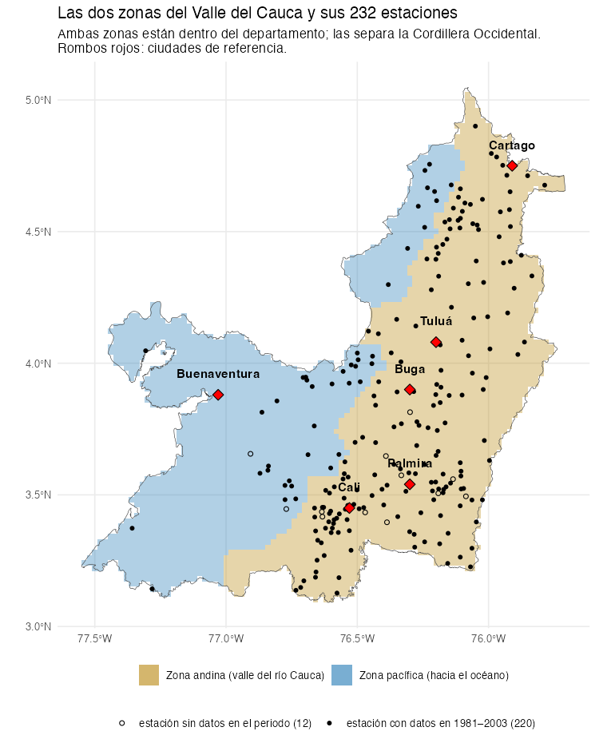

**Qué muestra.** Las 232 estaciones ubicadas en el Valle sobre el polígono oficial del DANE. Las azules tienen datos en 1981–2003; las naranjas, no.

**Cifras** (consola, sección 1):
- De 323 códigos con datos, 220 son del Valle con coordenada.
- Las otras 103 son del departamento del Cauca (55), del Valle pero sin coordenada exacta (30) o sin ubicar (18).
- Las 232 caen dentro del polígono; hay una prueba automática que lo verifica.
- De las 220 con datos, 179 son de la vertiente interandina y 41 del Pacífico.

**Interpretación.** La red cubre bien el valle interandino y es rala en el Pacífico, que es justo donde más llueve. Esa desigualdad aparece en todo lo que sigue: el Pacífico queda representado por pocas estaciones.

**Decisión.** Solo el Valle del Cauca, confirmado por el profesor (P-13). Los códigos sin ubicar se descartan (P-1).

---

## 2. Estructura del archivo

**Tabla** (`tablas/2_estructura.csv`): 1 386 107 filas de 220 estaciones, sin fechas inválidas, sin duplicados, sin valores vacíos y sin negativos. El máximo es 600 mm en un día.

**Decimales por tipo de estación** (`tablas/2_decimales_por_tipo.csv`):
- Las pluviométricas (tipo 01) anotan en mm enteros: 0,1 % de decimales.
- Las climatológicas (tipo 02) sí anotan decimales: 6 %.

Por eso, más adelante, la distribución de la lluvia sale "en escalera".

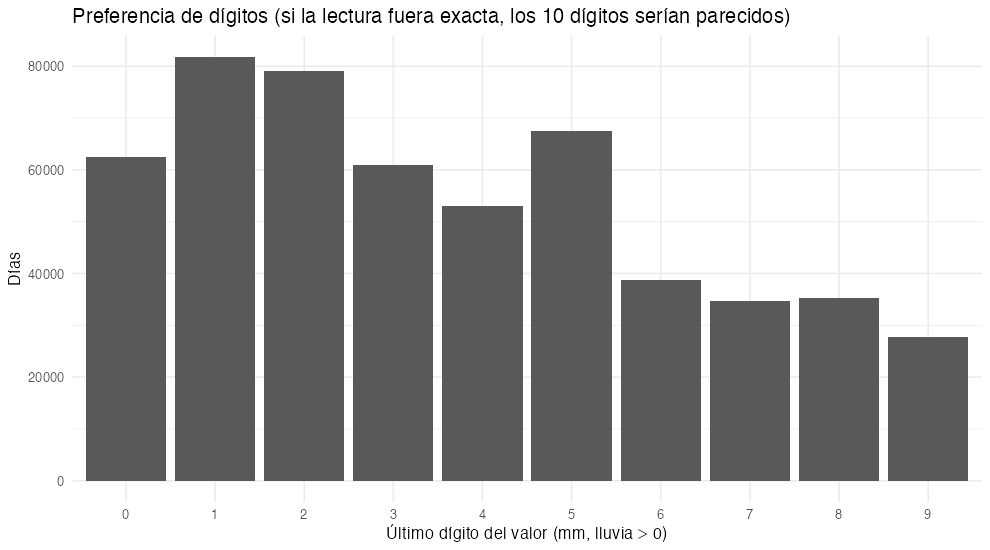

**Qué muestra.** Cuántos días con lluvia terminan en cada dígito: 0, 1, …, 9.

**Cómo se lee.** Si la lectura fuera perfecta y la lluvia uniforme, las barras serían parecidas. Aquí hay dos efectos:
- **1 y 2 son las más altas** porque los días de poca lluvia son los más comunes (1 mm, 2 mm). Eso es natural, no un error.
- **El 5 sobresale** frente al 4 y al 6 (67 000 frente a 53 000 y 39 000), y **el 0 también** frente al 9. Es la huella de observadores que redondean a 5 o a 10 mm.

**Interpretación.** Hay un redondeo moderado, típico de pluviómetros que se leen a mano. No cambia la curva anual, así que no se corrige. Se reporta como característica de los datos.

---

## 3. Disponibilidad: cuándo hay datos

**Cifras de la consola:**
- De todos los días posibles, el 75 % tiene dato, el 2,7 % son huecos dentro del periodo en que la estación funcionaba y el 22,3 % son días en que la estación no operaba.

**Qué muestra.** Cada fila es una estación y cada columna un año; el color es el porcentaje de días con dato. Las líneas rojas separan entrenamiento, validación y prueba.

**Interpretación:**
- Casi todo es amarillo (100 %) o morado (0 %): una estación funciona todo el año o no funciona.
- Abajo hay estaciones que se apagan cerca de 1991 y otras después de 1995. La red se encoge con el tiempo, así que hay menos estaciones en validación y en prueba.

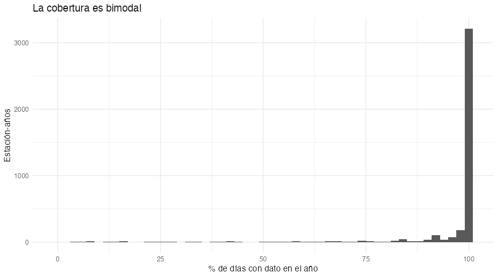

**Qué muestra.** La distribución del porcentaje de días con dato por estación–año. Casi todos los años están cerca del 100 %; los incompletos son pocos y están repartidos. Por eso cortar en 90 % se pierde poco.

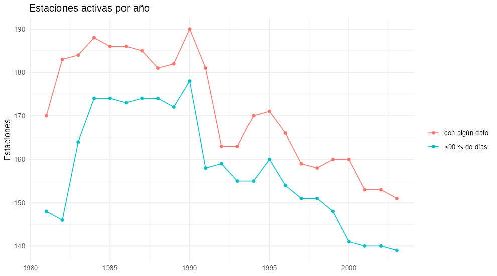

**Qué muestra.** Cuántas estaciones tienen algún dato (rojo) y cuántas tienen ≥ 90 % de días (azul) cada año.
- El máximo es en 1990: 190 estaciones con datos y 178 casi completas.
- En 2003 quedan 151 y 139.

**Interpretación.** Prueba (2001–2003) tiene menos estaciones que entrenamiento. Es normal, pero hay que tenerlo presente al comparar métricas entre periodos.

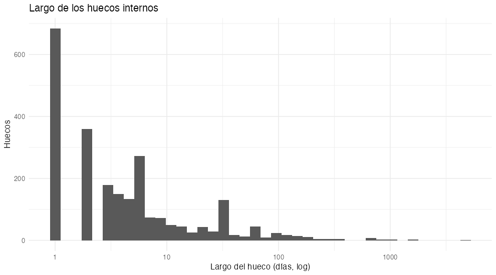

**Qué muestra.** El largo de los huecos internos, en escala logarítmica. Hay 2 425 huecos:
- la mediana es de 3 días y el 28 % dura un solo día;
- hay picos en ~30 días (un mes completo sin anotar) y en ~60;
- unos pocos duran años.

**Interpretación.** Hay dos tipos de faltante: días sueltos, que son inofensivos, y meses enteros, que sí dañan la curva. Por eso la regla de cobertura mira el **hueco más largo** y no solo el porcentaje (sección 7).

---

## 4. Valores: cuánto llueve y qué es un extremo

**Cifras:**
- El 60,6 % de los días son cero.
- En los días con lluvia, la mediana es 7 mm, el p90 30 mm, el p99 76 mm y el máximo 600 mm.

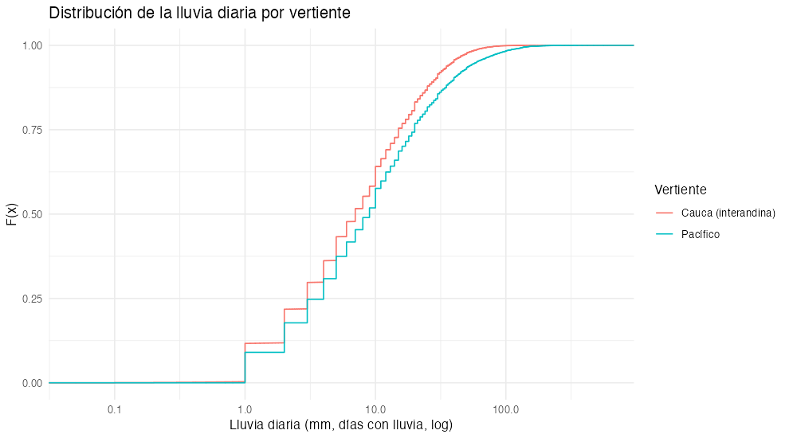

**Qué muestra.** La distribución acumulada de la lluvia en los días lluviosos, por vertiente. Para cada valor del eje X, la curva dice qué fracción de días llovió eso o menos.

**Cómo se lee:**
- La curva del Pacífico va a la derecha: allá los días lluviosos traen más agua.
- Las escaleras al inicio salen de anotar en mm enteros (sección 2).

**Extremos sospechosos** (`tablas/4_extremos_vs_vecinas.csv`): 8 días que superan 3 veces el p99 de la estación y 150 mm. Para cada uno se mira el máximo de las vecinas a menos de 25 km, el mismo día ± 1:

| Estación | Fecha | mm | Máximo de las vecinas | ¿Respaldo? |
|---|---|---|---|---|
| Pardo | 9-abr-2003 | 600 | 71 | No → faltante |
| Heraclio Uribe | 8-dic-1996 | 503 | 42 | No → faltante |
| La Cascada | 9-nov-1991 | 421 | 42 | No → faltante |
| Costa Rica | 21-dic-1988 | 283 | 21 | No → faltante |
| Venecia | 1-oct-1983 | 283 | 78 | No → faltante |
| Colegio San Luis | 16-dic-2002 | 157 | 95 | Sí → se conserva |
| El Aguacate | 26-may-1981 | 150 | 150 | Sí → se conserva |
| Dagua | 3-dic-1989 | 160 | 89 | Sí → se conserva |

**Interpretación.** Un aguacero de 600 mm sin que ninguna vecina pase de 71 mm es casi seguro un error de digitación, por ejemplo un 60 con un cero de más. Los que sí tienen respaldo de las vecinas son tormentas reales y se dejan.

**Regla R2.** Si un valor es mayor que 3·p99 y ≥ 150 mm, y ninguna vecina supera un tercio de ese valor, pasa a faltante. El p99 se calcula **solo con 1981–1995**, para que no haya fuga de información.

---

## 5. Patrones sospechosos

### 5a. Totales mensuales anotados en un solo día
**Tabla** `tablas/5a_meses_un_dia_con_lluvia.csv`. Son meses con un único día de lluvia y ese día por encima del p99. Por ejemplo, Triana registra 343 mm el único día lluvioso de agosto de 1995.

**Interpretación.** Cuando el observador no lee el pluviómetro en todo el mes y al final anota la suma en un día, el mes queda con un solo valor gigante. Se marca el mes entero como faltante si:
- el mes casi no tiene días observados, o
- las vecinas llovieron al menos el 40 % de esos días.

**Regla R3.** 62 días, en 10 estaciones.

### 5b. Rachas de ceros

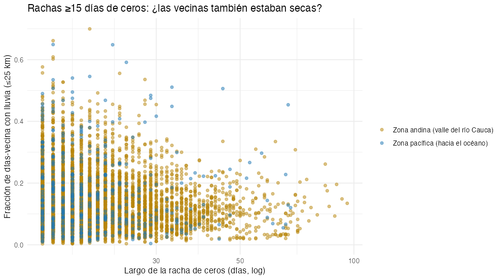

**Qué muestra.** Cada punto es una racha de 15 días o más en cero en una estación. El eje X es el largo de la racha. El eje Y es en qué fracción de esos días llovió en las vecinas (≤ 25 km).

**Cómo se lee:**
- Abajo, las vecinas también estaban secas: la sequía fue real.
- Arriba, las vecinas llovían y la estación marcaba cero: probablemente nadie leyó el pluviómetro y se anotó 0.

Esta gráfica muestra el problema, pero no basta para decidir: estar "arriba" depende de qué tan seguido coinciden la estación y su vecina. Por eso R4 usa la prueba de abajo.

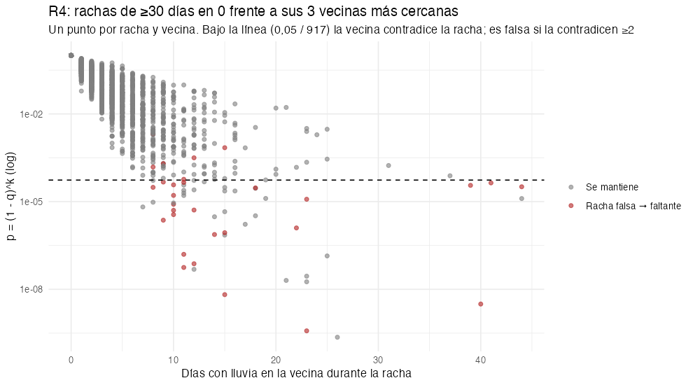

**Qué muestra.** Cada punto es una racha de 30 días o más en cero (hay 917). El eje X es cuántos días llovió su vecina más cercana con datos durante la racha (k). El eje Y es p = (1 − q)^k: la probabilidad de que la estación marcara 0 en todos esos días por azar. Aquí q es qué tan seguido llueve en la estación cuando llueve en la vecina, calculado solo con 1981–1995. La línea punteada es el umbral 0,05 / 917.

**Cómo se lee:**
- A la izquierda y arriba, la vecina casi no llovió: la sequía fue real y la racha se conserva.
- Abajo de la línea (en rojo), la vecina llovió muchos días y la estación siguió en 0: es muy improbable que sea real. Pasa a faltante.

**Cifras** (`tablas/5b_rachas_ceros_prueba.csv`). Hay 7 097 rachas de 15 días o más y 917 de 30 o más. **30 rachas, en 27 estaciones, no tienen respaldo** (1 356 días). El caso más claro es Bella Vista 1982: 49 días en 0 mientras La Ceja (8,7 km) llovió 23 días (p = 7e-10). La mayoría de las rachas largas son sequías reales (El Niño de 1997, temporadas secas).

**Regla R4** (D-49). Una racha de 30 días o más en 0 pasa a faltante si p < 0,05 / 917. El umbral es tan exigente porque p supone días independientes y la lluvia viene en rachas, así que exagera lo raro.
- Loboguerrero oct–nov de 1995, que antes se había quitado a mano, se conserva: Dagua coincide con ella solo la mitad de los días de lluvia y p = 2e-4 no alcanza el umbral.
- Loboguerrero dic-1982 a mar-1983 sí pasa a faltante. La revisión a mano la había dejado porque Dagua "también estaba seca", pero Dagua casi no tiene datos esos días. La vecina con datos, Limones, llovió 39 días.

**Otros controles:** ningún año está duplicado entre estaciones, y las rachas de valores repetidos distintos de cero son cortas (máximo 11 días de "1 mm").

---

## 6. Climatología y coherencia

**Qué muestra.** La lluvia media anual de cada estación: va de **709 a 12 129 mm**.
- Al oeste, en el Pacífico: 8 000 a 12 000 mm.
- En el fondo del valle, de Cali a Cartago: 1 000 a 1 500 mm.

**Qué muestra.** Cada punto es una estación; las líneas son la tendencia de cada vertiente.
- **Pacífico:** junto a la costa y abajo llueve muchísimo, y la lluvia baja al subir la cordillera, hasta unos 1 200 m.
- **Interandina:** el fondo del valle, a unos 1 000 m, es lo más seco. Al subir las laderas llueve más, hasta unos 2 000 m, y después vuelve a bajar.

**Interpretación.** Es el efecto de la montaña sobre la lluvia (orografía). Por eso **la altitud entra al modelo**.

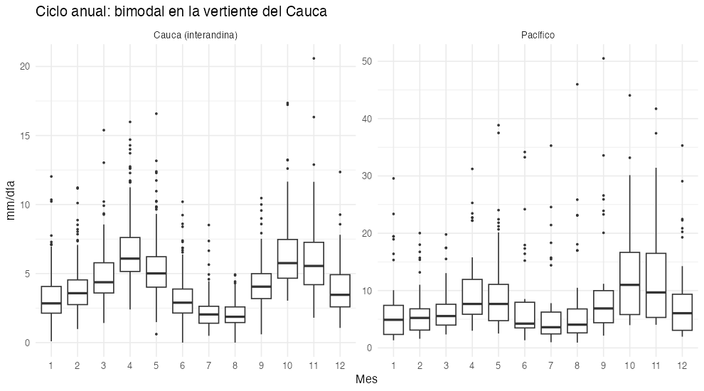

**Qué muestra.** La lluvia diaria media de cada mes, con un boxplot por mes y vertiente.
- **Interandina: régimen bimodal.**
  - Dos temporadas de lluvia: marzo–mayo (pico en abril, ~6 mm/día) y septiembre–noviembre (pico en octubre).
  - Dos secas: diciembre–febrero, y sobre todo julio–agosto (~2 mm/día).
- **Pacífico:** llueve todo el año, más en octubre–noviembre, y la escala es el doble.

**Interpretación.** Estas son las "dos jorobas" que deben capturar las curvas funcionales. La métrica de "fecha de los dos picos" sale de aquí.

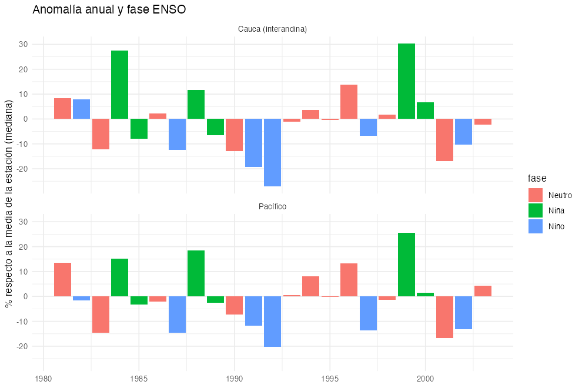

**Qué muestra.** Cuánto se apartó cada año de lo normal, en % de la media de cada estación. El color es la fase del ENSO según el ONI de la NOAA.

**Interpretación:**
- **La Niña = años húmedos** (1984, 1988, 1999: +12 a +30 %).
- **El Niño = años secos** (1991, 1992, 1997, 2002: −7 a −27 %).
- La correlación entre el ONI y la anomalía es −0,57 en la interandina y −0,68 en el Pacífico.
- Es la señal climática más fuerte entre un año y otro, y por eso **el ONI entra al modelo**.

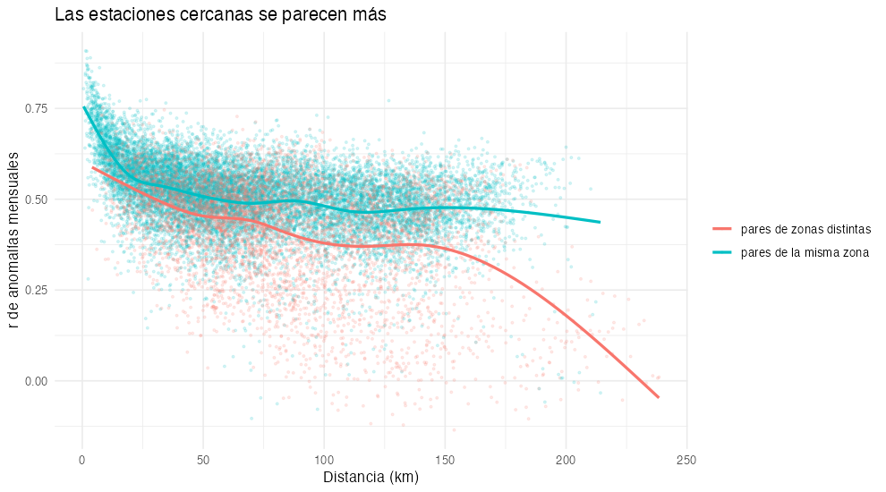

**Qué muestra.** Para cada par de estaciones, la correlación de sus anomalías mensuales según la distancia, separando los pares de la misma vertiente y los de vertientes distintas.

**Interpretación:**
- La correlación es de 0,68 entre estaciones a menos de 10 km y baja a 0,47 a más de 80 km.
- Entre vertientes distintas cae mucho más rápido: la cordillera separa dos climas.

Esto justifica dos cosas:
- comparar cada estación con sus vecinas a ≤ 25 km en las reglas R2 a R4;
- que el satélite, con píxeles de unos 5 km, pueda informar sobre la estación que cae dentro.

---

## 7. Experimento de huecos: cuántos faltantes se pueden tolerar

**Idea.** Se toman 1 960 estación–años completos de entrenamiento y se les **borran días a propósito**. Después se construye la curva B-spline (K = 8 y K = 12) y se mide cuánto cambia frente a la curva sin huecos. El error se mide en unidades de la variabilidad normal entre años.

**Qué muestra.** El error según el largo de un solo hueco. La línea roja (0,25) es el error tolerable.

**Interpretación:**
- Hasta unos 15 días el error es bajo: 0,12 con K = 8 y 0,14 con K = 12.
- A partir de 30 días se dispara, sobre todo con K = 12: 0,32 a 30 días y 3,07 a 90 días. Con más bases, la curva se inventa formas dentro del hueco.

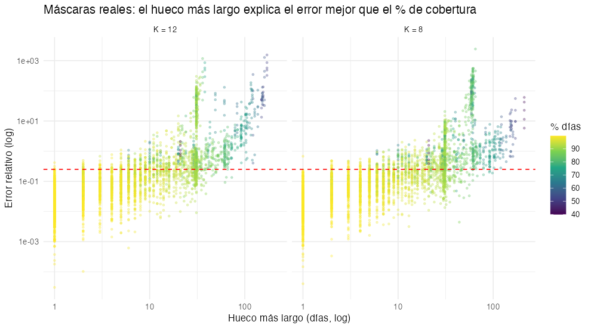

**Qué muestra.** Lo mismo, pero copiando los patrones de huecos reales de otras estaciones.

**Interpretación.** El **hueco más largo** explica el error mejor que el porcentaje de días con dato (R² 0,58 frente a 0,46). Un año con 92 % de días pero un hueco de un mes es peor que uno con 88 % y huecos sueltos.

**Qué muestra.** Para cada combinación de cobertura mínima y hueco máximo: cuántos años se conservan (eje X) y qué error se admite en el peor 1 % (eje Y).

**Interpretación.** Con "≥ 90 % de días y hueco ≤ 15" se conservan 2 361 estación–años y el p99 del error es 0,64. Si se relaja a 45 días o más, se ganan unos 100 años pero el error salta a 4,9.

**Reglas R5 y R6:**
- un año es válido si tiene ≥ 90 % de días y ningún hueco de más de 15;
- una estación entra si tiene ≥ 7 años válidos en entrenamiento.

**No se imputa** (R7).

---

## 8. Depuración y dataset final

**Días que pasan a faltante** (`tablas/8_marcas_limpieza.csv`): 1 423 en total.
- R2: 5 extremos.
- R3: 62 días de totales mensuales.
- R4: 1 356 días de 30 rachas de ceros sin respaldo.

**Qué muestra.** En azul, las 176 incluidas; en rojo, las 38 excluidas por no tener 7 años válidos en entrenamiento.

**Representatividad** (`tablas/8_representatividad.csv`):

| Grupo | Estaciones | Altitud mediana | % Pacífico | Lluvia anual mediana |
|---|---|---|---|---|
| Las 220 con datos | 220 | 1 330 m | 19 % | 1 515 mm |
| Las 176 incluidas | 176 | 1 330 m | 15 % | 1 444 mm |

**Interpretación.** Las excluidas están repartidas por todo el Valle, y las 176 conservan la misma altitud mediana y una lluvia parecida. El dataset final representa al Valle. Se pierde algo de Pacífico (de 19 % a 15 %), que es lo que más cuesta medir. La rúbrica pone un tope si el grupo no muestra que la muestra es representativa, así que esta tabla hay que citarla en el informe.

**Partición final:**

| Conjunto | Años | Curvas | Estaciones | Días faltantes |
|---|---|---|---|---|
| Entrenamiento | 1981–1995 | 2 257 | 176 | 2 191 (0,27 %) |
| Validación | 1996–2000 | 672 | 147 | 465 |
| Prueba | 2001–2003 | 370 | 137 | 219 |

---

## 9. Satélite: qué es y de dónde viene

**Estructura** (`tablas/9_estructura_satelite.csv`):
- 2 328 imágenes, una por péntada, de 1981 a abril de 2013.
- Malla de 39 × 37 píxeles de 0,05° (unos 5,5 km).
- Valores enteros entre 0 y 200, sin faltantes.

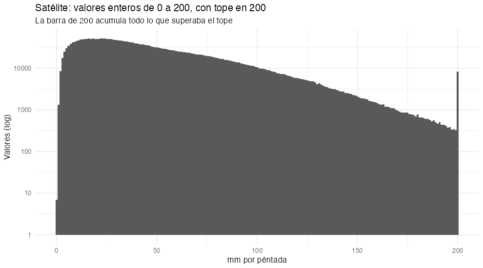

**Qué muestra.** El histograma de todos los valores, en mm por péntada. La barra de 200 es mucho más alta que sus vecinas: **todo lo que pasaba de 200 se cortó en 200** (el 0,24 % de los valores). Además casi nunca hay ceros: solo 7 en 3,36 millones.

**Fuente** (`tablas/9_fuente_satelite.csv`): se comparó con los productos del Climate Hazards Center.

| Año | r con CHIRP | r con CHIRPS |
|---|---|---|
| 1981 | 0,90 | 0,84 |
| 1988 | 0,84 | 0,78 |
| 2000 | 0,90 | 0,84 |

El mapa medio tiene r = 0,996 con CHIRP.

**Interpretación.** El satélite entregado es **CHIRP**, la versión solo-satélite (infrarrojo), y no CHIRPS, que viene corregida con estaciones. El profesor lo confirmó (P-8). Eso significa que el satélite es **independiente de las estaciones**, que es justo lo que el proyecto necesita: corregirlo con ellas.

---

## 10. Recorte y unidades

- Se usan **681 píxeles**: los 676 con centro dentro del Valle más 5 que contienen una estación junto al borde.
- Cada péntada se divide por **sus días reales**: las cinco primeras del mes tienen 5 días; la sexta, de 3 a 6 según el mes.

**Por qué importa:**

| Días de la péntada | mm por péntada (media) | mm/día |
|---|---|---|
| 3 (feb.) | 9,3 | 3,1 |
| 5 | 36,8 | 7,4 |
| 6 (meses de 31 días) | 49,4 | 8,2 |

Sin dividir, la última péntada de cada mes de 31 días parecería más lluviosa solo por tener un día más. En mm/día satélite y estación quedan en la misma unidad.

---

## 11. EDA del satélite

**Qué muestra.** La lluvia media anual de cada píxel, con las estaciones como puntos blancos. El satélite reproduce el patrón: el Pacífico húmedo al oeste y el valle seco en el centro.

**Pero su rango es más estrecho:** de **1 062 a 6 239 mm**, frente a 831–12 129 de las estaciones.

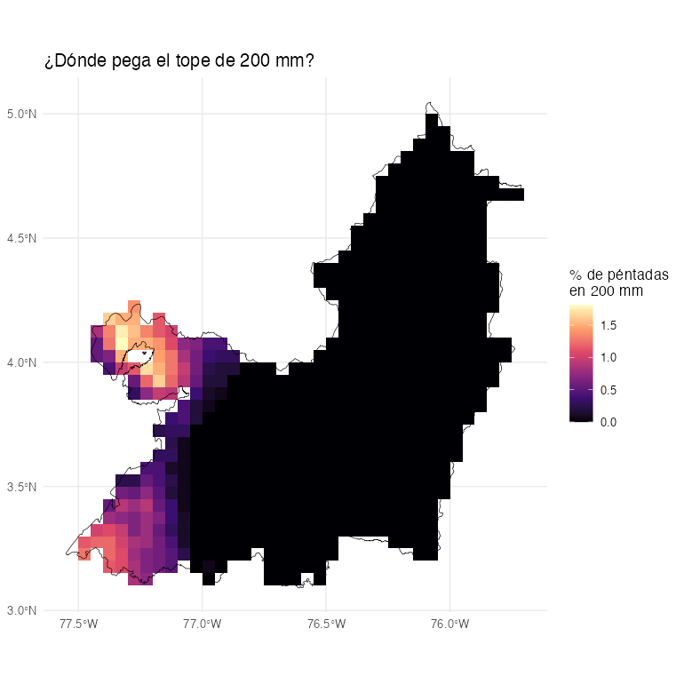

**Qué muestra.** Qué porcentaje de péntadas llega a 200 mm en cada píxel. Solo pasa en el Pacífico, hasta 1,8 %. En el valle interandino nunca.

**Interpretación.** El tope recorta los aguaceros del Pacífico, y es parte de por qué el satélite subestima allá.

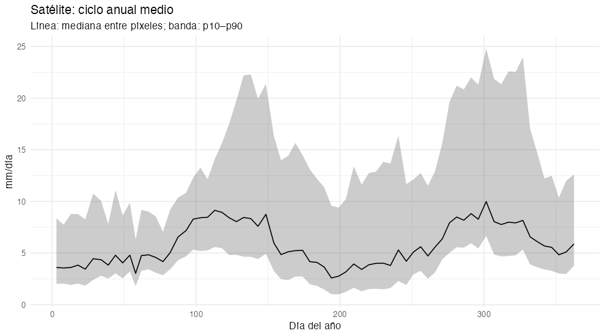

**Qué muestra.** El ciclo anual medio del satélite: la mediana entre píxeles y la banda del 10 al 90 %. Se ven las dos temporadas, abril–mayo y octubre–noviembre, igual que en las estaciones.

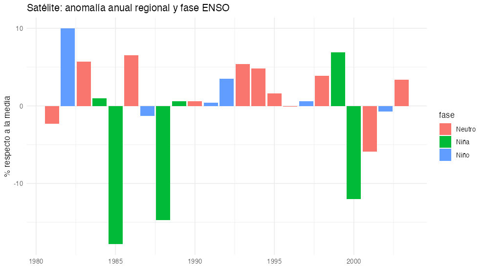

**Qué muestra.** Cuánto se apartó cada año para el satélite, coloreado por fase ENSO.

**Interpretación:**
- Los años más secos del satélite son **1985 (−18 %), 1988 (−15 %) y 2000 (−12 %), todos La Niña**.
- Según las estaciones, La Niña es húmeda (sección 6). **El satélite tiene la relación al revés**: r con el ONI de +0,27, frente a −0,60 en las estaciones.

---

## 12. Satélite frente a estaciones

**Qué muestra.** Las 238 224 parejas estación–péntada; la línea roja es la igualdad.

**Interpretación:**
- La nube es ancha: r ≈ 0,5.
- El satélite casi nunca marca 0, mientras que la estación marca 0 en el 22 % de las péntadas.
- El satélite no llega a los valores altos de la estación.

En una péntada concreta, el satélite es una estimación gruesa.

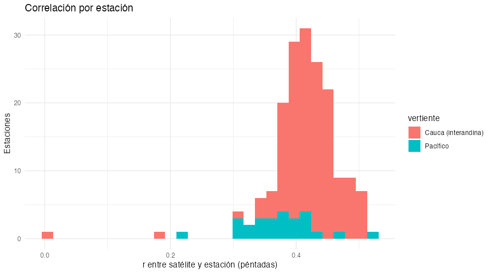

**Qué muestra.** La correlación satélite–estación de cada estación. La mediana es 0,42 en la interandina y 0,37 en el Pacífico. Hay un caso aislado en 0: **Santa Teresa**, que además tiene la coordenada "a revisar". Entra al análisis de sensibilidad.

**Qué muestra.** Lluvia anual de la estación (eje X) frente a la de su píxel (eje Y); la línea es la igualdad.

**Interpretación. El satélite aplana:**
- Donde llueve poco (menos de 2 000 mm), los puntos quedan **por encima** de la línea: sobreestima.
- Donde llueve mucho (Pacífico), quedan **por debajo**: subestima.
- r = −0,68 entre el sesgo y la lluvia de la estación.

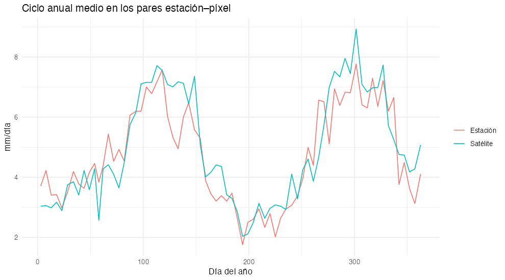

**Qué muestra.** El ciclo anual medio de las estaciones y de sus píxeles. Las dos curvas casi se superponen: **el satélite acierta cuándo llueve en el año** (r = 0,78).

**Qué muestra.** La anomalía anual del satélite (rojo) y de las estaciones (azul). Las líneas punteadas son los años en que más se separan; las rojas, los límites de la partición.

**Interpretación:**
- Las estaciones varían el doble que el satélite: desviación de 13,8 % frente a 7,3 %.
- En 1984, 1988, 1999 y 2000 (La Niña) las estaciones suben y el satélite no.
- En 1992 (El Niño) es al revés.

**El satélite no capta qué años son más o menos lluviosos** (r = 0,25).

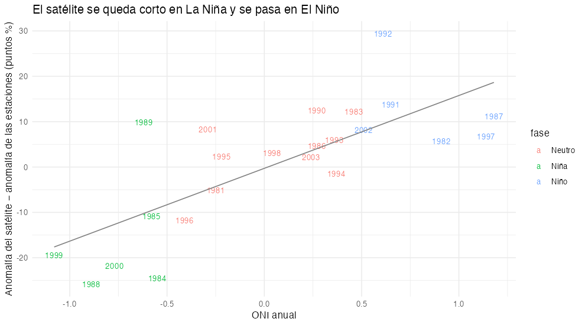

**Qué muestra.** La diferencia anomalía del satélite menos anomalía de las estaciones, frente al ONI de cada año.

**Interpretación. Es la gráfica clave del satélite.**
- La diferencia sigue al ONI con r = 0,74: en La Niña el satélite se queda corto hasta 25 puntos y en El Niño se pasa.
- No son "años dañados": es un **error sistemático** ligado al ENSO.
- El modelo puede corregirlo si conoce el ONI del año, y por eso el ONI va en el vector z.

### ¿Qué pasa en el tope de 200 mm? (pregunta del profesor)

**Qué muestra.** La serie completa, péntada a péntada, de Bahía Málaga (la estación con más péntadas de su píxel en el tope) y de su píxel. La línea punteada es el tope de 200 mm; los puntos rojos, las péntadas en el tope.

**Cómo se lee.** La estación (rojo) pasa de 200 mm casi todas las temporadas, con picos de hasta ~760 mm. El satélite (azul) casi nunca llega a 200: toca el tope solo 17 veces en 23 años.

**Cifras** (`tablas/12_tope_200_por_estacion.csv`):
- En todos los pares estación–píxel, el satélite está en el tope en **33 de 238 224 péntadas**, y solo en 3 estaciones del Pacífico (Bahía Málaga, Yurumanguí y San Francisco).
- La estación pasa de 200 mm en 1 049 péntadas, y **en solo el 2 % de ellas el satélite está en el tope**.

**Interpretación.** El tope no es lo que hace que el satélite subestime los aguaceros: el satélite casi nunca llega a esos valores por sí mismo. El tope se documenta y no hace falta corregirlo (D-47).

**Resumen de qué acierta el satélite** (`tablas/12_que_acierta_el_satelite.csv`):

| Componente | r satélite–estación | Lectura |
|---|---|---|
| Dónde llueve más | 0,79 | Bien |
| Cuándo llueve en el año | 0,78 | Bien |
| Meses más o menos lluviosos de lo normal | 0,30 | Mal |
| Años más o menos lluviosos de lo normal | 0,25 | Mal |

---

## 13. Datos preparados para lo funcional

**Qué muestra.** Cuatro ejemplos de cómo entran los datos a la construcción funcional:
- en rojo, la lluvia diaria de la estación, con muchos ceros y picos;
- en azul, la péntada de su píxel, mucho más suave.

**Interpretación.** Las dos fuentes tienen resoluciones muy distintas. Por eso cada una se construye con su propia base, y se comparan como curvas, no día a día.

**Contenido de `datos_preparados.rds`:**
- Estaciones: 3 299 curvas × 365 días, en mm/día, con `NA` en los faltantes (0,24 %).
- Satélite: 15 663 curvas × 72 péntadas, en mm/día, ubicadas en su día central.
- Pares: cada curva de estación con la de su píxel y su año, más el ONI y la fase ENSO.
- Metadatos de las estaciones: coordenada, altitud (Univalle con 996 m, D-46), vertiente y marcas para la sensibilidad (6 del cruce con el CNE, 12 con coordenada a revisar).
- 176 estaciones en 148 píxeles; 23 píxeles tienen más de una estación.

---

## 14. Pruebas automáticas

`tablas/14_pruebas.csv`: **26 comprobaciones; si una falla, el script se detiene.** Las más importantes:
- cada valor final es igual al del archivo crudo, que se vuelve a leer: 1 211 103 valores;
- la matriz del satélite coincide con 12 TIFF releídos;
- cada estación cae dentro de su píxel (a 3,9 km del centro como máximo);
- los umbrales (p99) usan solo entrenamiento;
- cada par tiene la altitud y el ONI que necesita el modelo.

---

## Preguntas al profesor (parte de datos) y sus respuestas

También están en `DECISIONES.md`, §8.

| # | Pregunta | Respuesta o por qué importa |
|---|---|---|
| P-12 ✅ | Fuentes externas | **Aceptadas**, principalmente las oficiales del IDEAM |
| P-14 ✅ | Univalle con los 996 m de la estación del IDEAM en el mismo campus. **Resuelta: el profesor lo acepta**, porque los datos del curso también salen del IDEAM | — |
| P-15 ✅ | Tope de 200 mm del satélite | El profesor pidió armar la serie y dibujarla: está en la sección 12. Afecta solo 33 péntadas de 3 estaciones del Pacífico |
| P-16 | ¿Qué "ONI del año" espera: la **media de los 12 trimestres** del año calendario (lo que usamos) o un trimestre concreto, por ejemplo DEF? | Cambia el valor que entra al vector z |
| P-17 ✅ | Quitar el 29 de febrero | **Aceptado** |
| P-18 ✅ | Píxel que contiene la estación | **Aceptado**: el píxel es más grande que el punto, no hay que promediar |
| P-19 | ¿Se pueden usar los **registros de 1930–1979** solo para estimar el FPCA? El enunciado lo menciona, pero la fe de erratas fija el periodo 1981–2003 | Decide si se agregan ~1 300 curvas al FPCA |
