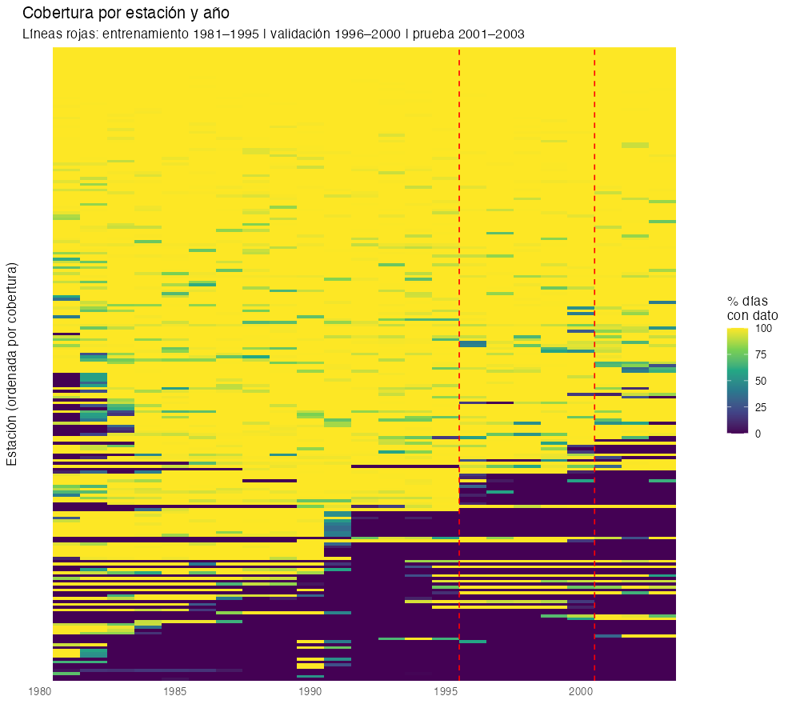
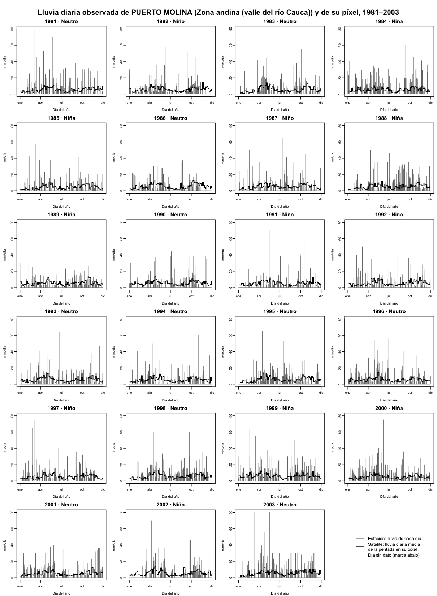
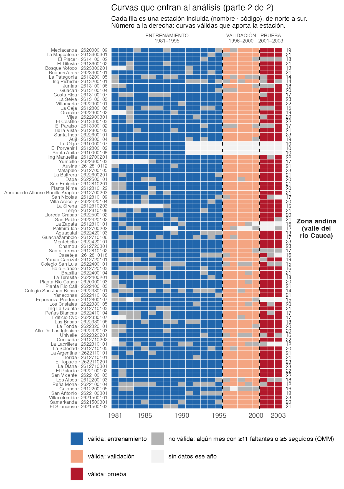
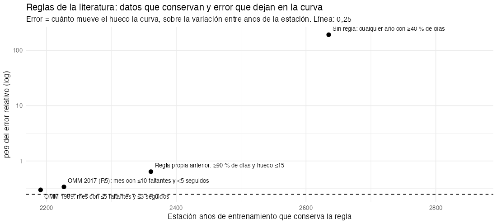
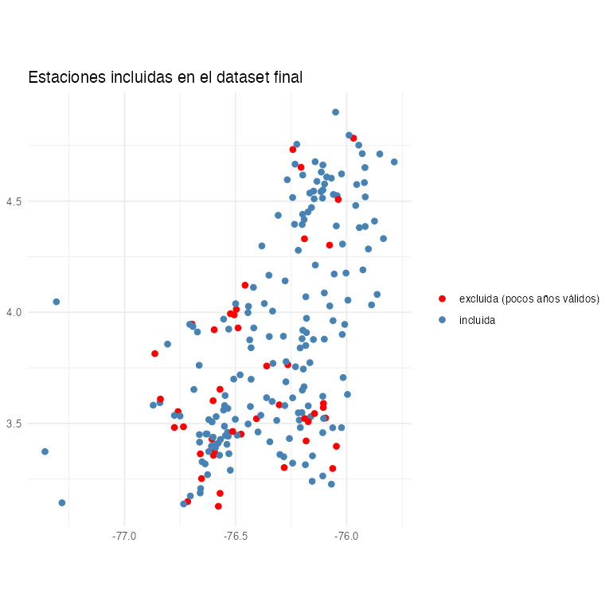
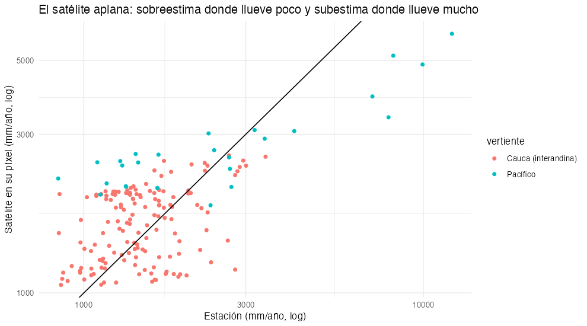
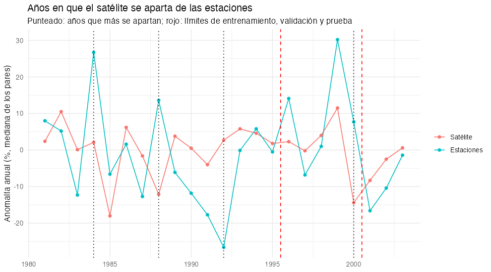

# Los datos de lluvia del Valle del Cauca: de dónde salen, cómo se limpian y qué muestran

Este documento explica la primera parte del proyecto, lo que hace `lluvia_valle_datos.R` antes de lo funcional:
- qué datos hay;
- qué problemas tienen y cómo se limpian;
- qué muestra el análisis exploratorio (EDA) de estaciones y satélite.

**Cómo está armado.** Cada gráfica viene con cuatro partes:
- **Para qué está:** la pregunta que responde.
- **Cómo se lee:** qué es cada eje, cada color y cada punto.
- **Qué muestra:** las cifras.
- **Qué decidimos:** la regla o la decisión que sale de ella.

Las gráficas marcadas con ★ son las que proponemos para la presentación (la lista ordenada está en el anexo B).

**Qué se dejó fuera.** Las gráficas que solo sirven de respaldo no están en el cuerpo del documento. Siguen en la carpeta de salidas y se listan en el anexo A, con lo que muestran.

**Dónde está todo.**
- Gráficas: `salidas_R_datos/graficos/`. Tablas: `salidas_R_datos/tablas/`.
- Decisiones (D-xx) y preguntas al profesor (P-xx): `DECISIONES.md`.
- Cifras: corrida del 20-nov-2026 del conjunto principal (R6 con ≥10 años), en la que las 30 pruebas automáticas pasan.
- **De dónde sale cada regla** (normas de la OMM, libros y artículos): `docs/FUNDAMENTOS_REGLAS.md`.

**Qué cambió tras la revisión del profesor por Teams (19-nov-2026):**
- Las reglas de qué años y qué estaciones entran (R5 y R6) ya no son umbrales propios: son la norma de la OMM para datos faltantes (WMO-No. 1203, 2017). Al comparar dos versiones de R6, el profesor prefirió la de **≥10 años válidos** (el mínimo de la OMM para cualquier promedio climatológico; D-63): entran **163 estaciones y 3 046 curvas**. El 80 % de la OMM (100 estaciones y 2 113 curvas) queda como sensibilidad.
- Se quitó la lluvia acumulada.
- Se agregó la serie diaria real de una estación, año por año.
- Se explican los huecos de la serie de Bahía Málaga.

**Qué cambió el 20-nov-2026 (D-61):**
- **R4** decide con las 3 vecinas más cercanas (al menos 2 deben contradecir la racha) y con q de la temporada: 10 rachas en vez de 30.
- **R7** rellena por kriging los pocos días faltantes que acepta R5 (719 en el conjunto principal).
- **R6** pide ≥10 años válidos (D-63); el 80 % de la OMM queda como sensibilidad.

---

## 0. El contexto en una página

### 0.1 Qué buscamos
El proyecto quiere **corregir la lluvia que estima el satélite usando las estaciones**. Al final, la lluvia de un año debe verse como una curva diaria (un valor por cada día del año) en cualquier punto del Valle del Cauca.

Las dos fuentes se complementan:

| | Estaciones (IDEAM / CVC) | Satélite (CHIRP) |
|---|---|---|
| Qué mide | La lluvia que cae en un pluviómetro, en un punto | Una estimación desde el espacio, en cuadros de unos 5,5 km |
| Cada cuánto | Cada día | Cada péntada (5 días) |
| Dónde | Solo donde hay estación | En todo el Valle, sin huecos |
| Problemas | Huecos, errores de digitación, días sin leer | Impreciso: exagera o se queda corto según la zona y el año |

El modelo aprende, con los años en que hay estación y satélite al mismo tiempo, cómo pasar de la curva del satélite a la curva real.

### 0.2 Periodo y partición
Se usan los años **1981 a 2003**, según la fe de erratas del enunciado. Se parten **por años**, nunca mezclando años:

| Conjunto | Años | Para qué |
|---|---|---|
| Entrenamiento | 1981–1995 | Ajustar el modelo y calcular cualquier umbral de limpieza |
| Validación | 1996–2000 | Escoger los parámetros del modelo |
| Prueba | 2001–2003 | Medir el resultado final, una sola vez |

Partir por años evita que el modelo "vea" el futuro.

### 0.3 Las dos zonas del Valle del Cauca
**Todo el análisis es solo del departamento del Valle del Cauca.** Dentro de él hay dos zonas con climas muy distintos, separadas por la Cordillera Occidental.

- **Zona andina (valle del río Cauca).** Es el valle por donde corre el río Cauca, entre las cordilleras Occidental y Central, con sus laderas. Allí están Cali, Palmira, Buga, Tuluá y Cartago. Aquí "Cauca" es **el río, no el departamento del Cauca**.
- **Zona pacífica (hacia el océano).** Es todo lo que drena hacia el océano Pacífico:
  - la costa de Buenaventura;
  - las cuencas del Dagua y el Anchicayá;
  - en el norte, las del Calima y el Garrapatas, que bajan al río San Juan.

**Cómo se asigna cada estación.** Por su código de la CVC, que dice a qué cuenca pertenece: los códigos que empiezan por 26 son de la cuenca del Cauca, y los que empiezan por 53 o 54 son de cuencas que van al Pacífico.

**¿Hacemos dos análisis separados? No.** El modelo es uno solo para todo el Valle, y la zona **no es una variable del modelo**. La zona se usa para dos cosas:
- **Describir los datos:** las dos zonas tienen climas distintos, y mezclarlas en una sola gráfica esconde el patrón de cada una.
- **Evaluar el modelo:** permite ver dónde funciona mejor y dónde peor.

**¿Por qué vale la pena distinguirlas? Porque los datos lo muestran:**

| | Zona andina | Zona pacífica |
|---|---|---|
| Estaciones con datos (de 220) | 179 | 41 |
| Estaciones en el análisis final (de 163) | 141 | 22 |
| Lluvia media anual por estación (mediana) | 1 440 mm | 2 417 mm, con estaciones de la costa que pasan de 8 000 mm |
| Forma del año | Dos temporadas de lluvia (abril y octubre) | Llueve todo el año, más en octubre–noviembre |
| Correlación satélite–estación por péntada (mediana) | 0,42 | 0,36 |
| Satélite / estación en la lluvia anual (mediana) | 1,11: el satélite da 11 % de más | 1,19: da 19 % de más, pero subestima en la costa más lluviosa |
| ¿El error del satélite depende de la zona? (ANOVA funcional, sección 4.4 de `EXPLICACION_FUNCIONAL`) | Sí, p = 0,0002 | (es la misma prueba) |
| Error de la curva en prueba, 2001–2003 (L² relativo, mediana por estación): satélite → modelo | 0,40 → 0,38 | 0,77 → 0,57 |
| Estaciones de prueba en que el modelo mejora al satélite | 66 de 122 | 13 de 14 |

**La zona pacífica entra con 22 estaciones.** Sus estaciones tienen registros cortados (varias dejan de medir hacia 1996). Con el 80 % de la OMM quedaban solo 7; con ≥10 años válidos (R6, D-63) entran 22, incluidas las de la costa más lluviosa (Bahía Málaga, Yurumanguí, San Francisco). Aun así es la zona con menos estaciones, y sus resultados se leen con cautela.

Una salvedad: la zona pacífica no es homogénea. Mezcla la costa, muy lluviosa, con las montañas del Calima, más secas. Por eso, cuando se compara una estación con otras (reglas de limpieza R2 a R4), se usan **las vecinas a menos de 25 km**, no la zona.

### 0.4 El ENSO y el ONI: por qué unos años llueven más que otros

**ENSO** es la sigla en inglés de *El Niño–Oscilación del Sur*. Es un fenómeno natural del océano Pacífico tropical: cada pocos años, el agua del Pacífico central y oriental, frente a Perú y Ecuador, se calienta o se enfría más de lo normal. Ese cambio en el océano mueve los vientos y la lluvia en buena parte del planeta, y Colombia está muy cerca de donde ocurre.

Tiene tres fases:

| Fase | Qué pasa en el océano | Qué pasa con la lluvia en Colombia |
|---|---|---|
| **El Niño** | El Pacífico está **más caliente** de lo normal | **Menos lluvia**: años secos, más sequías e incendios |
| **La Niña** | El Pacífico está **más frío** de lo normal | **Más lluvia**: años húmedos, más inundaciones |
| **Neutro** | Temperatura normal | Lluvia cercana a lo normal |

Por ejemplo, La Niña de 2010–2011 causó las grandes inundaciones del país, y El Niño de 1997–1998 trajo una sequía fuerte.

**El ONI** (*Oceanic Niño Index*) es el número oficial con que la NOAA, la agencia climática de Estados Unidos, mide el ENSO:
- Es **cuánto se aparta la temperatura del mar de lo normal**, en °C, en una franja del Pacífico central llamada región Niño 3.4.
- Se calcula como un promedio móvil de 3 meses: un valor para diciembre–febrero, otro para enero–marzo, y así sucesivamente.
- **ONI de +0,5 °C o más es El Niño; de −0,5 °C o menos es La Niña;** entre los dos es neutro. La NOAA exige además que se mantenga varios meses seguidos.

**Cómo lo usamos.** Como cada curva es un año completo, se usa **un ONI por año**: la media de los 12 valores de ese año calendario (D-56). La fase del año sale de esa media con el mismo umbral de ±0,5 (`datos_web/oni_anual_fase.csv`). En 1981–2003 quedan:

| Fase | Años |
|---|---|
| El Niño | 1982, 1987, 1991, 1992, 1997, 2002 |
| La Niña | 1984, 1985, 1988, 1989, 1999, 2000 |
| Neutro | Los otros 11 |

**Por qué importa para el proyecto:**
- **Explica la lluvia de un año a otro:** en las estaciones, La Niña da años de +12 a +30 % y El Niño de −7 a −27 % (sección 6).
- **El satélite no capta este efecto, y hasta lo tiene al revés.** Su error sigue al ONI con correlación de 0,73 (sección 12).
- Por eso **el ONI entra al modelo**: le dice qué tipo de año es, para que corrija al satélite en la dirección correcta.

Una advertencia: la prueba (2001–2003) **no tiene ningún año La Niña**. El comportamiento en esos años solo se ve en la validación, con 1999 y 2000.

---

## 1. Población: qué estaciones son del Valle

**★ Para qué está.** Para ubicar el problema: dónde están las estaciones y cuál es cada zona.

**Cómo se lee:**
- La línea gris es el límite oficial del departamento (DANE).
- El fondo de color es la zona: ocre para la andina y azul para la pacífica. Cada punto del mapa toma la zona de la estación más cercana. Esa regla acierta la zona del 97,7 % de las estaciones cuando se prueba dejando cada una fuera; un corte vertical por longitud no pasa del 89,2 %.
- Los puntos negros son estaciones con datos en 1981–2003. Los círculos vacíos son estaciones sin datos en ese periodo.
- Los rombos rojos son ciudades de referencia.

**Qué muestra:**
- De 323 códigos con datos, 220 son del Valle y tienen coordenada.
- Las otras 103 son del departamento del Cauca (55), del Valle pero sin coordenada exacta (30) o sin ubicar (18).
- Las 232 estaciones del Valle caen dentro del polígono; una prueba automática lo verifica.
- La zona andina es una franja ancha en el centro y el oriente. La pacífica ocupa el occidente y, en el norte, la ladera occidental de la cordillera.
- La red es densa en el valle del río Cauca y rala en la zona pacífica, que es justo donde más llueve. Por eso la zona pacífica queda representada por pocas estaciones en todo lo que sigue.

**Qué decidimos.** Solo el Valle del Cauca, confirmado por el profesor (P-13). Los códigos sin ubicar se descartan (P-1).

---

## 2. Revisión del archivo

**Para qué está.** Para confirmar que el archivo se puede usar tal como viene y que no hay errores de formato.

**Qué muestra** (`tablas/2_estructura.csv`):
- 1 386 107 filas de 220 estaciones.
- Sin fechas inválidas, sin duplicados, sin valores vacíos y sin negativos.
- El máximo es 600 mm en un día; la sección 4 muestra que es un error.

**Un faltante es una fila que no está.** El archivo no marca los faltantes con un valor especial: el día simplemente no aparece.

**Decimales:**
- Las estaciones pluviométricas (tipo 01) anotan en mm enteros; solo el 0,1 % de sus valores tiene decimales.
- Las climatológicas (tipo 02) sí anotan décimas: el 6 %.

**Redondeo.** Los días que terminan en 5 o en 0 aparecen más de lo esperado: 67 000 terminan en 5, frente a 53 000 en 4 y 39 000 en 6. Es la huella de observadores que redondean al leer el pluviómetro a mano. No cambia la curva anual, así que no se corrige; queda como tabla de respaldo (`tablas/2_ultimo_digito.csv`).

---

## 3. Disponibilidad: cuándo hay datos

**Qué muestra en cifras:**
- De todos los días posibles (220 estaciones × 23 años × 365 días), el **75 %** tiene dato.
- El **22,3 %** son días en que la estación no operaba: todavía no existía o ya se había cerrado.
- Solo el **2,7 %** son huecos dentro del periodo en que la estación funcionaba.

**Para qué está.** Para ver de un vistazo qué estaciones tienen datos y en qué años.

**Cómo se lee:**
- **Cada fila es una estación** y **cada columna es un año**, de 1981 a 2003. Cada casilla es un año de una estación.
- **El color dice qué tan completo está ese año:**
  - verde oscuro: completo, con los 365 días;
  - verde claro: casi completo, del 90 al 99 %;
  - naranja: incompleto, con menos del 90 %;
  - gris: sin datos, porque la estación no operaba.
- **Las filas se agrupan por zona** (rótulo a la derecha). Dentro de cada zona, **arriba van las estaciones con más datos**.
- **Arriba de la gráfica está el nombre de cada conjunto.** Las líneas punteadas son los cortes entre entrenamiento, validación y prueba.

**Cómo leer una fila:**
- Una fila toda verde es una estación que funcionó en todo el periodo.
- Verde y luego gris: la estación se cerró.
- Gris y luego verde: se abrió tarde.

**Cómo leer una columna:** cuántas estaciones funcionaron ese año.

**Qué muestra:**
- El 58,5 % de las casillas es un año completo y el 13,2 % casi completo. Solo el 6,2 % es incompleto y el 22,1 % no tiene datos.
- **Casi todo es verde o gris:** una estación funciona todo el año o no funciona. Los años a medias son pocos.
- **Abajo, en cada zona, hay estaciones que se apagan cerca de 1991 y otras después de 1995.** La red se encoge con el tiempo: 190 estaciones tenían datos en 1990 y 151 en 2003. Por eso validación y prueba tienen menos estaciones que entrenamiento, y hay que tenerlo presente al comparar resultados entre periodos.

Esta gráfica no lleva los nombres porque son 220 filas y no se alcanzarían a leer. Los nombres están en la siguiente, que muestra solo las estaciones que entran al análisis.

**★ Para qué está.** Para ver **la lluvia tal como se mide**, antes de volverla curva. Es la serie que el profesor pidió ver en la revisión («yo quiero ver cuál es la serie de la lluvia, al menos en un año»).

**Cómo se lee:**
- Es Puerto Molina (`2610000105`), la estación con más años válidos: los 23.
- **Cada panel es un año**, con su fase ENSO en el título. Todos tienen el mismo eje.
- Cada **barra gris** es la lluvia de un día, en mm.
- La **línea negra escalonada** es la lluvia diaria media que da el satélite en su píxel, en cada péntada.
- Las marcas negras abajo son los días sin dato.

**Qué muestra:**
- La lluvia diaria es muy irregular: muchos días en 0 y aguaceros aislados.
- El satélite, al promediar cinco días y unos 5,5 km, da una línea mucho más suave.
- Las dos temporadas de lluvia se ven en casi todos los años.
- **El ENSO se nota:** en esta estación un año El Niño trae en promedio 1 222 mm, uno neutro 1 460 mm y uno La Niña 1 585 mm. Los más secos son 1991 (974 mm) y 1992 (1 043 mm), los dos El Niño.
- Esa diferencia de resolución es la razón para comparar las dos fuentes como **curvas** y no día a día.

**★ Para qué está.** Para ver exactamente qué datos usa el proyecto: qué estación, qué año y en qué conjunto. Es el resultado de toda la limpieza de las secciones 4 a 7, y se pone aquí para compararlo con la gráfica anterior.

**Cómo se lee:**
- **Cada fila es una de las 163 estaciones incluidas**, con su nombre y su código CVC. Primero va la zona pacífica y luego la andina; dentro de cada una, de norte a sur. La lista se parte en dos imágenes para que los nombres se puedan leer.
- **Cada columna es un año.** Arriba está el nombre del conjunto.
- **Cada casilla es una curva**, es decir, un año completo de lluvia de esa estación:
  - **azul:** curva válida que va a entrenamiento;
  - **salmón:** curva válida que va a validación;
  - **rojo:** curva válida que va a prueba;
  - **gris:** hay datos ese año, pero algún mes no cumple la regla de la OMM (le faltan 11 días o más, o 5 o más seguidos), así que no se usa;
  - **casi blanco:** la estación no tiene datos ese año.
- **El número a la derecha** es cuántas curvas válidas aporta la estación.

**Qué muestra** (`tablas/8_anios_validez.csv`):
- Entran **3 046 curvas**: 2 031 de entrenamiento, 652 de validación y 363 de prueba.
- Las 163 estaciones tienen al menos 10 años válidos (regla R6, D-63).
- Todas aportan al entrenamiento; 146 a validación y 136 a prueba (133 a los tres). Algunas tienen bloques de años vacíos: cada curva es un año completo, así que un año ausente es solo una curva menos.
- La zona pacífica tiene 22 estaciones (sección 0.3).

---

## 4. Valores: cuánto llueve y qué es un extremo

**Para qué está.** Para saber qué valores son normales y detectar los que son errores.

**Qué muestra:**
- El **60,6 %** de los días no llueve (0 mm).
- En los días con lluvia:
  - la mediana es 7 mm;
  - el 10 % pasa de 30 mm (percentil 90);
  - el 1 % pasa de 76 mm (percentil 99, el "p99");
  - el máximo es 600 mm.

**Extremos sospechosos** (`tablas/4_extremos_vs_vecinas.csv`). Son los días que superan 3 veces el p99 de su estación y llegan a 150 mm: hay 8. Para cada uno se mira lo que marcaron **las estaciones vecinas** (a menos de 25 km) ese día, el anterior y el siguiente. Un aguacero real casi siempre deja lluvia también en alguna vecina.

| Estación | Fecha | mm | Máximo de las vecinas | ¿Respaldo? |
|---|---|---|---|---|
| Pardo | 9-abr-2003 | 600 | 71 | No → faltante |
| Heraclio Uribe | 8-dic-1996 | 503 | 42 | No → faltante |
| La Cascada | 9-nov-1991 | 421 | 42 | No → faltante |
| Costa Rica | 21-dic-1988 | 283 | 21 | No → faltante |
| Venecia | 1-oct-1983 | 283 | 78 | No → faltante |
| Colegio San Luis | 16-dic-2002 | 157 | 95 | Sí → se conserva |
| El Aguacate | 26-may-1981 | 150 | 150 | Sí → se conserva |
| Dagua | 3-dic-1989 | 160 | 89 | Sí → se conserva |

**★ Esta tabla es buena para la presentación:** muestra con casos concretos cómo se separa un error de una tormenta real.

**Qué muestra:**
- Un aguacero de 600 mm sin que ninguna vecina pase de 71 mm es casi seguro un error de digitación, por ejemplo un 60 con un cero de más.
- Los que tienen respaldo de las vecinas son tormentas reales y se dejan.

**Qué decidimos (regla R2).** Un valor pasa a faltante si cumple las tres condiciones:
- es mayor que 3 veces el p99 de su estación;
- llega a 150 mm o más;
- ninguna vecina supera un tercio de ese valor.

El p99 se calcula **solo con 1981–1995**, para que validación y prueba no influyan en la limpieza.

---

## 5. Patrones sospechosos

### 5a. Totales mensuales anotados en un solo día
**Para qué está.** Para detectar un error típico de los registros manuales: cuando nadie lee el pluviómetro durante el mes, el observador anota al final todo lo acumulado en un solo día. El mes queda con un único valor gigante.

**Qué muestra** (`tablas/5a_meses_un_dia_con_lluvia.csv`): meses con un solo día de lluvia, y ese día por encima del p99. Por ejemplo, Triana registra 343 mm el único día lluvioso de agosto de 1995.

**Qué decidimos (regla R3).** El mes entero pasa a faltante si:
- casi no tiene días observados, o
- las vecinas llovieron en al menos el 40 % de sus días.

Afecta 62 días en 10 estaciones.

### 5b. Rachas de ceros que no son sequía

**Para qué está.** Una estación puede marcar 0 durante semanas porque de verdad no llovió, o porque nadie leyó el pluviómetro y se anotó 0. Las dos cosas se ven igual en el archivo. La pista es la vecina: si la vecina llovió muchos días y la estación siguió en 0, la sequía no es creíble.

**Cómo se lee:**
- Hay 917 rachas de 30 días o más en 0. **Cada punto es una racha frente a una de sus 3 vecinas más cercanas** (a ≤25 km, con datos en al menos el 80 % de la racha).
- **Eje horizontal:** cuántos días llovió esa vecina durante la racha (k).
- **Eje vertical:** la probabilidad de que la estación marcara 0 todos esos días por azar, p = (1 − q)^k. Aquí q es qué tan seguido llueve en la estación cuando llueve en esa vecina, calculado con 1981–1995 y **solo con los meses de la racha** (el mes central y sus dos vecinos), porque en temporada seca la lluvia es más local.
- **La línea punteada es el umbral** (0,05 / 917). Debajo de ella, la vecina **contradice** la racha.
- **Los puntos rojos son de rachas falsas:** las que contradicen al menos 2 de sus 3 vecinas.

**Qué muestra** (`tablas/5b_rachas_ceros_prueba.csv` y `5b_rachas_ceros_versiones.csv`):
- **10 rachas, en 10 estaciones, son falsas.** Suman 469 días.
- En todas, al menos 2 vecinas a 20 km o menos llovieron entre 8 y 44 días. El caso más claro es **Loboguerrero, de diciembre de 1982 a marzo de 1983:** 67 días en 0 mientras Limones, Triana y El Cusumbo, a 17–20 km, llovieron 39, 44 y 41 días. Otro es **Univalle en enero de 1993:** tres estaciones a 5–7 km llovieron 11 o 12 días.
- La mayoría de las rachas largas son sequías reales: el El Niño de 1997 y las temporadas secas (ver el inventario abajo).

**Qué decidimos (regla R4, D-61).** Una racha de 30 días o más en 0 pasa a faltante si **al menos 2 de sus 3 vecinas más cercanas** la contradicen (p < 0,05 / 917). Es el principio de la regla de periodos secos de GSDR-QC (Lewis et al. 2021): una sola vecina en desacuerdo puede ser un aguacero local, pero si la mayoría llovió, la racha no es creíble. El umbral es muy exigente a propósito: la fórmula supone días independientes, pero la lluvia viene en rachas, así que exagera lo raro.

**Por qué cambió la regla.** Antes decidía con la vecina más cercana y con q de todo el año, y marcaba 30 rachas (1 356 días). Ese número dependía de una sola vecina:

| Versión | Rachas a faltante |
|---|---|
| Vecina más cercana, q de todo el año (antes) | 30 |
| Vecina más cercana, q de la temporada | 18 |
| **Al menos 2 de 3 vecinas, q de la temporada (ahora)** | **10** |
| Las 3 vecinas | 4 |

**Inventario por temporada y fase ENSO.** En la revisión, el profesor advirtió que en un año El Niño es normal no llover durante semanas, y pidió revisar las rachas según la temporada y la fase. Se cruzaron las dos cosas:
- **La temporada** es la de cada estación: un mes es seco si su lluvia media de entrenamiento está por debajo de la media mensual de esa estación.
- **La fase ENSO** es la del año en que empieza la racha.

El resultado está en `tablas/5b_rachas_ceros_escenarios.csv`:

| Temporada | Fase | Rachas | R4 las vuelve faltante | Días que llovió la vecina más cercana (mediana) |
|---|---|---|---|---|
| Seca | El Niño | 476 | 5 (1,1 %) | 2 |
| Seca | Neutro | 343 | 3 (0,9 %) | 3 |
| Seca | La Niña | 58 | 2 (3,4 %) | 4 |
| Lluviosa | las tres fases | 37 | 0 | 3,5 a 6 |

**Lectura:**
- El profesor tiene razón en el escenario: el 96 % de las rachas cae en temporada seca, y la mitad en temporada seca de un año El Niño.
- R4 no las borra. Decide con las vecinas, y en una sequía real las vecinas también están secas (la más cercana llovió 2 días de mediana en las rachas de El Niño). Por eso la regla no necesita conocer la fase.
- Ninguna de las fuentes de control de calidad revisadas (GSDR-QC, GHCN-Daily, Terán-Chaves et al. 2021 con datos del IDEAM, INQC) condiciona esta revisión a la fase ENSO (`docs/FUNDAMENTOS_REGLAS.md`, sección 3).

**Otros controles:** ningún año está duplicado entre estaciones, y las rachas de un mismo valor distinto de 0 son cortas (máximo 11 días de "1 mm").

---

## 6. Climatología: cómo llueve en el Valle

Esta sección explica **por qué el modelo usa la altitud y el ONI** (el índice de El Niño y La Niña).

**★ Para qué está.** Para ver dónde llueve más.

**Cómo se lee.** Cada punto es una estación, y el color es su lluvia media anual en escala logarítmica: amarillo es mucha lluvia y morado poca.

**Qué muestra.** La lluvia media anual va de **709 a 12 129 mm**:
- en la costa pacífica, de 8 000 a 12 000 mm, una de las zonas más lluviosas del mundo;
- en el fondo del valle, de Cali a Cartago, de 1 000 a 1 500 mm.

Es decir, hay estaciones donde llueve **más de 10 veces** lo que en otras, dentro del mismo departamento.

**★ Para qué está.** Para ver si la altura del terreno explica cuánto llueve.

**Cómo se lee.** Cada punto es una estación. El eje horizontal es su altitud y el vertical su lluvia anual, en escala logarítmica. Las líneas son la tendencia de cada zona.

**Qué muestra:**
- **Zona pacífica:** junto a la costa y abajo llueve muchísimo. La lluvia baja al subir la cordillera, hasta unos 1 200 m.
- **Zona andina:** el fondo del valle, a unos 1 000 m, es lo más seco. Al subir las laderas llueve más, hasta unos 2 000 m, y después vuelve a bajar.

**Un error que dejó ver esta gráfica, ya corregido.** En la versión anterior aparecía un punto de la zona andina cerca de 0 m: **El Alcázar (Zarzal, `2614500102`)**.
- El catálogo oficial del IDEAM (CNE, estación 0026100400) le da **17 m**.
- El terreno en su coordenada está a 977 m, y la estación oficial más cercana (El Medio, a 3 km) a 952 m.
- En la cuenca del Cauca ninguna estación tiene el terreno por debajo de 904 m.

17 m es imposible allí: es un error del catálogo. **Regla (D-59):** en la cuenca del Cauca, una altitud oficial más de 300 m por debajo de ese piso se reemplaza por el terreno en la coordenada. Los 300 m son la misma tolerancia del control de coordenadas (D-35). Solo afecta a El Alcázar, que pasa a 977 m, y una prueba automática lo verifica.

**Qué decidimos.** Es el efecto de la montaña sobre la lluvia (orografía). Por eso **la altitud entra al modelo**.

**★ Para qué está.** Para ver cómo se reparte la lluvia a lo largo del año. Esa forma es la que deben capturar las curvas funcionales.

**Cómo se lee:**
- El eje horizontal son los meses, de enero (E) a diciembre (D).
- Cada caja resume las estaciones de la zona en ese mes: la línea del medio es la mediana, la caja va del 25 % al 75 % de las estaciones y los puntos son estaciones atípicas.
- **Ojo con el eje vertical:** en la zona pacífica llega a más del doble que en la andina.

**Qué muestra:**
- **Zona andina: dos temporadas de lluvia** (régimen bimodal):
  - lluvias en marzo–mayo (pico en abril, unos 6 mm/día) y en septiembre–noviembre (pico en octubre);
  - secas en diciembre–febrero y, sobre todo, en julio–agosto (unos 2 mm/día).
- **Zona pacífica:** llueve todo el año, más en octubre–noviembre.

**Qué decidimos.** Estas "dos jorobas" son lo que deben capturar las curvas. De aquí sale la métrica de **fecha de los dos picos** que se usa para evaluar el modelo.

**★ Para qué está.** Para ver si unos años llueven más que otros y por qué.

**Cómo se lee:**
- Cada barra es un año.
- La altura es cuánto se apartó la lluvia de lo normal, en porcentaje: hacia arriba es más húmedo y hacia abajo más seco.
- El color es la fase del fenómeno ENSO según el ONI de la NOAA: El Niño, La Niña o neutro.

**Qué muestra:**
- **La Niña trae años húmedos:** 1984, 1988 y 1999, de +12 a +30 %.
- **El Niño trae años secos:** 1991, 1992, 1997 y 2002, de −7 a −27 %.
- La correlación entre el ONI y la anomalía es −0,57 en la zona andina y −0,68 en la pacífica.

**Qué decidimos.** Es la señal más fuerte de un año a otro. Por eso **el ONI entra al modelo**.

---

## 7. ¿Cuántos días faltantes se pueden tolerar?

**Para qué está.** Una curva anual se puede construir aunque falten algunos días, pero ¿cuántos? La regla sale de la norma de la OMM para datos faltantes, y un experimento verifica con nuestros datos que esa norma funciona para curvas.

**El experimento:**
1. Se toman 1 960 años de estación completos de entrenamiento.
2. Se les **borran días a propósito**.
3. Se reconstruye la curva B-spline, con 8 y con 12 funciones base (K = 8 y K = 12).
4. Se mide cuánto se aleja de la curva original, sin huecos. El error se mide en unidades de lo que normalmente varía un año respecto a otro: 0,25 significa un cuarto de esa variación.

**★ Cómo se lee.** El eje horizontal es el largo de un solo hueco, en días. El vertical es el error de la curva reconstruida. La línea roja (0,25) es el error tolerable.

**Qué muestra:**
- **Hasta unos 15 días el error es bajo:** 0,12 con K = 8 y 0,14 con K = 12.
- **Desde 30 días se dispara**, sobre todo con K = 12: 0,32 a 30 días y 3,07 a 90 días. Con más funciones base, la curva se inventa formas dentro del hueco.
- Un segundo experimento copia los patrones de huecos reales de otras estaciones (gráfica `7C`, anexo A). Muestra que **el hueco más largo explica el error mejor que el porcentaje de días con dato** (R² 0,58 frente a 0,46). Un año con el 92 % de los días pero un hueco de un mes es peor que uno con el 88 % y huecos sueltos.

**La norma.** La guía de la OMM para calcular valores climáticos (WMO-No. 1203, 2017, sección 4.4) dice:
- **Un mes de lluvia** se puede usar si los días faltantes, que se estiman, son menos de 11 y no hay 5 o más seguidos. La curva anual hace justamente eso: estima los días faltantes con la base.
- **Una estación** necesita datos válidos en al menos el 80 % de los años del periodo.

**★ Para qué está.** Para comprobar con nuestros datos que la regla de la OMM sirve para curvas, y compararla con otras.

**Cómo se lee:**
- Cada punto es una regla.
- **El eje horizontal** es cuántos años de estación de entrenamiento conserva.
- **El vertical** es el error de la curva en el peor 1 % de los años que acepta, medido con los huecos reales del experimento. Está en escala logarítmica.
- Lo ideal es estar abajo: poco error.

**Qué muestra** (`tablas/7_reglas_comparadas.csv`):

| Regla | Años que conserva | Error del peor 10 % | Error del peor 1 % |
|---|---|---|---|
| **OMM 2017 (la que usamos)** | 2 227 | 0,12 | **0,34** |
| OMM 1989, más estricta (5 faltantes y 3 seguidos por mes) | 2 191 | 0,11 | 0,30 |
| La regla propia anterior (≥90 % de días y hueco ≤15) | 2 361 | 0,21 | 0,64 |
| Sin regla (≥40 % de días) | 2 635 | 1,88 | 191,7 |

- La regla de la OMM conserva el 94 % de los años que conservaba la anterior y deja **la mitad del error** en el peor 1 %.
- Funciona mejor porque mira **cada mes** y no acepta 5 o más días faltantes seguidos. La anterior aceptaba un hueco de hasta 15 días.

**Qué decidimos** (fuentes en `docs/FUNDAMENTOS_REGLAS.md`):
- **R5 (OMM 2017, 4.4.1):** un año es válido si en cada uno de sus 12 meses faltan como máximo 10 días y no hay 5 o más seguidos.
- **R6 (OMM 2017, 4.4.2):** una estación entra si tiene años válidos en al menos el 80 % de 1981–2003, es decir, 19 de 23. La OMM 2017 no pide un criterio adicional de años seguidos.
- **R7 (D-61):** los días faltantes de los años válidos se rellenan por kriging ordinario con las vecinas del mismo día, cada una escalada por la razón de medias mensuales. R5 limita cuántos (los de la OMM para días estimados). Detalle en la sección 8b.

---

## 8. El conjunto de datos final

**Trazabilidad.** Qué se pierde en cada paso (`tablas/8_trazabilidad.csv`; la rúbrica la pide en el punto 4.1):

| Paso | Estaciones | Años de estación | Qué se decidió |
|---|---|---|---|
| Crudo, 1981–2003 | 323 | 5 514 | — |
| Solo el Valle, con coordenada | 220 | 3 943 | Solo las del polígono del DANE (D-31 a D-35) |
| R1 a R4: limpiar días | 220 | 3 943 | 536 días pasan a faltante, más los 832 del 29 de febrero, que se quitan |
| R5 (OMM): años válidos | 213 | 3 296 | En cada mes, ≤10 días faltantes y menos de 5 seguidos |
| R7: rellenar esos huecos | 213 | 3 296 | 944 días faltantes de esos años se rellenan por kriging; 36 sin vecina con dato quedan faltantes |
| R6: estaciones con historia | **163** | **3 046** | ≥10 años válidos (mínimo de la OMM para cualquier promedio; D-63) |
| R6, sensibilidad | 100 | 2 113 | ≥80 % de 1981–2003, 19 de 23 (OMM; se corre con `CONJUNTO=r6_omm`) |

**Días que pasan a faltante** (`tablas/8_marcas_limpieza.csv`): 536 en total.
- R2: 5 extremos sin respaldo.
- R3: 62 días de totales mensuales.
- R4: 469 días de 10 rachas de ceros que al menos 2 de 3 vecinas contradicen (antes, con una sola vecina, eran 1 356 días de 30 rachas).

**Para qué está.** Para comprobar que las estaciones que se quedan siguen representando a todo el Valle.

**Cómo se lee.** En azul, las 163 incluidas. En rojo, las 57 excluidas: tienen menos de 10 años válidos, casi siempre porque empezaron a medir tarde o dejaron de medir antes de 2003.

**Representatividad** (`tablas/8_representatividad.csv`):

| Grupo | Estaciones | Altitud mediana | % zona pacífica | Lluvia anual mediana |
|---|---|---|---|---|
| Las 220 con datos | 220 | 1 330 m | 19 % | 1 515 mm |
| Las 163 incluidas | 163 | 1 350 m | 13 % | 1 430 mm |

**Qué muestra:**
- En la zona andina, las 141 estaciones incluidas conservan una altitud y una lluvia parecidas a las de todas: ahí el conjunto representa bien al Valle.
- **La zona pacífica queda algo subrepresentada: baja del 19 % al 13 %.** Con el 80 % de la OMM bajaba al 7 %; por eso el profesor prefirió ≥10 años (D-63).
- Con la regla propia del principio entraban 176 estaciones, 26 de ellas pacíficas. Como sensibilidad se corre todo también con el **80 % de la OMM** (100 estaciones, 7 pacíficas; `CONJUNTO=r6_omm`).

La rúbrica baja la nota si el grupo no muestra que la muestra es representativa, así que **esta tabla hay que citarla en el informe**.

**Partición final:**

| Conjunto | Años | Curvas | Estaciones | Días faltantes |
|---|---|---|---|---|
| Entrenamiento | 1981–1995 | 2 031 | 163 | 36 (0,003 %): días sin ninguna vecina con dato. R7 rellenó otros 719 (548 en entrenamiento, 120 en validación y 51 en prueba) |
| Validación | 1996–2000 | 652 | 146 | |
| Prueba | 2001–2003 | 363 | 136 | |

---

### 8b. R7: cómo se rellenan los días faltantes

**Qué se rellena.** Solo los días faltantes de los años que pasan R5. En el conjunto principal son **719 días de 1 111 790 (0,065 %)**; otros 36 no tienen ninguna vecina con dato ese día y los cubre la curva. No se rellenan los años que no pasan R5, ni los años sin datos, ni nada con el satélite.

**Por qué con las vecinas** (`tablas/8_R7_por_que_vecinas.csv`). La lluvia de una vecina el mismo día dice mucho más sobre el día faltante que la propia estación el día anterior:

| Comparación | Correlación de la lluvia diaria (mediana, 1981–1995) |
|---|---|
| Vecina a ≤5 km, mismo día | 0,54 |
| Vecina a 15–25 km, mismo día | 0,31 |
| Vecina a 25–50 km, mismo día | 0,26 |
| La misma estación con su día anterior | 0,12 |

La OMM (2017, 4.6) dice lo mismo: para valores diarios, los días de antes y después «are rarely useful», y propone primero la interpolación espacial.

**Cómo** (`tablas/8_R7_semivariograma_modelos.csv` y gráfica `8_R7_semivariograma`):
1. Se buscan hasta 10 vecinas a ≤50 km que tengan dato ese día.
2. Cada vecina se multiplica por la razón entre la lluvia media de la estación y la suya en ese mes (1981–1995). Así se corrige que una estación sea más lluviosa que otra: a ≤25 km, una llueve en promedio 1,28 veces lo que la otra.
3. Se combinan con los pesos del **kriging ordinario**, que salen del semivariograma de la lluvia diaria de 1981–1995. El modelo se eligió por validación cruzada: el exponencial tuvo el menor error (ECM 88,7).
4. Un valor negativo se pone en 0.

**La prueba** (`tablas/8_R7_metodos_relleno.csv`). A 1 932 años completos de entrenamiento se les quitaron días, con el patrón real o con el máximo que acepta R5 (120 al año), y se comparó la curva con la del año completo:

| Método | Error con el patrón real | Error con el máximo de R5 |
|---|---|---|
| Solo la curva (sin rellenar) | 0,032 | 0,551 |
| IDW con 3 vecinas | 0,018 | 0,321 |
| **Kriging con la razón de medias (R7)** | **0,018** | **0,300** |

El error se mide frente a cuánto varía la curva de esa estación de un año a otro. Rellenar con vecinas casi divide el error a la mitad, y el kriging es el mejor de los métodos con vecinas.

**¿Se validó cada decisión? Sí** (D-64; tablas `8_R7_*`). R7 pasa los tres filtros del flujo de kriging de la clase: hay dependencia espacial (Moran significativo en el 65 % de los días), no es pepita pura y baja el error un 31 % frente a la media del mes. Ninguna alternativa lo mejora al menos un 1 %: ni un semivariograma por temporada, por zona o por fase ENSO, ni 5 o 20 vecinas, ni el kriging simple, ni un semivariograma por día como en el proyecto 1. Los años Niña son algo más difíciles de rellenar, pero el kriging gana en las tres fases. El detalle y la literatura están en `docs/FUNDAMENTOS_REGLAS.md`, sección 6.

**Cada día rellenado queda marcado** (`tablas/8_R7_dias_rellenados.csv` y la matriz `rellenado` de `datos_preparados.rds`), y R5 se mide siempre con los días observados.

---

## 9. El satélite: qué es y de dónde viene

**Para qué está.** Para saber exactamente qué producto de satélite nos entregaron, porque de eso depende cómo se interpreta todo lo demás.

**Qué muestra** (`tablas/9_estructura_satelite.csv`):
- 2 328 imágenes, una por péntada, de 1981 a abril de 2013.
- Una malla de 39 × 37 cuadros (píxeles) de 0,05° de lado, unos 5,5 km.
- Valores enteros entre 0 y 200 mm por péntada, sin faltantes.
- Todo lo que pasaba de 200 mm se cortó en 200: es el 0,24 % de los valores (gráfica `9_satelite_valores`, anexo A). La sección 12 muestra que ese tope casi no afecta.

**Cuál producto es** (`tablas/9_fuente_satelite.csv`). Se comparó con los dos productos del Climate Hazards Center:

| Año | Correlación con CHIRP | Correlación con CHIRPS |
|---|---|---|
| 1981 | 0,90 | 0,84 |
| 1988 | 0,84 | 0,78 |
| 2000 | 0,90 | 0,84 |

El mapa medio tiene una correlación de 0,996 con CHIRP.

**Qué decidimos.** El satélite entregado es **CHIRP**, la versión que usa solo el satélite (infrarrojo), y no CHIRPS, que ya viene corregida con estaciones. El profesor lo confirmó (P-8). Eso quiere decir que el satélite es **independiente de las estaciones**, que es justo lo que el proyecto necesita para corregirlo con ellas.

---

## 10. Recorte y unidades

- Se usan **681 píxeles**: los 676 cuyo centro cae dentro del Valle, más 5 que contienen una estación junto al borde.
- Cada péntada se divide por **sus días reales**. Las cinco primeras del mes tienen 5 días; la sexta va del día 26 al fin de mes y tiene de 3 a 6 días.

**Por qué importa:**

| Días de la péntada | mm por péntada (media) | mm/día |
|---|---|---|
| 3 (febrero) | 9,3 | 3,1 |
| 5 | 36,8 | 7,4 |
| 6 (meses de 31 días) | 49,4 | 8,2 |

Sin dividir, la última péntada de cada mes de 31 días parecería más lluviosa solo por tener un día más. Al pasar a mm/día, satélite y estación quedan en la misma unidad.

---

## 11. Cómo ve el satélite la lluvia del Valle

**★ Para qué está.** Para comparar el mapa del satélite con el de las estaciones (sección 6).

**Cómo se lee.** Cada cuadro es un píxel, con su lluvia media anual. Los puntos blancos son las estaciones.

**Qué muestra:**
- El satélite reproduce el patrón general: la zona pacífica, húmeda al occidente, y el valle, seco en el centro.
- **Pero su rango es mucho más estrecho:** de **1 062 a 6 239 mm**, frente a 709–12 129 mm de las estaciones. El satélite "aplana" el Valle: se queda corto donde llueve muchísimo.

**Otros resultados del satélite solo** (gráficas en el anexo A):
- El tope de 200 mm solo se alcanza en la zona pacífica, en hasta el 1,8 % de las péntadas de un píxel; en el valle nunca.
- Su ciclo anual tiene las mismas dos temporadas que las estaciones.
- **Sus años "secos" son 1985, 1988 y 2000, todos de La Niña**, que según las estaciones son años húmedos. El satélite tiene la relación con el ENSO al revés: en los píxeles de las estaciones, su correlación con el ONI es +0,27, frente a −0,60 en las estaciones. Esto se confirma en la sección 12.

---

## 12. El satélite frente a las estaciones

Esta es la parte central: **qué acierta y qué falla el satélite**. Lo que falla es lo que el modelo debe corregir.

**Para qué está.** Para ver qué tan bien coincide el satélite con la estación en cada péntada concreta.

**Cómo se lee.**
- Cada punto es una pareja estación–péntada: hay 148 504.
- El eje horizontal es lo que midió la estación y el vertical lo que dijo el satélite en su píxel.
- El color indica cuántos puntos caen en esa zona.
- La línea roja es la igualdad: si el satélite fuera perfecto, todo estaría sobre ella.

**Qué muestra:**
- La nube es ancha: correlación de 0,40 en entrenamiento, 0,42 en validación y 0,49 en prueba.
- El satélite nunca marca 0, mientras que la estación marca 0 en el 23 % de las péntadas.
- El satélite no llega a los valores altos de la estación.

En una péntada concreta, el satélite es solo una estimación gruesa.

**★ Para qué está.** Para ver si el satélite se equivoca igual en todas partes.

**Cómo se lee.** Cada punto es una estación. El eje horizontal es su lluvia anual y el vertical la del satélite en su píxel. La diagonal es la igualdad.

**Qué muestra. El satélite "aplana":**
- Donde llueve poco (menos de 2 000 mm al año), los puntos quedan **por encima** de la diagonal: el satélite **da más lluvia** de la que hay.
- Donde llueve mucho (la costa pacífica), quedan **por debajo**: el satélite **da menos**.
- La correlación entre el sesgo y la lluvia de la estación es −0,65.
- Con las 163 estaciones, en la zona andina el satélite sobreestima en 48 estaciones y subestima en 23. En la pacífica sobreestima en 11 y subestima en 7, las de la costa más lluviosa.

**★ Para qué está.** Para ver si el satélite acierta **en qué época del año** llueve.

**Cómo se lee.** Las dos líneas son la lluvia media de cada día del año: una para las estaciones y otra para sus píxeles.

**Qué muestra.** Las dos curvas casi se superponen: **el satélite acierta cuándo llueve en el año** (correlación de 0,80).

**★ Para qué está.** Para ver si el satélite acierta **qué años** son más lluviosos.

**Cómo se lee.**
- Cada línea es cuánto se apartó cada año de lo normal: rojo para el satélite y azul para las estaciones.
- Las líneas punteadas marcan los años en que más se separan.
- Las líneas rojas verticales son los cortes de la partición.

**Qué muestra:**
- Las estaciones varían el doble que el satélite: su desviación es de 13,6 % frente a 7,1 %.
- En 1984, 1988, 1999 y 2000, años de La Niña, las estaciones suben y el satélite no. En 1992, de El Niño, pasa al revés.
- **El satélite no capta qué años son más o menos lluviosos** (correlación de 0,24).

**★ Para qué está.** Es **la gráfica clave del satélite**: muestra que su error en un año no es al azar.

**Cómo se lee.**
- Cada año aparece escrito con su número, coloreado por su fase ENSO.
- El eje horizontal es el ONI de ese año: negativo es La Niña y positivo El Niño.
- El eje vertical es cuánto se equivocó el satélite: su anomalía menos la de las estaciones.

**Qué muestra:**
- La diferencia sigue al ONI, con correlación de 0,73.
- En La Niña el satélite se queda corto hasta 26 puntos porcentuales (1984), y en El Niño se pasa hasta 30 (1992).
- No son "años dañados": es un **error sistemático** ligado al ENSO.

**Qué decidimos.** El modelo lo puede corregir si conoce el ONI del año. Por eso el ONI va entre las variables del modelo.

### Año por año

**La lluvia no se trabaja acumulada.** El profesor lo pidió expresamente en la revisión: para modelar una curva acumulada hacen falta bases monótonas, y el error de cada día se arrastra a todos los siguientes. Por eso la gráfica de lluvia acumulada por año se quitó. Año por año se mira con **totales anuales**, que son un número por año, y con la correlación.

**Totales anuales en los mismos pares** (`tablas/12_por_anio.csv`). Solo entran los años de estación con las 72 péntadas completas, para que estación y satélite sumen exactamente los mismos días:

| Fase | Satélite / estación en el total del año (media) | Rango entre años |
|---|---|---|
| La Niña | 93 % | 77 % (1988) a 115 % (1989) |
| Neutro | 109 % | 95 % a 122 % |
| El Niño | 119 % | 109 % a 137 % (1992) |

- La correlación entre ese porcentaje y el ONI es **0,73**.
- Con las 163 estaciones, casi todas andinas, el satélite da más lluvia que las estaciones en casi todos los años. Pero da mucho más en El Niño y casi lo justo en La Niña: su error sigue al ENSO.

**Para qué está.** Para ver si el satélite sigue igual de bien la lluvia todos los años.

**Cómo se lee.** Cada barra es la correlación entre estación y satélite en las péntadas de ese año. El tono de la barra es la fase ENSO, y la línea punteada es la mediana.

**Qué muestra.** La correlación va de **0,31 a 0,52**, con mediana de 0,42. Cambia poco con el ENSO: 0,39 en años Niña, 0,41 en Niño y 0,45 en neutros.

**Interpretación.** El satélite sigue parecido **el ritmo** de la lluvia todos los años. Lo que cambia con el ENSO es sobre todo **la cantidad**, como muestra la tabla de totales. Es justo lo que el modelo debe corregir.

### ¿Qué pasa en el tope de 200 mm? Y los huecos de Bahía Málaga (P-15)

**Para qué está.** El profesor pidió armar la serie de una estación afectada por el tope y dibujarla. En la revisión preguntó además **por qué la serie tenía huecos**.

**Cómo se lee:**
- Es la serie de Bahía Málaga y de su píxel, péntada a péntada, de 1981 a 2003. Bahía Málaga es la estación de la costa con más péntadas del satélite en el tope.
- **Ahora se dibujan todos los años en que la estación midió**, también los que la regla no acepta. El satélite se dibuja completo.
- Los **años sombreados en gris** son los que no entran, con la causa escrita arriba:
  - "sin registro": la estación todavía no existía;
  - "N días": el número de días que midió ese año.
- La línea punteada es el tope de 200 mm, y los puntos rojos son las péntadas en que el satélite lo toca.

**Por qué había huecos.** La gráfica anterior solo mostraba los años que la regla de calidad aceptaba, y por eso el satélite también aparecía cortado. En los datos crudos:

| Años | Qué pasó |
|---|---|
| 1981–1983 | La estación no existía: empieza en julio de 1984 |
| 1984 | Solo midió desde julio (170 días) |
| 1986 | 322 días: le faltan del 17 de enero al 26 de febrero |
| 1987 | 336 días: varios huecos en febrero, marzo, abril, junio y julio |
| 1989 | Midió solo hasta junio (186 días) |
| 2000 | 315 días: le falta casi todo mayo |

**Qué muestra:**
- La estación pasa de 200 mm casi todas las temporadas, con picos de hasta unos 760 mm. El satélite casi nunca llega a 200.
- **Bahía Málaga entra al análisis** con 15 años válidos (R6 pide 10; sección 8). También entran las otras dos estaciones de la costa donde el satélite toca el tope: Yurumanguí y San Francisco.
- **Aun así, el satélite está en el tope en solo 33 de las 218 806 péntadas** estación-satélite (0,015 %). En las 950 péntadas en que la estación pasa de 200 mm, el satélite está en el tope solo en el 2 %. Con el 80 % de la OMM no hay ninguna.

**Qué decidimos.** El tope no afecta los datos con que se ajusta el modelo. Aun en las estaciones de la costa, el tope no era la causa de que el satélite subestime los aguaceros: por sí mismo casi nunca llega a esos valores (D-47).

### Resumen: qué acierta el satélite

(`tablas/12_que_acierta_el_satelite.csv`)

| Componente | Correlación satélite–estación | Lectura |
|---|---|---|
| Dónde llueve más | 0,47 | Regular: sin las estaciones de la costa, el rango de lluvia es más estrecho y el satélite lo distingue peor |
| Cuándo llueve en el año | 0,80 | Bien |
| Meses más o menos lluviosos de lo normal | 0,36 | Mal |
| Años más o menos lluviosos de lo normal | 0,24 | Mal |

**★ Esta tabla resume en una línea para qué sirve el proyecto.** El satélite sabe cuándo llueve, y más o menos dónde, pero no cuánto llueve un año en particular. El modelo tiene que corregir eso.

---

## 13. Los datos listos para lo funcional

**★ Para qué está.** Para mostrar cómo entran los datos a la parte funcional: un año de una estación junto al mismo año de su píxel.

**Cómo se lee.** Son cuatro ejemplos.
- **En rojo**, la lluvia diaria de la estación: muchos ceros y picos.
- **En azul**, la péntada de su píxel: mucho más suave.

**Qué muestra.** Las dos fuentes tienen resoluciones muy distintas. Por eso cada una se convierte en curva con su propia base, y después se comparan como curvas, no día a día. Eso se explica en `EXPLICACION_FUNCIONAL`.

**Qué queda en `datos_preparados.rds`:**
- **Estaciones:** 3 046 curvas × 365 días, en mm/día. R7 rellenó 719 días (la matriz `rellenado` dice cuáles); quedan 36 faltantes (`NA`) sin ninguna vecina con dato.
- **Satélite:** 15 571 curvas × 72 péntadas, en mm/día, ubicadas en su día central.
- **Pares:** cada curva de estación con la de su píxel en el mismo año, más el ONI y la fase ENSO.
- **Metadatos de las estaciones:**
  - coordenada y altitud (Univalle con 996 m, D-46);
  - zona;
  - marcas para el análisis de sensibilidad: 2 estaciones del cruce con el CNE y 3 con la coordenada "a revisar".
- **Estaciones y píxeles:** las 163 estaciones caen en 142 píxeles, y 17 píxeles tienen más de una estación.

---

## 14. Pruebas automáticas

`tablas/14_pruebas.csv`: **30 comprobaciones; si una falla, el script se detiene.** Las más importantes:
- cada valor observado es igual al del archivo crudo, que se vuelve a leer: 1 111 035 valores;
- R7 solo rellena días de años válidos, nunca con valores negativos, y su semivariograma usa solo entrenamiento;
- la matriz del satélite coincide con 12 imágenes TIFF releídas;
- cada estación cae dentro de su píxel, a 3,9 km del centro como máximo;
- los umbrales (p99) usan solo entrenamiento;
- cada par tiene la altitud y el ONI que necesita el modelo.

---

## Anexo A. Gráficas de respaldo

Están en `salidas_R_datos/graficos/` pero no en el cuerpo: repiten algo que ya se ve mejor en otra gráfica, o solo respaldan un detalle.

| Gráfica | Qué muestra | Por qué no está en el cuerpo |
|---|---|---|
| `3_cobertura_histograma` | Casi todos los años de estación tienen cerca del 100 % de los días | El mapa de cobertura ya lo muestra |
| `3_estaciones_por_anio` | Estaciones activas por año: 190 en 1990 y 151 en 2003 | Se ve en el mapa de cobertura; la cifra está en el texto |
| `3_huecos_largo` | Largo de los huecos: mediana de 3 días, 28 % de un solo día, picos en 30 y 60 días | El experimento de la sección 7 es la evidencia que decide |
| `4_distribucion_lluvia` | Distribución acumulada de la lluvia diaria por zona | Difícil de leer; las cifras están en la sección 4 |
| `5b_rachas_ceros` | Rachas de 15 días o más en 0 y cuánto llovió en las vecinas | Muestra el problema pero no decide; la prueba de la sección 5b sí |
| `6_coherencia_distancia` | La correlación entre estaciones baja con la distancia: 0,68 a menos de 10 km y 0,47 a más de 80 km, y cae más rápido entre zonas | Justifica el radio de 25 km de las vecinas; basta mencionarlo |
| `7C_mascaras_reales` | Error de la curva con patrones de huecos reales | La conclusión, que el hueco más largo importa más, está en la sección 7 |
| `9_satelite_valores` | Histograma del satélite con la barra del tope en 200 | La sección 12 trata el tope con la serie que pidió el profesor |
| `11_satelite_mapa_tope` | Píxeles donde el satélite toca los 200 mm | La cifra está en la sección 11 |
| `11_satelite_ciclo` | Ciclo anual del satélite solo | La gráfica `12_ciclo_satelite_estacion` lo compara con las estaciones |
| `11_satelite_anomalia_anual` | Años secos y húmedos del satélite solo | La gráfica `12_anomalia_anual_satelite_estaciones` lo compara con las estaciones |
| `12_correlacion_por_estacion` | Correlación satélite–estación de cada estación: mediana 0,42 en la zona andina y 0,36 en la pacífica | La cifra está en la tabla de la sección 0 |
| `7A_hueco_continuo` | Error de la curva según el largo de un hueco continuo | La regla sale de la OMM; la comparación de reglas (`7_reglas_comparadas`) es la que decide |

Se quitaron:
- **La gráfica de preferencia de dígitos:** quedó como tabla (`tablas/2_ultimo_digito.csv`), con la conclusión en la sección 2.
- **`7_reglas_candidatas`:** era una rejilla de umbrales propios. La reemplaza `7_reglas_comparadas`, que compara reglas publicadas.
- **`12_acumulada_por_anio`:** era lluvia acumulada, que no se modela.

---

## Anexo B. Gráficas propuestas para la presentación

Este orden cuenta la historia de los datos en unas 13 láminas:

1. **El Valle y sus dos zonas:** `1_mapa_estaciones`.
2. **La lluvia como se mide:** `6_serie_diaria_por_anio`.
3. **Qué datos se usan:** `3_curvas_validas_parte1`, con la tabla de trazabilidad.
4. **Cómo se limpian:** la tabla de extremos (sección 4), `5b_rachas_ceros_prueba` y el inventario por temporada y ENSO.
5. **Cuántos faltantes se toleran, según la OMM:** `7_reglas_comparadas`.
6. **Dónde llueve:** `6_mapa_lluvia_anual` junto a `11_satelite_mapa_anual`.
7. **Por qué la altitud:** `6_lluvia_altitud`.
8. **Cómo llueve en el año:** `6_ciclo_anual`.
9. **Por qué el ONI:** `6_anomalia_anual_ENSO`.
10. **El satélite aplana:** `12_sesgo_por_estacion`.
11. **El satélite acierta cuándo, pero no cuánto:** `12_ciclo_satelite_estacion` y `12_anomalia_anual_satelite_estaciones`.
12. **El error del satélite sigue al ENSO:** `12_diferencia_vs_ONI` y la tabla de totales por fase.
13. **Qué acierta el satélite:** la tabla resumen de la sección 12, y `13_ejemplos_pares` como puente a lo funcional.

---

## Preguntas al profesor (parte de datos) y sus respuestas

También están en `DECISIONES.md`, §8.

| # | Pregunta | Respuesta o por qué importa |
|---|---|---|
| P-12 ✅ | Fuentes externas | **Aceptadas**, sobre todo las oficiales del IDEAM |
| P-14 ✅ | Univalle con los 996 m de la estación del IDEAM en el mismo campus | **El profesor lo acepta**, porque los datos del curso también salen del IDEAM |
| P-15 ✅ | Tope de 200 mm del satélite | El profesor pidió armar la serie y dibujarla: está en la sección 12, ahora con todos los años y la causa de cada hueco. Con la regla de la OMM ninguna estación incluida tiene péntadas en el tope |
| P-20 🟡 | Reglas de inclusión con respaldo en la literatura | **Hecho:** R5 sigue la OMM (WMO-No. 1203, 2017). R6 con ≥10 años válidos, que el profesor prefirió (D-63): la zona pacífica queda con 22 estaciones |
| P-16 ✅ | ¿Qué "ONI del año" usar? | **Resuelta (D-56):** la media de los 12 trimestres del año calendario, porque la curva es del año completo |
| P-17 ✅ | Quitar el 29 de febrero | **Aceptado** |
| P-18 ✅ | Usar el píxel que contiene la estación | **Aceptado**: el píxel es más grande que el punto, no hay que promediar |
| P-19 ✅ | ¿Usar los **registros de 1930–1979** para estimar el FPCA? | **Resuelta (D-56):** no se usan; la fe de erratas fija el periodo 1981–2003 |
