# Los datos de lluvia del Valle del Cauca: de dónde salen, cómo se limpian y qué muestran

Este documento explica la primera parte del proyecto, lo que hace `lluvia_valle_datos.R` antes de lo funcional:
- qué datos hay;
- qué problemas tienen y cómo se limpian;
- qué muestra el análisis exploratorio (EDA) de estaciones y satélite.

**Cómo está armado.** Cada gráfica viene con cuatro partes:
- **Para qué está:** la pregunta que responde.
- **Cómo se lee:** qué es cada eje, cada color y cada punto.
- **Qué muestra:** las cifras.
- **Qué decidimos:** la regla o la decisión que sale de ella.

Las gráficas marcadas con ★ son las que proponemos para la presentación (la lista ordenada está en el anexo B).

**Qué se dejó fuera.** Las gráficas que solo sirven de respaldo no están en el cuerpo del documento. Siguen en la carpeta de salidas y se listan en el anexo A, con lo que muestran.

**Dónde está todo.**
- Gráficas: `salidas_R_datos/graficos/`. Tablas: `salidas_R_datos/tablas/`.
- Decisiones (D-xx) y preguntas al profesor (P-xx): `DECISIONES.md`.
- Cifras: corrida del 18-nov-2026, en la que las 28 pruebas automáticas pasan.

---

## 0. El contexto en una página

### 0.1 Qué buscamos
El proyecto quiere **corregir la lluvia que estima el satélite usando las estaciones**. Al final, la lluvia de un año debe verse como una curva diaria (un valor por cada día del año) en cualquier punto del Valle del Cauca.

Las dos fuentes se complementan:

| | Estaciones (IDEAM / CVC) | Satélite (CHIRP) |
|---|---|---|
| Qué mide | La lluvia que cae en un pluviómetro, en un punto | Una estimación desde el espacio, en cuadros de unos 5,5 km |
| Cada cuánto | Cada día | Cada péntada (5 días) |
| Dónde | Solo donde hay estación | En todo el Valle, sin huecos |
| Problemas | Huecos, errores de digitación, días sin leer | Impreciso: exagera o se queda corto según la zona y el año |

El modelo aprende, con los años en que hay estación y satélite al mismo tiempo, cómo pasar de la curva del satélite a la curva real.

### 0.2 Periodo y partición
Se usan los años **1981 a 2003**, según la fe de erratas del enunciado. Se parten **por años**, nunca mezclando años:

| Conjunto | Años | Para qué |
|---|---|---|
| Entrenamiento | 1981–1995 | Ajustar el modelo y calcular cualquier umbral de limpieza |
| Validación | 1996–2000 | Escoger los parámetros del modelo |
| Prueba | 2001–2003 | Medir el resultado final, una sola vez |

Partir por años evita que el modelo "vea" el futuro.

### 0.3 Las dos zonas del Valle del Cauca
**Todo el análisis es solo del departamento del Valle del Cauca.** Dentro de él hay dos zonas con climas muy distintos, separadas por la Cordillera Occidental.

- **Zona andina (valle del río Cauca).** Es el valle por donde corre el río Cauca, entre las cordilleras Occidental y Central, con sus laderas. Allí están Cali, Palmira, Buga, Tuluá y Cartago. Aquí "Cauca" es **el río, no el departamento del Cauca**.
- **Zona pacífica (hacia el océano).** Es todo lo que drena hacia el océano Pacífico:
  - la costa de Buenaventura;
  - las cuencas del Dagua y el Anchicayá;
  - en el norte, las del Calima y el Garrapatas, que bajan al río San Juan.

**Cómo se asigna cada estación.** Por su código de la CVC, que dice a qué cuenca pertenece: los códigos que empiezan por 26 son de la cuenca del Cauca, y los que empiezan por 53 o 54 son de cuencas que van al Pacífico.

**¿Hacemos dos análisis separados? No.** El modelo es uno solo para todo el Valle, y la zona **no es una variable del modelo**. La zona se usa para dos cosas:
- **Describir los datos:** las dos zonas tienen climas distintos, y mezclarlas en una sola gráfica esconde el patrón de cada una.
- **Evaluar el modelo:** permite ver dónde funciona mejor y dónde peor.

**¿Por qué vale la pena distinguirlas? Porque los datos lo muestran:**

| | Zona andina | Zona pacífica |
|---|---|---|
| Estaciones con datos (de 220) | 179 | 41 |
| Estaciones en el análisis final (de 176) | 150 | 26 |
| Lluvia media anual por estación (mediana) | 1 440 mm | 2 417 mm, con estaciones de la costa que pasan de 8 000 mm |
| Forma del año | Dos temporadas de lluvia (abril y octubre) | Llueve todo el año, más en octubre–noviembre |
| Correlación satélite–estación (mediana) | 0,42 | 0,37 |
| ¿La curva media del satélite difiere de la de las estaciones? (prueba t funcional pareada) | Sí (p < 0,001), en 235 días del año | La prueba global no lo detecta (p = 0,16): son solo 26 estaciones |
| Error de la curva en prueba, 2001–2003 (L² relativo, mediana por estación): satélite → modelo | 0,40 → 0,38 | 0,77 → 0,58 |
| Estaciones de prueba en que el modelo mejora al satélite | 69 de 123 | 13 de 14 |

El análisis de varianza funcional confirma que el error del satélite depende de la zona (p = 0,0007; sección 4.5 de `EXPLICACION_FUNCIONAL`). La última fila dice algo importante: el satélite se equivoca mucho más en la zona pacífica, y es ahí donde el modelo más lo corrige.

Una salvedad: la zona pacífica no es homogénea. Mezcla la costa, muy lluviosa, con las montañas del Calima, más secas. Por eso, cuando se compara una estación con otras (reglas de limpieza R2 a R4), se usan **las vecinas a menos de 25 km**, no la zona.

### 0.4 El ENSO y el ONI: por qué unos años llueven más que otros

**ENSO** es la sigla en inglés de *El Niño–Oscilación del Sur*. Es un fenómeno natural del océano Pacífico tropical: cada pocos años, el agua del Pacífico central y oriental, frente a Perú y Ecuador, se calienta o se enfría más de lo normal. Ese cambio en el océano mueve los vientos y la lluvia en buena parte del planeta, y Colombia está muy cerca de donde ocurre.

Tiene tres fases:

| Fase | Qué pasa en el océano | Qué pasa con la lluvia en Colombia |
|---|---|---|
| **El Niño** | El Pacífico está **más caliente** de lo normal | **Menos lluvia**: años secos, más sequías e incendios |
| **La Niña** | El Pacífico está **más frío** de lo normal | **Más lluvia**: años húmedos, más inundaciones |
| **Neutro** | Temperatura normal | Lluvia cercana a lo normal |

Por ejemplo, La Niña de 2010–2011 causó las grandes inundaciones del país, y El Niño de 1997–1998 trajo una sequía fuerte.

**El ONI** (*Oceanic Niño Index*) es el número oficial con que la NOAA, la agencia climática de Estados Unidos, mide el ENSO:
- Es **cuánto se aparta la temperatura del mar de lo normal**, en °C, en una franja del Pacífico central llamada región Niño 3.4.
- Se calcula como un promedio móvil de 3 meses: un valor para diciembre–febrero, otro para enero–marzo, y así sucesivamente.
- **ONI de +0,5 °C o más es El Niño; de −0,5 °C o menos es La Niña;** entre los dos es neutro. La NOAA exige además que se mantenga varios meses seguidos.

**Cómo lo usamos.** Como cada curva es un año completo, se usa **un ONI por año**: la media de los 12 valores de ese año calendario (D-56). La fase del año sale de esa media con el mismo umbral de ±0,5 (`datos_web/oni_anual_fase.csv`). En 1981–2003 quedan:

| Fase | Años |
|---|---|
| El Niño | 1982, 1987, 1991, 1992, 1997, 2002 |
| La Niña | 1984, 1985, 1988, 1989, 1999, 2000 |
| Neutro | Los otros 11 |

**Por qué importa para el proyecto:**
- **Explica la lluvia de un año a otro:** en las estaciones, La Niña da años de +12 a +30 % y El Niño de −7 a −27 % (sección 6).
- **El satélite no capta este efecto, y hasta lo tiene al revés.** Su error sigue al ONI con correlación de 0,74 (sección 12).
- Por eso **el ONI entra al modelo**: le dice qué tipo de año es, para que corrija al satélite en la dirección correcta.

Una advertencia: la prueba (2001–2003) **no tiene ningún año La Niña**. El comportamiento en esos años solo se ve en la validación, con 1999 y 2000.

---

## 1. Población: qué estaciones son del Valle

**★ Para qué está.** Para ubicar el problema: dónde están las estaciones y cuál es cada zona.

**Cómo se lee:**
- La línea gris es el límite oficial del departamento (DANE).
- El fondo de color es la zona: ocre para la andina y azul para la pacífica. Cada punto del mapa toma la zona de la estación más cercana. Esa regla acierta la zona del 97,7 % de las estaciones cuando se prueba dejando cada una fuera; un corte vertical por longitud no pasa del 89,2 %.
- Los puntos negros son estaciones con datos en 1981–2003. Los círculos vacíos son estaciones sin datos en ese periodo.
- Los rombos rojos son ciudades de referencia.

**Qué muestra:**
- De 323 códigos con datos, 220 son del Valle y tienen coordenada.
- Las otras 103 son del departamento del Cauca (55), del Valle pero sin coordenada exacta (30) o sin ubicar (18).
- Las 232 estaciones del Valle caen dentro del polígono; una prueba automática lo verifica.
- La zona andina es una franja ancha en el centro y el oriente. La pacífica ocupa el occidente y, en el norte, la ladera occidental de la cordillera.
- La red es densa en el valle del río Cauca y rala en la zona pacífica, que es justo donde más llueve. Por eso la zona pacífica queda representada por pocas estaciones en todo lo que sigue.

**Qué decidimos.** Solo el Valle del Cauca, confirmado por el profesor (P-13). Los códigos sin ubicar se descartan (P-1).

---

## 2. Revisión del archivo

**Para qué está.** Para confirmar que el archivo se puede usar tal como viene y que no hay errores de formato.

**Qué muestra** (`tablas/2_estructura.csv`):
- 1 386 107 filas de 220 estaciones.
- Sin fechas inválidas, sin duplicados, sin valores vacíos y sin negativos.
- El máximo es 600 mm en un día; la sección 4 muestra que es un error.

**Un faltante es una fila que no está.** El archivo no marca los faltantes con un valor especial: el día simplemente no aparece.

**Decimales:**
- Las estaciones pluviométricas (tipo 01) anotan en mm enteros; solo el 0,1 % de sus valores tiene decimales.
- Las climatológicas (tipo 02) sí anotan décimas: el 6 %.

**Redondeo.** Los días que terminan en 5 o en 0 aparecen más de lo esperado: 67 000 terminan en 5, frente a 53 000 en 4 y 39 000 en 6. Es la huella de observadores que redondean al leer el pluviómetro a mano. No cambia la curva anual, así que no se corrige; queda como tabla de respaldo (`tablas/2_ultimo_digito.csv`).

---

## 3. Disponibilidad: cuándo hay datos

**Qué muestra en cifras:**
- De todos los días posibles (220 estaciones × 23 años × 365 días), el **75 %** tiene dato.
- El **22,3 %** son días en que la estación no operaba: todavía no existía o ya se había cerrado.
- Solo el **2,7 %** son huecos dentro del periodo en que la estación funcionaba.

**Para qué está.** Para ver de un vistazo qué estaciones tienen datos y en qué años.

**Cómo se lee:**
- **Cada fila es una estación** y **cada columna es un año**, de 1981 a 2003. Cada casilla es un año de una estación.
- **El color dice qué tan completo está ese año:**
  - verde oscuro: completo, con los 365 días;
  - verde claro: casi completo, del 90 al 99 %;
  - naranja: incompleto, con menos del 90 %;
  - gris: sin datos, porque la estación no operaba.
- **Las filas se agrupan por zona** (rótulo a la derecha). Dentro de cada zona, **arriba van las estaciones con más datos**.
- **Arriba de la gráfica está el nombre de cada conjunto.** Las líneas punteadas son los cortes entre entrenamiento, validación y prueba.

**Cómo leer una fila:**
- Una fila toda verde es una estación que funcionó en todo el periodo.
- Verde y luego gris: la estación se cerró.
- Gris y luego verde: se abrió tarde.

**Cómo leer una columna:** cuántas estaciones funcionaron ese año.

**Qué muestra:**
- El 58,5 % de las casillas es un año completo y el 13,2 % casi completo. Solo el 6,2 % es incompleto y el 22,1 % no tiene datos.
- **Casi todo es verde o gris:** una estación funciona todo el año o no funciona. Los años a medias son pocos.
- **Abajo, en cada zona, hay estaciones que se apagan cerca de 1991 y otras después de 1995.** La red se encoge con el tiempo: 190 estaciones tenían datos en 1990 y 151 en 2003. Por eso validación y prueba tienen menos estaciones que entrenamiento, y hay que tenerlo presente al comparar resultados entre periodos.

Esta gráfica no lleva los nombres porque son 220 filas y no se alcanzarían a leer. Los nombres están en la siguiente, que muestra solo las estaciones que entran al análisis.

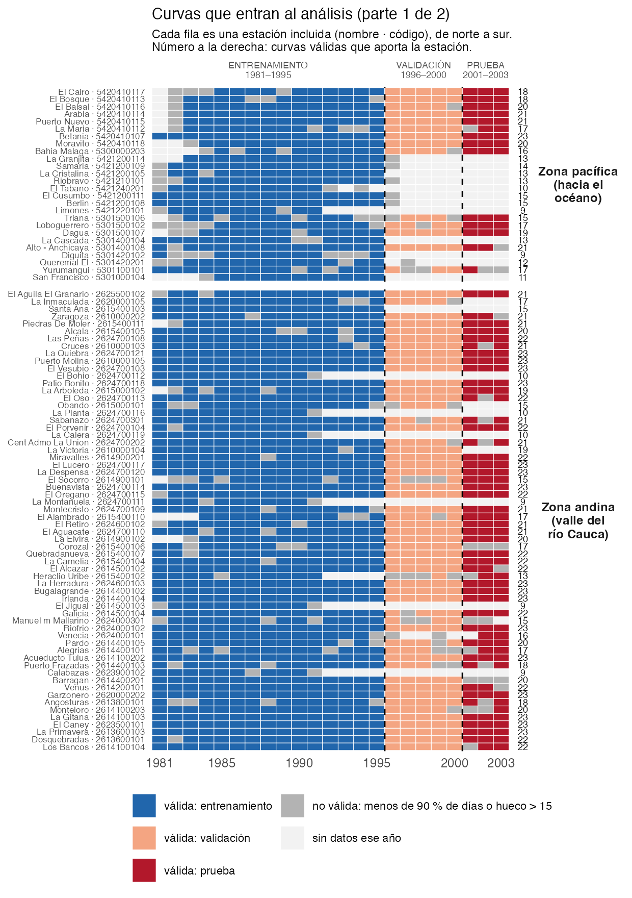

**★ Para qué está.** Para ver exactamente qué datos usa el proyecto: qué estación, qué año y en qué conjunto. Es el resultado de toda la limpieza de las secciones 4 a 7, y se pone aquí para compararlo con la gráfica anterior.

**Cómo se lee:**
- **Cada fila es una de las 176 estaciones incluidas**, con su nombre y su código CVC. Primero va la zona pacífica y luego la andina; dentro de cada una, de norte a sur. La lista se parte en dos imágenes para que los nombres se puedan leer.
- **Cada columna es un año.** Arriba está el nombre del conjunto.
- **Cada casilla es una curva**, es decir, un año completo de lluvia de esa estación:
  - **azul:** curva válida que va a entrenamiento;
  - **salmón:** curva válida que va a validación;
  - **rojo:** curva válida que va a prueba;
  - **gris:** hay datos ese año, pero no los suficientes (menos del 90 % de los días o un hueco de más de 15 días), así que no se usa;
  - **casi blanco:** la estación no tiene datos ese año.
- **El número a la derecha** es cuántas curvas válidas aporta la estación.

**Qué muestra** (`tablas/8_anios_validez.csv`):
- Entran **3 299 curvas**: 2 257 de entrenamiento, 672 de validación y 370 de prueba.
- Las 176 estaciones tienen al menos 7 años válidos en entrenamiento (regla R6).
- Muchas estaciones dejan de aportar en validación o en prueba. Por eso esos conjuntos tienen menos estaciones: 147 y 137.
- **En la zona pacífica pesa más.** Las estaciones del Calima (de La Granjita a Limones) y varias del Dagua dejan de medir hacia 1996. Por eso en prueba la zona pacífica tiene solo 14 estaciones, y sus resultados se leen con más cautela.
- Las casillas grises son pocas y sueltas: 376 años con datos insuficientes, frente a 3 299 curvas válidas. La regla de calidad (R5) quita años puntuales, no estaciones enteras.

---

## 4. Valores: cuánto llueve y qué es un extremo

**Para qué está.** Para saber qué valores son normales y detectar los que son errores.

**Qué muestra:**
- El **60,6 %** de los días no llueve (0 mm).
- En los días con lluvia:
  - la mediana es 7 mm;
  - el 10 % pasa de 30 mm (percentil 90);
  - el 1 % pasa de 76 mm (percentil 99, el "p99");
  - el máximo es 600 mm.

**Extremos sospechosos** (`tablas/4_extremos_vs_vecinas.csv`). Son los días que superan 3 veces el p99 de su estación y llegan a 150 mm: hay 8. Para cada uno se mira lo que marcaron **las estaciones vecinas** (a menos de 25 km) ese día, el anterior y el siguiente. Un aguacero real casi siempre deja lluvia también en alguna vecina.

| Estación | Fecha | mm | Máximo de las vecinas | ¿Respaldo? |
|---|---|---|---|---|
| Pardo | 9-abr-2003 | 600 | 71 | No → faltante |
| Heraclio Uribe | 8-dic-1996 | 503 | 42 | No → faltante |
| La Cascada | 9-nov-1991 | 421 | 42 | No → faltante |
| Costa Rica | 21-dic-1988 | 283 | 21 | No → faltante |
| Venecia | 1-oct-1983 | 283 | 78 | No → faltante |
| Colegio San Luis | 16-dic-2002 | 157 | 95 | Sí → se conserva |
| El Aguacate | 26-may-1981 | 150 | 150 | Sí → se conserva |
| Dagua | 3-dic-1989 | 160 | 89 | Sí → se conserva |

**★ Esta tabla es buena para la presentación:** muestra con casos concretos cómo se separa un error de una tormenta real.

**Qué muestra:**
- Un aguacero de 600 mm sin que ninguna vecina pase de 71 mm es casi seguro un error de digitación, por ejemplo un 60 con un cero de más.
- Los que tienen respaldo de las vecinas son tormentas reales y se dejan.

**Qué decidimos (regla R2).** Un valor pasa a faltante si cumple las tres condiciones:
- es mayor que 3 veces el p99 de su estación;
- llega a 150 mm o más;
- ninguna vecina supera un tercio de ese valor.

El p99 se calcula **solo con 1981–1995**, para que validación y prueba no influyan en la limpieza.

---

## 5. Patrones sospechosos

### 5a. Totales mensuales anotados en un solo día
**Para qué está.** Para detectar un error típico de los registros manuales: cuando nadie lee el pluviómetro durante el mes, el observador anota al final todo lo acumulado en un solo día. El mes queda con un único valor gigante.

**Qué muestra** (`tablas/5a_meses_un_dia_con_lluvia.csv`): meses con un solo día de lluvia, y ese día por encima del p99. Por ejemplo, Triana registra 343 mm el único día lluvioso de agosto de 1995.

**Qué decidimos (regla R3).** El mes entero pasa a faltante si:
- casi no tiene días observados, o
- las vecinas llovieron en al menos el 40 % de sus días.

Afecta 62 días en 10 estaciones.

### 5b. Rachas de ceros que no son sequía

**Para qué está.** Una estación puede marcar 0 durante semanas porque de verdad no llovió, o porque nadie leyó el pluviómetro y se anotó 0. Las dos cosas se ven igual en el archivo. La pista es la vecina: si la vecina llovió muchos días y la estación siguió en 0, la sequía no es creíble.

**Cómo se lee:**
- Cada punto es una racha de 30 días o más en 0. Hay 917.
- **Eje horizontal:** cuántos días llovió la vecina más cercana con datos durante la racha (k).
- **Eje vertical:** la probabilidad de que la estación marcara 0 todos esos días por azar, p = (1 − q)^k. Aquí q es qué tan seguido llueve en la estación cuando llueve en su vecina, calculado solo con 1981–1995.
- **La línea punteada es el umbral** (0,05 / 917). Los puntos rojos, debajo de ella, son rachas imposibles de creer.

**Qué muestra** (`tablas/5b_rachas_ceros_prueba.csv`):
- **30 rachas, en 27 estaciones, no tienen respaldo.** Suman 1 356 días.
- El caso más claro es Bella Vista en 1982: 49 días en 0 mientras La Ceja, a 8,7 km, llovió 23 días (p = 7e-10).
- La mayoría de las rachas largas son sequías reales: el El Niño de 1997 y las temporadas secas.

**Qué decidimos (regla R4).** Una racha de 30 días o más en 0 pasa a faltante si p < 0,05 / 917. El umbral es muy exigente a propósito: la fórmula supone días independientes, pero la lluvia viene en rachas, así que exagera lo raro.

Dos casos que muestran que la regla corrige la revisión a mano:
- **Loboguerrero, octubre–noviembre de 1995, se conserva.** Antes se había quitado a mano, pero Dagua coincide con ella solo la mitad de los días de lluvia y p = 2e-4 no alcanza el umbral.
- **Loboguerrero, diciembre de 1982 a marzo de 1983, pasa a faltante.** La revisión a mano la había dejado porque Dagua "también estaba seca", pero Dagua casi no tiene datos esos días. La vecina que sí tiene datos, Limones, llovió 39 días.

**Otros controles:** ningún año está duplicado entre estaciones, y las rachas de un mismo valor distinto de 0 son cortas (máximo 11 días de "1 mm").

---

## 6. Climatología: cómo llueve en el Valle

Esta sección explica **por qué el modelo usa la altitud y el ONI** (el índice de El Niño y La Niña).

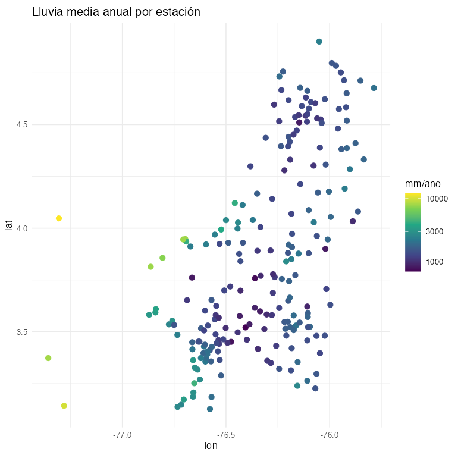

**★ Para qué está.** Para ver dónde llueve más.

**Cómo se lee.** Cada punto es una estación, y el color es su lluvia media anual en escala logarítmica: amarillo es mucha lluvia y morado poca.

**Qué muestra.** La lluvia media anual va de **709 a 12 129 mm**:
- en la costa pacífica, de 8 000 a 12 000 mm, una de las zonas más lluviosas del mundo;
- en el fondo del valle, de Cali a Cartago, de 1 000 a 1 500 mm.

Es decir, hay estaciones donde llueve **más de 10 veces** lo que en otras, dentro del mismo departamento.

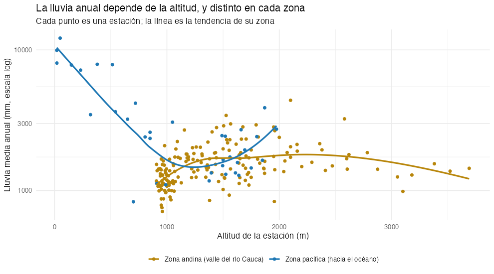

**★ Para qué está.** Para ver si la altura del terreno explica cuánto llueve.

**Cómo se lee.** Cada punto es una estación. El eje horizontal es su altitud y el vertical su lluvia anual, en escala logarítmica. Las líneas son la tendencia de cada zona.

**Qué muestra:**
- **Zona pacífica:** junto a la costa y abajo llueve muchísimo. La lluvia baja al subir la cordillera, hasta unos 1 200 m.
- **Zona andina:** el fondo del valle, a unos 1 000 m, es lo más seco. Al subir las laderas llueve más, hasta unos 2 000 m, y después vuelve a bajar.

**Un error que dejó ver esta gráfica, ya corregido.** En la versión anterior aparecía un punto de la zona andina cerca de 0 m: **El Alcázar (Zarzal, `2614500102`)**.
- El catálogo oficial del IDEAM (CNE, estación 0026100400) le da **17 m**.
- El terreno en su coordenada está a 977 m, y la estación oficial más cercana (El Medio, a 3 km) a 952 m.
- En la cuenca del Cauca ninguna estación tiene el terreno por debajo de 904 m.

17 m es imposible allí: es un error del catálogo. **Regla (D-59):** en la cuenca del Cauca, una altitud oficial más de 300 m por debajo de ese piso se reemplaza por el terreno en la coordenada. Los 300 m son la misma tolerancia del control de coordenadas (D-35). Solo afecta a El Alcázar, que pasa a 977 m, y una prueba automática lo verifica.

**Qué decidimos.** Es el efecto de la montaña sobre la lluvia (orografía). Por eso **la altitud entra al modelo**.

**★ Para qué está.** Para ver cómo se reparte la lluvia a lo largo del año. Esa forma es la que deben capturar las curvas funcionales.

**Cómo se lee:**
- El eje horizontal son los meses, de enero (E) a diciembre (D).
- Cada caja resume las estaciones de la zona en ese mes: la línea del medio es la mediana, la caja va del 25 % al 75 % de las estaciones y los puntos son estaciones atípicas.
- **Ojo con el eje vertical:** en la zona pacífica llega a más del doble que en la andina.

**Qué muestra:**
- **Zona andina: dos temporadas de lluvia** (régimen bimodal):
  - lluvias en marzo–mayo (pico en abril, unos 6 mm/día) y en septiembre–noviembre (pico en octubre);
  - secas en diciembre–febrero y, sobre todo, en julio–agosto (unos 2 mm/día).
- **Zona pacífica:** llueve todo el año, más en octubre–noviembre.

**Qué decidimos.** Estas "dos jorobas" son lo que deben capturar las curvas. De aquí sale la métrica de **fecha de los dos picos** que se usa para evaluar el modelo.

**★ Para qué está.** Para ver si unos años llueven más que otros y por qué.

**Cómo se lee:**
- Cada barra es un año.
- La altura es cuánto se apartó la lluvia de lo normal, en porcentaje: hacia arriba es más húmedo y hacia abajo más seco.
- El color es la fase del fenómeno ENSO según el ONI de la NOAA: El Niño, La Niña o neutro.

**Qué muestra:**
- **La Niña trae años húmedos:** 1984, 1988 y 1999, de +12 a +30 %.
- **El Niño trae años secos:** 1991, 1992, 1997 y 2002, de −7 a −27 %.
- La correlación entre el ONI y la anomalía es −0,57 en la zona andina y −0,68 en la pacífica.

**Qué decidimos.** Es la señal más fuerte de un año a otro. Por eso **el ONI entra al modelo**.

---

## 7. ¿Cuántos días faltantes se pueden tolerar?

**Para qué está.** Una curva anual se puede construir aunque falten algunos días, pero ¿cuántos? En vez de escoger un número a ojo, se hizo un experimento.

**El experimento:**
1. Se toman 1 960 años de estación completos de entrenamiento.
2. Se les **borran días a propósito**.
3. Se reconstruye la curva B-spline, con 8 y con 12 funciones base (K = 8 y K = 12).
4. Se mide cuánto se aleja de la curva original, sin huecos. El error se mide en unidades de lo que normalmente varía un año respecto a otro: 0,25 significa un cuarto de esa variación.

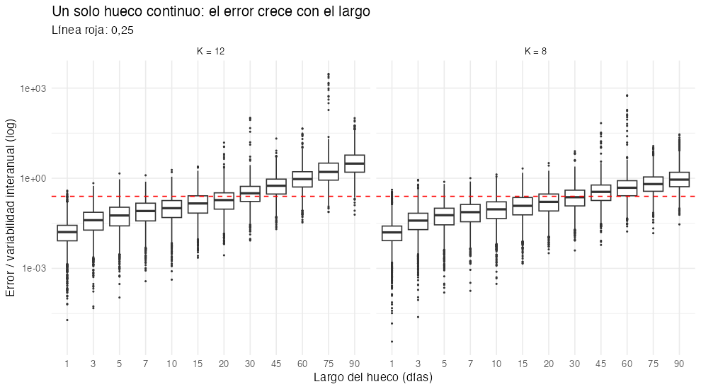

**★ Cómo se lee.** El eje horizontal es el largo de un solo hueco, en días. El vertical es el error de la curva reconstruida. La línea roja (0,25) es el error tolerable.

**Qué muestra:**
- **Hasta unos 15 días el error es bajo:** 0,12 con K = 8 y 0,14 con K = 12.
- **Desde 30 días se dispara**, sobre todo con K = 12: 0,32 a 30 días y 3,07 a 90 días. Con más funciones base, la curva se inventa formas dentro del hueco.
- Un segundo experimento copia los patrones de huecos reales de otras estaciones (gráfica `7C`, anexo A). Muestra que **el hueco más largo explica el error mejor que el porcentaje de días con dato** (R² 0,58 frente a 0,46). Un año con el 92 % de los días pero un hueco de un mes es peor que uno con el 88 % y huecos sueltos.

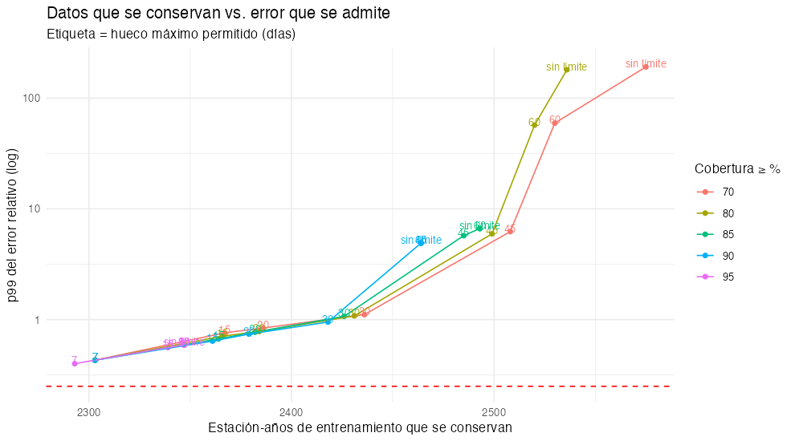

**Para qué está.** Para escoger la regla comparando lo que se gana con lo que se arriesga.

**Cómo se lee.** Cada punto es una regla posible: una combinación de porcentaje mínimo de días y hueco máximo permitido.
- El eje horizontal es **cuántos años de estación se conservan** con esa regla.
- El vertical es **el error en el peor 1 % de las curvas** que deja pasar.
- Lo ideal es estar a la derecha y abajo.

**Qué muestra.** Con "al menos el 90 % de los días y ningún hueco de más de 15" se conservan 2 361 años de estación, y el error del peor 1 % es 0,64. Si se permiten huecos de 45 días o más, se ganan unos 100 años, pero ese error salta a 4,9.

**Qué decidimos:**
- **R5:** un año es válido si tiene al menos el 90 % de los días y ningún hueco de más de 15 días.
- **R6:** una estación entra si tiene al menos 7 años válidos en entrenamiento.
- **R7:** no se imputa, es decir, no se rellenan los días faltantes.

---

## 8. El conjunto de datos final

**Trazabilidad.** Qué se pierde en cada paso (`tablas/8_trazabilidad.csv`; la rúbrica la pide en el punto 4.1):

| Paso | Estaciones | Años de estación | Qué se decidió |
|---|---|---|---|
| Crudo, 1981–2003 | 323 | 5 514 | — |
| Solo el Valle, con coordenada | 220 | 3 943 | Solo las del polígono del DANE (D-31 a D-35) |
| R1 a R4: limpiar días | 220 | 3 943 | 1 423 días pasan a faltante, más los 832 del 29 de febrero, que se quitan |
| R5: años válidos | 214 | 3 455 | Al menos el 90 % de los días y ningún hueco de más de 15 |
| R6: estaciones con historia | **176** | **3 299** | Al menos 7 años válidos en entrenamiento |

**Días que pasan a faltante** (`tablas/8_marcas_limpieza.csv`): 1 423 en total.
- R2: 5 extremos sin respaldo.
- R3: 62 días de totales mensuales.
- R4: 1 356 días de 30 rachas de ceros sin respaldo.

**Para qué está.** Para comprobar que las estaciones que se quedan siguen representando a todo el Valle.

**Cómo se lee.** En azul, las 176 incluidas. En rojo, las 44 excluidas: 38 tienen menos de 7 años válidos en entrenamiento y 6 no tienen ningún año válido.

**Representatividad** (`tablas/8_representatividad.csv`):

| Grupo | Estaciones | Altitud mediana | % zona pacífica | Lluvia anual mediana |
|---|---|---|---|---|
| Las 220 con datos | 220 | 1 330 m | 19 % | 1 515 mm |
| Las 176 incluidas | 176 | 1 330 m | 15 % | 1 444 mm |

**Qué muestra:**
- Las excluidas están repartidas por todo el Valle.
- Las 176 conservan la misma altitud mediana y una lluvia parecida, así que el conjunto final representa al Valle.
- Se pierde algo de la zona pacífica (del 19 % al 15 %), que es la más difícil de medir.

La rúbrica baja la nota si el grupo no muestra que la muestra es representativa, así que **esta tabla hay que citarla en el informe**.

**Partición final:**

| Conjunto | Años | Curvas | Estaciones | Días faltantes |
|---|---|---|---|---|
| Entrenamiento | 1981–1995 | 2 257 | 176 | 2 191 (0,27 %) |
| Validación | 1996–2000 | 672 | 147 | 465 |
| Prueba | 2001–2003 | 370 | 137 | 219 |

---

## 9. El satélite: qué es y de dónde viene

**Para qué está.** Para saber exactamente qué producto de satélite nos entregaron, porque de eso depende cómo se interpreta todo lo demás.

**Qué muestra** (`tablas/9_estructura_satelite.csv`):
- 2 328 imágenes, una por péntada, de 1981 a abril de 2013.
- Una malla de 39 × 37 cuadros (píxeles) de 0,05° de lado, unos 5,5 km.
- Valores enteros entre 0 y 200 mm por péntada, sin faltantes.
- Todo lo que pasaba de 200 mm se cortó en 200: es el 0,24 % de los valores (gráfica `9_satelite_valores`, anexo A). La sección 12 muestra que ese tope casi no afecta.

**Cuál producto es** (`tablas/9_fuente_satelite.csv`). Se comparó con los dos productos del Climate Hazards Center:

| Año | Correlación con CHIRP | Correlación con CHIRPS |
|---|---|---|
| 1981 | 0,90 | 0,84 |
| 1988 | 0,84 | 0,78 |
| 2000 | 0,90 | 0,84 |

El mapa medio tiene una correlación de 0,996 con CHIRP.

**Qué decidimos.** El satélite entregado es **CHIRP**, la versión que usa solo el satélite (infrarrojo), y no CHIRPS, que ya viene corregida con estaciones. El profesor lo confirmó (P-8). Eso quiere decir que el satélite es **independiente de las estaciones**, que es justo lo que el proyecto necesita para corregirlo con ellas.

---

## 10. Recorte y unidades

- Se usan **681 píxeles**: los 676 cuyo centro cae dentro del Valle, más 5 que contienen una estación junto al borde.
- Cada péntada se divide por **sus días reales**. Las cinco primeras del mes tienen 5 días; la sexta va del día 26 al fin de mes y tiene de 3 a 6 días.

**Por qué importa:**

| Días de la péntada | mm por péntada (media) | mm/día |
|---|---|---|
| 3 (febrero) | 9,3 | 3,1 |
| 5 | 36,8 | 7,4 |
| 6 (meses de 31 días) | 49,4 | 8,2 |

Sin dividir, la última péntada de cada mes de 31 días parecería más lluviosa solo por tener un día más. Al pasar a mm/día, satélite y estación quedan en la misma unidad.

---

## 11. Cómo ve el satélite la lluvia del Valle

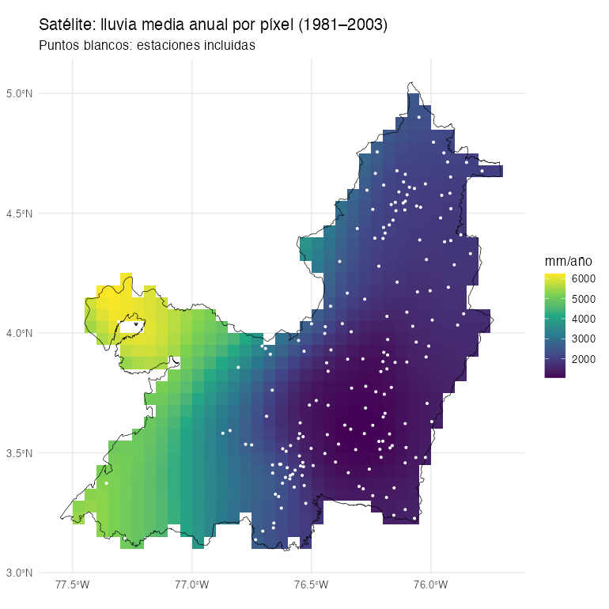

**★ Para qué está.** Para comparar el mapa del satélite con el de las estaciones (sección 6).

**Cómo se lee.** Cada cuadro es un píxel, con su lluvia media anual. Los puntos blancos son las estaciones.

**Qué muestra:**
- El satélite reproduce el patrón general: la zona pacífica, húmeda al occidente, y el valle, seco en el centro.
- **Pero su rango es mucho más estrecho:** de **1 062 a 6 239 mm**, frente a 709–12 129 mm de las estaciones. El satélite "aplana" el Valle: se queda corto donde llueve muchísimo.

**Otros resultados del satélite solo** (gráficas en el anexo A):
- El tope de 200 mm solo se alcanza en la zona pacífica, en hasta el 1,8 % de las péntadas de un píxel; en el valle nunca.
- Su ciclo anual tiene las mismas dos temporadas que las estaciones.
- **Sus años "secos" son 1985, 1988 y 2000, todos de La Niña**, que según las estaciones son años húmedos. El satélite tiene la relación con el ENSO al revés: su correlación con el ONI es +0,27, frente a −0,60 en las estaciones. Esto se confirma en la sección 12.

---

## 12. El satélite frente a las estaciones

Esta es la parte central: **qué acierta y qué falla el satélite**. Lo que falla es lo que el modelo debe corregir.

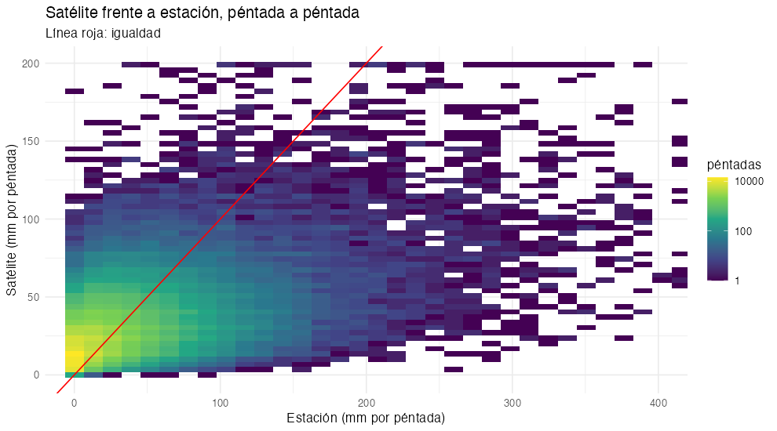

**Para qué está.** Para ver qué tan bien coincide el satélite con la estación en cada péntada concreta.

**Cómo se lee.**
- Cada punto es una pareja estación–péntada: hay 238 224.
- El eje horizontal es lo que midió la estación y el vertical lo que dijo el satélite en su píxel.
- El color indica cuántos puntos caen en esa zona.
- La línea roja es la igualdad: si el satélite fuera perfecto, todo estaría sobre ella.

**Qué muestra:**
- La nube es ancha: correlación de 0,5 aproximadamente.
- El satélite casi nunca marca 0, mientras que la estación marca 0 en el 22 % de las péntadas.
- El satélite no llega a los valores altos de la estación.

En una péntada concreta, el satélite es solo una estimación gruesa.

**★ Para qué está.** Para ver si el satélite se equivoca igual en todas partes.

**Cómo se lee.** Cada punto es una estación. El eje horizontal es su lluvia anual y el vertical la del satélite en su píxel. La diagonal es la igualdad.

**Qué muestra. El satélite "aplana":**
- Donde llueve poco (menos de 2 000 mm al año), los puntos quedan **por encima** de la diagonal: el satélite **da más lluvia** de la que hay.
- Donde llueve mucho (la costa pacífica), quedan **por debajo**: el satélite **da menos**.
- La correlación entre el sesgo y la lluvia de la estación es −0,68.

**★ Para qué está.** Para ver si el satélite acierta **en qué época del año** llueve.

**Cómo se lee.** Las dos líneas son la lluvia media de cada día del año: una para las estaciones y otra para sus píxeles.

**Qué muestra.** Las dos curvas casi se superponen: **el satélite acierta cuándo llueve en el año** (correlación de 0,78).

**★ Para qué está.** Para ver si el satélite acierta **qué años** son más lluviosos.

**Cómo se lee.**
- Cada línea es cuánto se apartó cada año de lo normal: rojo para el satélite y azul para las estaciones.
- Las líneas punteadas marcan los años en que más se separan.
- Las líneas rojas verticales son los cortes de la partición.

**Qué muestra:**
- Las estaciones varían el doble que el satélite: su desviación es de 13,8 % frente a 7,3 %.
- En 1984, 1988, 1999 y 2000, años de La Niña, las estaciones suben y el satélite no. En 1992, de El Niño, pasa al revés.
- **El satélite no capta qué años son más o menos lluviosos** (correlación de 0,25).

**★ Para qué está.** Es **la gráfica clave del satélite**: muestra que su error en un año no es al azar.

**Cómo se lee.**
- Cada año aparece escrito con su número, coloreado por su fase ENSO.
- El eje horizontal es el ONI de ese año: negativo es La Niña y positivo El Niño.
- El eje vertical es cuánto se equivocó el satélite: su anomalía menos la de las estaciones.

**Qué muestra:**
- La diferencia sigue al ONI, con correlación de 0,74.
- En La Niña el satélite se queda corto hasta 25 puntos porcentuales, y en El Niño se pasa.
- No son "años dañados": es un **error sistemático** ligado al ENSO.

**Qué decidimos.** El modelo lo puede corregir si conoce el ONI del año. Por eso el ONI va entre las variables del modelo.

### Año por año, como en la tesis del profesor

El profesor presenta sus datos **en paneles, uno por año** (tesis, figuras 5.8 y 5.12). Aquí se hace igual con la lluvia acumulada, que es la escala en que él trabaja.

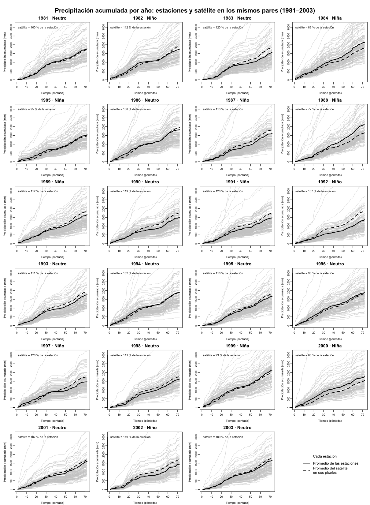

**★ Para qué está.** Para ver, año por año, si el satélite da tanta lluvia como las estaciones, y si eso depende del ENSO.

**Cómo se lee:**
- Cada panel es un año, con su fase ENSO en el título. Todos tienen el mismo eje.
- El eje horizontal son las 72 péntadas del año, de enero a diciembre. El vertical es la lluvia **acumulada** desde el 1 de enero: cada curva sube a medida que llueve, y donde se aplana es temporada seca.
- Las líneas grises son las estaciones, una por estación. Las pocas de la costa, que pasan de 8 000 mm, se salen por arriba.
- La línea negra continua es el promedio de las estaciones, y la discontinua el promedio del satélite **en los píxeles de esas mismas estaciones**.
- El texto de arriba dice cuánto da el satélite al final del año, en % de lo que midieron las estaciones.
- Solo entran los años de estación con las 72 péntadas completas, para que estación y satélite sumen exactamente los mismos días.

**Qué muestra** (`tablas/12_por_anio.csv`):
- En los años **La Niña** la línea discontinua queda **por debajo**: el satélite da en promedio el **92 %** de lo que midieron las estaciones (77 % en 1988).
- En los años **El Niño** queda **por encima**: el satélite da el **120 %** en promedio (137 % en 1992).
- En los neutros da el 108 %.
- La correlación entre ese porcentaje y el ONI es **0,76**.

**Interpretación.** Es la gráfica más directa del error del satélite ligado al ENSO: se queda corto justo en los años más lluviosos y se pasa en los secos.

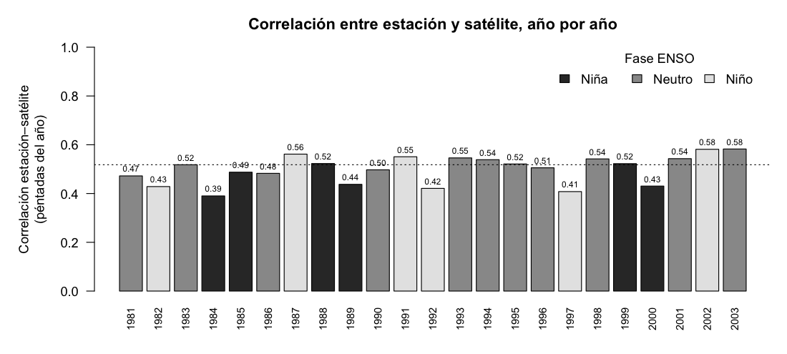

**Para qué está.** El profesor mide en su tesis la correlación estación–satélite de cada año (de 0,33 a 0,67). Aquí se repite con nuestros datos.

**Cómo se lee.** Cada barra es la correlación entre estación y satélite en las péntadas de ese año. El tono de la barra es la fase ENSO, y la línea punteada es la mediana.

**Qué muestra.** La correlación va de **0,39 a 0,58**, con mediana de 0,52. Casi no cambia con el ENSO: 0,47 en años Niña, 0,49 en Niño y 0,52 en neutros.

**Interpretación.** El satélite sigue igual de bien **el ritmo** de la lluvia todos los años. Lo que cambia con el ENSO es **la cantidad**, como mostró la gráfica anterior. Es justo lo que el modelo debe corregir.

### ¿Qué pasa en el tope de 200 mm? (pregunta del profesor, P-15)

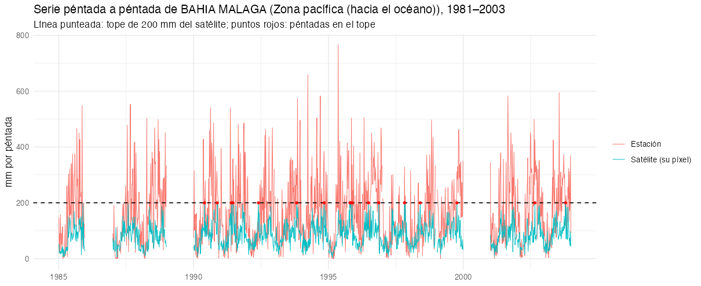

**Para qué está.** El profesor pidió armar la serie de una estación afectada y dibujarla.

**Cómo se lee.**
- Es la serie completa, péntada a péntada, de Bahía Málaga y de su píxel. Bahía Málaga es la estación de la costa con más péntadas en el tope.
- La línea punteada es el tope de 200 mm, y los puntos rojos son las péntadas en que el satélite lo toca.

**Qué muestra:**
- La estación pasa de 200 mm casi todas las temporadas, con picos de hasta unos 760 mm. El satélite casi nunca llega a 200: lo toca solo 17 veces en 23 años.
- En todos los pares, el satélite está en el tope en **33 de 238 224 péntadas**, y solo en 3 estaciones de la costa: Bahía Málaga, Yurumanguí y San Francisco (`tablas/12_tope_200_por_estacion.csv`).
- De las 1 049 péntadas en que la estación pasa de 200 mm, **el satélite está en el tope solo en el 2 %**.

**Qué decidimos.** El tope no es lo que hace que el satélite subestime los aguaceros: por sí mismo casi nunca llega a esos valores. Se documenta y no hace falta corregirlo (D-47).

### Resumen: qué acierta el satélite

(`tablas/12_que_acierta_el_satelite.csv`)

| Componente | Correlación satélite–estación | Lectura |
|---|---|---|
| Dónde llueve más | 0,79 | Bien |
| Cuándo llueve en el año | 0,78 | Bien |
| Meses más o menos lluviosos de lo normal | 0,30 | Mal |
| Años más o menos lluviosos de lo normal | 0,25 | Mal |

**★ Esta tabla resume en una línea para qué sirve el proyecto.** El satélite sabe dónde y cuándo llueve, pero no cuánto llueve un año en particular. El modelo tiene que corregir eso.

---

## 13. Los datos listos para lo funcional

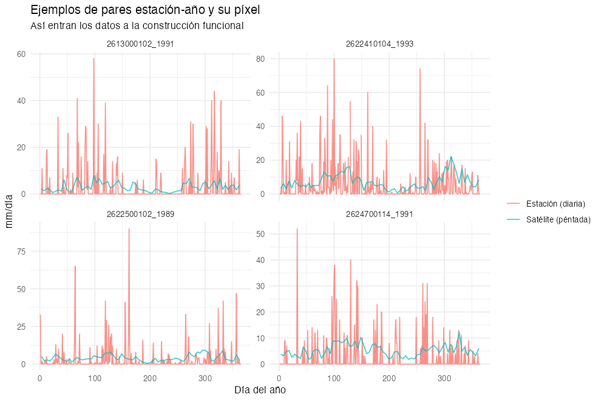

**★ Para qué está.** Para mostrar cómo entran los datos a la parte funcional: un año de una estación junto al mismo año de su píxel.

**Cómo se lee.** Son cuatro ejemplos.
- **En rojo**, la lluvia diaria de la estación: muchos ceros y picos.
- **En azul**, la péntada de su píxel: mucho más suave.

**Qué muestra.** Las dos fuentes tienen resoluciones muy distintas. Por eso cada una se convierte en curva con su propia base, y después se comparan como curvas, no día a día. Eso se explica en `EXPLICACION_FUNCIONAL`.

**Qué queda en `datos_preparados.rds`:**
- **Estaciones:** 3 299 curvas × 365 días, en mm/día, con `NA` en los días faltantes (el 0,24 %).
- **Satélite:** 15 663 curvas × 72 péntadas, en mm/día, ubicadas en su día central.
- **Pares:** cada curva de estación con la de su píxel en el mismo año, más el ONI y la fase ENSO.
- **Metadatos de las estaciones:**
  - coordenada y altitud (Univalle con 996 m, D-46);
  - zona;
  - marcas para el análisis de sensibilidad: 6 estaciones del cruce con el CNE y 12 con la coordenada "a revisar".
- **Estaciones y píxeles:** las 176 estaciones caen en 148 píxeles, y 23 píxeles tienen más de una estación.

---

## 14. Pruebas automáticas

`tablas/14_pruebas.csv`: **28 comprobaciones; si una falla, el script se detiene.** Las más importantes:
- cada valor final es igual al del archivo crudo, que se vuelve a leer: 1 211 103 valores;
- la matriz del satélite coincide con 12 imágenes TIFF releídas;
- cada estación cae dentro de su píxel, a 3,9 km del centro como máximo;
- los umbrales (p99) usan solo entrenamiento;
- cada par tiene la altitud y el ONI que necesita el modelo.

---

## Anexo A. Gráficas de respaldo

Están en `salidas_R_datos/graficos/` pero no en el cuerpo: repiten algo que ya se ve mejor en otra gráfica, o solo respaldan un detalle.

| Gráfica | Qué muestra | Por qué no está en el cuerpo |
|---|---|---|
| `3_cobertura_histograma` | Casi todos los años de estación tienen cerca del 100 % de los días | El mapa de cobertura ya lo muestra |
| `3_estaciones_por_anio` | Estaciones activas por año: 190 en 1990 y 151 en 2003 | Se ve en el mapa de cobertura; la cifra está en el texto |
| `3_huecos_largo` | Largo de los huecos: mediana de 3 días, 28 % de un solo día, picos en 30 y 60 días | El experimento de la sección 7 es la evidencia que decide |
| `4_distribucion_lluvia` | Distribución acumulada de la lluvia diaria por zona | Difícil de leer; las cifras están en la sección 4 |
| `5b_rachas_ceros` | Rachas de 15 días o más en 0 y cuánto llovió en las vecinas | Muestra el problema pero no decide; la prueba de la sección 5b sí |
| `6_coherencia_distancia` | La correlación entre estaciones baja con la distancia: 0,68 a menos de 10 km y 0,47 a más de 80 km, y cae más rápido entre zonas | Justifica el radio de 25 km de las vecinas; basta mencionarlo |
| `7C_mascaras_reales` | Error de la curva con patrones de huecos reales | La conclusión, que el hueco más largo importa más, está en la sección 7 |
| `9_satelite_valores` | Histograma del satélite con la barra del tope en 200 | La sección 12 trata el tope con la serie que pidió el profesor |
| `11_satelite_mapa_tope` | Píxeles donde el satélite toca los 200 mm | La cifra está en la sección 11 |
| `11_satelite_ciclo` | Ciclo anual del satélite solo | La gráfica `12_ciclo_satelite_estacion` lo compara con las estaciones |
| `11_satelite_anomalia_anual` | Años secos y húmedos del satélite solo | La gráfica `12_anomalia_anual_satelite_estaciones` lo compara con las estaciones |
| `12_correlacion_por_estacion` | Correlación satélite–estación de cada estación: mediana 0,42 en la zona andina y 0,37 en la pacífica | La cifra está en la tabla de la sección 0 |

La gráfica de preferencia de dígitos se quitó: quedó como tabla (`tablas/2_ultimo_digito.csv`), con la conclusión en la sección 2.

---

## Anexo B. Gráficas propuestas para la presentación

Este orden cuenta la historia de los datos en unas 12 láminas:

1. **El Valle y sus dos zonas:** `1_mapa_estaciones`.
2. **Qué datos se usan:** `3_curvas_validas_parte1` (o un recorte de ella), con la tabla de trazabilidad.
3. **Cómo se limpian:** la tabla de extremos (sección 4) y `5b_rachas_ceros_prueba`.
4. **Cuántos faltantes se toleran:** `7A_hueco_continuo`.
5. **Dónde llueve:** `6_mapa_lluvia_anual` junto a `11_satelite_mapa_anual`.
6. **Por qué la altitud:** `6_lluvia_altitud`.
7. **Cómo llueve en el año:** `6_ciclo_anual`.
8. **Por qué el ONI:** `6_anomalia_anual_ENSO`.
9. **El satélite aplana:** `12_sesgo_por_estacion`.
10. **El satélite acierta cuándo, pero no cuánto:** `12_ciclo_satelite_estacion` y `12_anomalia_anual_satelite_estaciones`.
11. **El error del satélite sigue al ENSO:** `12_acumulada_por_anio` (año por año, como en la tesis del profesor) y `12_diferencia_vs_ONI`.
12. **Qué acierta el satélite:** la tabla resumen de la sección 12, y `13_ejemplos_pares` como puente a lo funcional.

---

## Preguntas al profesor (parte de datos) y sus respuestas

También están en `DECISIONES.md`, §8.

| # | Pregunta | Respuesta o por qué importa |
|---|---|---|
| P-12 ✅ | Fuentes externas | **Aceptadas**, sobre todo las oficiales del IDEAM |
| P-14 ✅ | Univalle con los 996 m de la estación del IDEAM en el mismo campus | **El profesor lo acepta**, porque los datos del curso también salen del IDEAM |
| P-15 ✅ | Tope de 200 mm del satélite | El profesor pidió armar la serie y dibujarla: está en la sección 12. Afecta solo 33 péntadas de 3 estaciones de la costa |
| P-16 ✅ | ¿Qué "ONI del año" usar? | **Resuelta (D-56):** la media de los 12 trimestres del año calendario, porque la curva es del año completo |
| P-17 ✅ | Quitar el 29 de febrero | **Aceptado** |
| P-18 ✅ | Usar el píxel que contiene la estación | **Aceptado**: el píxel es más grande que el punto, no hay que promediar |
| P-19 ✅ | ¿Usar los **registros de 1930–1979** para estimar el FPCA? | **Resuelta (D-56):** no se usan; la fe de erratas fija el periodo 1981–2003 |
