# Qué sale de la parte funcional y cómo se interpreta

Este documento sigue donde termina `EXPLICACION_DATOS.md`. Aquella explica el EDA de los datos diarios (`lluvia_valle_datos.R`). Esta recorre lo que viene después:

- la **reconstrucción**: pasar de 365 datos diarios a una curva;
- el **EDA funcional**;
- la **comparación** entre estaciones y satélite;
- la **regresión funcional**: la del equipo, de función a función, y la concurrente de María.

Para cada paso explica qué muestra cada tabla y gráfica, qué significa y qué decisión sale de ahí. Sirve para estudiar y para defender esta parte en la sustentación.

- **Dónde está el código:**
  - las secciones 1 a 6 de `lluvia_valle_funcional.R`;
  - el archivo unido `lluvia_valle.R` tiene las mismas secciones, idénticas salvo los encabezados de rúbrica, desde su línea 1535;
  - la regresión concurrente está en `regresion_concurrente.R`.
- **Cifras actualizadas el 20-nov-2026 (D-61 y D-63):** el conjunto principal pasa a R6 con **≥10 años válidos: 163 estaciones y 3 046 curvas**, con la nueva R4 y el relleno por kriging (R7). Ya tienen las cifras nuevas la tabla de resumen, la sección 1 y las secciones 5.5 y 5.6. **El resto del documento conserva las del 19-nov-2026 (98 estaciones, regla del 80 %) y hay que actualizarlo.** La sensibilidad con el 80 % de la OMM (100 estaciones) está en `salidas_R_funcional_r6_omm/`.
- **Las cifras anteriores** son de la corrida del 19-nov-2026, con las **98 estaciones** que deja la regla de la OMM (D-60):
  - `lluvia_valle_funcional.R` pasa sus 15 pruebas, la evaluación de la red sus 5 y `regresion_concurrente.R` sus 10;
  - las tablas salen iguales a las que están en el repositorio.
- **Qué cambió tras la revisión del profesor por Teams** (fuentes en `docs/FUNDAMENTOS_REGLAS.md`):
  - se quitaron las pruebas t y F pareadas y la vista de lluvia acumulada;
  - se quitó Wilcoxon: los modelos se comparan con el IC bootstrap por estación;
  - la tesis de 2016 ya no es guía.
- **Salidas:** gráficas en `salidas_R_funcional/graficos/` y tablas en `salidas_R_funcional/tablas/`, con prefijos F1 a F6. La concurrente deja las suyas en `salidas_R_concurrente/`, con prefijos C1 a C5.
- **Decisiones:** las D-xx están en `DECISIONES.md`.
- **Conceptos:** la guía de estudio (curva, base, matriz W, FPCA y demás) explica cada concepto con ejemplos.

> **Recordatorio.** "Cauca (interandina)" y "Pacífico" son las dos vertientes **dentro del Valle del Cauca**, según la cuenca de la CVC. No son departamentos.

## Resumen en una tabla

| Paso | Rúbrica | Qué se hace | Resultado clave | Sección del R |
|---|---|---|---|---|
| Emparejar | 3 | Cada estación toma el píxel del satélite que la contiene | 163 estaciones en 142 píxeles; 3 046 pares estación–año | 1 |
| Reconstruir | 1 (10 %) | B-splines cúbicas y mínimos cuadrados, sin librerías | K = 8 en estaciones y K = 11 en satélite, elegidos con VC y VCG | 2 |
| EDA funcional | 2 (15 %) | Media, varianza, covarianza, derivadas, profundidad y boxplot | Régimen bimodal; la primera componente (el nivel de cada sitio) explica el 55 % | 3 |
| Comparar fuentes | 3 (15 %) | d(t) con banda, correlación cruzada, por vertiente, altitud y ENSO | El satélite arranca tarde la primera temporada, da 191 mm/año de más y amortigua el ENSO | 4 |
| Inferencia por grupos | 3 | ANOVA funcional de la clase sobre el error del satélite | El error del satélite cambia con la fase ENSO (p = 0,003), la vertiente y la altitud | 4.4 |
| Regresión de función a función | 4.2 y 4.4 | β(s,t) con FPCA de entrenamiento y penalización | En prueba, el error L² relativo baja de 0,51 a 0,44 y el sesgo anual de +26 % a +6 %; con el 80 % de la OMM, de 0,52 a 0,42 | 5 |
| Regresión concurrente | (contraste) | y(t) = b0(t) + b1(t)·x(t), como en el script de clase | El mismo error que la de función a función, pero peor KGE y peor en los dos picos | `regresion_concurrente.R` |

---

## 1. Datos y emparejamiento estación–píxel

**De dónde vienen los datos.** Todo sale de `salidas_R_datos/datos_preparados.rds`, que deja el archivo de datos. No se vuelve a leer el satélite.
- 3 046 curvas estación–año de 163 estaciones: 2 031 de entrenamiento (1981–1995), 652 de validación (1996–2000) y 363 de prueba (2001–2003). De ellas, 2 750 tienen los 365 días observados; en las otras, el kriging rellenó 719 días (R7, D-61) y quedan 36 sin ninguna vecina con dato.
- 15 571 curvas píxel–año: 677 píxeles por 23 años. Para el EDA se usan los 676 píxeles del Valle.

**Emparejamiento.** Cada estación toma la celda de 0,05° del satélite que contiene su coordenada, y una prueba comprueba que de verdad cae dentro.
- Las 163 estaciones caen en 142 píxeles.
- 7 píxeles tienen de 2 a 4 estaciones (16 estaciones en total), que comparten la misma curva satelital.
- El centro del píxel queda a 2,2 km de la estación en mediana, y nunca a más de 3,9 km.

**Vertiente de cada píxel.** Los píxeles no traen la cuenca de la CVC, así que hay que asignársela con alguna regla. Se compararon dos dejando una estación fuera cada vez:

| Regla | Acierta |
|---|---|
| Corte en la longitud −76,8° (la que se usaba) | 85,3 % |
| El mejor corte en longitud posible | 87,1 % |
| La vertiente de la estación más cercana | **97,0 %** |

Tabla: `F1_regla_vertiente_pixeles.csv`. La regla se calcula con **las 232 estaciones del Valle** con coordenada oficial, no solo con las 98 que entran al modelo, porque la zona es geografía y no calidad de datos. Con solo las 98, que tienen 7 estaciones pacíficas, muchos píxeles de la costa habrían quedado como "Cauca". El corte en longitud deja como "Cauca" a las estaciones del Dagua, el Calima y el Garrapatas, sobre la cordillera Occidental.

**Decisión:** se usa la estación más cercana. Así las dos fuentes tienen una sola definición de vertiente: 377 píxeles quedan en el Cauca y 300 en el Pacífico.

**Qué muestra.** Cada punto es un año. El eje x es el ONI, y el eje y el cociente satélite/estación de la lluvia anual.

**Cifras.**
- La correlación es r = 0,71 (0,70 solo con entrenamiento).
- El cociente mediano es 1,02 en años Niña, 1,19 en neutros y 1,34 en años Niño. Con las 98 estaciones, casi todas andinas, el satélite da más lluvia que la estación en casi todos los años, y mucho más en El Niño.
- Los cinco cocientes más bajos son 1984, 2000, 1988, 1981 y 1999: cuatro de ellos son años Niña.

**Interpretación.** 1985, 1988 y 2000 no son archivos dañados del satélite. Son un error sistemático ligado al ENSO: en La Niña el satélite se queda corto y en El Niño se pasa. 1984 y 1999 se apartan igual y nunca se marcaron.

**Decisión.** No se excluye ningún año (D-47, lo pidió el profesor). El modelo recibe el ONI para que aprenda a corregir ese error.

---

## 2. Reconstrucción: de datos diarios a curvas (rúbrica 1)

### 2.1 La idea

**Qué muestra.**
- **A la izquierda**, la lluvia diaria de una estación en un año: muchos días en 0 y aguaceros sueltos.
- **A la derecha**, su píxel del satélite el mismo año: 72 péntadas (promedios de 5 días), cada una puesta en su día central.

Las dos fuentes tienen resoluciones distintas. La reconstrucción las pone a las dos como **curvas en el mismo dominio**, del día 1 al 365. Así se pueden sumar, restar, integrar y comparar.

**Cómo se hace.** La curva de cada año se escribe como una suma de K funciones base fijas, cada una multiplicada por un coeficiente:

x(t) = c₁ φ₁(t) + … + c_K φ_K(t)

- Las bases φ_k son **B-splines cúbicas**: polinomios de grado 3 por tramos, pegados sin saltos ni "codos".
- Toda la curva de un año queda guardada en K números, los coeficientes c.
- Las unidades son mm/día.

### 2.2 La base, programada sin librerías

**Qué muestra.** Las 8 funciones base de las estaciones (izquierda) y las 11 del satélite (derecha). Cada una es una "colina" que sube desde 0, llega a un pico y vuelve a 0. Las líneas verticales son los nodos, donde se pegan los tramos. Con más bases las colinas son más estrechas y la curva puede seguir detalles más finos.

**Cómo se calcula.** Con la recursión de Cox–de Boor (funciones `nodos` y `base_en_nodos`): se empieza con funciones escalón y cada orden se arma promediando dos funciones del orden anterior.

**Verificaciones** (sección 2 y pruebas de la sección 6):
- La base propia coincide con `splines::splineDesign` con una diferencia de 3 × 10⁻¹⁶. La librería solo se usa para comprobar.
- En cada día las bases suman 1 y ninguna es negativa. Se comprueba con K = 6, 8, 11, 20 y 40.

**Con K = 8** (estaciones), los nodos interiores caen el 15 de marzo, el 27 de mayo, el 7 de agosto y el 19 de octubre. El año queda partido en 5 tramos.

### 2.3 Los coeficientes por mínimos cuadrados

Se arma la matriz Φ (365 × K), donde cada fila es un día y cada columna una base. Los coeficientes son los que dejan la curva lo más cerca posible de los datos:

ĉ = (ΦᵀΦ)⁻¹ Φᵀ y   y   ŷ = S y, con S = Φ (ΦᵀΦ)⁻¹ Φᵀ

**Verificación de S** (`F2_controles_S.csv`). La rúbrica pide comprobar tres propiedades:

| Fuente | K | Simetría, máx. ∣S − Sᵀ∣ | Idempotencia, máx. ∣SS − S∣ | ∣tr(S) − K∣ |
|---|---|---|---|---|
| Estaciones | 8 | 7 × 10⁻¹⁷ | 5 × 10⁻¹⁶ | 1 × 10⁻¹⁴ |
| Satélite | 11 | 8 × 10⁻¹⁷ | 2 × 10⁻¹⁶ | 2 × 10⁻¹⁵ |

Todas son cero hasta el error de redondeo del computador. También se cumplen en las curvas con días faltantes, que tienen cada una su propia S.

**Días faltantes.** No se imputan. Cada curva se ajusta solo con sus días observados: se quitan esas filas de Φ y de y. El archivo de datos ya garantiza, con la regla de la OMM (R5), que a ningún mes le faltan 11 días o más ni 5 o más seguidos. En total falta el 0,05 % de los días.

### 2.4 Cuántas bases: elegir K

**Qué muestra.** Los tres criterios de clase en función de K, arriba para estaciones y abajo para satélite. Se calculan solo con las curvas completas de entrenamiento: 1 206 de estación y 10 155 de satélite.
- **ECM:** el error de ajuste. Siempre baja al subir K, así que no sirve para elegir.
- **VC:** el error al dejar un día fuera. Se calcula con el atajo de la diagonal de S, y se comprobó que da lo mismo que hacer los 365 ajustes.
- **VCG:** la validación cruzada generalizada.

**Cifras** (`F2_K_elegido.csv`).
- VC y VCG coinciden: **K = 8 en estaciones y K = 11 en satélite**.
- En el satélite el mínimo es nítido.
- En estaciones la VC es casi plana: cualquier K entre 5 y 15 queda a menos de 1 % del mínimo. La lluvia diaria es tan ruidosa que más bases solo persiguen aguaceros.

**Sensibilidad** (`F2_sensibilidad_K_estaciones.csv`). Como la VC es plana, se probó qué cambia con más bases:

| K | VC sobre el mínimo | Pico 1 (mediana) | Pico 2 (mediana) | Puntos negativos |
|---|---|---|---|---|
| **8** | 0 % | 18 abr | 24 oct | 2,1 % |
| 12 | 0,5 % | 26 abr | 27 oct | 2,3 % |
| 16 | 1,2 % | 22 abr | 29 oct | 3,4 % |
| 24 | 2,4 % | 18 abr | 24 oct | 5,7 % |

- La fecha de los picos se mueve a lo sumo 8 días.
- Eso es mucho menos que la dispersión entre curvas: el rango intercuartílico de la fecha del pico es de 28 a 44 días.
- Lo que sí sube con K son los valores negativos.

**P-20 (D-51).** Se probó también elegir K comparando la fecha del pico con una media móvil de los datos. El K que gana depende del ancho de la media móvil:
- con 15 o 31 días gana K = 20;
- con 61 días gana K = 10.

Las referencias difieren entre sí tanto como lo que se gana subiendo K, así que la fecha del pico no sirve para elegir K.

**Decisión.** K = 8 y K = 11, el mínimo de la VCG.

### 2.5 Residuos y bandas de confianza

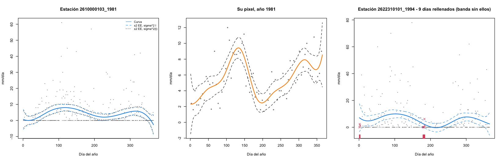

**Qué muestra.** La curva de una estación con su banda de ±2 errores estándar, su píxel con la suya, y la curva con el hueco más largo de la muestra (la marca roja): 4 días, porque la regla de la OMM no deja pasar 5 o más seguidos.

**Cifras** (consola y `F2_varianza_error_estaciones.csv`).
- **El error no es igual todo el año.** Su varianza va de 13,5 (mm/día)² el 14 de julio a 249 el 17 de octubre, la temporada húmeda. Por eso se dibujan dos bandas: con σ² constante y con σ²(t).
- **Los residuos de días seguidos casi no se correlacionan** (0,05 en general y 0,07 a un día; gráfica `F2_covarianza_residual.png`). Eso justifica la banda con σ²I. En el satélite la correlación es mayor (0,14), porque cada péntada ya promedia cinco días.
- Un hueco de 4 días ensancha la banda solo un 6 % en esos días.

**Interpretación.** Las bandas son **punto a punto**: cada día tiene 95 % de cobertura por separado, no la curva completa.

### 2.6 Valores negativos y efecto de borde

**Cifras** (`F2_valores_negativos.csv`).

| Fuente | Puntos negativos | Curvas con algún negativo | Mínimo |
|---|---|---|---|
| Estaciones | 2,0 % | 48,4 % | −6,9 mm/día |
| Satélite | 0 % | 1 % | −0,5 mm/día |

**Interpretación.** Los negativos aparecen en dos lugares:
- en la temporada seca de julio–agosto, donde la curva baja cerca de 0;
- en los bordes, el 1 de enero y el 31 de diciembre. Ahí la curva tiene datos de un solo lado y depende de un solo coeficiente: es el **efecto de borde** de una base que no es periódica.

**Decisión.** Para modelar, la curva se recorta en 0 (D-23). Se documenta como costo de la base.

### 2.7 ¿Por qué B-splines y no Fourier?

Fourier arma la curva con senos y cosenos, y obliga a que el 31 de diciembre empalme con el 1 de enero.

**Razones del código** (sección 2 y D-47):
- el enunciado exige B-splines para X(t) y para w_k(t) en el codificador de la red;
- el ejemplo de clase con esta misma lluvia usa B-splines cúbicas;
- una curva de un solo año no es periódica.

**Comprobación con los datos.** Se hizo el 16-nov-2026 con un script aparte, con la muestra anterior de 176 estaciones, y **todavía no está en el R**. Se ajustaron las 1 882 curvas completas de entrenamiento de esa muestra con las dos bases:

| | B-spline, K = 8 | Fourier, K = 7 |
|---|---|---|
| VC en todo el año | 105,2 | 105,0 |
| VC en los bordes, en el 25 % de curvas con enero y diciembre muy distintos | 161,2 | 165,7 |
| Curvas que bajan de 0 en los bordes | 34 % | 3 % |

- **Ajustan igual.** Fourier incluso tiene menos efecto de borde.
- **Pero un año no es periódico.** La lluvia del 1 al 15 de enero y la del 17 al 31 de diciembre del mismo año solo se correlacionan 0,54. En la climatología, el promedio de muchos años, la correlación sube a 0,97: ese es el caso en que Fourier es natural, como la temperatura de Canadá en clase.

**Conclusión.** La B-spline se queda porque el enunciado la exige, porque un año no es periódico y porque es local: un aguacero en abril casi no mueve la curva en octubre. El costo es el efecto de borde, que se maneja recortando en 0. Esta comprobación debería pasar al R para que quede respaldada en el código.

### 2.8 La matriz de Gram W

W = ∫ φ(t) φ(t)ᵀ dt permite calcular integrales con los coeficientes. Por ejemplo, ∫ x(t) y(t) dt = c_xᵀ W c_y. La red la necesita para z = A W c.
- Se calcula por cuadratura de Gauss–Legendre: 4 puntos en cada tramo entre nodos, lo que es exacto para estos polinomios.
- **Verificaciones:** 1ᵀW1 = 364, que es la longitud del dominio, y cᵀWc coincide con la regla del trapecio en una malla fina.

**Qué muestra.** Una estación (K = 8) y su píxel (K = 11), ya como curvas, en el mismo dominio de 1 a 365. A partir de aquí las dos fuentes se pueden comparar día a día. Se ve también el efecto de borde: cerca del 1 de enero y del 31 de diciembre la curva de la estación puede bajar de 0, y por eso se recorta en 0.

---

## 3. EDA funcional (rúbrica 2)

**Qué se usa.** Las 98 estaciones que cumplen la regla de la OMM, con sus 2 066 curvas de 1981–2003, sin submuestrear, y los 676 píxeles del Valle en los 23 años.
- La sección 8 del archivo de datos muestra que en la zona andina las incluidas representan a las 220 con datos.
- La zona pacífica queda con 7 estaciones (7 % frente a 19 %). Esa subrepresentación sale de una norma publicada, no de una elección propia, y se dice en cada resultado por zona.

### 3.1 Media, varianza y desviación estándar

**Qué muestra.** Las curvas en gris, la media en color y la banda de ±2 DE en rojo, para estaciones y para satélite. Luego, la desviación estándar funcional de las dos fuentes. A la derecha, el **coeficiente de variación funcional** CV(t) = DE(t)/media(t), que la clase usa para comparar fuentes con niveles distintos.

**Cómo se calcula.** La media es la base por el promedio de los coeficientes: x̄(t) = Φ(t) c̄. Se verifica contra `fda::mean.fd` con una diferencia de 3 × 10⁻¹⁵ (`F3_verificacion_media.csv`).

**Cifras** (`F3_extremos_de_la_media.csv`, `F3_dispersion_resumen.csv`).

| | Estaciones | Satélite |
|---|---|---|
| Primer máximo | 17 abr, 5,9 mm/día | 13 may, 10,7 mm/día |
| Segundo máximo | 28 oct, 6,5 mm/día | 5 nov, 12,3 mm/día |
| Mínimo de mitad de año | 1 ago, 1,6 mm/día | 20 jul, 4,6 mm/día |
| Coeficiente de variación medio | 0,61 | 0,61 |

**Interpretación.**
- **Las dos fuentes muestran el régimen bimodal:** dos temporadas de lluvia (abril–mayo y octubre–noviembre) y dos secas.
- **El satélite pone los picos de 1 a 4 semanas después y con casi el doble de magnitud.** Su media pesa por área, y el 44 % de los píxeles es de la vertiente Pacífica, donde llueven unos 4 000 mm/año.
- **Por vertiente, el satélite supera a las estaciones en las dos:** 1 706 frente a 1 551 mm/año en el Cauca, y 3 958 frente a 1 552 en el Pacífico. En el Pacífico la diferencia es tan grande porque las 7 estaciones que quedan son de sitios relativamente secos, mientras el satélite promedia toda la vertiente.
- **La variación entre curvas es más de la mitad de la media** (CV de 0,61 en las dos fuentes).
- **La DE de las estaciones** es alta en la segunda temporada y mínima el 17 de agosto. El máximo del 1 de enero (4,3) es efecto de borde, no un hecho del clima.

### 3.2 Covarianza y correlación

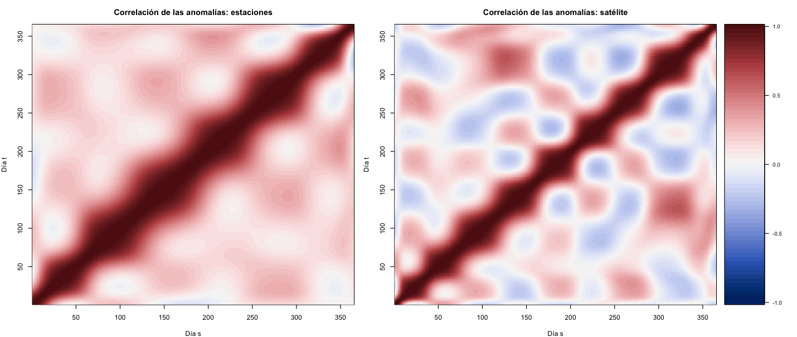

**Qué muestra.** La correlación entre la lluvia del día s y la del día t, después de restar a cada curva la media de su estación (anomalías). Las superficies sin restar están en `F3_covarianza_estaciones.png`, `F3_correlacion_estaciones.png` y sus equivalentes del satélite.

**Cifras** (`F3_covarianza_por_vertiente_y_anomalias.csv`).

| Grupo | 1.ª componente | Correlación abril–octubre | Correlación mínima |
|---|---|---|---|
| Estaciones, todas | 55 % | 0,58 | −0,10 |
| Estaciones del Cauca | 54 % | 0,58 | −0,13 |
| Estaciones, anomalías por estación | 26 % | 0,13 | −0,35 |
| Satélite, todos los píxeles | 88 % | 0,83 | 0,43 |

**Interpretación.**
- Con todas las estaciones juntas, una sola componente explica el 55 %, y abril y octubre se correlacionan 0,58. Eso es sobre todo **el nivel de lluvia de cada sitio**. Antes, con las estaciones de la costa (de 8 000 a 12 000 mm/año), esa componente pesaba 76 %; sin ellas, la diferencia entre sitios pesa menos.
- En el satélite, que sigue teniendo toda la vertiente Pacífica, la primera componente explica el 88 %.
- Al quitar el nivel de cada estación queda la variación de un año a otro. Ahí la primera componente baja a 26 % y abril y octubre casi no se relacionan (0,13).
- **En palabras:** un sitio húmedo es húmedo todo el año, pero un año con una primera temporada lluviosa no anuncia una segunda temporada lluviosa.

### 3.3 Derivadas y temporadas de lluvia

**Qué muestra.** La primera derivada de la media, es decir, la velocidad a la que cambia la lluvia.
- Donde es positiva, la lluvia sube; donde es negativa, baja.
- Donde cruza el 0 hay un máximo o un mínimo de la curva.

La derivada se calcula derivando la base: D x(t) = Σ c_k Dφ_k(t).

**Cifras** (`F3_temporadas_fechas.csv`, curvas medias).

| Momento | Estaciones del Cauca | Satélite en el Cauca |
|---|---|---|
| Inicio de la 1.ª temporada | 28 feb | 18 mar |
| Pico de la 1.ª temporada | 14 abr | 1 may |
| Fin de la 1.ª temporada | 14 jun | 11 jun |
| Inicio de la 2.ª temporada | 15 sep | 24 sep |
| Pico de la 2.ª temporada | 31 oct | 3 nov |

**Interpretación.**
- **El satélite fecha el inicio y el pico de la primera temporada unas 3 semanas tarde**, y el inicio de la segunda unas 10 días tarde.
- La gráfica `F3_temporadas_por_curva.png` hace lo mismo curva por curva. En el 62 % de las curvas de estación del Cauca la lluvia sigue bajando hasta el borde del año, así que el fin de la segunda temporada no se puede fechar en ellas.

### 3.4 Profundidad, boxplot funcional y curvas atípicas

**Profundidad.** Mide qué tan "central" es una curva dentro del grupo. Se usan las dos de clase:
- **Fraiman–Muniz (FM)**, que promedia la profundidad de cada día;
- **MBD**, que cuenta cuántas veces la curva queda entre otras dos.

Las dos ordenan casi igual (Spearman 0,99 y 1,00). La curva más profunda, la mediana funcional, es **Betania 2002**. Gráfica: `F3_centralidad.png`.

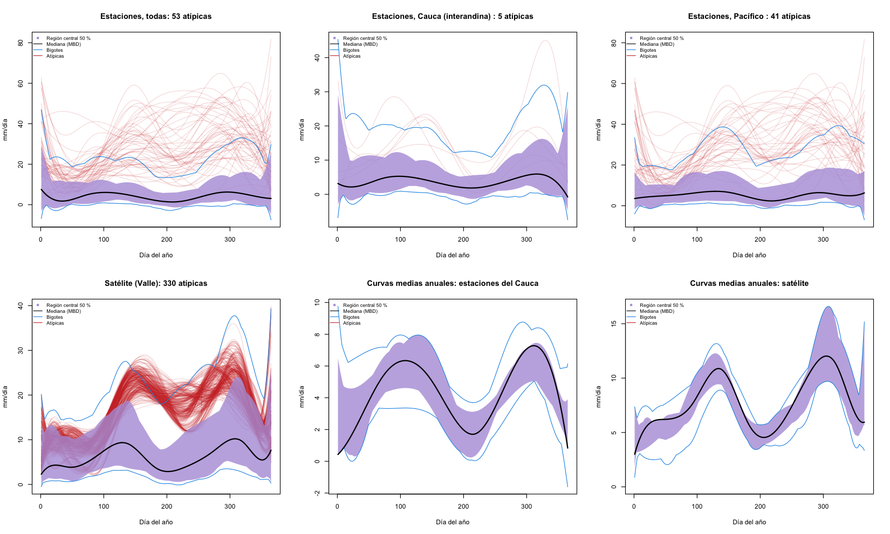

**Qué muestra.** El boxplot funcional:
- **región central**, en morado: el 50 % de las curvas más profundas;
- **bigotes**, en azul: 1,5 veces esa región;
- **curvas atípicas**, en rojo: las que se salen de los bigotes.

Arriba están las estaciones (todas, Cauca y Pacífico) y el satélite; abajo, las curvas medias de cada año. Las atípicas coinciden con las de `fda::fbplot`, y hay una prueba automática que lo verifica.

**Cifras** (`F3_atipicas_*.csv`, `F3_profundidad_anual.csv`).
- **Estaciones todas juntas:** 1 curva atípica de 2 066, Tenjo 1982 (4 482 mm/año, candidata a revisión). Antes, con 176 estaciones, eran 63, casi todas de cinco estaciones de la costa (Bahía Málaga, Yurumanguí, San Francisco, Triana y El Tabano), que ya no entran.
- **Por vertiente:** en el Cauca solo Tenjo 1982; en el Pacífico, 8 curvas, todas de Alto Anchicayá, la más lluviosa de las 7.
- **Satélite:** 330 atípicas de 15 548 curvas (2,1 %). Todas son del Pacífico, y 229 tocan el tope de 200 mm por péntada.
- **Años:** ninguna curva media anual es atípica. Los años menos profundos de las estaciones son 1988, 1984, 1983 y 1999, tres de ellos Niña.

**Interpretación.** Sin la costa más lluviosa casi no quedan atípicas en las estaciones. Las del satélite siguen siendo de otro clima (el Pacífico), no errores; por eso el boxplot se separa por vertiente.

### 3.5 Contexto climático: vertiente, altitud y ENSO

**Qué muestra.** La media por vertiente, la de las estaciones del Cauca por franja de altitud y la de esas mismas estaciones por fase ENSO.

**Cifras** (`F3_contexto_vertiente_altitud_ENSO.csv`, `F3_picos_por_fase_ENSO.csv`).

| Grupo (estaciones del Cauca) | Lluvia anual |
|---|---|
| Menos de 1 200 m (fondo del valle) | 1 304 mm |
| 1 200 a 2 000 m | **1 708 mm** |
| Más de 2 000 m | 1 616 mm |
| Años neutros | 1 538 mm |
| Años Niña | 1 734 mm (+13 %) |
| Años Niño | 1 388 mm (−10 %) |

**Interpretación.**
- **Orografía:** las laderas medias son lo más lluvioso del Cauca, más que el fondo del valle y más que lo alto. Por eso la altitud entra al modelo.
- **La Niña se nota en la segunda temporada** (7,1 frente a 6,3 mm/día) y en una sequía de mitad de año más húmeda (2,4 frente a 1,4 mm/día).
- **El satélite no muestra la señal ENSO:** da menos lluvia en años Niña (1 639 mm) que en neutros (1 738), y casi lo mismo en El Niño (1 716). Si se quitan 1985, 1988 y 2000, el satélite pasa a dar 1 811 mm en La Niña. Es el mismo error ligado al ENSO de la sección 1, y la razón para darle el ONI al modelo.

### 3.5b Año por año

Las curvas de cada año en un panel, con el mismo eje en todos: las curvas en gris, el promedio en negro y la desviación estándar punteada. Son **datos funcionales** (las curvas reconstruidas), en **mm/día**, nunca lluvia acumulada. La lluvia observada antes de volverla curva está en `6_serie_diaria_por_anio` del archivo de datos. El título de cada panel lleva la fase ENSO del año.

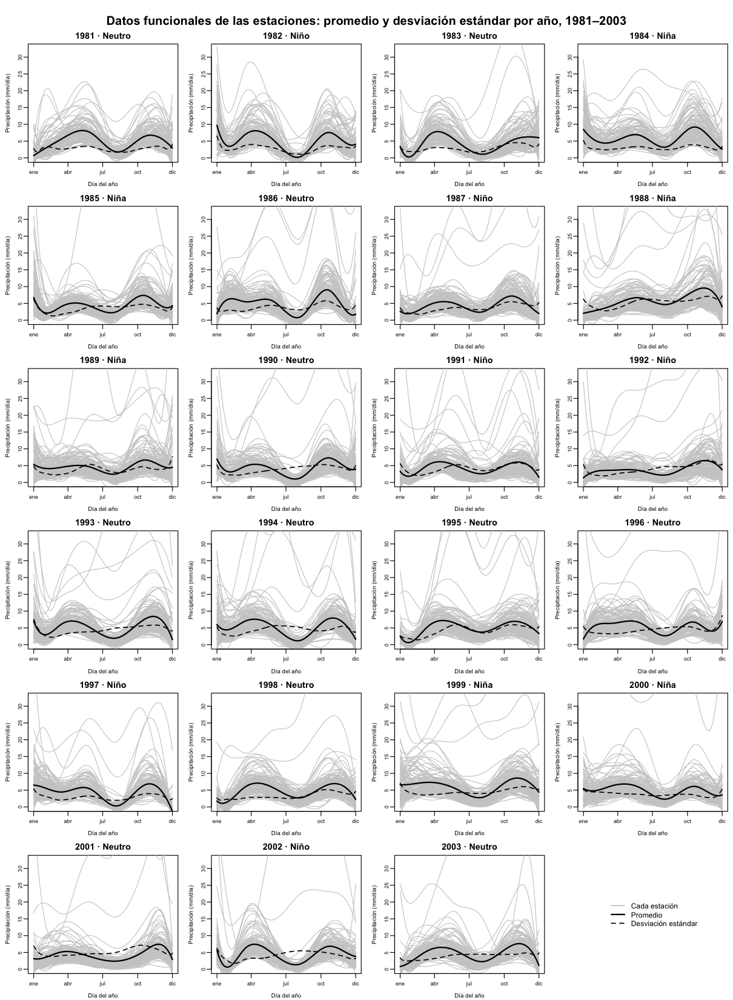

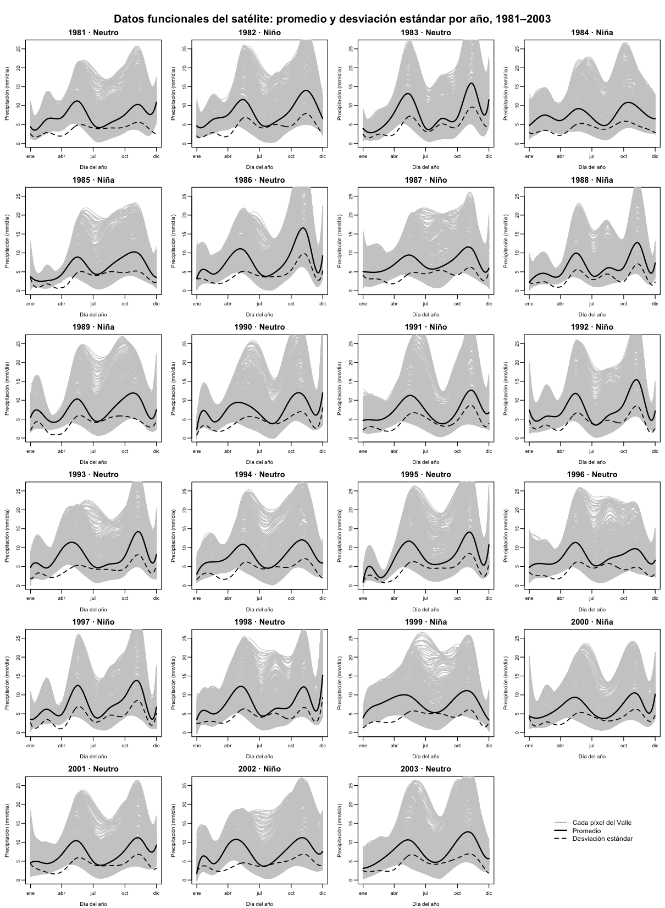

**Cómo se lee:**
- Cada panel es un año.
- Las líneas grises son las curvas de ese año: una por estación, o una por píxel del Valle en la del satélite.
- La línea negra es el promedio y la punteada la desviación estándar.
- Como todos los paneles tienen el mismo eje, se compara un año con otro mirando la altura de la línea negra.

**Cifras** (`F3_por_anio_resumen.csv`):
- **Estaciones:** los años más lluviosos son de La Niña: 1999 (2 048 mm), 1984 (1 999) y 1988 (1 769). Los más secos son de El Niño: 1992 (1 175) y 1991 (1 272). La lluvia anual media de las estaciones tiene correlación **−0,60** con el ONI.
- **Satélite:** sus años más secos son 1985, 1988 y 2000, los tres de La Niña. Su correlación con el ONI es **+0,47**, al revés que las estaciones.
- El satélite promedia todos los píxeles del Valle, y el 44 % son de la zona pacífica. Por eso su nivel no se compara directamente con el de las estaciones; lo que se compara es **cómo cambia de un año a otro**.

**Interpretación.** La gráfica por año deja ver lo que las medias de todo el periodo esconden. La forma bimodal se repite casi todos los años, pero su altura cambia con el ENSO, y el satélite responde al revés que las estaciones. Es la razón, ya vista en el EDA de datos, para darle el ONI al modelo.

### 3.6 Lista de la rúbrica 2

| La rúbrica pide | Dónde está |
|---|---|
| Media calculada paso a paso y verificada contra la librería | 3.1: `F3_verificacion_media.csv` (3 × 10⁻¹⁵ frente a `fda::mean.fd`) |
| Varianza y desviación estándar funcional | 3.1: `F3_media_y_dispersion.png`, `F3_dispersion_resumen.csv` |
| Covarianza y correlación de cada fuente | 3.2: superficies `F3_covarianza_*` y `F3_correlacion_*` |
| Derivadas e inicio y fin de las temporadas | 3.3: `F3_derivada_media.png`, `F3_temporadas_*.csv` |
| Profundidad FM y MBD, boxplot y atípicas por estación y año | 3.4: `F3_centralidad.png`, `F3_boxplot_funcional.png`, `F3_atipicas_*.csv` |
| Interpretación climatológica (bimodal, orografía, ENSO) | 3.1 a 3.5 |
| Sin subconjuntos sin justificar | Se usan todas las estaciones que cumplen la norma de la OMM y todos los años |

---

## 4. Comparación funcional por fuente (rúbrica 3)

**Pares.** 2 066 pares estación–año y píxel–año: 98 estaciones en 89 píxeles, todos los años.

**El error estándar se calcula entre estaciones.** Primero se promedia cada estación y luego se compara entre estaciones. Así el EE sale 3 veces más grande que si cada curva fuera independiente, porque los años de una misma estación repiten su sesgo. Usar el EE ingenuo daría bandas falsamente estrechas.

### 4.1 La diferencia media d(t)

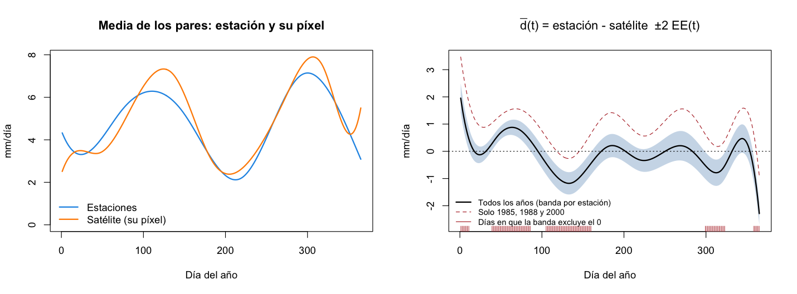

**Qué muestra.**
- **A la izquierda**, la media de las estaciones y la de sus píxeles.
- **A la derecha**, la diferencia d(t) = estación − satélite, con su banda de ±2 EE. Las marcas rojas abajo son los días en que la banda excluye el 0. La línea roja discontinua es la diferencia solo en 1985, 1988 y 2000.

Es una **descripción**, no una prueba: la banda dice en qué días las dos fuentes se separan. La pregunta formal de si el satélite está sesgado la responde la regresión (sección 5.4). Allí se ve si su intercepto es 0 y la integral de β es 1, que es lo que pasaría si el satélite midiera lo mismo que la estación. Por eso ya no se usa la prueba t pareada (`docs/FUNDAMENTOS_REGLAS.md`, 5.3).

**Cifras** (`F4_intervalos_diferencia.csv`).

| Tramo | Días | Quién da más |
|---|---|---|
| 12 feb – 20 mar | 37 | La estación: el satélite arranca tarde la primera temporada |
| 6 abr – 21 sep | 169 | El satélite: exagera la primera temporada y la sequía de mitad de año |
| 5 oct – 29 nov | 56 | El satélite: exagera la segunda temporada |
| 1–7 ene, 16–30 ene y 16–31 dic | 38 | Bordes del año; se interpretan con cuidado |

**Interpretación.**
- **Con las 98 estaciones, casi todas andinas, el satélite da más lluvia que la estación la mayor parte del año:** 191 mm/año de más en promedio. La banda excluye el 0 en 300 de los 365 días.
- La excepción es febrero–marzo, donde el satélite arranca tarde la primera temporada. Es el mismo retraso que mostraron las derivadas.
- En 1985, 1988 y 2000, años La Niña, el satélite da 136 mm/año **menos** que la estación; en el resto de años da 241 mm/año de más.

### 4.2 Correlación cruzada y covarianzas

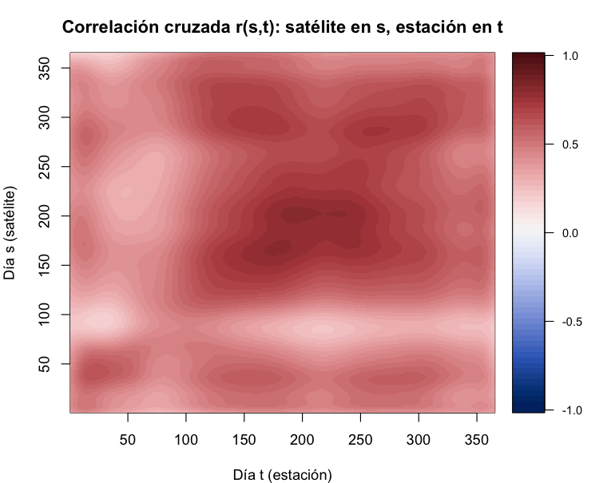

**Qué muestra.** La correlación entre la estación en el día t y su píxel en el día s. La diagonal (s = t) dice qué tanto sigue el satélite a la estación el mismo día. La diagonal sola está en `F4_diagonal_correlacion.png`.

**Cifras.**
- **La diagonal** vale 0,41 en promedio, con un máximo de 0,52 el 11 de junio. La correlación máxima está casi en el mismo día (desfase mediano de +1 día).
- **Con anomalías**, restando la climatología de cada estación, la diagonal vale 0,30: máximo 0,54 en febrero y apenas 0,04 en noviembre.
- **Covarianzas** (`F4_covarianzas.png`, `F4_covarianzas_comparadas.csv`):
  - la forma se parece: la correlación abril–octubre es 0,58 en estaciones y 0,70 en satélite, y la primera componente explica 54 % y 67 %;
  - la varianza del satélite es **la mitad** de la de las estaciones (cociente mediano 0,48 por día).

**Interpretación.**
- Antes, con las estaciones de la costa, la diagonal valía 0,62. Esa correlación salía sobre todo de que el satélite distingue un sitio muy húmedo de uno seco. Con las 98 estaciones, todas con lluvias parecidas, esa ventaja se pierde, y queda a la vista lo que el satélite sigue mal: la variación de un año a otro, sobre todo en la segunda temporada.
- Un píxel de unos 5,5 km y una péntada de 5 días promedian los aguaceros locales. Por eso el satélite varía menos.

**¿Sale esto de usar K distinto?** No. Con el satélite también en K = 8 (`F4_sensibilidad_mismo_K.csv`):
- la diferencia media pasa de −191 a −188 mm/año;
- la diagonal, de 0,41 a 0,42;
- el cociente de varianzas, de 0,48 a 0,48.

El veredicto día a día sí es algo sensible: coincide en 272 de 365 días. Por eso las fechas exactas se reportan con esa salvedad.

### 4.3 Por vertiente, altitud y fase ENSO

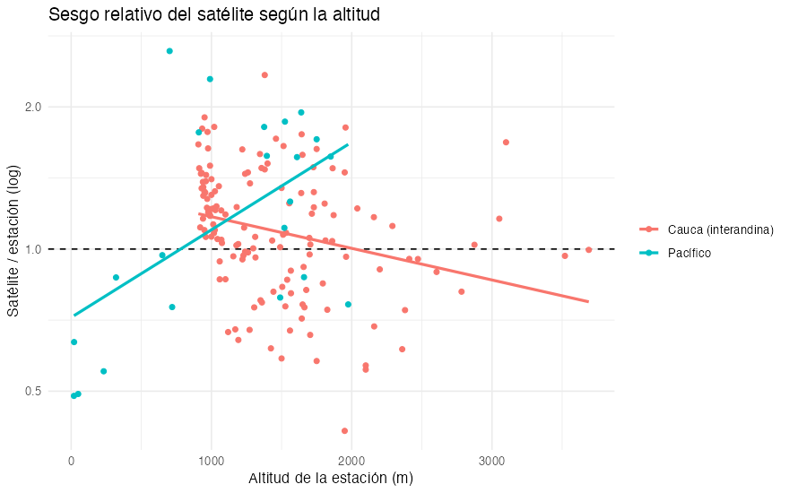

**Cifras** (`F4_comparacion_por_grupo.csv`, `F4_sesgo_por_estacion.csv`).

| Grupo | Estaciones | Estación (mm/año) | Satélite (mm/año) | Cociente satélite/estación | Días con la banda sin el 0 |
|---|---|---|---|---|---|
| Cauca | 91 | 1 551 | 1 690 | 1,09 | 265 |
| Pacífico | 7 | 1 552 | 2 443 | 1,57 | 357 |
| Menos de 1 200 m | 37 | 1 345 | 1 687 | 1,25 | 321 |
| 1 200 a 2 000 m | 55 | 1 682 | 1 805 | 1,07 | 235 |
| Más de 2 000 m | 6 | 1 616 | 1 486 | 0,92 | 31 |
| Años Niña | 98 | 1 733 | 1 667 | 0,96 | 161 |
| Años Niño | 98 | 1 383 | 1 754 | 1,27 | 313 |

**Interpretación.**
- **En el Cauca el satélite sobreestima un 9 %** (+137 mm/año).
- **En el Pacífico quedan 7 estaciones, de sitios relativamente secos** (1 552 mm/año, como el Cauca), y el satélite les da 57 % de más. Las estaciones de la costa muy lluviosa, donde antes el satélite se quedaba corto a la mitad, ya no entran (R6). Por eso el resultado del Pacífico no se puede generalizar a toda la vertiente.
- **El satélite suaviza hacia la media regional:** sube lo seco. Entre estaciones, la lluvia anual del píxel explica la de la estación con r = 0,47 (0,50 en el Cauca).
- **Altitud:** en el Cauca el cociente satélite/estación baja un 15 % por cada 1 000 m (p = 0,03). El satélite exagera en el fondo del valle (25 % de más) y se queda corto arriba de 2 000 m, donde la lluvia orográfica no se ve a 5 km.
- **ENSO:** en La Niña el satélite da casi lo justo (cociente 0,96), y en El Niño un 27 % de más. Amortigua la señal: no sube la lluvia en La Niña ni la baja en El Niño.

**Decisión.** Esto justifica darle al modelo la **altitud** y el **ONI** junto con la curva del satélite, como pide el enunciado. La gráfica `F4_diferencia_por_grupo.png` muestra d(t) por grupo.

---

### 4.4 ANOVA funcional del error del satélite

¿Cambia el error del satélite, d(t) = estación − satélite, según la fase ENSO, la vertiente o la altitud? Son grupos **independientes**, que es el caso para el que se hizo el ANOVA funcional de la clase (Cuevas, Febrero y Fraiman 2004; Zhang 2013):
- la F puntual F(t);
- la F global, con grados de libertad multiplicados por d̂;
- la **GPF**, que integra F(t) y es mejor cuando la diferencia es pequeña pero extendida;
- la **F_max**, que es mejor cuando la diferencia es localizada.

Las decisiones se toman con valores p **por permutación** (Górecki y Smaga 2015), que no dependen de ninguna aproximación.

**Unidades:**
- para el ENSO, los 23 años (la fase es del año);
- para la vertiente y la altitud, las estaciones, con la curva media de cada una, porque sus años no son independientes.

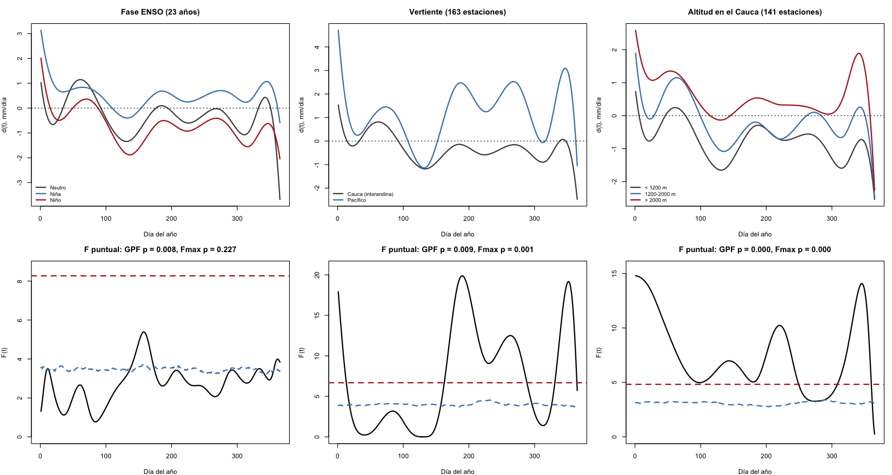

**Cifras** (`F4_anova_funcional.csv`).

| Factor | F (p por permutación) | GPF (p) | F_max (p) | Días con el criterio del máximo |
|---|---|---|---|---|
| Fase ENSO (23 años) | 2,7 (0,003) | 0,011 | 0,34 | 0 |
| Vertiente (98 estaciones) | 14,2 (0,0002) | 0,0002 | 0,0002 | 338 |
| Altitud en el Cauca (91 estaciones) | 4,3 (0,013) | 0,02 | 0,0002 | 106 |

**Interpretación.**
- **El error del satélite depende del ENSO.** El efecto es pequeño en cada día y por eso F_max no lo detecta, pero se extiende por todo el año, y por eso lo detectan F y GPF. Es la respuesta con datos que pidió el profesor («ustedes pueden hacer inferencia funcional, entonces eso lo tienen que demostrar»), y respalda darle el ONI al modelo.
- **También depende de la vertiente y de la altitud**, con diferencias fuertes y localizadas: el satélite no ve la orografía.
- **Ojo con la vertiente:** el Pacífico tiene solo 7 estaciones. La prueba lo detecta, pero el resultado describe a esas 7 estaciones, no a toda la vertiente.
- **Comprobaciones de la clase (ejercicio 1):** SSE_n = (n − k) tr(γ̂) y, con k = 2, F(t) = t², las dos exactas.

**Sobre lo quitado.** La prueba t y la F pareadas y la vista de lluvia acumulada se quitaron tras la revisión del profesor. Las razones y las fuentes están en `docs/FUNDAMENTOS_REGLAS.md` (secciones 5.1 y 5.3).

---

## 5. Regresión funcional de función a función (rúbrica 4.2 y 4.4)

### 5.1 Qué modelo es y por qué

Se predice **la curva de la estación completa** a partir de **la curva del satélite completa**, más la altitud y el ONI:

y_i(t) = α(t) + ∫ β(s,t) x_i(s) ds + γ(t)·altitud_i + δ(t)·ONI_i + error

- **β(s,t)** dice cuánto pesa la lluvia del satélite en el día s para predecir la estación en el día t. Es el modelo integral de clase (Ramsay y Silverman 2005, cap. 16).
- **Se resuelve en tres pasos:**
  1. Se hace un **FPCA** de las curvas de estación, solo con entrenamiento: y(t) ≈ μ(t) + Σ_m s_m ψ_m(t).
  2. Cada puntaje s_m se predice con la integral del satélite, que con coeficientes es z = C_x W, más la altitud y el ONI. Es una regresión de cresta en la que λ castiga la curvatura de β.
  3. Se arma β(s,t) = Σ_m β_m(s) ψ_m(t).
- **Es la referencia lineal de la red.** La cabeza lineal de la red tiene que reproducir este modelo (rúbrica 4.2).

**La escala raíz.** La lluvia es muy asimétrica, así que el modelo trabaja con la raíz de la curva en mm/día. Al final se eleva al cuadrado, lo que garantiza que la reconstrucción no es negativa.
- Recortar en 0 antes de sacar la raíz solo cambia el 2 % de los días de las estaciones.
- La raíz se reproyecta en la misma base con un error de 0,09 (estaciones) y 0,03 (satélite), en raíz de mm/día.

**Primero se suaviza y luego se saca la raíz** (`F5_orden_raiz_y_suavizado.csv`, 1 206 curvas completas de entrenamiento):

| Camino | Total anual / dato diario (mediana) |
|---|---|
| A. Suavizar en mm, recortar en 0 y sacar la raíz (el que se usa) | **1,000** |
| B. Sacar la raíz al dato diario, suavizar y elevar al cuadrado | 0,32 |

El camino B reduce la lluvia anual a un tercio, porque el cuadrado de la media de las raíces no es la media. Como el sesgo del total anual es una métrica de la rúbrica, se usa el camino A.

### 5.2 FPCA de las estaciones (solo entrenamiento)

**Qué muestra.** A la izquierda, la media de entrenamiento en escala raíz, con las dos temporadas. A la derecha, las 6 funciones propias ψ_m(t).

**Cifras** (`F5_fpca_varianza.csv`).

| Componente | 1 | 2 | 3 | 4 | 5 | 6 |
|---|---|---|---|---|---|---|
| Varianza explicada | 43 % | 19 % | 12 % | 7 % | 6 % | 5 % |
| Acumulada | 43 % | 62 % | 73 % | 81 % | 86 % | **91,2 %** |

- **La primera componente** es casi plana: es el nivel de lluvia de cada sitio. Las demás mueven las temporadas.
  - Pesa menos que antes (62 % con 176 estaciones) porque sin la costa muy lluviosa los sitios se parecen más entre sí.
- **Se calcula sobre W¹ᐟ² Σ W¹ᐟ²**, para que la varianza se mida como integral y no como suma de coeficientes. Las funciones propias son ortonormales con W, y hay una prueba que lo verifica.

**P-19: ¿usar los registros de 1930–1979?** (D-56, `F5_P19_conteo.csv`).
- Habría 710 curvas válidas de 82 de nuestras estaciones, 562 de ellas de los años setenta. Sumarían un 54 % a las de entrenamiento.
- Con ellas las cuatro primeras funciones propias no cambian (coseno 1,000), y la varianza explicada con M = 6 pasa de 91,2 % a 91,0 %.
- **Decisión:** no se usan. Traen variabilidad de otra época, no estructura nueva, y la fe de erratas fija 1981–2003.

### 5.3 Elegir M y λ con validación

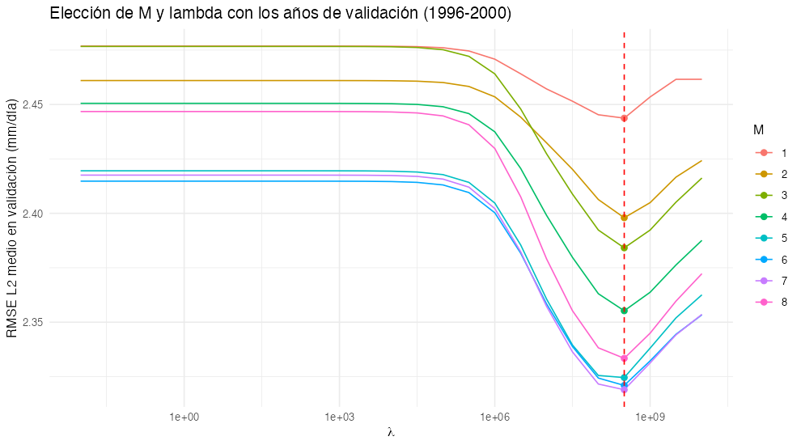

**Qué muestra.** El error en los años de validación (1996–2000) para cada número de componentes M y cada penalización λ.

**Regla.** Se toma el menor M cuyo mejor error de validación queda a menos de 0,5 % del mínimo.

**Resultado.**
- **M = 6**, que explica el 91,2 % de la varianza; el enunciado pide M entre 4 y 6.
- **λ = 3,2 × 10⁸**, los mismos valores que con 176 estaciones.
- Con ese λ el modelo usa unos 9 grados de libertad efectivos de 14 parámetros por componente.
- La prueba (2001–2003) no se usa para elegir nada.

### 5.4 La superficie β(s,t) y la equivalencia

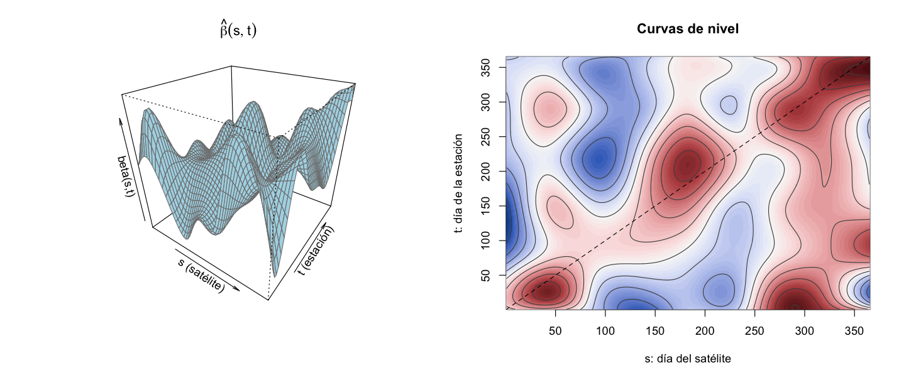

**Qué muestra.** β(s,t) en 3D y en curvas de nivel:
- en rojo, donde más lluvia del satélite en el día s sube la predicción del día t;
- en azul, donde la baja.

**Interpretación.**
- **Los valores altos siguen la diagonal:** la lluvia del satélite de una época predice sobre todo esa misma época de la estación.
- **Fuera de la diagonal hay contrastes entre temporadas.**

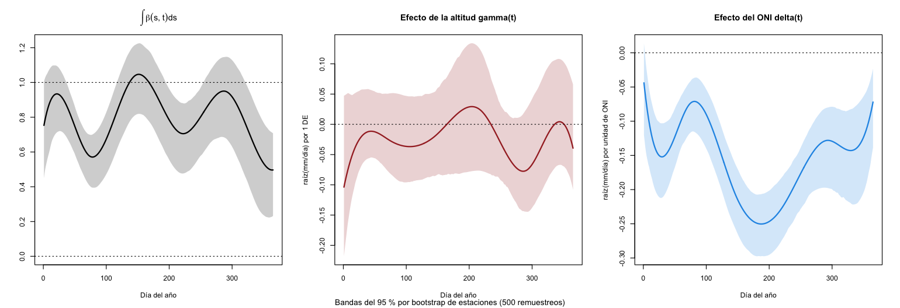

**Qué muestra.** Cada efecto con su banda del 95 %, como en la clase (semana 15): se lee dónde excluye el 0. La banda sale de un bootstrap de estaciones con 500 remuestreos, que respeta que los años de una estación no son independientes (`F5_efectos_bandas.csv`).

- **∫β(s,t) ds**, a la izquierda: cuánto pasa a la estación si el satélite sube igual todo el año.
  - Va de 0,10 (mediados de diciembre) a 0,68 (1 de junio).
  - **Es la prueba formal de que el satélite está sesgado.** Si el satélite midiera lo mismo que la estación, esta integral valdría 1. Su banda **excluye el 1 los 365 días**: el satélite exagera las variaciones, y el modelo las amortigua siempre, sobre todo al final del año.
  - La banda excluye el 0 en 318 días: el satélite informa casi todo el año.
- **El efecto del ONI δ(t)** resta lluvia todo el año, y sobre todo a mitad de año (−0,29 por unidad de ONI el 2 de julio). El Niño profundiza la sequía de junio–julio. La banda excluye el 0 en 363 días.
- **La altitud γ(t)** es positiva y pequeña: su banda excluye el 0 en 51 días (25 lejos de los bordes del año). Una vez se conoce el píxel, la altitud aporta poco. Se mantiene porque el enunciado la pide en el vector z de la red.

**Equivalencia.** La predicción con la integral de β por cuadratura y la predicción por puntajes FPCA difieren en 3 × 10⁻¹⁵ (el criterio es 10⁻⁴). Es la identidad β(s,t) = Σ_m β_m(s) ψ_m(t) que la cabeza lineal de la red debe reproducir.

### 5.5 Evaluación en prueba (2001–2003)

**Qué muestra.**
- **Arriba**, tres curvas de prueba con la estación, el satélite y la regresión, escogidas en los percentiles 10, 50 y 90 del error.
- **Abajo**, la varianza explicada por día, el error por curva y el sesgo anual, comparados con el satélite sin corregir y con un modelo que solo usa altitud y ONI.

**Cifras** (`F5_metricas_prueba.csv`: 363 curvas de 136 estaciones; IC del 95 % por bootstrap de estaciones con 2 000 remuestreos).

| Modelo | L² relativo | KGE | Sesgo anual | Error pico 1 | Error pico 2 |
|---|---|---|---|---|---|
| Satélite sin corregir | 0,51 [0,47; 0,56] | 0,38 | +26,0 % | 22,5 días | 17,5 días |
| **Regresión funcional** | **0,44 [0,41; 0,47]** | **0,46** | **+6,4 %** | **17,4 días** | **17,0 días** |
| Solo altitud y ONI | 0,50 [0,47; 0,54] | 0,36 | +18,3 % | 20,9 días | 19,1 días |

**Por estación** (`F5_regresion_vs_satelite_por_estacion.csv`). Se calcula la diferencia de la métrica en cada estación y su IC con el mismo bootstrap; ya no se usa Wilcoxon (`docs/FUNDAMENTOS_REGLAS.md`, 5.2).

| Métrica | Satélite | Regresión | Diferencia [IC 95 %] | Estaciones que mejoran |
|---|---|---|---|---|
| L² relativo | 0,514 | 0,438 | −0,076 [−0,104; −0,051] | 79 de 136 |
| KGE | 0,382 | 0,463 | +0,081 [0,050; 0,115] | 70 |
| \|Sesgo anual\| | 38,5 % | 25,6 % | −12,9 [−16,4; −9,3] | 91 |
| Error pico 1 | 22,5 días | 17,4 días | −5,1 [−6,2; −3,9] | 111 |
| Error pico 2 | 17,5 días | 17,0 días | −0,5 [−1,1; 0,2] | 71 |

- En cinco métricas el IC excluye el 0.
- En el pico de la segunda temporada la ganancia es de medio día y **no es significativa**.
- La regresión baja el error en el 68 % de las curvas.

**Interpretación.**
- La regresión corrige sobre todo el **nivel** (sesgo de +26 % a +6 %) y la **fecha del primer pico** (5,1 días mejor).
- **El satélite sí aporta.** Con solo altitud y ONI, sin el satélite, el error L² queda en 0,50, frente a 0,44 de la regresión, y la prueba por permutación de la sección 5.9 lo confirma (p = 0,003). Con el 80 % de la OMM (100 estaciones, casi todas andinas) la diferencia era menor (0,45 frente a 0,42): las 22 estaciones del Pacífico que entran con ≥10 años son las que más necesitan al satélite.

### 5.6 Por fase ENSO y sensibilidad

**Por fase** (`F5_metricas_por_fase_ENSO.csv`). La prueba solo tiene años neutros (2001 y 2003) y un Niño (2002), ningún año Niña. Por eso se muestra también la validación, de forma orientativa: con ella se escogieron M y λ.

| Años | Satélite: L² / sesgo | Regresión: L² / sesgo |
|---|---|---|
| 1997, Niño (validación) | 0,61 / +31 % | **0,45 / −8 %** |
| 1999–2000, Niña (validación) | 0,42 / −0,1 % | 0,40 / −11 % |
| 2002, Niño (prueba) | 0,50 / +28 % | **0,40 / −16 %** |
| 2001 y 2003, neutros (prueba) | 0,52 / +25 % | 0,46 / +17 % |

**Interpretación.**
- **El modelo gana más en años Niño**, cuando el satélite exagera más. En 2002 corrige de más: pasa de +28 % a −16 %.
- **En La Niña casi empata con el satélite** en el error de la curva (0,40 frente a 0,42), pero el sesgo empeora: el satélite ya da casi la lluvia correcta (−0,1 %) y el modelo la baja a −11 %. Con el 80 % de la OMM no pasaba (+2,3 %). La prueba no tiene años Niña, así que esto solo se ve en validación.

**Sensibilidad a 1985, 1988 y 2000** (`F5_sensibilidad_anios_marcados.csv`). Sin esos años en el entrenamiento, la prueba **casi no cambia**:
- L² relativo de 0,439 a 0,446, y sesgo de 6,8 % a 7,6 %: quitarlos empeora un poco la prueba.

Con 176 estaciones quitarlos también empeoraba la prueba; con el 80 % de la OMM daba igual. Se mantienen, como indicó el profesor (D-47), porque no hay razón para quitarlos.

**No negatividad.** La reconstrucción en mm nunca es negativa, y ningún valor predicho se recorta en 0.

### 5.7 Contraste con los métodos de clase (D-53)

Se compararon tres formas de hacer la regresión vista en clase (`F5_contraste_metodos_clase.csv` y `F5_contraste_por_estacion.csv`):

| Método | L² relativo | KGE | Sesgo anual |
|---|---|---|---|
| Nuestra regresión (penalización de rugosidad) | 0,41 | **0,51** | +10,8 % |
| Taller de clase: regresión sobre componentes principales (l = 6) | 0,42 | 0,49 | +6,2 % |
| `fda.usc::fregre.basis.fr` (sin altitud ni ONI) | 0,41 | 0,48 | +7,6 % |

**Interpretación.**
- **Los tres llegan al mismo error:** las diferencias de L² por estación tienen IC con el 0.
- **La nuestra sube el KGE** entre 0,02 y 0,03, con IC que excluyen el 0, porque la penalización conserva mejor la forma y la amplitud que truncar en componentes.
- **No es un método aparte:** es el modelo integral de clase.
- **La altitud y el ONI no cambian la prueba** (IC con el 0). En validación bajan el RMSE de 2,15 a 2,02 mm/día, y por eso se dejan.

### 5.8 Lo que pasa a la red

La sección 5.7 del R exporta a `salidas_R_funcional/para_python/`:
- los coeficientes de estaciones y satélite, en mm y en raíz;
- las matrices W de las dos bases y la de rugosidad R;
- la media y las funciones propias del FPCA;
- los pares con su partición, altitud y ONI;
- los coeficientes de esta regresión, y un archivo con la especificación (K, M, λ).

La red (`lluvia_valle_red.py`) usa el mismo codificador (z = A W c) y el mismo decodificador FPCA. Su cabeza lineal reproduce esta regresión al decimal (diferencia de 10⁻¹⁴).

**Resultados de la red en prueba** (`F7_ablacion_IC_bootstrap.csv`, media de 3 semillas):

| Cabeza | L² relativo | KGE | Sesgo anual |
|---|---|---|---|
| Lineal | 0,41 | 0,51 | +10,5 % |
| KAN | 0,42 | 0,50 | +9,3 % |
| MLP | 0,41 | 0,51 | +9,4 % |

- Entre cabezas, ninguna diferencia de L² ni de KGE excluye el 0 (`F7_comparaciones_por_estacion_prueba.csv`).
- KAN y MLP bajan el |sesgo| unos 3 puntos frente a la lineal, pero empeoran el segundo pico en 1,5 días. Los dos IC excluyen el 0.
- Con 98 estaciones, **la no linealidad no aporta en el error global.**

### 5.9 Inferencia y diagnóstico de residuos

**¿Aporta el satélite más allá de la altitud y el ONI?** Se hace una prueba F por permutación, a la manera de `Fperm.fd` de la clase:
- en cada permutación, las curvas del satélite se intercambian entre estaciones **del mismo año**, así se conserva el año y su fase ENSO;
- luego se reajusta el modelo con el mismo FPCA, M y λ.

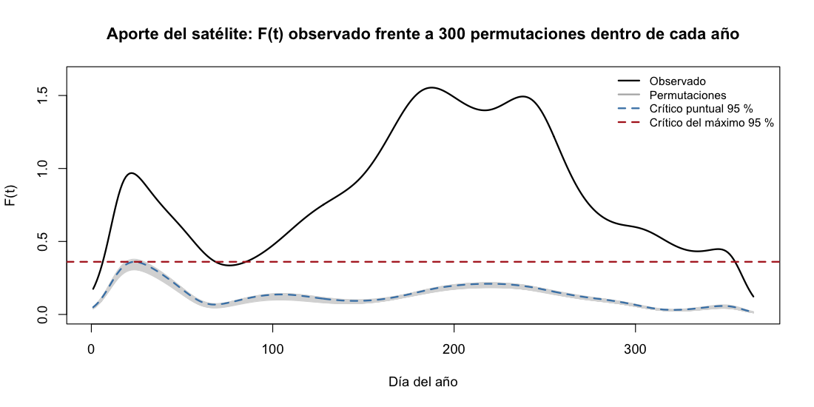

**Resultado** (`F5_permutacion_satelite.csv`, 300 permutaciones). El F(t) observado supera el crítico en los 365 días: F máximo 0,99 frente a un crítico de 0,56, con p = 0,003, el mínimo posible con 300 permutaciones. **El satélite aporta todo el año**, aunque menos que con las 176 estaciones (F máximo 1,49).

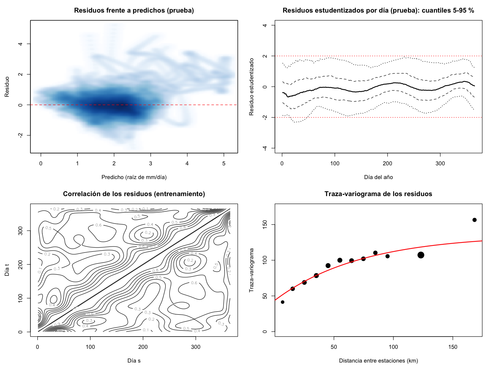

**Diagnóstico de residuos** (`F5_diagnostico_residuos.csv`).
- El 5,9 % de los residuos estudentizados de prueba está fuera de ±2 y el 0,4 % fuera de ±3: cerca de lo que daría una normal.
- Los residuos casi no se correlacionan con lo predicho (−0,06).
- La correlación de los residuos entre días es alta a corto plazo (0,71 a 30 días): son curvas suaves.

**Traza-variograma de los residuos** (Giraldo, Delicado y Mateu 2011; `F5_traza_variograma_residuos.csv`). Mide cuánto se parecen los residuos de dos estaciones según la distancia que las separa.
- Crece de 35 a menos de 10 km hasta unos 74 a 55 km, y luego se estabiliza.
- El ajuste exponencial (mínimos cuadrados ponderados, Cressie 1985) da una pepita de 6,5, una meseta parcial de 65 y un **rango práctico de 42 km**.
- **Queda correlación espacial** que el modelo no recoge: estaciones a menos de unos 40 km se equivocan parecido.
- Aquí se respeta con los IC por bootstrap de estaciones. Modelarla, por ejemplo con mínimos cuadrados generalizados, queda como trabajo futuro.

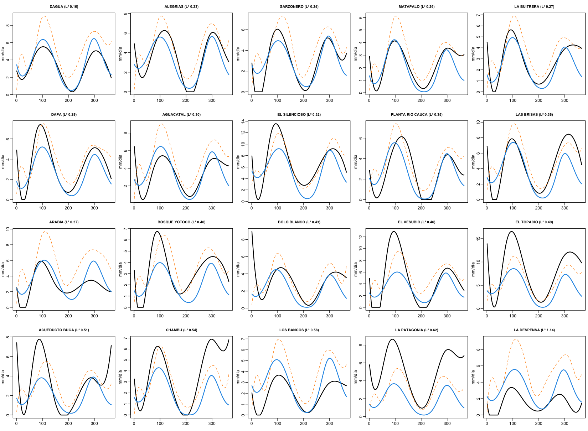

**Qué muestra.** Veinte estaciones de 2002, repartidas por cuantiles del error, cada una con la estación (negro), el satélite (naranja) y la regresión (azul). El título de cada panel da su error L² relativo.

**Qué muestra** (`F5_error_por_estacion_prueba.csv`). El tamaño de cada punto es el error de la regresión; el color, cuánto mejora frente al satélite.
- La regresión mejora en 66 de 97 estaciones.
- El error medio es 0,41 en el Cauca y 0,51 en el Pacífico (7 estaciones).

---

## 6. Regresión funcional concurrente (`regresion_concurrente.R`, de María)

### 6.1 Qué es "concurrente"

Es el ejercicio 3 del script de regresión funcional de clase. **Cada día t de la estación se explica solo con el mismo día t del satélite**:

- **Modelo A, el de clase:** y_i(t) = b0(t) + b1(t)·x_i(t) + error.
- **Modelo B:** agrega la altitud y el ONI, γ(t)·altitud_i + δ(t)·ONI_i.

**La diferencia con la sección 5:**
- En la de función a función, todo el año del satélite puede predecir cada día: β(s,t) es una superficie.
- En la concurrente solo cuenta la diagonal s = t: b1(t) es una curva.

Es un modelo más simple y más fácil de leer, porque dice en qué época del año el satélite sirve más.

**Cómo se ajusta.** b0 y b1 se escriben en una base B-spline de K_b funciones, con penalización de curvatura λ. El número de bases y λ se eligen con validación:
- modelo A: K_b = 8 y λ = 0;
- modelo B: K_b = 8 y λ = 10⁹.

Usa las mismas curvas en escala raíz, la misma partición y las mismas métricas que la sección 5. Pasa sus 10 pruebas, entre ellas que no hay fuga de datos y que las ecuaciones normales dan lo mismo que mínimos cuadrados directos. Además se contrastó con `fda::fRegress`: la diferencia del error de ajuste es del 0,02 %.

### 6.2 Qué dice b1(t)

**Qué muestra.** El intercepto b0(t) y el efecto del satélite b1(t), con bandas de ±2 EE.
- Si b1 = 1, la estación sube lo mismo que el satélite.
- Si b1 < 1, sube menos.

**Cifras** (`C3_R2_y_b1_por_mes.csv`).
- b1 vale unos 0,45 en abril y 0,38 en noviembre: en las temporadas de lluvia la estación sube mucho menos que el satélite.
- Vale unos 0,68 en julio y agosto, en la temporada seca, y 0,77 en enero.

**Interpretación.** El satélite exagera las variaciones de lluvia, sobre todo en las temporadas húmedas, y el modelo las amortigua. Es lo mismo que mostró la comparación (sección 4.1) y la integral de β (sección 5.4).

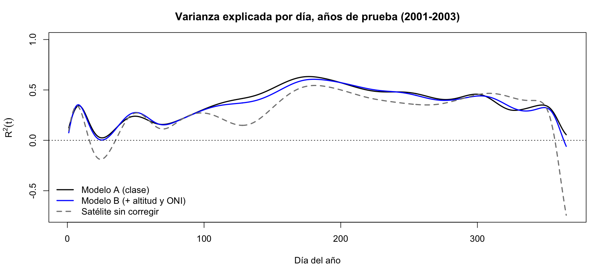

**Qué muestra.** R²(t), qué parte de la variación de la estación explica el modelo cada día de los años de prueba.

**Cifras.**
- Es mayor a mitad de año: 0,40 en junio y 0,34 en julio.
- Es casi 0 en enero.
- En noviembre el satélite solo explica algo más que el modelo (0,17 frente a 0,15).

### 6.3 Resultados en prueba y comparación con la de función a función

| Modelo | L² relativo | KGE | Sesgo anual | Error pico 1 | Error pico 2 |
|---|---|---|---|---|---|
| Satélite sin corregir | 0,52 | 0,39 | +28,8 % | 21,8 días | 17,1 días |
| Concurrente A (clase) | 0,41 | 0,49 | +7,2 % | 18,6 días | 18,7 días |
| Concurrente B (+ altitud y ONI) | 0,42 | 0,47 | **+6,0 %** | 19,4 días | 18,8 días |
| De función a función (sección 5) | **0,41** | **0,51** | +10,8 % | **16,2 días** | **16,7 días** |

Tablas: `C4_metricas_prueba.csv`, `C4_concurrente_vs_satelite_por_estacion.csv`, `F5_metricas_prueba.csv`.

**Interpretación.**
- **En error L² la concurrente empata con la de función a función.**
- **La de función a función gana en KGE y en los dos picos.** La concurrente tiene algo menos de sesgo anual.
- **Las dos concurrentes empeoran el segundo pico** frente al satélite sin corregir: 1,6 y 1,7 días, con IC que excluyen el 0. Al mirar solo el mismo día, no pueden corregir un retraso de la temporada.
- **Conclusión:** la concurrente sirve como contraste de clase y para leer b1(t) y R²(t). La de función a función sigue siendo la referencia.

**Las bandas de b1(t), corregidas** (`C2_bandas_sandwich_vs_bootstrap.csv`). Las bandas sándwich tratan cada curva como independiente. Al remuestrear estaciones con todos sus años (300 remuestreos), las bandas salen unas **2,3 veces más anchas**. Aun así:
- b1(t) excluye el 0 y el 1 los 365 días: el satélite siempre informa, y siempre exagera;
- b0(t) excluye el 0 en 337 días.

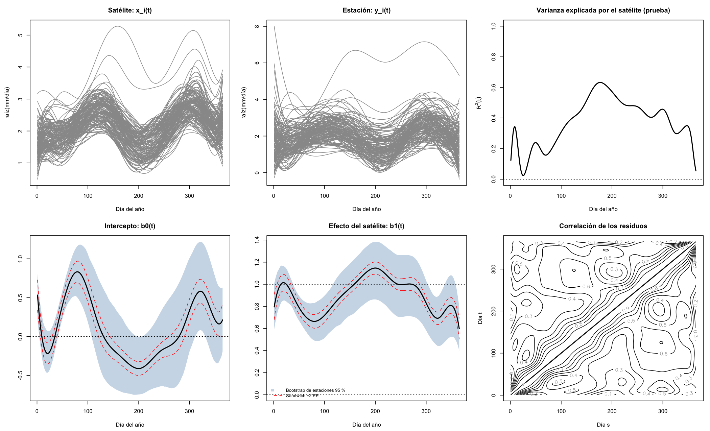

**Qué muestra.** La misma figura que la clase arma para el modelo concurrente, aquí con nuestros datos:
- arriba, las curvas del satélite x_i(t) y de la estación y_i(t), y R²(t) en prueba;
- abajo, b0(t) y b1(t) con las dos bandas (sombreada, bootstrap de estaciones; roja, sándwich) y la correlación de los residuos entre días.

### 6.4 El modelo concurrente año por año (descriptivo)

¿Cambia con el ENSO cuánto aporta el satélite? Para verlo, el modelo concurrente se ajusta **por separado en cada año**, con todas las estaciones de ese año:
- en cada día t se ajusta por mínimos cuadrados y_i(t) = b0(t) + b1(t)·x_i(t), en escala raíz;
- la banda es ±2 errores estándar punto a punto;
- una prueba automática verifica que coincide con `lm()` (diferencia < 10⁻¹⁰).

Es **descriptivo**: usa todos los años, incluidos validación y prueba, y no se usa para predecir ni para escoger nada. Un ajuste por año no sirve para predecir un año nuevo, porque necesita las estaciones de ese mismo año. Además, la banda supone estaciones independientes dentro del año; con la correlación espacial de los residuos (sección 5.9) es algo optimista.

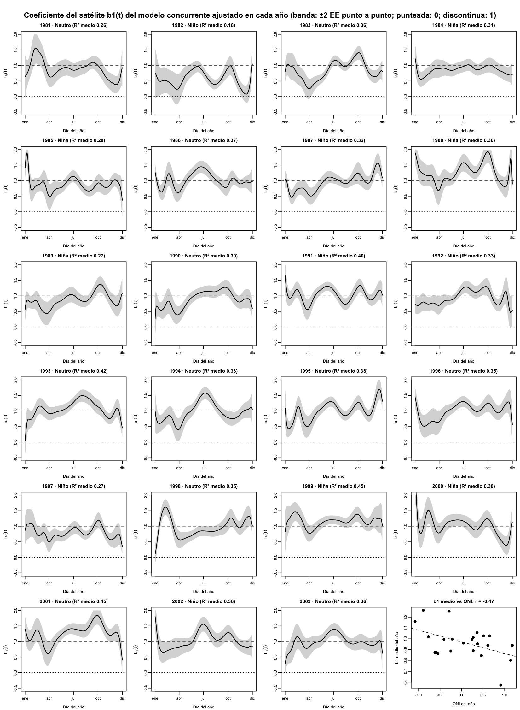

**Cómo se lee:**
- Cada panel es un año, con su fase ENSO y su R² medio en el título.
- La línea negra es b1(t) y la sombra gris su banda.
- La línea punteada es 0: debajo de ella, el satélite no informa.
- La discontinua es 1: en ella, la estación sube lo mismo que el satélite.
- El último panel cruza el b1 medio de cada año con el ONI.

**Cifras** (`C7_concurrente_por_anio.csv`):
- b1(t) excluye el 0 en 224 a 365 días según el año: el satélite informa casi siempre.
- El b1 medio va de 0,38 (1992, El Niño) a 0,85 (1999, La Niña).
- En promedio, b1 vale 0,59 en años Niña y neutros, y 0,51 en años Niño.
- **Con el ONI, r = −0,30 (p = 0,17): no es significativo.** Con 176 estaciones era −0,44 (p = 0,04).
- El R² medio va de 0,09 a 0,28 y tampoco depende del ONI (r = −0,08).

**Interpretación.** Hay una tendencia a que el satélite "aporte más" en La Niña: los dos b1 más altos son 1999 y 2000. Pero con 98 estaciones no alcanza a ser significativa, así que no se afirma. Donde sí se ve el ENSO con una prueba formal es en el error del satélite (ANOVA funcional, sección 4.4).

---

## 7. Pruebas automáticas de la parte funcional

Si una prueba falla, el script se detiene. Tabla: `F6_pruebas.csv`, con 15 de 15 pruebas que pasan. La evaluación de la red pasa sus 5 (`F7_pruebas_red.csv`).

| Prueba | Qué protege |
|---|---|
| El emparejamiento es el mismo del archivo de datos | Que las dos partes usen los mismos pares |
| Ningún año queda fuera del modelo | La indicación del profesor (D-47) |
| La base propia coincide con `splines::splineDesign` | La construcción sin librerías (rúbrica 1) |
| S es simétrica e idempotente, y tr(S) = K | Las propiedades que pide la rúbrica |
| W integra el dominio: 1ᵀW1 = 364 | Las integrales de la red |
| La media paso a paso coincide con `fda::mean.fd` | La verificación que pide la rúbrica 2 |
| Las atípicas coinciden con `fda::fbplot` | El boxplot programado |
| Las funciones propias son ortonormales con W | El FPCA |
| Sin fuga: alterar validación y prueba no cambia K, FPCA, escalas ni B | Que la prueba no se use para ajustar |
| Equivalencia de β(s,t) con los puntajes FPCA (≤ 10⁻⁴) | La rúbrica 4.2 |
| La reconstrucción en mm no es negativa | La rúbrica 4.2 |
| Bootstrap con al menos 1 000 remuestreos | Los IC de la rúbrica 4.4 |
| SSE_n = (n − k) tr(γ̂) y, con k = 2, F(t) = t² | El ANOVA funcional (sección 4.4) |
| Réplicas mínimas de bootstrap y permutación | Las bandas y las pruebas por permutación (secciones 4.4, 5.4 y 5.9) |
| El contraste de clase está bien armado | Que la comparación con los métodos de clase sea justa |

La prueba "F pareada con curvas constantes = t²" se quitó junto con la prueba t pareada.

---

## 8. Lo que falta o hay que cuidar

1. **La zona pacífica tiene 7 estaciones.** Es el costo de la regla de la OMM (R6). Todo resultado del Pacífico describe a esas 7 estaciones y no a toda la vertiente. Hay que confirmar con el profesor que acepta esta consecuencia de la norma.
2. **El aporte del satélite es moderado.** Sin satélite, solo con altitud y ONI, el error L² es 0,44, frente a 0,41 de la regresión. La permutación confirma que el satélite aporta (p = 0,003), pero hay que decirlo con esa medida.
3. **Fourier frente a B-spline:** la comprobación de la sección 2.7 está en un script aparte y con la muestra anterior. Hay que pasarla al R para que quede respaldada en el código.
4. **Correlación espacial de los residuos:** el traza-variograma (sección 5.9) muestra que queda, con un rango de unos 42 km. Se respeta con IC por bootstrap de estaciones; modelarla queda como trabajo futuro.
5. **El segundo pico:** ninguna regresión lo mejora de forma significativa, y la concurrente lo empeora. Hay que decirlo así en el informe.
6. **La Niña:** la prueba no tiene años Niña. Lo que se diga de La Niña sale de la validación y es orientativo.
7. **¿Qué R se edita?** Hay cuatro archivos: `lluvia_valle_datos.R`, `lluvia_valle_funcional.R`, el unido `lluvia_valle.R` y `regresion_concurrente.R`. Hay que decidir cuál es el definitivo para que las copias no se desincronicen.
8. **Pregunta para la asesoría:** el ejercicio 3 de la clase de inferencia aplica la prueba F pareada a satélite contra estación. ¿Qué diferencia ve el profesor con nuestro caso? (`docs/FUNDAMENTOS_REGLAS.md`, 5.3)
