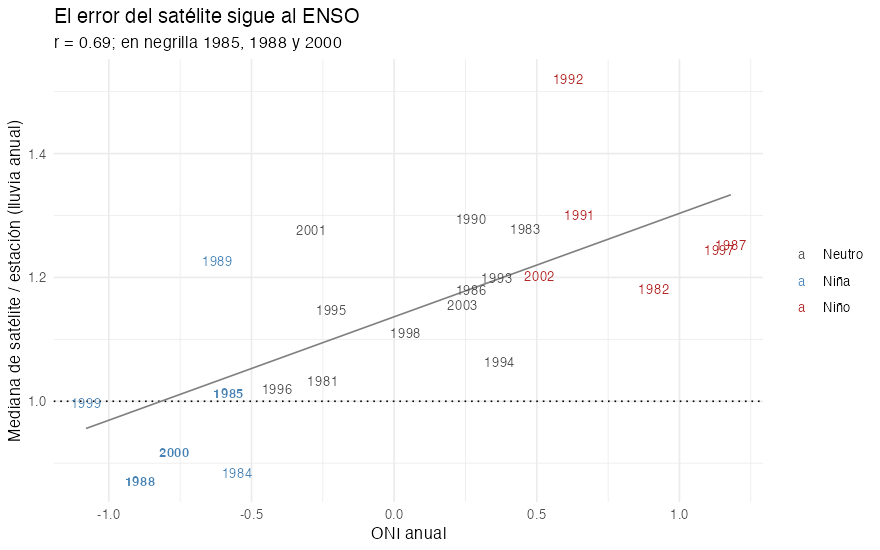
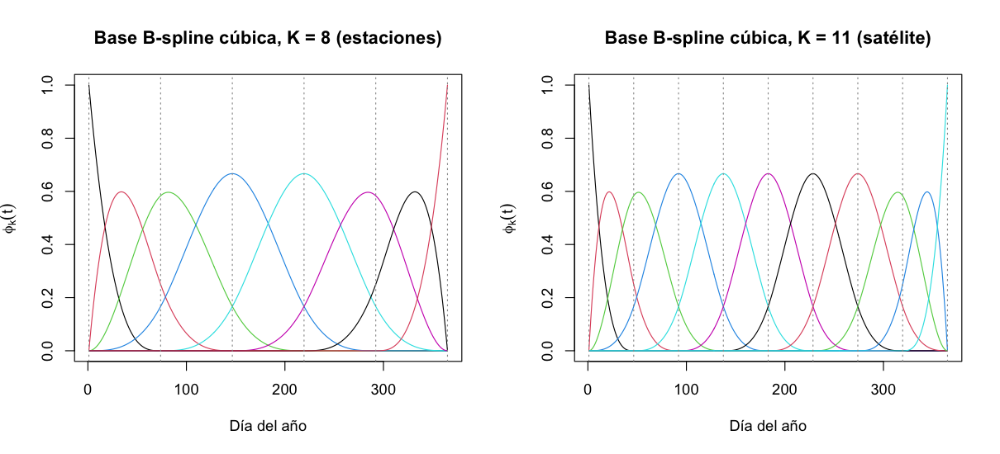
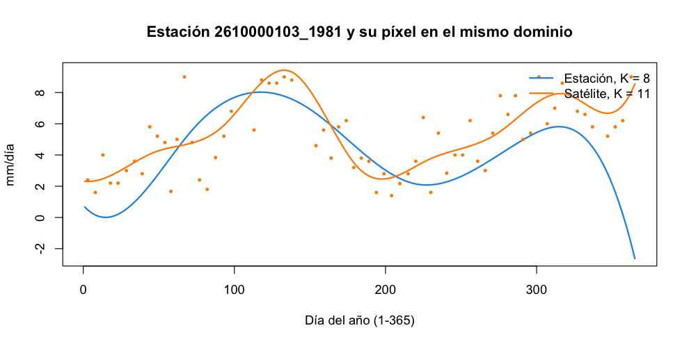
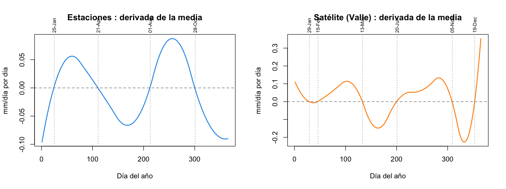
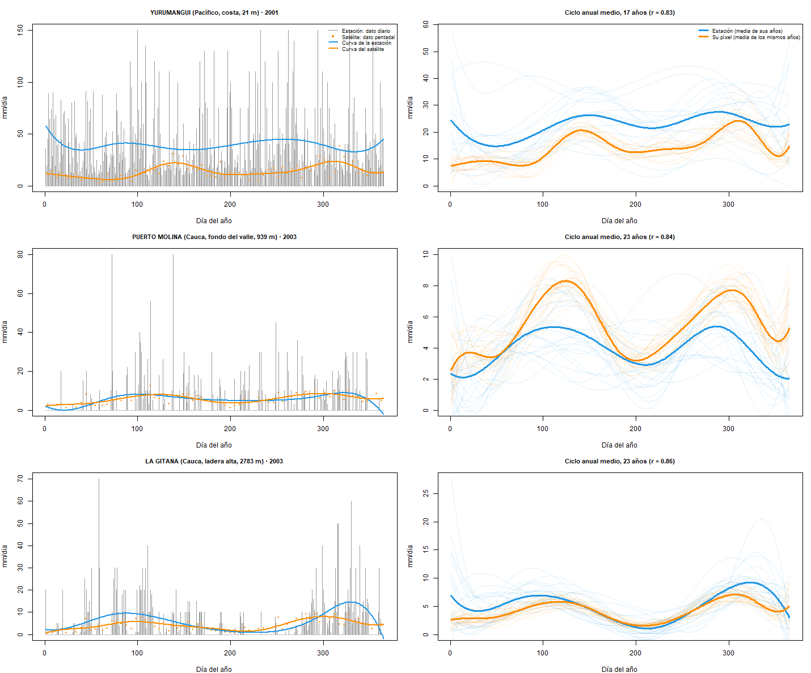
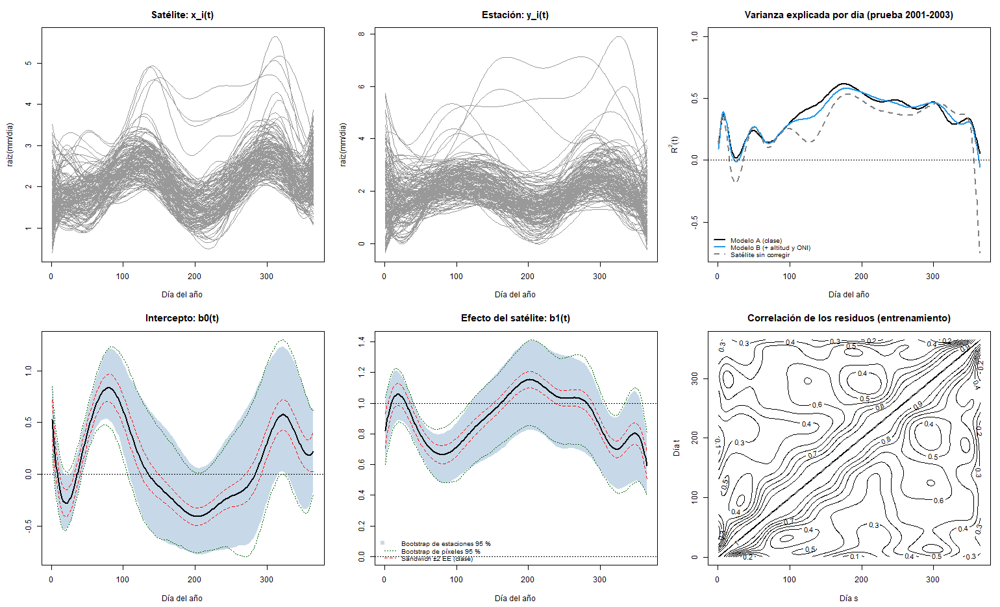
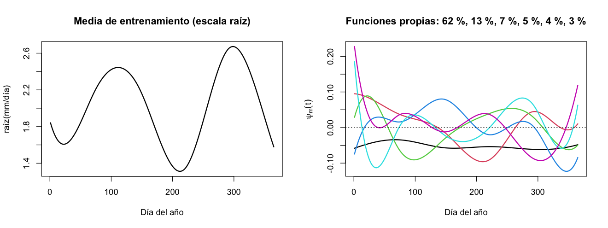
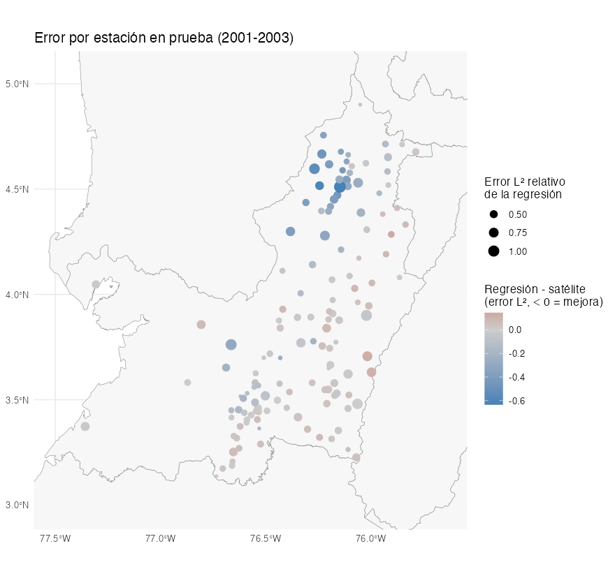

# Qué sale de la parte funcional y cómo se interpreta

Este documento sigue donde termina `EXPLICACION_DATOS.md`. Aquella explica el EDA de los datos diarios (`lluvia_valle_datos.R`). Esta recorre lo que viene después:

- la **reconstrucción**: pasar de 365 datos diarios a una curva;
- el **EDA funcional**;
- la **comparación** entre estaciones y satélite;
- la **regresión funcional**: la concurrente de clase (para comparar las fuentes) y la de función a función (la referencia lineal de la red).

Para cada paso explica qué muestra cada tabla y gráfica, qué significa y qué decisión sale de ahí. Sirve para estudiar y para defender esta parte en la sustentación.

- **Dónde está el código:**
  - las secciones 1 a 6 de `lluvia_valle_funcional.R`;
  - el archivo unido `lluvia_valle.R` tiene las mismas secciones, idénticas salvo los encabezados de rúbrica, desde su línea 1458;
  - la regresión concurrente es la sección 4.4 del mismo archivo (antes estaba aparte en `regresion_concurrente.R`, D-60).
- **Las cifras** son de la corrida del 19-nov-2026:
  - `lluvia_valle_funcional.R` pasa sus 17 pruebas;
  - incluyen lo que se agregó a partir del material del profesor (D-57, `docs/BASE_CONOCIMIENTO_PROFESOR.md`) y los cambios de la asesoría del 19-nov (D-60): sin vista acumulada, sin t pareada y con la regresión concurrente en la comparación.
- **Salidas:** gráficas en `salidas_R_funcional/graficos/` y tablas en `salidas_R_funcional/tablas/`, con prefijos F1 a F6. Las de la concurrente llevan el prefijo `F4_concurrente_`.
- **Decisiones:** las D-xx están en `DECISIONES.md`.
- **Conceptos:** la guía de estudio (curva, base, matriz W, FPCA y demás) explica cada concepto con ejemplos.

> **Recordatorio.** "Cauca (interandina)" y "Pacífico" son las dos vertientes **dentro del Valle del Cauca**, según la cuenca de la CVC. No son departamentos.

## Resumen en una tabla

| Paso | Rúbrica | Qué se hace | Resultado clave | Sección del R |
|---|---|---|---|---|
| Emparejar | 3 | Cada estación toma el píxel del satélite que la contiene | 176 estaciones en 148 píxeles; 3 299 pares estación–año | 1 |
| Reconstruir | 1 (10 %) | B-splines cúbicas y mínimos cuadrados, sin librerías | K = 8 en estaciones y K = 11 en satélite, elegidos con VC y VCG | 2 |
| EDA funcional | 2 (15 %) | Media, varianza, covarianza, derivadas, profundidad y boxplot | Régimen bimodal; el 74 % de la varianza es diferencia entre sitios | 3 |
| Comparar fuentes | 3 (15 %) | d(t) con banda, correlación cruzada, por vertiente, altitud y ENSO | El satélite arranca tarde la primera temporada, exagera los picos y amortigua el ENSO | 4 |
| Regresión concurrente | 3 | y(t) = b0(t) + b1(t)·x(t), ejercicio 3 del script de clase | El satélite explica mejor a la estación de mayo a octubre; en las temporadas lluviosas conviene encoger su señal | 4.4 |
| ANOVA funcional | 3 | F, GPF y F_max de la clase, por permutación | El error del satélite depende del ENSO, la vertiente y la altitud | 4.5 |
| Regresión de función a función | 4.2 y 4.4 | β(s,t) con FPCA de entrenamiento y penalización | En prueba, el error L² relativo baja de 0,51 a 0,44 y el sesgo anual de +26 % a +7 % | 5 |
| Concurrente frente a función a función | 4.4 | Las dos en las mismas curvas de prueba | Empatan en L² y KGE; la de función a función gana en sesgo y en el segundo pico | 5.5c |

---

## 1. Datos y emparejamiento estación–píxel

**De dónde vienen los datos.** Todo sale de `salidas_R_datos/datos_preparados.rds`, que deja el archivo de datos. No se vuelve a leer el satélite.
- 3 299 curvas estación–año de 176 estaciones: 2 257 de entrenamiento (1981–1995), 672 de validación (1996–2000) y 370 de prueba (2001–2003). De ellas, 2 812 no tienen ningún día faltante.
- 15 663 curvas píxel–año: 681 píxeles por 23 años. Para el EDA se usan los 676 píxeles del Valle.

**Emparejamiento.** Cada estación toma la celda de 0,05° del satélite que contiene su coordenada, y una prueba comprueba que de verdad cae dentro.
- Las 176 estaciones caen en 148 píxeles.
- 23 píxeles tienen de 2 a 4 estaciones (51 estaciones en total), que comparten la misma curva satelital.
- El centro del píxel queda a 2,2 km de la estación en mediana, y nunca a más de 3,9 km.

**Vertiente de cada píxel.** Los píxeles no traen la cuenca de la CVC, así que hay que asignársela con alguna regla. Se compararon dos dejando una estación fuera cada vez:

| Regla | Acierta |
|---|---|
| Corte en la longitud −76,8° (la que se usaba) | 88,6 % |
| El mejor corte en longitud posible | 89,2 % |
| La vertiente de la estación más cercana | **97,7 %** |

Tabla: `F1_regla_vertiente_pixeles.csv`. El corte en longitud dejaba como "Cauca" a 20 de las 26 estaciones del Pacífico: las de las cuencas del Dagua, el Calima y el Garrapatas, sobre la cordillera Occidental. **Decisión:** se usa la estación más cercana. Así las dos fuentes tienen una sola definición de vertiente.

**Qué muestra.** Cada punto es un año. El eje x es el ONI, y el eje y el cociente satélite/estación de la lluvia anual.

**Cifras.**
- La correlación es r = 0,68.
- El cociente medio es 0,99 en años Niña, 1,16 en neutros y 1,29 en años Niño.
- Los cinco cocientes más bajos son 1988, 1984, 2000, 1999 y 1996: cuatro de ellos son años Niña.

**Interpretación.** 1985, 1988 y 2000 no son archivos dañados del satélite. Son un error sistemático ligado al ENSO: en La Niña el satélite se queda corto y en El Niño se pasa. 1984 y 1999 se apartan igual y nunca se marcaron.

**Decisión.** No se excluye ningún año (D-47, lo pidió el profesor). El modelo recibe el ONI para que aprenda a corregir ese error.

---

## 2. Reconstrucción: de datos diarios a curvas (rúbrica 1)

### 2.1 La idea

**Qué muestra.**
- **A la izquierda**, la lluvia diaria de una estación en un año: muchos días en 0 y aguaceros sueltos.
- **A la derecha**, su píxel del satélite el mismo año: 72 péntadas (promedios de 5 días), cada una puesta en su día central.

Las dos fuentes tienen resoluciones distintas. La reconstrucción las pone a las dos como **curvas en el mismo dominio**, del día 1 al 365. Así se pueden sumar, restar, integrar y comparar.

**Cómo se hace.** La curva de cada año se escribe como una suma de K funciones base fijas, cada una multiplicada por un coeficiente:

x(t) = c₁ φ₁(t) + … + c_K φ_K(t)

- Las bases φ_k son **B-splines cúbicas**: polinomios de grado 3 por tramos, pegados sin saltos ni "codos".
- Toda la curva de un año queda guardada en K números, los coeficientes c.
- Las unidades son mm/día.

### 2.2 La base, programada sin librerías

**Qué muestra.** Las 8 funciones base de las estaciones (izquierda) y las 11 del satélite (derecha). Cada una es una "colina" que sube desde 0, llega a un pico y vuelve a 0. Las líneas verticales son los nodos, donde se pegan los tramos. Con más bases las colinas son más estrechas y la curva puede seguir detalles más finos.

**Cómo se calcula.** Con la recursión de Cox–de Boor (funciones `nodos` y `base_en_nodos`): se empieza con funciones escalón y cada orden se arma promediando dos funciones del orden anterior.

**Verificaciones** (sección 2 y pruebas de la sección 6):
- La base propia coincide con `splines::splineDesign` con una diferencia de 3 × 10⁻¹⁶. La librería solo se usa para comprobar.
- En cada día las bases suman 1 y ninguna es negativa. Se comprueba con K = 6, 8, 11, 20 y 40.

**Con K = 8** (estaciones), los nodos interiores caen el 15 de marzo, el 27 de mayo, el 7 de agosto y el 19 de octubre. El año queda partido en 5 tramos.

### 2.3 Los coeficientes por mínimos cuadrados

Se arma la matriz Φ (365 × K), donde cada fila es un día y cada columna una base. Los coeficientes son los que dejan la curva lo más cerca posible de los datos:

ĉ = (ΦᵀΦ)⁻¹ Φᵀ y   y   ŷ = S y, con S = Φ (ΦᵀΦ)⁻¹ Φᵀ

**Verificación de S** (`F2_controles_S.csv`). La rúbrica pide comprobar tres propiedades:

| Fuente | K | Simetría, máx. ∣S − Sᵀ∣ | Idempotencia, máx. ∣SS − S∣ | ∣tr(S) − K∣ |
|---|---|---|---|---|
| Estaciones | 8 | 1 × 10⁻¹⁶ | 9 × 10⁻¹⁶ | 1 × 10⁻¹⁴ |
| Satélite | 11 | 8 × 10⁻¹⁷ | 2 × 10⁻¹⁶ | 2 × 10⁻¹⁵ |

Todas son cero hasta el error de redondeo del computador. También se cumplen en las curvas con días faltantes, que tienen cada una su propia S.

**Días faltantes.** No se imputan. Cada curva se ajusta solo con sus días observados: se quitan esas filas de Φ y de y. El archivo de datos ya garantiza que ningún año aceptado tiene un hueco de más de 15 días (regla R5).

### 2.4 Cuántas bases: elegir K

**Qué muestra.** Los tres criterios de clase en función de K, arriba para estaciones y abajo para satélite. Se calculan solo con las curvas completas de entrenamiento: 1 882 de estación y 10 215 de satélite.
- **ECM:** el error de ajuste. Siempre baja al subir K, así que no sirve para elegir.
- **VC:** el error al dejar un día fuera. Se calcula con el atajo de la diagonal de S, y se comprobó que da lo mismo que hacer los 365 ajustes.
- **VCG:** la validación cruzada generalizada.

**Cifras** (`F2_K_elegido.csv`).
- VC y VCG coinciden: **K = 8 en estaciones y K = 11 en satélite**.
- En el satélite el mínimo es nítido.
- En estaciones la VC es casi plana: cualquier K entre 5 y 17 queda a menos de 1 % del mínimo. La lluvia diaria es tan ruidosa que más bases solo persiguen aguaceros.

**Sensibilidad** (`F2_sensibilidad_K_estaciones.csv`). Como la VC es plana, se probó qué cambia con más bases:

| K | VC sobre el mínimo | Pico 1 (mediana) | Pico 2 (mediana) | Puntos negativos |
|---|---|---|---|---|
| **8** | 0 % | 18 abr | 25 oct | 2,0 % |
| 12 | 0,4 % | 27 abr | 28 oct | 2,1 % |
| 16 | 0,9 % | 23 abr | 29 oct | 3,3 % |
| 24 | 2,1 % | 18 abr | 24 oct | 5,4 % |

- La fecha de los picos se mueve a lo sumo 9 días.
- Eso es mucho menos que la dispersión entre curvas: el rango intercuartílico de la fecha del pico es de 29 a 45 días.
- Lo que sí sube con K son los valores negativos.

**P-20 (D-51).** Se probó también elegir K comparando la fecha del pico con una media móvil de los datos. El K que gana depende del ancho de la media móvil:
- con 15 o 31 días gana K = 20;
- con 61 días gana K = 10.

Las referencias difieren entre sí tanto como lo que se gana subiendo K, así que la fecha del pico no sirve para elegir K.

**Decisión.** K = 8 y K = 11, el mínimo de la VCG.

### 2.5 Residuos y bandas de confianza

**Qué muestra.** La curva de una estación con su banda de ±2 errores estándar, su píxel con la suya, y una curva con 15 días faltantes (la marca roja).

**Cifras** (consola y `F2_varianza_error_estaciones.csv`).
- **El error no es igual todo el año.** Su varianza va de 26 (mm/día)² el 11 de agosto a 264 el 17 de octubre, la temporada húmeda. Por eso se dibujan dos bandas: con σ² constante y con σ²(t).
- **Los residuos de días seguidos casi no se correlacionan** (0,04 en general y 0,08 a un día; gráfica `F2_covarianza_residual.png`). Eso justifica la banda con σ²I. En el satélite la correlación es mayor (0,14), porque cada péntada ya promedia cinco días.
- Un hueco de 15 días ensancha la banda solo un 15 % en esos días.

**Interpretación.** Las bandas son **punto a punto**: cada día tiene 95 % de cobertura por separado, no la curva completa.

### 2.6 Valores negativos y efecto de borde

**Cifras** (`F2_valores_negativos.csv`).

| Fuente | Puntos negativos | Curvas con algún negativo | Mínimo |
|---|---|---|---|
| Estaciones | 1,9 % | 46,9 % | −12,0 mm/día |
| Satélite | 0 % | 1 % | −0,5 mm/día |

**Interpretación.** Los negativos aparecen en dos lugares:
- en la temporada seca de julio–agosto, donde la curva baja cerca de 0;
- en los bordes, el 1 de enero y el 31 de diciembre. Ahí la curva tiene datos de un solo lado y depende de un solo coeficiente: es el **efecto de borde** de una base que no es periódica.

**Decisión.** Para modelar, la curva se recorta en 0 (D-23). Se documenta como costo de la base.

### 2.7 ¿Por qué B-splines y no Fourier?

Fourier arma la curva con senos y cosenos, y obliga a que el 31 de diciembre empalme con el 1 de enero.

**Razones del código** (sección 2 y D-47):
- el enunciado exige B-splines para X(t) y para w_k(t) en el codificador de la red;
- el ejemplo de clase con esta misma lluvia usa B-splines cúbicas;
- una curva de un solo año no es periódica.

**Comprobación con los datos.** Se hizo el 16-nov-2026 con un script aparte y **todavía no está en el R**. Se ajustaron las 1 882 curvas completas de entrenamiento con las dos bases:

| | B-spline, K = 8 | Fourier, K = 7 |
|---|---|---|
| VC en todo el año | 105,2 | 105,0 |
| VC en los bordes, en el 25 % de curvas con enero y diciembre muy distintos | 161,2 | 165,7 |
| Curvas que bajan de 0 en los bordes | 34 % | 3 % |

- **Ajustan igual.** Fourier incluso tiene menos efecto de borde.
- **Pero un año no es periódico.** La lluvia del 1 al 15 de enero y la del 17 al 31 de diciembre del mismo año solo se correlacionan 0,54. En la climatología, el promedio de muchos años, la correlación sube a 0,97: ese es el caso en que Fourier es natural, como la temperatura de Canadá en clase.

**Conclusión.** La B-spline se queda porque el enunciado la exige, porque un año no es periódico y porque es local: un aguacero en abril casi no mueve la curva en octubre. El costo es el efecto de borde, que se maneja recortando en 0. Esta comprobación debería pasar al R para que quede respaldada en el código.

### 2.8 La matriz de Gram W

W = ∫ φ(t) φ(t)ᵀ dt permite calcular integrales con los coeficientes. Por ejemplo, ∫ x(t) y(t) dt = c_xᵀ W c_y. La red la necesita para z = A W c.
- Se calcula por cuadratura de Gauss–Legendre: 4 puntos en cada tramo entre nodos, lo que es exacto para estos polinomios.
- **Verificaciones:** 1ᵀW1 = 364, que es la longitud del dominio, y cᵀWc coincide con la regla del trapecio en una malla fina.

**Qué muestra.** Una estación (K = 8) y su píxel (K = 11), ya como curvas, en el mismo dominio de 1 a 365. A partir de aquí las dos fuentes se pueden comparar día a día. Se ve también el efecto de borde: la curva de la estación baja a −2,6 mm/día el 31 de diciembre, y por eso se recorta en 0.

---

## 3. EDA funcional (rúbrica 2)

**Qué se usa.** Las 176 estaciones con sus 3 299 curvas de 1981–2003, sin submuestrear, y los 676 píxeles del Valle en los 23 años. La sección 8 del archivo de datos muestra que las estaciones incluidas representan a las 220 con datos. Esto evita el tope de la rúbrica por analizar solo un subconjunto.

### 3.1 Media, varianza y desviación estándar

**Qué muestra.** Las curvas en gris, la media en color y la banda de ±2 DE en rojo, para estaciones y para satélite. Luego, la desviación estándar funcional de las dos fuentes. A la derecha, el **coeficiente de variación funcional** CV(t) = DE(t)/media(t), que la clase usa para comparar fuentes con niveles distintos.

**Cómo se calcula.** La media es la base por el promedio de los coeficientes: x̄(t) = Φ(t) c̄. Se verifica contra `fda::mean.fd` con una diferencia de 3 × 10⁻¹⁵ (`F3_verificacion_media.csv`).

**Cifras** (`F3_extremos_de_la_media.csv`, `F3_dispersion_resumen.csv`).

| | Estaciones | Satélite |
|---|---|---|
| Primer máximo | 22 abr, 6,3 mm/día | 13 may, 10,7 mm/día |
| Segundo máximo | 28 oct, 7,2 mm/día | 5 nov, 12,3 mm/día |
| Mínimo de mitad de año | 1 ago, 2,2 mm/día | 20 jul, 4,6 mm/día |
| Coeficiente de variación medio | 0,96 | 0,61 |

**Interpretación.**
- **Las dos fuentes muestran el régimen bimodal:** dos temporadas de lluvia (abril–mayo y octubre–noviembre) y dos secas.
- **El satélite pone los picos de 1 a 3 semanas después y con casi el doble de magnitud.** Su media pesa por área, y el 43 % de los píxeles es de la vertiente Pacífica, donde llueven unos 4 000 mm/año. Por vertiente, el satélite supera a las estaciones en las dos: 1 735 frente a 1 551 mm/año en el Cauca, y 3 998 frente a 3 105 en el Pacífico.
- **La variación entre curvas es tan grande como la media** (CV de 0,96 en estaciones).
- **La DE de las estaciones** es alta en la segunda temporada y mínima el 27 de febrero. El máximo del 1 de enero (5,9) es efecto de borde, no un hecho del clima.

### 3.2 Covarianza y correlación

**Qué muestra.** La correlación entre la lluvia del día s y la del día t, después de restar a cada curva la media de su estación (anomalías). Las superficies sin restar están en `F3_covarianza_estaciones.png`, `F3_correlacion_estaciones.png` y sus equivalentes del satélite.

**Cifras** (`F3_covarianza_por_vertiente_y_anomalias.csv`).

| Grupo | 1.ª componente | Correlación abril–octubre | Correlación mínima |
|---|---|---|---|
| Estaciones, todas | 76 % | 0,74 | 0,39 |
| Estaciones del Cauca | 50 % | 0,54 | −0,14 |
| Estaciones, anomalías por estación | 29 % | 0,14 | −0,27 |
| Satélite, todos los píxeles | 88 % | 0,83 | 0,43 |

**Interpretación.**
- Con todas las estaciones juntas, todo se correlaciona positivamente y una sola componente explica el 76 %. Eso es sobre todo **el nivel de lluvia de cada sitio**: el 74 % de la varianza de las estaciones, y el 88 % de la del satélite, es diferencia *entre* sitios.
- Al quitar el nivel de cada estación queda la variación de un año a otro. Ahí la primera componente baja a 29 % y abril y octubre casi no se relacionan (0,14).
- **En palabras:** un sitio húmedo es húmedo todo el año, pero un año con una primera temporada lluviosa no anuncia una segunda temporada lluviosa.

### 3.3 Derivadas y temporadas de lluvia

**Qué muestra.** La primera derivada de la media, es decir, la velocidad a la que cambia la lluvia.
- Donde es positiva, la lluvia sube; donde es negativa, baja.
- Donde cruza el 0 hay un máximo o un mínimo de la curva.

La derivada se calcula derivando la base: D x(t) = Σ c_k Dφ_k(t).

**Cifras** (`F3_temporadas_fechas.csv`, curvas medias).

| Momento | Estaciones del Cauca | Satélite en el Cauca |
|---|---|---|
| Inicio de la 1.ª temporada | 28 feb | 18 mar |
| Pico de la 1.ª temporada | 14 abr | 2 may |
| Fin de la 1.ª temporada | 14 jun | 11 jun |
| Inicio de la 2.ª temporada | 15 sep | 25 sep |
| Pico de la 2.ª temporada | 1 nov | 3 nov |

**Interpretación.**
- **El satélite fecha el inicio y el pico de la primera temporada 2 a 3 semanas tarde.**
- La gráfica `F3_temporadas_por_curva.png` hace lo mismo curva por curva. En el 62 % de las curvas de estación la lluvia sigue bajando hasta el borde del año, así que el fin de la segunda temporada no se puede fechar en ellas.

### 3.4 Profundidad, boxplot funcional y curvas atípicas

**Profundidad.** Mide qué tan "central" es una curva dentro del grupo. Se usan las dos de clase:
- **Fraiman–Muniz (FM)**, que promedia la profundidad de cada día;
- **MBD**, que cuenta cuántas veces la curva queda entre otras dos.

Las dos ordenan casi igual (Spearman 0,99 y 1,00). La curva más profunda, la mediana funcional, es **Betania 2002**. Gráfica: `F3_centralidad.png`.

**Qué muestra.** El boxplot funcional:
- **región central**, en morado: el 50 % de las curvas más profundas;
- **bigotes**, en azul: 1,5 veces esa región;
- **curvas atípicas**, en rojo: las que se salen de los bigotes.

Arriba están las estaciones (todas, Cauca y Pacífico) y el satélite; abajo, las curvas medias de cada año. Las atípicas coinciden con las de `fda::fbplot`, y hay una prueba automática que lo verifica.

**Cifras** (`F3_atipicas_*.csv`, `F3_profundidad_anual.csv`).
- **Estaciones todas juntas:** 63 curvas atípicas. 62 son de cinco estaciones de la costa Pacífica (Bahía Málaga, Yurumanguí, San Francisco, Triana y El Tabano), con 7 000 a 12 600 mm/año.
- **Por vertiente:**
  - en el Cauca solo quedan 2 atípicas, Tenjo 1982 (4 482 mm/año, candidata a revisión) y Las Brisas 1981;
  - en el Pacífico quedan 44.
- **Satélite:** 330 atípicas. Todas son del Pacífico, y 229 tocan el tope de 200 mm por péntada.
- **Años:** ninguna curva media anual es atípica. Los años menos profundos de las estaciones son 1988, 1984, 1983 y 1999, tres de ellos Niña.

**Interpretación.** Las atípicas del Pacífico no son errores: son otro clima. Por eso el boxplot se separa por vertiente.

### 3.5 Contexto climático: vertiente, altitud y ENSO

**Qué muestra.** La media por vertiente, la de las estaciones del Cauca por franja de altitud y la de esas mismas estaciones por fase ENSO.

**Cifras** (`F3_contexto_vertiente_altitud_ENSO.csv`, `F3_picos_por_fase_ENSO.csv`).

| Grupo (estaciones del Cauca) | Lluvia anual |
|---|---|
| Menos de 1 200 m (fondo del valle) | 1 333 mm |
| 1 200 a 2 000 m | **1 715 mm** |
| Más de 2 000 m | 1 607 mm |
| Años neutros | 1 544 mm |
| Años Niña | 1 718 mm (+11 %) |
| Años Niño | 1 387 mm (−10 %) |

**Interpretación.**
- **Orografía:** las laderas medias son lo más lluvioso del Cauca, más que el fondo del valle y más que lo alto. Por eso la altitud entra al modelo.
- **La Niña se nota en la segunda temporada** (7,1 frente a 6,3 mm/día) y en una sequía de mitad de año más húmeda (2,4 frente a 1,4 mm/día).
- **El satélite no muestra la señal ENSO:** da menos lluvia en años Niña (1 664 mm) que en neutros (1 767). Si se quitan 1985, 1988 y 2000, el satélite pasa a dar 1 838 mm en La Niña. Es el mismo error ligado al ENSO de la sección 1, y la razón para darle el ONI al modelo.

### 3.5b Año por año, como en la tesis del profesor

En su tesis, el profesor presenta casi todo **en paneles, uno por año** (figuras 5.8, 6.2, 6.3 y 9.2): las curvas en gris, el promedio en negro y la desviación estándar punteada, con el mismo eje en todos los paneles. Aquí se hace igual con nuestras curvas (mm/día, 1981–2003). El título de cada panel lleva la fase ENSO del año.

**Cómo se lee:**
- Cada panel es un año.
- Las líneas grises son las curvas de ese año: una por estación, o una por píxel del Valle en la del satélite.
- La línea negra es el promedio y la punteada la desviación estándar.
- Como todos los paneles tienen el mismo eje, se compara un año con otro mirando la altura de la línea negra.

**Cifras** (`F3_por_anio_resumen.csv`):
- **Estaciones:** los años más lluviosos son de La Niña: 1999 (2 204 mm), 1984 (2 145) y 1988 (2 129). Los más secos son de El Niño: 1992 (1 379) y 1997 (1 532). La lluvia anual media de las estaciones tiene correlación **−0,62** con el ONI.
- **Satélite:** sus años más secos son 1985, 1988 y 2000, los tres de La Niña. Su correlación con el ONI es **+0,47**, al revés que las estaciones.
- El satélite promedia todos los píxeles del Valle, y el 43 % son de la zona pacífica. Por eso su nivel no se compara directamente con el de las estaciones; lo que se compara es **cómo cambia de un año a otro**.

**Interpretación.** La gráfica por año deja ver lo que las medias de todo el periodo esconden. La forma bimodal se repite casi todos los años, pero su altura cambia con el ENSO, y el satélite responde al revés que las estaciones. Es la razón, ya vista en el EDA de datos, para darle el ONI al modelo.

### 3.6 Lista de la rúbrica 2

| La rúbrica pide | Dónde está |
|---|---|
| Media calculada paso a paso y verificada contra la librería | 3.1: `F3_verificacion_media.csv` (3 × 10⁻¹⁵ frente a `fda::mean.fd`) |
| Varianza y desviación estándar funcional | 3.1: `F3_media_y_dispersion.png`, `F3_dispersion_resumen.csv` |
| Covarianza y correlación de cada fuente | 3.2: superficies `F3_covarianza_*` y `F3_correlacion_*` |
| Derivadas e inicio y fin de las temporadas | 3.3: `F3_derivada_media.png`, `F3_temporadas_*.csv` |
| Profundidad FM y MBD, boxplot y atípicas por estación y año | 3.4: `F3_centralidad.png`, `F3_boxplot_funcional.png`, `F3_atipicas_*.csv` |
| Interpretación climatológica (bimodal, orografía, ENSO) | 3.1 a 3.5 |
| Sin subconjuntos sin justificar | Se usan todas las estaciones y todos los años |

---

## 4. Comparación funcional por fuente (rúbrica 3)

**Pares.** 3 299 pares estación–año y píxel–año: 176 estaciones en 148 píxeles, todos los años.

**El error estándar se calcula entre estaciones.** Primero se promedia cada estación y luego se compara entre estaciones. Así el EE sale 3,7 veces más grande que si cada curva fuera independiente, porque los años de una misma estación repiten su sesgo. Usar el EE ingenuo daría bandas falsamente estrechas.

### 4.1 La diferencia media d(t)

**Qué muestra.**
- **A la izquierda**, la media de las estaciones y la de sus píxeles.
- **A la derecha**, la diferencia d(t) = estación − satélite, con su banda de ±2 EE. Las marcas rojas abajo son los días en que la banda excluye el 0. La línea roja discontinua es la diferencia solo en 1985, 1988 y 2000.

**Cifras** (`F4_intervalos_diferencia.csv`).

| Tramo | Días | Quién da más |
|---|---|---|
| 8 feb – 28 mar | 49 | La estación: el satélite arranca tarde la primera temporada |
| 15 abr – 9 jun | 56 | El satélite: exagera el primer pico |
| 28 oct – 18 nov | 22 | El satélite: exagera el segundo pico |
| 1–12 ene y 24–31 dic | 20 | Efecto de borde, no se interpreta |

**Interpretación.**
- **En el promedio anual casi no hay diferencia:** el satélite da 22 mm/año más. Pero el signo cambia con la temporada, y la banda excluye el 0 en 147 de los 365 días.
- Es el mismo retraso que mostraron las derivadas.
- En 1985, 1988 y 2000 el satélite pierde 337 mm/año frente a la estación; en el resto de años da 83 mm/año de más.

**¿Depende la banda de cómo se calcula?** (`F4_diferencia_bandas_contraste.csv`). En la gráfica hay dos bandas más, como contraste:

| Banda | Ancho medio (mm/día) | Días sin el 0 |
|---|---|---|
| ±2 EE entre estaciones (176), la de la rúbrica | 0,83 | 147 |
| Bootstrap de estaciones, percentiles 95 % (2 000) | 0,82 | 152 |
| ±2 EE entre píxeles (148) | 0,95 | 137 |

- El bootstrap da casi lo mismo: la aproximación normal no cambia nada.
- Con el píxel como unidad (varias estaciones comparten píxel) la banda se ensancha un 14 %. Siguen los mismos tramos: el arranque tardío del 7 de febrero al 30 de marzo y el pico exagerado del 20 de abril al 5 de junio. El de la segunda temporada se reduce a 5–12 de noviembre (`F4_intervalos_diferencia_por_pixel.csv`).

### 4.1b Un año de datos y el ciclo anual de cada estación frente a su píxel

El profesor pidió ver la lluvia puntual y no solo resúmenes anuales. Se toma una estación de cada zona (la de más años): costa Pacífica (bajo 500 m), fondo del valle y ladera alta del Cauca.

**Qué muestra.**
- **A la izquierda**, un año: las barras grises son el dato diario de la estación, los puntos naranjas el dato pentadal del satélite y las líneas las dos curvas.
- **A la derecha**, el ciclo anual medio de la estación (azul) y de su píxel (naranja), con cada año de fondo.

**Cifras** (`F4_ejemplos_estacion_pixel.csv`).

| Estación | Zona | Estación (mm/día) | Su píxel (mm/día) | r del ciclo anual |
|---|---|---|---|---|
| Yurumanguí (21 m) | Costa Pacífica | 22,4 | 14,2 | 0,83 |
| Puerto Molina (939 m) | Fondo del valle | 3,9 | 5,4 | 0,84 |
| La Gitana (2 783 m) | Ladera alta | 5,1 | 4,1 | 0,86 |

**Interpretación.** El satélite ve la forma del año en los tres sitios (r de 0,83 a 0,86), pero falla en el nivel y en la amplitud, y el signo depende del sitio:
- en la costa se queda en dos tercios;
- en el fondo del valle exagera los dos picos;
- en la ladera alta aplana el pico de noviembre.

### 4.2 Correlación cruzada y covarianzas

**Qué muestra.** La correlación entre la estación en el día t y su píxel en el día s. La diagonal (s = t) dice qué tanto sigue el satélite a la estación el mismo día. La diagonal sola está en `F4_diagonal_correlacion.png`.

**Cifras.**
- **La diagonal** vale 0,62 en promedio, con un máximo de 0,78 a mediados de julio. La correlación máxima está en el mismo día (desfase mediano de −1 día).
- **Con anomalías**, restando la climatología de cada estación, la diagonal baja a 0,24: máximo 0,47 en febrero y apenas 0,07 en noviembre.
- **Covarianzas** (`F4_covarianzas.png`, `F4_covarianzas_comparadas.csv`):
  - la forma es casi igual: la correlación abril–octubre es 0,74 en estaciones y 0,72 en satélite, y la primera componente explica 76 % y 77 %;
  - la varianza del satélite es **una cuarta parte** de la de las estaciones (cociente mediano 0,24 por día).

**Interpretación.**
- Casi toda la correlación viene de que el satélite reconoce qué sitios son húmedos y cuáles secos. Sigue mal la variación de un año a otro, sobre todo en la segunda temporada.
- Un píxel de unos 5,5 km y una péntada de 5 días promedian los aguaceros locales. Por eso el satélite varía menos.

**¿Sale esto de usar K distinto?** No. Con el satélite también en K = 8 (`F4_sensibilidad_mismo_K.csv`), la diferencia media (−20 frente a −22 mm/año), la diagonal (0,64 frente a 0,62) y el cociente de varianzas (0,25 frente a 0,24) casi no cambian. El veredicto día a día sí es algo sensible: coincide en 281 de 365 días. Por eso las fechas exactas se reportan con esa salvedad.

### 4.3 Por vertiente, altitud y fase ENSO

**Cifras** (`F4_comparacion_por_grupo.csv`, `F4_sesgo_por_estacion.csv`).

| Grupo | Estación (mm/año) | Satélite (mm/año) | Cociente satélite/estación | Días con la banda sin el 0 |
|---|---|---|---|---|
| Cauca | 1 551 | 1 669 | 1,08 | 263 |
| Pacífico | 3 105 | 2 827 | 0,91 | 46 |
| Años Niña | 1 926 | 1 731 | 0,90 | 273 |
| Años Niño | 1 570 | 1 833 | 1,17 | 269 |

**Interpretación.**
- **En el Cauca el satélite sobreestima un 8 %** (+109 mm/año).
- **En el Pacífico el sesgo depende del sitio:**
  - subestima a la mitad las estaciones más lluviosas (El Tabano, San Francisco y Bahía Málaga, cocientes de 0,43 a 0,50);
  - duplica la lluvia de los sitios secos a sotavento (Loboguerrero 2,6; La Despensa 2,3; Puerto Nuevo 2,3; Moravito 1,9).
  - Es decir, el satélite suaviza hacia la media regional: sube lo seco y baja lo muy húmedo.
- **Lluvia anual:** entre estaciones, la del píxel explica la de la estación con r = 0,79, pero dentro del Cauca solo con 0,42 (`F4_anual_estacion_vs_pixel.png`).
- **Altitud:** en el Cauca el cociente satélite/estación baja un 15 % por cada 1 000 m (p = 0,001). El satélite exagera en el fondo del valle y se queda corto en las laderas altas, donde la lluvia orográfica no se ve a 5 km.
- **ENSO:** el satélite subestima un 10 % en La Niña y sobreestima un 17 % en El Niño. Amortigua la señal.

**Decisión.** Esto justifica darle al modelo la **altitud** y el **ONI** junto con la curva del satélite, como pide el enunciado. La gráfica `F4_diferencia_por_grupo.png` muestra d(t) por grupo.

---

### 4.4 Regresión concurrente: ¿en qué época el satélite explica a la estación?

Es el modelo concurrente del script de regresión funcional de clase. El **ejercicio 3** lo pide con los datos de precipitación del curso: "ajuste el modelo concurrente Y_est(t) = b0(t) + b1(t) X_sat(t). ¿En qué parte del año el satélite explica mejor las mediciones en tierra?". **Cada día t de la estación se explica solo con el mismo día t del satélite**:

- **Modelo A, el de clase:** y_i(t) = b0(t) + b1(t)·x_i(t) + error.
- **Modelo B:** agrega la altitud y el ONI, γ(t)·altitud_i + δ(t)·ONI_i.

**Por qué esta herramienta y no una prueba t pareada.** En la regresión el satélite es la covariable y la estación la respuesta: no se supone que sean dos mediciones del mismo individuo, que fue la objeción del profesor a la t pareada. La pregunta "¿el satélite y la estación tienen la misma media?" la responde la banda d̄(t) ± 2 EE de la sección 4.1, y "¿cambia el error con el ENSO, la vertiente o la altitud?" el ANOVA funcional de la sección 4.5.

**Cómo se lee b1(t).**
- Si b1 = 1, la estación sube lo mismo que el satélite.
- Si b1 < 1, sube menos: conviene **encoger** la señal del satélite hacia la media. Como el satélite trae error de medida, b1 < 1 no quiere decir por sí solo que el satélite "mida mal en escala".

**Cómo se ajusta.** b0 y b1 se escriben en una base B-spline de K_b funciones, con penalización de curvatura λ. K_b y λ se eligen con validación (`F4_concurrente_seleccion_lambda.png`):
- modelo A: K_b = 12 y λ = 0;
- modelo B: K_b = 8 y λ = 10⁸.

Usa las curvas en escala raíz de la sección 5 y solo los años de entrenamiento para ajustar. Contrastado con `fda::fRegress` (`F4_concurrente_contraste_fRegress.csv`): el error de ajuste difiere un 0,4 % y el RMSE de prueba es 2,140 frente a 2,145 mm/día.

**Qué muestra.** La misma figura que la clase arma para el modelo concurrente, aquí con nuestros datos:
- arriba, las curvas del satélite x_i(t) y de la estación y_i(t), y R²(t) en los años de prueba;
- abajo, b0(t) y b1(t) con tres bandas: sombreada, bootstrap de estaciones; verde punteada, bootstrap de píxeles; roja, la sándwich de clase. A la derecha, la correlación de los residuos entre días.

**Cifras** (`F4_concurrente_R2_y_b1_por_mes.csv`, `F4_concurrente_intervalos_b1.csv`).

| Mes | R²(t) del modelo (prueba) | R²(t) del satélite crudo | b1 medio | Días con b1 < 1 |
|---|---|---|---|---|
| Ene | 0,17 | 0,06 | 1,00 | 0 |
| Mar | 0,17 | 0,16 | 0,68 | 31 |
| May | 0,45 | 0,20 | 0,89 | 0 |
| Jun | 0,59 | 0,47 | 1,03 | 0 |
| Jul | 0,56 | 0,49 | 1,14 | 0 |
| Nov | 0,35 | 0,42 | 0,73 | 30 |
| Dic | 0,27 | 0,10 | 0,75 | 10 |

**Interpretación.**
- **El satélite explica mejor a la estación de mayo a octubre** (R² de 0,44 a 0,59; máximo 0,62 el 24 de junio) y peor de enero a marzo (0,17 a 0,19). Es la respuesta al ejercicio 3.
- **b1(t) queda bajo 1 del 10 de febrero al 29 de abril y del 1 de noviembre al 1 de diciembre:** en las dos temporadas lluviosas conviene encoger la señal del satélite. Es lo mismo que mostró d(t): el satélite exagera los picos.
- De junio a septiembre b1 vale cerca de 1 y la banda lo contiene. Ningún día b1 es mayor que 1 de forma significativa.

**Las bandas** (`F4_concurrente_bandas.csv`).

| Banda | Ancho medio de b1 | Días con b1 ≠ 1 |
|---|---|---|
| Sándwich ±2 EE (clase) | 0,11 | 262 |
| Bootstrap de estaciones (176) | 0,46 | **119** |
| Bootstrap de píxeles (148) | 0,47 | 112 |

- La sándwich de clase trata cada curva como independiente y sale **4 veces más angosta**: exageraría los días en que el satélite se aparta. Se reportan las de bootstrap.
- Remuestrear píxeles da casi lo mismo: las estaciones que comparten píxel no cambian la conclusión.
- Los residuos están muy correlacionados entre días cercanos (0,7 a 0,9) y poco a varios meses: las bandas se leen punto a punto.

**¿Es lineal la relación?** (`F4_concurrente_linealidad.png`). Se agrupan los residuos de entrenamiento por quintil del satélite en cada temporada. El residuo medio se aparta de 0 hasta 0,16 raíz(mm/día), con una DE de los residuos de 0,63: donde el satélite marca poco, la estación recibe algo más de lo que da la recta, y en el cuarto quintil algo menos. Es una **no linealidad moderada**, que el modelo lineal no captura y que justifica probar una cabeza no lineal (KAN) en la red.

**El modelo año por año, como en la tesis** (figura 9.2; `F4_concurrente_b1_por_anio.png`, `F4_concurrente_por_anio.csv`). Se ajusta por separado en cada uno de los 23 años, con las estaciones de ese año. Es descriptivo: no se usa para elegir ni para predecir.
- b1(t) excluye el 0 en 346 a 365 días según el año: **el satélite informa siempre**.
- El b1 medio va de 0,72 (1997, El Niño) a 1,25 (1988, La Niña). **Con el ONI, r = −0,44 (p = 0,036):** b1 vale 1,02 en años Niña, 0,97 en neutros y 0,91 en años Niño.
- El R² medio va de 0,23 a 0,45 y **no** depende del ONI (r = −0,12, p = 0,60). Lo que cambia con el ENSO es la pendiente, no qué tan bien explica el satélite. Por eso el modelo de la sección 5 recibe el ONI.

### 4.5 ANOVA funcional del error del satélite

¿Cambia la diferencia estación − satélite según la fase ENSO, la vertiente o la altitud? Se usan las pruebas de la clase:
- la F puntual F(t);
- la F global, con grados de libertad multiplicados por d̂;
- la **GPF**, que integra F(t) y es mejor cuando la diferencia es pequeña pero extendida;
- la **F_max**, que es mejor cuando la diferencia es localizada.

Todas se calibran con permutaciones. **Unidades:** para el ENSO, los 23 años (la fase es del año); para la vertiente y la altitud, las estaciones.

**Cifras** (`F4_anova_funcional.csv`).

| Factor | F (p) | GPF (p) | F_max (p) | Días con el criterio del máximo |
|---|---|---|---|---|
| Fase ENSO (23 años) | 2,9 (0,0003) | 0,005 | 0,22 | 0 |
| Vertiente (176 estaciones) | 10,1 (0,0007) | 0,005 | 0,0004 | 189 |
| Altitud en el Cauca (150 estaciones) | 5,9 (0,0009) | 0,001 | 0,0004 | 202 |

**Interpretación.**
- **El error del satélite depende del ENSO.** El efecto es pequeño en cada día y por eso F_max no lo detecta, pero se extiende por todo el año, y por eso lo detectan F y GPF. En La Niña la estación supera al satélite casi todo el año. Esto respalda con una prueba formal la decisión de darle el ONI al modelo.
- **También depende de la vertiente y de la altitud**, con diferencias fuertes y localizadas. El satélite no ve la orografía, que es la misma conclusión de la tesis del profesor.
- **Comprobaciones de la clase (ejercicio 1):** SSE_n = (n − k) tr(γ̂) y, con k = 2, F(t) = t², las dos exactas.

---

## 5. Regresión funcional de función a función (rúbrica 4.2 y 4.4)

### 5.1 Qué modelo es y por qué

Se predice **la curva de la estación completa** a partir de **la curva del satélite completa**, más la altitud y el ONI:

y_i(t) = α(t) + ∫ β(s,t) x_i(s) ds + γ(t)·altitud_i + δ(t)·ONI_i + error

- **β(s,t)** dice cuánto pesa la lluvia del satélite en el día s para predecir la estación en el día t. Es el modelo integral de clase.
- **Se resuelve en tres pasos:**
  1. Se hace un **FPCA** de las curvas de estación, solo con entrenamiento: y(t) ≈ μ(t) + Σ_m s_m ψ_m(t).
  2. Cada puntaje s_m se predice con la integral del satélite, que con coeficientes es z = C_x W, más la altitud y el ONI. Es una regresión de cresta en la que λ castiga la curvatura de β.
  3. Se arma β(s,t) = Σ_m β_m(s) ψ_m(t).
- **Es la referencia lineal de la red.** La cabeza lineal de la red tiene que reproducir este modelo (rúbrica 4.2).

**La escala raíz.** La lluvia es muy asimétrica, así que el modelo trabaja con la raíz de la curva en mm/día. Al final se eleva al cuadrado, lo que garantiza que la reconstrucción no es negativa.
- Recortar en 0 antes de sacar la raíz solo cambia el 2 % de los días de las estaciones.
- La raíz se reproyecta en la misma base con un error de 0,09 (estaciones) y 0,03 (satélite), en raíz de mm/día.

**Primero se suaviza y luego se saca la raíz** (`F5_orden_raiz_y_suavizado.csv`):

| Camino | Acumulado anual / dato diario (mediana) |
|---|---|
| A. Suavizar en mm, recortar en 0 y sacar la raíz (el que se usa) | **1,000** |
| B. Sacar la raíz al dato diario, suavizar y elevar al cuadrado | 0,329 |

El camino B reduce la lluvia anual a un tercio, porque el cuadrado de la media de las raíces no es la media. Como el sesgo del acumulado anual es una métrica de la rúbrica, se usa el camino A.

### 5.2 FPCA de las estaciones (solo entrenamiento)

**Qué muestra.** A la izquierda, la media de entrenamiento en escala raíz, con las dos temporadas. A la derecha, las 6 funciones propias ψ_m(t).

**Cifras** (`F5_fpca_varianza.csv`).

| Componente | 1 | 2 | 3 | 4 | 5 | 6 |
|---|---|---|---|---|---|---|
| Varianza explicada | 62 % | 13 % | 7 % | 5 % | 4 % | 3 % |
| Acumulada | 62 % | 75 % | 82 % | 87 % | 91 % | **94,2 %** |

- **La primera componente** es casi plana: es el nivel de lluvia de cada sitio. Las demás mueven las temporadas.
- **Se calcula sobre W¹ᐟ² Σ W¹ᐟ²**, para que la varianza se mida como integral y no como suma de coeficientes. Las funciones propias son ortonormales con W, y hay una prueba que lo verifica.

**P-19: ¿usar los registros de 1930–1979?** (D-56, `F5_P19_conteo.csv`).
- Habría 1 250 curvas válidas de 140 estaciones, 963 de ellas de los años setenta. Sumarían un 55 % a las de entrenamiento.
- Con ellas las cuatro primeras funciones propias no cambian (coseno 1,000) y la varianza explicada con M = 6 baja de 94,2 % a 93,2 %.
- **Decisión:** no se usan. Traen variabilidad de otra época, no estructura nueva, y la fe de erratas fija 1981–2003.

### 5.3 Elegir M y λ con validación

**Qué muestra.** El error en los años de validación (1996–2000) para cada número de componentes M y cada penalización λ.

**Regla.** Se toma el menor M cuyo mejor error de validación queda a menos de 0,5 % del mínimo.

**Resultado.** **M = 6** (94,2 % de la varianza; el enunciado pide M entre 4 y 6) y **λ = 3,2 × 10⁸**. Con ese λ el modelo usa unos 10 grados de libertad efectivos de 14 parámetros por componente. La prueba (2001–2003) no se usa para elegir nada.

### 5.4 La superficie β(s,t) y la equivalencia

**Qué muestra.** β(s,t) en 3D y en curvas de nivel:
- en rojo, donde más lluvia del satélite en el día s sube la predicción del día t;
- en azul, donde la baja.

**Interpretación.**
- **Los valores altos siguen la diagonal:** la lluvia del satélite de una época predice sobre todo esa misma época de la estación.
- **Fuera de la diagonal hay contrastes entre temporadas.**

**Qué muestra.** Cada efecto con su banda del 95 %. Como en la clase y en la tesis del profesor, cada coeficiente va con banda y se lee dónde excluye el 0. La banda sale de un bootstrap de estaciones con 500 remuestreos, que respeta que los años de una estación no son independientes (`F5_efectos_bandas.csv`).
- **∫β(s,t) ds**, a la izquierda: cuánto pasa a la estación si el satélite sube igual todo el año.
  - Lejos de los bordes va de 0,62 en diciembre a 1,03 el 1 de junio: el modelo traslada el nivel del satélite casi completo a mitad de año y lo amortigua al final.
  - La banda excluye el 0 todo el año y excluye el 1 en 173 días.
- **El efecto del ONI δ(t)** resta lluvia todo el año, y sobre todo a mitad de año (−0,24 por unidad de ONI el 2 de julio). El Niño profundiza la sequía de junio–julio. La banda excluye el 0 en 360 días.
- **Con el píxel como bloque del bootstrap** (148 píxeles; `F5_efectos_bandas_estaciones_vs_pixeles.csv`) las bandas casi no cambian: ancho medio 0,43 frente a 0,42 en la integral de β, y el ONI sigue excluyendo el 0 en 360 días.
- **La altitud γ(t):** su banda **contiene el 0 todo el año**. Una vez se conoce el píxel, la altitud no aporta, igual que concluyó la tesis del profesor. Se mantiene porque el enunciado la pide en el vector z de la red.

**Equivalencia.** La predicción con la integral de β por cuadratura y la predicción por puntajes FPCA difieren en 4 × 10⁻¹⁵ (el criterio es 10⁻⁴). Es la identidad β(s,t) = Σ_m β_m(s) ψ_m(t) que la cabeza lineal de la red debe reproducir.

### 5.5 Evaluación en prueba (2001–2003)

**Qué muestra.**
- **Arriba**, tres curvas de prueba con la estación, el satélite y la regresión. La Despensa 2001 es un caso difícil: un sitio seco que el satélite ve húmedo.
- **Abajo**, la varianza explicada por día, el error por curva y el sesgo anual, comparados con el satélite sin corregir y con un modelo que solo usa altitud y ONI.

**Cifras** (`F5_metricas_prueba.csv`: 370 curvas de 137 estaciones; IC del 95 % por bootstrap de estaciones con 2 000 remuestreos).

| Modelo | L² relativo | KGE | Sesgo anual | Error pico 1 | Error pico 2 |
|---|---|---|---|---|---|
| Satélite sin corregir | 0,51 [0,47; 0,56] | 0,38 | +26,0 % | 23,1 días | 18,0 días |
| **Regresión funcional** | **0,44 [0,41; 0,46]** | **0,47** | **+7,3 %** | **18,1 días** | **17,4 días** |
| Solo altitud y ONI | 0,51 [0,47; 0,54] | 0,35 | +19,3 % | 21,7 días | 19,4 días |

**Pareado por estación** (`F5_regresion_vs_satelite_pareado.csv`):
- en cinco métricas el IC de la diferencia excluye el 0 y el Wilcoxon da p < 0,001;
- en el pico de la segunda temporada la ganancia es de medio día y **no es significativa** (IC de −1,2 a 0,08 días, p = 0,08);
- la regresión mejora el error en el 65 % de las curvas;
- con los 120 píxeles de prueba como unidad (`F5_regresion_vs_satelite_por_pixel.csv`) la conclusión es la misma: gana en cinco métricas y el segundo pico sigue sin diferencia (p = 0,06).

**El sesgo del acumulado anual** es una de las cuatro métricas de la rúbrica 4.4: se calcula sobre la curva predicha en mm/día. No es un modelo de la lluvia acumulada.

**Interpretación.**
- La regresión corrige sobre todo el **nivel** (sesgo de +26 % a +7 %) y la **fecha del primer pico** (5 días mejor).
- Sin el satélite, con solo altitud y ONI, el error queda igual que el del satélite crudo. **El satélite sí aporta.**

### 5.6 Por fase ENSO y sensibilidad

**Por fase** (`F5_metricas_por_fase_ENSO.csv`). La prueba solo tiene años neutros (2001 y 2003) y un Niño (2002), ningún año Niña. Por eso se muestra también la validación, de forma orientativa:

| Años | Satélite: L² / sesgo | Regresión: L² / sesgo |
|---|---|---|
| 1997, Niño (validación) | 0,61 / +29 % | **0,46 / −6 %** |
| 1999–2000, Niña (validación) | 0,41 / −0,5 % | 0,40 / **−11 %** |
| 2002, Niño (prueba) | 0,50 / +28 % | 0,39 / −14 % |

**Interpretación.**
- El modelo gana más en años Niño.
- En La Niña casi empata con el satélite y el sesgo empeora: baja el nivel del satélite como en un año normal, y el término del ONI no alcanza a devolver lo que el satélite ya perdió.
- Es el **punto débil de la referencia lineal**, y lo que una cabeza no lineal (KAN o MLP) podría mejorar.

**Sensibilidad a 1985, 1988 y 2000** (`F5_sensibilidad_anios_marcados.csv`). Sin esos años en el entrenamiento, la prueba empeora:
- L² relativo de 0,435 a 0,439 y sesgo de 7,4 % a 9,0 %;
- en 79 de 137 estaciones (Wilcoxon p = 0,003).

Confirma con datos la indicación del profesor de no quitarlos (D-47).

**No negatividad.** La reconstrucción en mm nunca es negativa. Solo el 0,02 % de los valores se recorta en 0.

### 5.7 Contraste con los métodos de clase (D-53)

Se compararon tres formas de hacer la regresión vista en clase (`F5_contraste_metodos_clase.csv`):

| Método | L² relativo | KGE | Sesgo anual |
|---|---|---|---|
| Nuestra regresión (penalización de rugosidad) | 0,44 | **0,47** | +7,3 % |
| Taller de clase: regresión sobre componentes principales (l = 4) | 0,44 | 0,44 | +6,9 % |
| `fda.usc::fregre.basis.fr` | 0,44 | 0,44 | +7,6 % |

**Interpretación.** Los tres llegan al mismo error. La nuestra sube el KGE unos 0,03 (IC que excluyen el 0), porque la penalización conserva mejor la forma y la amplitud que truncar en 4 componentes. **No es un método aparte:** es el modelo integral de clase. La altitud y el ONI no cambian la prueba, pero en validación bajan el RMSE de 2,42 a 2,29 mm/día, y por eso se dejan.

### 5.8 Lo que pasa a la red

La sección 5.7 del R exporta a `salidas_R_funcional/para_python/`:
- los coeficientes de estaciones y satélite, en mm y en raíz;
- las matrices W de las dos bases y la de rugosidad R;
- la media y las funciones propias del FPCA;
- los pares con su partición, altitud y ONI;
- los coeficientes de esta regresión, y un archivo con la especificación (K, M, λ).

La red (`lluvia_valle_red.py`) usa el mismo codificador (z = A W c) y el mismo decodificador FPCA. Su cabeza lineal reproduce esta regresión al decimal.

### 5.9 Inferencia y diagnóstico como en la tesis del profesor

**¿Aporta el satélite más allá de la altitud y el ONI?** Se hace una prueba F por permutación, a la manera de `Fperm.fd` de la clase:
- en cada permutación, las curvas del satélite se intercambian entre estaciones **del mismo año**, así se conserva el año y su fase ENSO;
- luego se reajusta el modelo con el mismo FPCA, M y λ.

**Resultado** (`F5_permutacion_satelite.csv`, 300 permutaciones). El F(t) observado supera el crítico en los 365 días: F máximo 1,49 frente a un crítico de 0,35, con p = 0,003, el mínimo posible con 300 permutaciones. **El satélite aporta todo el año.**

**Diagnóstico de residuos** (tesis, figuras 9.3 y 9.4; `F5_diagnostico_residuos.csv`).
- El 4,5 % de los residuos estudentizados de prueba está fuera de ±2, como en una normal. Pero el 1,1 % está fuera de ±3: hay colas más pesadas por los aguaceros.
- Los residuos no se correlacionan con lo predicho (−0,001). Su dispersión sí crece con el valor predicho.
- La correlación de los residuos entre días es alta a corto plazo (0,77 a 30 días): son curvas suaves, como en el ejemplo de la clase.

**Traza-variograma de los residuos** (tesis, capítulo 8; `F5_traza_variograma_residuos.csv`). Mide cuánto se parecen los residuos de dos estaciones según la distancia que las separa.
- Crece de 43 a 7 km hasta unos 115 entre 60 y 100 km.
- El ajuste exponencial da una pepita de 21, una meseta parcial de 100 y un rango práctico de **96 km**.
- **Queda correlación espacial** que el modelo no recoge: estaciones cercanas se equivocan parecido. Es el problema que la tesis del profesor resolvió con mínimos cuadrados generalizados.
- Aquí se respeta con los IC por bootstrap de estaciones, y modelarla queda como trabajo futuro.

**Qué muestra** (tesis, figura 10.3). Veinte estaciones de 2002, repartidas por cuantiles del error, cada una con la estación (negro), el satélite (naranja) y la regresión (azul). El título de cada panel da su error L² relativo.

**Qué muestra** (tesis, figuras 10.4 a 10.6; `F5_error_por_estacion_prueba.csv`). El tamaño de cada punto es el error de la regresión; el color, cuánto mejora frente al satélite.
- La regresión mejora en 82 de 137 estaciones.
- El error medio es 0,42 en el Cauca y 0,60 en el Pacífico.
- La mayor mejora está en el norte del Valle.

---

## 6. Regresión concurrente frente a la de función a función (sección 5.5c del R)

La concurrente (sección 4.4) usa solo el mismo día del satélite. La de función a función usa todo su año, con β(s,t). Se evalúan las dos en las mismas 370 curvas de prueba, con las métricas de la rúbrica, IC por bootstrap de estaciones y Wilcoxon pareado por estación (`F5_concurrente_vs_funcion_a_funcion.csv` y `F5_concurrente_vs_funcion_a_funcion_pareado.csv`).

| Modelo | L² relativo | KGE | Sesgo anual | Error pico 1 | Error pico 2 |
|---|---|---|---|---|---|
| Satélite sin corregir | 0,51 | 0,38 | +26,0 % | 23,1 días | 18,0 días |
| Concurrente A (clase) | 0,44 | 0,47 | +10,6 % | 18,9 días | **23,0 días** |
| Concurrente B (+ altitud y ONI) | 0,45 | 0,45 | +10,3 % | 20,9 días | 19,4 días |
| De función a función (sección 5) | 0,44 | 0,47 | **+7,3 %** | **18,1 días** | **17,4 días** |

**Pareado por estación.**
- **En L², RMSE y KGE empatan:** el IC de la diferencia contiene el 0.
- **La de función a función gana en el sesgo anual** (25 % frente a 29 % en valor absoluto por estación; IC de −5,9 a −2,3 puntos) y **en el segundo pico** (17 frente a 23 días; IC de −6,5 a −4,6 días).
- **La concurrente A empeora el segundo pico** en 5 días frente al satélite sin corregir (IC de 4,1 a 5,9 días). Al mirar solo el mismo día, no puede corregir un desfase de la temporada; β(s,t) usa el resto del año del satélite.

**Conclusión.** La concurrente queda en la comparación (fase 3) para leer b1(t) y R²(t). La de función a función es la referencia lineal de la red, como pide el enunciado.

---

## 7. Pruebas automáticas de la parte funcional

Si una prueba falla, el script se detiene. Tabla: `F6_pruebas.csv`, con 17 de 17 pruebas que pasan.

| Prueba | Qué protege |
|---|---|
| El emparejamiento es el mismo del archivo de datos | Que las dos partes usen los mismos pares |
| Ningún año queda fuera del modelo | La indicación del profesor (D-47) |
| La base propia coincide con `splines::splineDesign` | La construcción sin librerías (rúbrica 1) |
| S es simétrica e idempotente, y tr(S) = K | Las propiedades que pide la rúbrica |
| W integra el dominio: 1ᵀW1 = 364 | Las integrales de la red |
| La media paso a paso coincide con `fda::mean.fd` | La verificación que pide la rúbrica 2 |
| Las atípicas coinciden con `fda::fbplot` | El boxplot programado |
| Las funciones propias son ortonormales con W | El FPCA |
| Sin fuga: alterar validación y prueba no cambia K, FPCA, escalas ni B | Que la prueba no se use para ajustar |
| Equivalencia de β(s,t) con los puntajes FPCA (≤ 10⁻⁴) | La rúbrica 4.2 |
| La reconstrucción en mm no es negativa | La rúbrica 4.2 |
| Bootstrap con al menos 1 000 remuestreos | Los IC de la rúbrica 4.4 |
| El contraste de clase está bien armado | Que la comparación con los métodos de clase sea justa |
| La concurrente coincide con `lm()` año por año y con mínimos cuadrados directos, no usa validación ni prueba para ajustar, y su reconstrucción no es negativa | La regresión concurrente (sección 4.4) |
| La concurrente y la de función a función se evalúan en las mismas curvas de prueba | La comparación de la sección 6 |
| SSE_n = (n − k) tr(γ̂) y, con k = 2, F(t) = t² | El ANOVA funcional (sección 4.5) |
| Réplicas mínimas de bootstrap y permutación | Las bandas y las pruebas por permutación (secciones 4.5, 5.4 y 5.9) |

---

## 8. Lo que falta o hay que cuidar

1. **Fourier frente a B-spline:** la comprobación de la sección 2.7 está en un script aparte. Hay que pasarla al R y a `DECISIONES.md` para que quede respaldada en el código.
2. **Correlación espacial de los residuos:** el traza-variograma (sección 5.9) muestra que queda. Se respeta con IC por bootstrap de estaciones. Modelarla con mínimos cuadrados generalizados, como en la tesis del profesor, queda como trabajo futuro.
3. **El segundo pico:** la regresión de función a función no lo mejora de forma significativa frente al satélite, y la concurrente lo empeora. Hay que decirlo así en el informe.
4. **La Niña:** la prueba no tiene años Niña. Lo que se diga de La Niña sale de la validación y es orientativo.
5. **¿Qué R se edita?** Hay tres archivos: `lluvia_valle_datos.R`, `lluvia_valle_funcional.R` y el unido `lluvia_valle.R`, que se mantienen sincronizados. La concurrente ya no está aparte.
