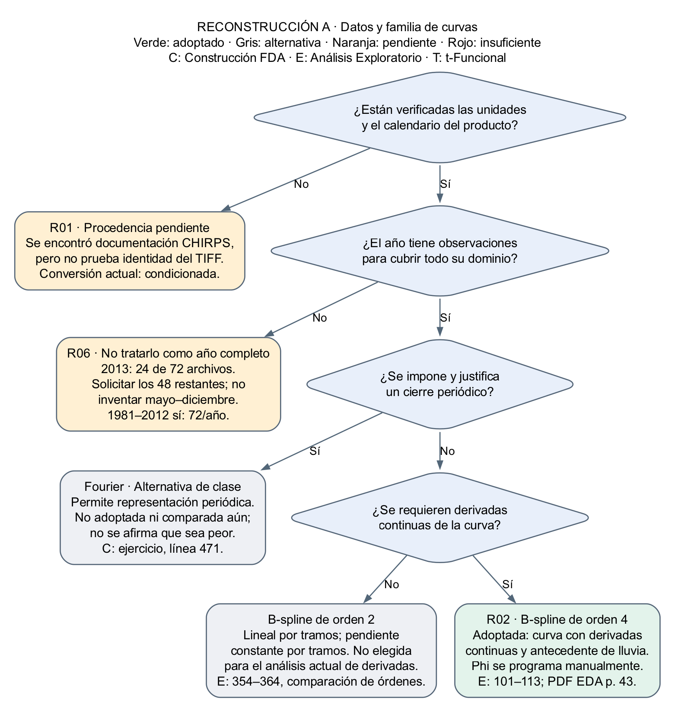
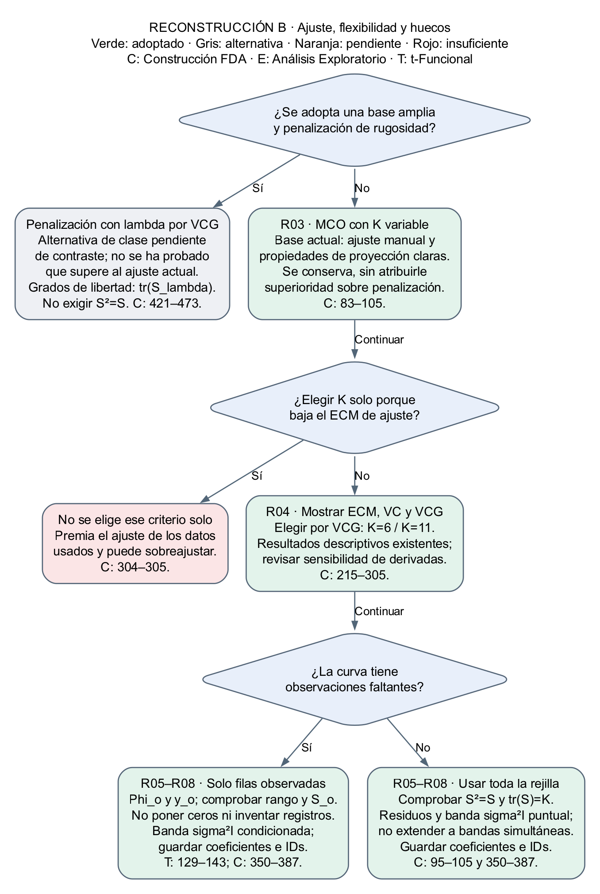
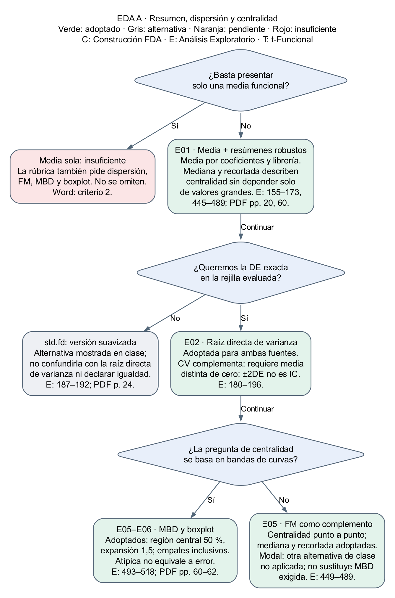
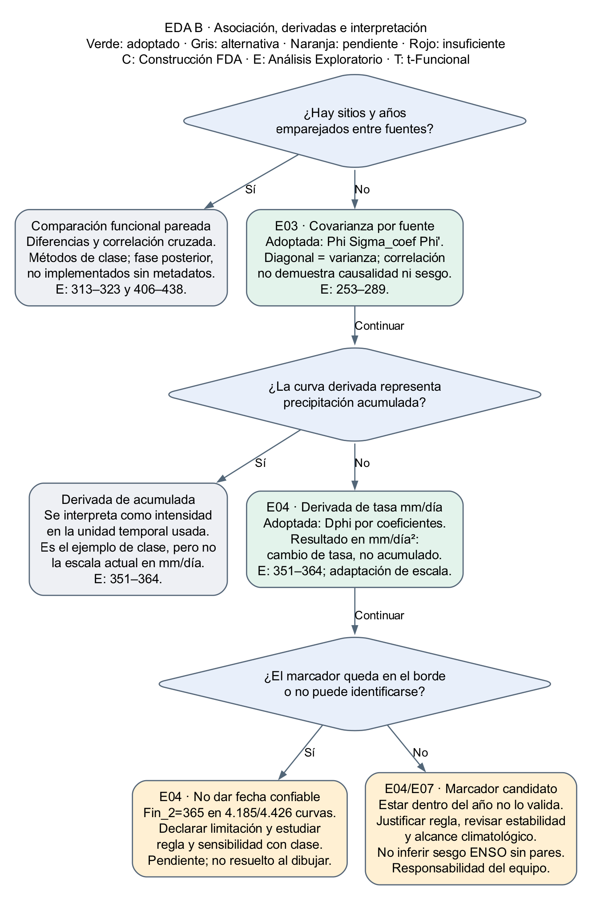

# Reconstrucción y EDA funcional: explicación y respaldo de clase

> **Fe de erratas vigente:** periodo **1981–2003**, ambas fuentes. La comparación
> completa está en [COMPARACION_WORD_FE_ERRATAS.md](COMPARACION_WORD_FE_ERRATAS.md).
> El cuerpo inferior es histórico: sus menciones a 2013 y conteos previos no
> describen las salidas actuales. La guía `.docx` también sigue siendo histórica.
> Ejecución actual: abrir `proyecto_funcional.R` y ejecutar desde la primera línea
> con Cmd/Ctrl+Enter, o pulsar Source para ejecutar todo. No requiere carga previa.

> **Actualización operativa — flujo R vigente (9/11/2026).** La implementación
> principal ahora es `proyecto_funcional.R`, con entradas compatibles 03/04.
> Los ocho notebooks están preservados en `archivo_historico_notebooks/`.
> Las referencias a notebooks, números de sección R antiguos, figuras y a
> «esta intervención» del cuerpo inferior corresponden a la bitácora anterior;
> no son las instrucciones de ejecución actuales. Véanse
> [README](README.md) y [requisitos, decisiones y verificación R](REQUISITOS_Y_ENTREGA_R.md).
> La reconstrucción es manual sin librerías; el EDA **sí permite** librerías
> y la media fue contrastada con `fda::mean.fd` en ambas fuentes. Las salidas
> nuevas van exclusivamente a `resultados_R/`, sin sobrescribir las anteriores.
> Se retiraron del flujo vigente la banda estacional y las fechas heurísticas
> de temporadas. La derivada continúa calculándose; el significado meteorológico
> de inicio/fin permanece pendiente. La guía Word y árboles anteriores no se
> regeneraron: conservan valor histórico, no acreditan la nueva ejecución R.
> **Revisión contra originales:** consultar la sección 8 del documento de
> decisiones para FM (escala docente y PDF), recorte por cuantil, empates MBD,
> bigotes del boxplot y contexto de geoestadística. El cuerpo histórico no
> sustituye esas correcciones ni documenta la versión vigente del código.

## 0. Contexto del problema: empezar desde cero

### 0.1 ¿Qué problema estudia este proyecto?

Queremos describir cómo cambia la lluvia a lo largo de un año en el Valle del Cauca y, en las fases posteriores del proyecto grupal, estudiar las diferencias entre lo registrado en tierra y lo estimado por satélite. El periodo solicitado es **1981–2013**. No basta decir cuánto llovió en total: también importa **en qué momentos del año** aumenta o disminuye la lluvia.

Por ejemplo, dos años pueden acumular la misma cantidad de lluvia, pero uno concentrarla en abril y noviembre y otro repartirla de manera diferente. Un único total anual no permite distinguir esos comportamientos. Por eso el proyecto estudia la **forma anual** de la lluvia.

**Respaldo del contexto:** `Proyecto_Final_Analitica.docx`, apartados Introducción, Objetivo general y Objetivos específicos. Esta guía es un documento de estudio y una bitácora de trabajo; no sustituye el informe final del grupo.

### 0.2 ¿De dónde salen los datos?

Hay dos fuentes que observan la lluvia de manera diferente:

- **Estaciones en tierra:** instrumentos situados en puntos concretos. Sus registros son diarios. Un código identifica la estación y una fecha indica cuándo se midió.
- **Satélite:** estimaciones para celdas de una cuadrícula geográfica. Cada celda es un **píxel** y representa una superficie, no un punto. Los archivos entregados tienen resolución de **péntada**, es decir, intervalos de varios días, habitualmente alrededor de cinco. Sus fechas y duraciones exactas deben interpretarse según la documentación del producto.

**Precipitación** significa cantidad de lluvia. Se expresa en milímetros (mm): 1 mm equivale a una lámina de agua de un milímetro de altura sobre una superficie horizontal. Una cantidad en **mm/día** es una tasa media por día; no es lo mismo que el acumulado de varios días.

Un ejemplo solo para entender las unidades: si un intervalo de cinco días acumula 25 mm, su tasa media es 25/5 = 5 mm/día. Eso **no significa** que se hayan medido 5 mm en cada uno de esos días; dentro del intervalo pudo llover de forma desigual.

### 0.3 ¿Qué es un dato funcional?

Un dato funcional es una **curva** que describe una cantidad a lo largo de un intervalo. Aquí el intervalo es un año y la cantidad es la lluvia. En vez de analizar cada día como si no tuviera relación con los otros, estudiamos el recorrido completo del año.

La unidad que se analiza es una **estación–año** o un **píxel–año**. Por ejemplo, la estación A en 1990 y la misma estación en 1991 son dos curvas distintas. El código real de estación y el año deben acompañar siempre a cada curva.

La notación `x(t)` solo significa «valor de la curva en el tiempo t». Aquí `t` puede ser el día 100 de un año normalizado. Una curva estimada resume la forma de los datos: no se convierte por ello en una medición verdadera de los días sin registro.

### 0.4 ¿Qué te corresponde hacer?

**Reconstrucción funcional:** pasar de los registros disponibles a una representación suave de cada curva anual. Hay que explicar cómo se construye, cómo se elige su flexibilidad y cómo se comprueba el cálculo.

**EDA funcional:** EDA significa **análisis exploratorio de datos**. Una vez construidas las curvas, se estudian sus formas: cómo es una curva media, cuánto cambian entre sí, dónde aumentan o disminuyen y cuáles resultan poco habituales.

El orden es: **registros → curvas estimadas → descripción e interpretación**. La comparación pareada estación–satélite y el entrenamiento de redes pertenecen a fases posteriores del grupo. En esta parte no se debe presentar una diferencia entre promedios sin emparejamiento como un sesgo del satélite ya demostrado.

### 0.5 ¿Qué tenemos realmente y qué significa «pendiente»?

En la base seleccionada hay **238 estaciones y 4.426 curvas estación–año de 1981–2003**. De esas curvas, 3.761 están completas y 665 tienen algún día faltante. La construcción satelital disponible contiene 46.176 curvas píxel–año de 1981–2012; el EDA utiliza 43.296 tras la máscara de tierra.

Estos números describen la base actual, no toda la cobertura solicitada de 1981–2013. Las ausencias de años no se resuelven dibujando curvas donde no hubo observaciones. Esa es una limitación de los insumos que debemos aclarar y registrar.

En la bitácora, **documentado** significa explicado; **implementado**, escrito en código; **verificado**, comprobado mediante una evidencia concreta; y **pendiente**, todavía no resuelto. Un procedimiento puede estar implementado y seguir pendiente de una justificación o de una ejecución completa.

## 1. Qué estamos haciendo y dónde está el trabajo

Convertimos los registros de cada estación–año y píxel–año en curvas suaves para estudiar su forma anual. **Reconstrucción aquí significa ajustar la curva con los datos observados**, no predecir estaciones a partir del satélite ni recuperar años completos sin mediciones.

La parte computacional está en `03_construccion_funcional.ipynb` / `.R` y `04_eda_funcional.ipynb` / `.R`. Este archivo es su explicación y bitácora metodológica. `trazabilidad_metodos_clase.csv` permite localizar cada decisión. La numeración R01–R08 y E01–E07 se conserva en el diagrama y en las anotaciones del código.

**Fuentes autorizadas:** `../analitica/`. No se consultaron métodos de Internet. El Word del proyecto fija los requisitos; los scripts y PDF de clase respaldan los métodos. Las páginas de PDF citadas abajo son **páginas físicas**, no el contador de diapositivas.

**Documento editable:** `GUIA_RECONSTRUCCION_EDA.docx`. Es la versión Word de esta bitácora, con árboles de decisiones de los dos componentes divididos en cuatro láminas. Se genera con `generar_documento_fda.py` y debe regenerarse cuando cambie este registro.

**Autoría de las decisiones:** los notebooks 03 y 04 y sus decisiones iniciales ya estaban en esta carpeta. En esta intervención se revisaron y documentaron con fuentes de clase; se corrigieron MBD con empates y explicaciones de unidades, incertidumbre, representatividad y sesgo. No se atribuye a esta intervención la ejecución previa ni se presentan sus gráficas como reejecutadas.

## 2. Árboles de decisiones: alternativas y razones

Un flujo indica el orden de pasos. Un **árbol de decisiones** plantea preguntas y muestra qué cambia si la respuesta es **sí o no**. Aquí el árbol de cada componente se divide en dos láminas para que se puedan leer las alternativas y sus razones.

**Cómo leerlos:** verde = procedimiento adoptado; gris = alternativa de clase no ensayada o no adoptada para esa pregunta; naranja = decisión o evidencia pendiente; rojo = camino insuficiente o no válido para el objetivo indicado. Una alternativa no ensayada **no se declara peor** que la elegida. Las ramas son criterios condicionales: un requisito pendiente no se da por satisfecho porque exista una rama verde más abajo.

Los códigos R01–R08 y E01–E07 enlazan cada rama con la explicación y las fuentes de las secciones 3 y 4. **C** significa `Script_Construcción_FDA.R`; **E**, `Script_AnalisisExploratorio.R`; **T**, `Script_t-Funcional.R`. Las referencias son líneas de esos archivos.

### Árbol R-A — Datos y familia de curvas

{width=6.3in}

### Árbol R-B — Ajuste y tratamiento de huecos

{width=6.3in}

### Árbol E-A — Resumen y centralidad

{width=6.3in}

### Árbol E-B — Asociación e interpretación

{width=6.3in}

### Por qué se siguieron estas ramas y qué falta contrastar

- **B-spline cúbica frente a orden 2:** se requieren derivadas continuas para el análisis actual. El script E compara órdenes 2 y 4 en 354–364. Esto sustenta la elección de representación, no asegura por sí solo fechas meteorológicas correctas.
- **B-splines frente a Fourier:** Fourier aparece como alternativa periódica en el ejercicio C, línea 471. No se ha hecho una comparación empírica ni impuesto un cierre anual; por eso figura como alternativa pendiente, no como método inferior demostrado.
- **MCO con K frente a penalización con lambda:** ambas vías se ven en clase. La base existente implementa MCO manual, selección de K y verificaciones de S; la penalización está en C 421–473 y aún debe contrastarse si los diagnósticos lo justifican. No se eligió MCO porque ya se hubiera probado que gana.
- **ECM de ajuste frente a VC/VCG:** el ECM no basta para elegir la flexibilidad; puede premiar el sobreajuste. La elección actual usa el mínimo de VCG, mostrando también VC y ECM (C 215–305).
- **Rejilla completa frente a puntos observados:** si hay huecos se restringen los datos del ajuste; no se reemplazan ausencias por cero. Si falta gran parte de un año, no se presenta una extrapolación como curva anual observada.
- **DE directa frente a `std.fd`:** se adopta la raíz de la varianza evaluada para mantener la misma definición al describir las dos fuentes. `std.fd` produce una versión suavizada; no se declara identidad numérica sin comprobarla (E 180–192).
- **Media frente a mediana y recortada:** no son opciones excluyentes: se usan de forma complementaria porque describen centralidad de distinta manera y la rúbrica exige profundidades. La profundidad modal es otra opción de clase, no aplicada ni necesaria para sustituir FM/MBD.
- **Covarianza propia frente a correlación cruzada:** la primera se puede describir sin emparejar las fuentes. La segunda necesita pares de sitios y años; queda para la fase correspondiente, no se inventa ese pareamiento.
- **Marcadores interiores frente a marcadores en el borde:** un resultado en día 365 se declara limitado; un resultado interior también requiere una regla sustentada y sensibilidad. Dibujar una rama no resuelve ese trabajo pendiente.

**Archivos editables de los árboles:** `arboles_decision_fda.json` y los `.dot` junto a cada imagen. El generador comprueba que cada nodo de decisión tenga una rama Sí y otra No.

## 3. Reconstrucción: qué se elige, por qué y dónde se vio

### R01 — Una curva anual y unidades comparables

**Primero, qué significa:** el **dominio** es el intervalo de tiempo en el que describimos la curva. La **rejilla** es la lista de tiempos donde se observa o evalúa: por ejemplo, los días 1, 2, …, 365. Compartir dominio no exige tener observaciones en las mismas fechas.

**Qué:** estaciones en días 1–365; satélite en el centro de cada péntada; cantidades expresadas en mm/día. Se conserva la diferencia entre una medición diaria y una tasa media pentadal.

**Por qué:** la representación funcional necesita un dominio común. Dividir el acumulado de una péntada por su duración no fabrica observaciones diarias. Evaluar después una función en 365 días tampoco convierte esa evaluación en medición.

**Visto en:** `Script_Construcción_FDA.R`, líneas 55–65 (tiempos, dominio y número de curvas); `Script_AnalisisExploratorio.R`, líneas 47–61 y 127–133 (rejillas distintas de observación y evaluación).

**Adaptación del proyecto:** eliminar el 29 de febrero y usar centros/duraciones de péntada. Estas convenciones no son una receta textual de clase. Excluyen el día bisiesto: las sumas de la curva son resúmenes de un año normalizado, no necesariamente el acumulado original de un año de 366 días.

**Implementado en:** notebook 03, §1. Resultado disponible: 4.426 curvas de 238 estaciones, 1981–2003; satélite: 46.176 curvas, 1981–2012. En el EDA se usan 43.296 curvas satelitales tras la máscara de tierra.

### R02 — B-splines cúbicos, sin escoger K a ojo

**Primero, qué significa:** una **base** es un conjunto de formas sencillas que se combinan para construir una curva. Los **B-splines** son funciones hechas con piezas polinómicas que se unen en puntos llamados **nodos**. Sus **coeficientes** son los pesos de la combinación: indican cuánto aporta cada función base.

**K** es el número de funciones base. Más funciones permiten más flexibilidad, pero también pueden seguir demasiado las oscilaciones particulares de los datos. **Orden 4** significa piezas de grado 3; no significa que haya cuatro curvas ni que K tenga que valer cuatro.

Una **matriz** es una tabla de números. La matriz **Phi (Φ)** guarda el valor de cada función base en cada tiempo: filas = tiempos; columnas = funciones base. Multiplicarla por los coeficientes permite evaluar la curva.

**Qué:** representar cada curva como `x(t) = phi(t)' c`, con B-splines de orden 4. Phi contiene las funciones base evaluadas en los tiempos observados.

**Por qué:** una representación suave permite estimar curvas y derivadas continuas. El orden no es K: el primero fija el grado; K controla la dimensión y flexibilidad.

**Visto en:** `Script_AnalisisExploratorio.R`, líneas 101–113, precipitación con orden 4; `AnalisisExploratorioDatosFuncionales.pdf`, p. 43, continuidad de las derivadas. `Script_Construcción_FDA.R`, líneas 73–80, construcción y evaluación de Phi.

**Implementado en:** notebook 03, §2; R 03, §2. La recursión manual es la implementación de la base B-spline, mientras el script de clase usa `create.bspline.basis` y `eval.basis`. No se afirma que la programación manual de Cox–de Boor sea una copia del script docente. Las librerías sirven como contraste, no para sustituir el ajuste manual exigido.

### R03 — Coeficientes por mínimos cuadrados

**Primero, qué significa:** **ajustar** una curva es escoger sus coeficientes para acercarla a los registros. El **residuo** es observado menos ajustado. Si observamos 8 mm/día y la curva estima 6, el residuo es 2 y su cuadrado es 4.

**Mínimos cuadrados ordinarios (MCO)** escoge los coeficientes que minimizan la suma de esos residuos al cuadrado. Así los errores positivos y negativos no se cancelan. No obliga a la curva a pasar exactamente por cada registro.

En la fórmula que sigue, el símbolo `'` indica **transponer** una matriz, es decir, intercambiar filas por columnas. `c` contiene los coeficientes y `y` los valores observados. La ecuación es la forma matricial del ajuste explicado arriba.

**Qué:** resolver `(Phi' Phi) c = Phi' y`; obtener `C = (Phi' Phi)^(-1) Phi'` y `S = Phi C`.

**Por qué:** son las ecuaciones vistas en clase; estiman la curva dentro del espacio elegido. El código resuelve el sistema sin formar explícitamente la inversa.

**Visto en:** `Script_Construcción_FDA.R`, líneas 83–105.

**Implementado en:** notebook 03, §3, `ajuste_mco`; R 03, §3 y §5.

### R04 — ECM, VC y VCG

**Primero, qué significa:** necesitamos elegir cuánta flexibilidad dar a la curva. Si sigue cada oscilación del registro, puede capturar ruido en lugar de un patrón anual: eso se llama **sobreajuste**.

- **ECM (error cuadrático medio):** promedio de los errores al cuadrado. En el ajuste, indica qué tan cerca queda la curva de los puntos usados para construirla.
- **VC (validación cruzada):** aquí se oculta un punto temporal, se ajusta con los demás y se comprueba cómo se estima el punto oculto. Se repite para los puntos de la curva. Esto no es la validación de años futuros de los modelos.
- **VCG (validación cruzada generalizada):** criterio de clase que utiliza el error y los grados de libertad del suavizador para aproximar la evaluación cruzada. Permite comparar distintos K sin hacer todos los ajustes punto por punto.

**Decisión que nos corresponde:** calcular los criterios, estudiar los resultados y justificar el K elegido. No pedir al profesor que escoja por nosotros. Si la forma de la curva o sus derivadas es problemática, nos corresponde contrastar alternativas vistas en clase, como la penalización por rugosidad: una penalización que desalienta curvas demasiado onduladas. Su intensidad se controla con **lambda (λ)**.

**Qué:** calcular los tres criterios para cada K y cada fuente. VC deja fuera puntos temporales de una curva; VCG utiliza los grados de libertad del suavizador.

**Por qué:** un ECM de ajuste bajo puede premiar el sobreajuste. La elección se basa en el mínimo de VCG, mostrando también VC y ECM; no se importa el K=20 del ejemplo docente.

**Visto en:** `Script_Construcción_FDA.R`, líneas 215–235 y 240–305; `ConstruccionDatosFuncionales.pdf`, pp. 20 y 30.

**Implementado en:** notebook 03, §4; R 03, §4. Resultados guardados: **K=6 estaciones, K=11 satélite**. La selección terrestre utiliza 3.761 curvas completas; después se ajustan también las 665 incompletas. Debe mostrarse esa restricción, no decir que K fue seleccionado con todas las curvas terrestres.

**Límite:** esta VC de suavizado no sustituye la partición temporal ni las estaciones reservadas de la evaluación predictiva. El K satelital descriptivo usó también años posteriores a 2005; no debe reutilizarse como hiperparámetro elegido sin fuga para los modelos finales.

### R05 — Comprobar la matriz suavizadora

**Primero, qué significa:** la **matriz suavizadora S** resume cómo se combinan los valores observados para obtener los ajustados. Verificar sus propiedades permite comprobar que la programación hizo el ajuste matemático previsto.

**Simétrica** significa que S coincide con su transpuesta. **Idempotente** significa que aplicar de nuevo la misma proyección a los valores ya ajustados no los cambia: S²=S. La **traza** es la suma de la diagonal; en el ajuste sin penalización y de rango completo coincide con K. Estas son comprobaciones del cálculo, no demostraciones de que el modelo explique toda la climatología.

**Qué:** verificar simetría, `S² = S` y `tr(S) = K` para mínimos cuadrados sin penalización.

**Por qué:** confirma que el cálculo es la proyección esperada y detecta errores de implementación.

**Visto en:** `Script_Construcción_FDA.R`, líneas 95–102.

**Implementado en:** notebook 03, §3 y §5; R 03, `verificar_H`. Con penalización no se exigiría idempotencia ni traza entera; esa alternativa se ve en clase, pero no es el ajuste actual.

### R06 — Curvas con faltantes

**Primero, qué significa:** un **faltante** es un registro que no tenemos o que quedó marcado para no utilizarse. Un **hueco** es una sucesión de fechas sin dato. No es equivalente a cero: cero puede ser una observación válida de un día sin lluvia.

La reconstrucción usa los puntos disponibles para estimar una función. Evaluar esa función en un hueco produce una estimación, no una observación recuperada. Si falta un año completo, ya no hay puntos de ese año con los que realizar este ajuste individual.

**Qué:** ajustar con `Phi_observada` y `y_observado`; evaluar la función resultante sobre el dominio anual.

**Por qué:** los patrones de ausencia cambian entre curvas. Los huecos no son lluvia cero. Las evaluaciones reconstruidas dentro de ellos son estimaciones, no datos recuperados.

**Visto en:** `Script_t-Funcional.R`, líneas 74–95 y 129–143; `Script_anova_funcional.R`, líneas 142–164. En esos ejemplos se usa penalización; aquí se conserva la variante MCO de R03 con K pequeño y se comprueba su estimabilidad.

**Implementado en:** notebook 03, §3 y §5; R 03, §5. Los umbrales de calidad de la fase 0 son entradas heredadas, **no umbrales autorizados por el ejemplo ICA**. No se reconstruyen 2004–2013 sin observaciones terrestres.

### R07 — Residuos y bandas punto a punto

**Primero, qué significa:** los **residuos** son las diferencias entre lo observado y la curva ajustada. Estudiarlos permite ver qué variación quedó sin representar.

El **error estándar (EE)** cuantifica incertidumbre de estimación bajo un modelo. Una **banda punto a punto** dibuja, para cada tiempo por separado, la curva más y menos una cantidad de EE. No es lo mismo que describir cuánto se dispersan las distintas curvas de la muestra.

El supuesto **sigma²I** dice que los errores tienen una misma varianza y covarianza cero entre tiempos distintos. La letra sigma² representa esa varianza; I es la matriz identidad, con unos en la diagonal y ceros fuera. En la fórmula, **SSE** es la suma de residuos al cuadrado y `n_observado` el número de puntos utilizados.

**Qué:** estudiar los residuos y usar `sigma² = SSE/(n_observado-K)` y `Var(y_ajustada) = sigma² Phi C C' Phi'` para la banda `curva ± 2 EE`.

**Por qué:** describe la incertidumbre puntual del ajuste bajo el supuesto de errores con covarianza `sigma² I`. Revisar residuos sirve para discutir ese supuesto; una correlación media pequeña no demuestra independencia.

**Visto en:** `Script_Construcción_FDA.R`, líneas 350–387.

**Implementado en:** notebook 03, §6; R 03, §6. Las bandas son aproximadas y condicionadas al modelo; **no simultáneas, no intervalos de predicción, no media ± 2 DE**.

**Observación de respaldo:** la banda adicional con una forma estacional de varianza escalada por curva es una extensión heredada. No se localizó esa receta en los scripts revisados: **no se incluye como método de clase validado**. La fórmula `e²/(1-h)` no identifica por sí sola la varianza heterocedástica de cada día. Para nuestra sustentación, el respaldo directo es la banda `sigma² I` y sus limitaciones.

### R08 — Exportar una construcción reproducible

**Primero, qué significa:** **exportar** es guardar resultados en archivos; **reproducible** significa que otra persona puede obtenerlos con los mismos datos, código y condiciones. Una figura muestra la curva, pero por sí sola no conserva todos los números necesarios para reconstruirla.

CSV guarda tablas; NPZ guarda conjuntos de arreglos numéricos de Python; JSON guarda especificaciones como dominio, orden y K. Estos son formatos de archivo, no técnicas estadísticas.

**Qué:** guardar la base, coeficientes, identificadores, años, escala y tiempos.

**Por qué:** permite recuperar exactamente las funciones y alimentar el EDA sin repetir la depuración. No basta una imagen de curvas.

**Visto en:** `Script_Construcción_FDA.R`, líneas 83–105 y 187–194, relación entre coeficientes y curvas. Los formatos CSV/NPZ/JSON son decisiones de organización del proyecto, no métodos estadísticos nuevos.

**Implementado en:** notebook 03, exportación final; `fda_fase1/`.

## 4. EDA funcional: qué se calcula y para qué

### E01 — Media funcional

**Primero, qué significa:** la **media** es un promedio. La media funcional promedia los valores de las curvas en cada tiempo. Si, como ejemplo didáctico, tres curvas valen 2, 4 y 6 mm/día el día 100, su media ese día es 4 mm/día. Al repetirlo a lo largo del año obtenemos una curva media.

**Qué hacemos y por qué:** promediamos los coeficientes y evaluamos la curva resultante. Comprobamos que coincide con promediar las curvas evaluadas y con la función de librería. Esto describe el comportamiento medio y comprueba la implementación.

**Decisión y límite:** cada curva estación–año pesa igual en esta media agrupada. Una estación con más años aporta más curvas, por lo que no debemos llamarla automáticamente un promedio geográfico con igual peso por estación. La media también puede ser elevada por unas pocas curvas muy lluviosas.

**Visto en:** `Script_AnalisisExploratorio.R`, 155–173; `AnalisisExploratorioDatosFuncionales.pdf`, p. física 20. **Implementado en:** notebook 04 §2; R 04 §1. **Estado:** cálculo contrastado con los archivos preparados; salidas incrustadas previas a la actualización completa.

### E02 — Varianza, desviación estándar y coeficiente de variación

**Primero, qué significa:** la **varianza** mide cuánto se separan las curvas de su media en cada día. La **desviación estándar (DE)** es la raíz de la varianza y vuelve a las unidades de la curva, aquí mm/día. Si las curvas son muy distintas en noviembre, la DE de noviembre será grande.

El **coeficiente de variación (CV)** divide la DE por la media: expresa dispersión relativa. No se puede dividir por cero y un resultado con media muy cercana a cero puede ser inestable.

**Qué hacemos y por qué:** calculamos estas medidas por tiempo y fuente para localizar épocas de mayor dispersión. Para la varianza muestral se divide por N−1, siendo N el número de curvas.

**Decisión y límite:** usamos la raíz directa de la varianza. Las líneas media ±2 DE describen dispersión entre curvas; no son las bandas de incertidumbre del ajuste explicadas en R07. Mezclar estaciones y años combina variación espacial y temporal.

**Visto en:** `Script_AnalisisExploratorio.R`, 180–196; PDF EDA p. 24. **Implementado en:** notebook 04 §3; R 04 §2. **Estado:** varianza y DE contrastadas; interpretar CV con su denominador.

### E03 — Covarianza y correlación funcional

**Primero, qué significa:** la **covarianza** describe cómo cambian conjuntamente los valores de dos momentos del año entre las curvas. Por ejemplo: ¿las curvas con más lluvia que la media en abril también suelen tener más lluvia que la media en octubre?

La **correlación** expresa esa asociación en una escala de −1 a 1, cuando las varianzas permiten definirla. Una asociación positiva indica que ambos valores tienden a variar en el mismo sentido; no demuestra que una temporada cause la otra.

**Qué hacemos y por qué:** centramos los coeficientes restando su media, calculamos su matriz de covarianza y la llevamos al dominio temporal: `Phi Sigma_coef Phi'`. Comprobamos que la diagonal coincide con la varianza de E02.

**Decisión y límite:** calculamos estas superficies por separado para cada fuente. No son la correlación cruzada entre una estación y su píxel: esa requiere emparejamiento.

**Visto en:** `Script_AnalisisExploratorio.R`, 253–289; PDF EDA p. 30. **Implementado en:** notebook 04 §4; R 04 §3. **Estado:** diagonal y momentos contrastados.

### E04 — Derivadas y lectura de temporadas

**Primero, qué significa:** la **derivada** describe qué tan rápido cambia una curva. Es la pendiente: positiva cuando aumenta, negativa cuando disminuye y cero en un tramo horizontal o en determinados extremos. Un **pico** es una zona de máximo de la curva; no es el máximo de su pendiente.

**Qué hacemos y por qué:** derivamos las funciones base y las combinamos con los mismos coeficientes. Esto permite describir aumentos y descensos de la lluvia a lo largo del año. Como aquí la curva está en mm/día, la derivada está en mm/día²: es cambio de la tasa de lluvia. En el ejemplo de clase de precipitación acumulada, la interpretación y las unidades son distintas.

**Decisión que nos corresponde:** justificar cómo se identifican marcadores de temporadas y comprobar su sensibilidad al ajuste. No atribuir a un máximo de pendiente un significado de inicio meteorológico que no se haya definido y sustentado.

**Visto en:** `Script_AnalisisExploratorio.R`, 351–364; PDF EDA p. 43. **Implementado en:** notebook 04 §5; R 04 §4. **Estado:** derivada comprobada; interpretación de inicio/fin y casos de borde todavía pendiente de resolver por el equipo.

### E05 — Profundidad, mediana y media recortada

**Primero, qué significa:** una **profundidad funcional** indica qué tan central es una curva respecto de las demás. No es profundidad física del agua. Una curva central se parece, en ese sentido estadístico, al conjunto; una periférica se aparta de él.

**Fraiman–Muniz (FM)** resume centralidad punto a punto a lo largo del dominio. **MBD**, profundidad de bandas modificada, mide la proporción promedio del tiempo en que una curva queda entre las bandas formadas por pares de otras curvas de la muestra. En el conteo usado se incluyen los valores que coinciden con los bordes de la banda.

La **mediana funcional** es una curva de máxima profundidad, no la colección de medianas de cada día. La **media recortada al 25 %** promedia aproximadamente el 75 % de curvas más profundas, dejando fuera las más periféricas para obtener un resumen menos sensible a extremos.

**Decisión y por qué:** usar FM y MBD de clase junto a la media, y verificar la definición por pares cuando hay valores iguales, llamados **empates**. El promedio sobre la rejilla es la convención discreta utilizada; no se afirma que tenga la misma escala que una integral sin normalizar.

**Visto en:** `Script_AnalisisExploratorio.R`, 445–489 y 493–518; PDF EDA pp. 53 y 60. **Implementado en:** notebook 04 §6; R 04 §5. **Estado:** MBD con empates corregida y probada; ver detalle más abajo.

### E06 — Boxplot funcional y curvas atípicas

**Primero, qué significa:** un **boxplot funcional** es un diagrama de cajas para curvas completas. En lugar de una caja de números, muestra una envolvente: una zona que contiene las curvas más centrales.

**Qué hacemos:** ordenamos por MBD; la envolvente del 50 % más profundo forma la región central. Se amplía esa región con el factor 1,5 del procedimiento de clase y se señalan las curvas que salen de los límites en algún momento.

**Por qué y qué decidimos:** permite localizar años y sitios que merecen revisión. Conservamos el ID y el año de cada curva marcada. Una **atípica** es poco habitual respecto de esa muestra: no implica que sea un error de digitación ni que deba eliminarse. Puede representar un sitio genuinamente lluvioso o un año diferente.

**Límite:** las agrupaciones geográficas actuales son aproximaciones que necesitan metadatos; no prueban por sí solas pertenencia a una cuenca.

**Visto en:** `Script_AnalisisExploratorio.R`, 493–518; PDF EDA pp. 60–62. **Implementado en:** notebook 04 §7; R 04 §5; CSV de atípicas. **Estado:** atípicas terrestres contrastadas con los archivos guardados.

### E07 — Interpretar la lluvia en su contexto

**Primero, qué significa:** **interpretar** es explicar qué dice una gráfica sobre la lluvia y hasta dónde alcanza esa explicación. Un **régimen bimodal** presenta dos temporadas de mayor lluvia. La **orografía** es el relieve; puede relacionarse con diferencias entre lugares, pero confirmar esa relación requiere su ubicación y altitud.

**ENSO** es el fenómeno El Niño–Oscilación del Sur, relacionado con variaciones climáticas. **ONI** es un índice utilizado para describir su estado. Una clasificación por promedio anual de ONI no equivale automáticamente a una clasificación oficial de episodios.

**Qué hacemos y por qué:** relacionamos medias, dispersión, pendientes y atípicas con el comportamiento anual observado. Diferenciamos lo que efectivamente muestran las curvas de una explicación que todavía necesita datos o comprobaciones.

**Decisión y límite:** las poblaciones y periodos son distintos entre fuentes. Sin sitios y años emparejados no se demuestra un sesgo satelital. Tampoco basta analizar todas las curvas seleccionadas para demostrar representatividad de todo 1981–2013.

**Visto en:** PDF EDA pp. 20, 24, 43, 53 y 60; Word del proyecto, criterio 2. **Implementado en:** notebook 04 §3–§8. **Estado:** interpretación delimitada; cobertura completa y representatividad pendientes.

### Temporadas: decisión adaptada, todavía limitada

Las ventanas de búsqueda y los extremos de la derivada empleados en `temporadas()` son una regla descriptiva del proyecto. **No se localizó esa regla exacta de inicio/fin en clase.** Un máximo de pendiente es el aumento más rápido, no necesariamente el inicio meteorológico de una temporada. Las fechas seleccionadas en el borde no constituyen evidencia de cierre.

El resultado guardado da `fin_2=365` en 4.185 de 4.426 curvas terrestres y 165 valores ausentes. Esto debe mostrarse como limitación; no presentar el 31 de diciembre como un fin estimado confiable. Mantener la derivada de clase y transparentar la regla es preferible a incorporar un detector de temporadas externo sin respaldo.

### Profundidad: corrección del conteo con empates

La definición de MBD en clase cuenta las bandas que contienen una curva. La fórmula heredada de un solo rango fallaba con **empates**: por ejemplo, cuatro curvas idénticas daban 0,5 en vez de 1. Se comprobó primero el fallo con pruebas independientes y se corrigió en Python y R contando los pares completamente por debajo o por encima del valor. Si L y U son los números de valores estrictamente menores y mayores, la proporción inclusiva es `1 - [L(L-1)+U(U-1)]/[N(N-1)]`. Es el mismo método de clase, no una profundidad nueva.

La verificación compara la corrección con la definición por pares, con y sin empates. Los resultados de estaciones guardados también se contrastan. Las figuras incrustadas de los notebooks son de la ejecución anterior; no se presentan como regeneradas tras esta corrección.

### Comparación de fuentes y ENSO

El ejemplo docente usa los mismos diez sitios en X e Y (`Script_AnalisisExploratorio.R`, líneas 60–61). Aquí las estaciones y píxeles aún no están emparejados. Por eso, las medias separadas **no estiman el sesgo satelital**. Tampoco se valida una subestimación en La Niña comparando poblaciones, periodos o agrupaciones geográficas diferentes.

La clasificación ENSO por promedio anual de ONI y los grupos por prefijo de estación o corte de longitud son convenciones heredadas: deben citar su procedencia y sus límites. Un promedio anual de ONI no equivale automáticamente a la clasificación oficial de episodios. Los sitios y años desigualmente representados pesan de forma desigual en la media agrupada.

## 5. Bitácora de esta intervención

| Paso | Estado real | Evidencia |
|---|---|---|
| Localizar métodos de construcción y EDA en clase | Revisado | Scripts y páginas citados arriba; matriz CSV. |
| Explicar cada elección y separar adaptaciones | Documentado | Esta guía; anotaciones en 03/04 Python y R. |
| Recalcular desde matrices y coeficientes ya disponibles | Verificado: 42 controles OK | `verificacion_fda_clase.json`. No equivale a ejecutar desde los archivos crudos. |
| Generar árboles de decisiones | Se actualizan en esta intervención | Cuatro láminas PNG/SVG, ramas Sí/No, alternativas de clase, razones y estados; mismos IDs de la guía. |
| Cubrir todo 1981–2013 y demostrar representatividad | Pendiente | Estaciones solo 1981–2003, satélite construido solo hasta 2012. Usar todas las curvas seleccionadas no demuestra representatividad de todo el periodo. |
| Corregir MBD con empates | Verificado: 3 pruebas Python y contraste en R | `test_fda_clase.py`, notebook 04 y R 04. Primero se reprodujo el fallo y después se aplicó la corrección. |
| Regenerar todas las figuras y salidas incrustadas de los notebooks | Pendiente | Esta intervención comprueba funciones y archivos preparados; no presenta las figuras previas como reejecutadas. |
| Validar fechas de temporadas | Pendiente | Regla adaptada y limitación de borde descritas arriba. |
| Confirmar métodos auxiliares no localizados | Pendiente | Banda estacional y regla exacta de temporadas no se cuentan como métodos de clase validados. |

## 6. Cómo reproducir las comprobaciones

Desde la raíz de este proyecto, con Python y `numpy`, `pandas` y `matplotlib` disponibles:

```bash
python verificar_fda_clase.py
python -m unittest test_fda_clase -v
```

El verificador carga **las funciones reales de los notebooks**, recalcula los ajustes terrestres a partir de la matriz disponible, comprueba la reconstrucción satelital con tolerancia por exportación redondeada, revisa momentos y profundidades, y escribe resultados en archivos separados. No modifica observaciones ni coeficientes existentes.

Una coincidencia numérica valida ese cálculo, **no** la procedencia de los datos ni toda la rúbrica. El Word también exige justificación, interpretación, representatividad y una entrega final con un único script por lenguaje: estos notebooks y su verificador son archivos de trabajo que después habrá que consolidar.

**Regla para continuar:** por cada modificación, anotar ID, motivo, archivo de clase con líneas/página, archivo/celda de implementación, comprobación y estado. «Visto en clase», «adaptado al proyecto», «verificado numéricamente» y «pendiente» significan cosas diferentes.

## 7. Registro de decisiones y cambios — 9 de noviembre de 2026

### Decisiones de la base que se revisaron y documentaron

- **R01–R02:** dominio 1–365 y B-splines de orden 4. Se distingue la convención de calendario del método funcional enseñado.
- **R03–R06:** MCO, K por VCG separado por fuente y ajuste con días observados. K=6 y K=11 son resultados de la base existente; no valores fijados de nuevo durante la documentación.
- **R07:** usar como respaldo directo la banda punto a punto bajo sigma²I del script de clase. La extensión estacional permanece identificada como heredada y sin receta docente localizada; no se declara validada.
- **E01–E06:** conservar los procedimientos de media, dispersión, covarianza, derivadas, profundidades y boxplot del material de clase. No incorporar nuevos detectores de temporadas ni métodos de imputación externos.

### Cambios efectivamente realizados en esta intervención

1. **E05 — MBD con empates:** se reprodujeron dos fallos antes de modificar código. Se corrigió el conteo inclusivo de bandas en el notebook 04 y en R 04. Después pasaron tres pruebas Python y el contraste por pares en R.
2. **R01/R08 — Unidades:** se corrigió el texto que sugería elevar al cuadrado curvas ya construidas en mm/día.
3. **R07 — Incertidumbre:** se precisó que la banda ±2 EE es puntual y condicionada al modelo. Se retiró la afirmación de independencia demostrada por una correlación residual media pequeña.
4. **E04 — Temporadas:** se distinguió aumento/descenso más rápido de inicio/fin meteorológico. No se dio por resuelto el marcador dominado por el borde.
5. **E07 — Interpretación:** se retiró la conclusión de subestimación satelital en La Niña a partir de muestras no emparejadas. Se dejó explícita la falta de representatividad demostrada de todo 1981–2013.
6. **Trazabilidad:** se agregaron referencias de clase en 03/04 Python y R, la matriz de 15 pasos y los diagramas.
7. **Verificación:** se efectuaron 42 controles sobre archivos preparados. La ejecución registrada en JSON es del 9 de noviembre de 2026 a las 04:55 UTC; no se volvieron a ejecutar todos los notebooks desde crudos.
8. **Actualización didáctica:** se incorporó contexto del problema, explicación de los datos y de la parte asignada, y definiciones antes de los procedimientos R01–R08/E01–E07. Se sustituyeron las consultas que delegaban decisiones metodológicas por preguntas de insumos y alcance que sí requieren información del profesor. Esta actualización es documental; no significa que se hayan resuelto los análisis pendientes.
9. **Árboles e investigación de procedencia:** a petición de la usuaria, se reemplazó la secuencia de pasos por ramas Sí/No con alternativas de clase y sus estados. Se recontaron los 2.328 TIFF originales y se investigó documentación oficial de CHIRPS; se distinguió la fuente candidata de la identidad todavía no demostrada del paquete entregado. No se ejecutó una comparación nueva entre modelos de suavizado ni se mezclaron productos satelitales.

### Registro para el siguiente tema que se aplique

Completar una entrada nueva antes de marcar un tema como cerrado:

| Campo | Qué registrar |
|---|---|
| Fecha e ID | Fecha y código R/E del tema. |
| Tema y objetivo | Qué se quiere calcular o corregir. |
| Decisión y motivo | Qué se elige y por qué. |
| Visto en clase | Nombre exacto del archivo y líneas o página física. |
| Implementación | Notebook, sección/celda, función y equivalente R. |
| Evidencia | Tabla, figura, archivo o prueba que comprueba el resultado. |
| Estado | Documentado, implementado, verificado o pendiente; no confundirlos. |

## 8. Preguntas para el profesor — reunión de hoy

Aquí se distinguen **datos que debe aclarar o entregar el docente** de **decisiones que debemos tomar y justificar nosotros**. Las respuestas se anotarán en esta bitácora; ninguna se da por recibida.

### Prioridad 1 — Confirmar una entrega incompleta, no preguntar cómo ajustar

**Pregunta:** «Revisamos la carpeta y de 2013 tenemos `ppt201301.tif` a `ppt201324.tif`, mientras que los años anteriores tienen los índices 01–72. ¿Existe otra entrega con los archivos 25–72 de 2013 o la entrega de ese año termina en el índice 24?»

**Por qué es una duda de mi parte:** el inventario actual confirma 24 archivos de 2013 frente a 72 por año entre 1981 y 2012. **Que los archivos lleguen hasta 2013 no significa que 2013 esté completo.** Para un año anterior se usan los registros de ese año, no todos los años juntos como si fueran una sola curva. Con los índices 01–24 se puede estudiar el tramo observado; no reconstruir con respaldo observacional un año completo sin información del resto. En el calendario CHIRPS de seis péntadas por mes, esos índices llegan hasta abril; asociar ese calendario al producto original sigue condicionado a su identificación.

**Respuesta:** pendiente. **Afecta:** R01, R06 y el alcance del EDA. **Evidencia actual:** `evidencia_fuente_satelite.json`. La carpeta inspeccionada está en `../proyecto-3/ImagenesSatelitePentadal`; fue leída como referencia, no copiada ni mezclada con el proyecto activo.

### Investigación resuelta parcialmente — La documentación pública sí existe

Se investigó primero en los archivos, el notebook 02 y fuentes oficiales. **Sí existe documentación pública de CHIRPS v2**: resolución 0,05°, cobertura desde 1981, unidades mm/péntada y calendario de seis péntadas por mes. El repositorio oficial también tiene 2013 completo; la descarga CHIRPS ya guardada en `datos_web/` contiene sus 72 intervalos.

Pero **no se ha demostrado que los TIFF entregados sean ese mismo producto y versión**. Los tags locales no declaran producto, versión ni unidades; sí declaran NoData=−9999. Sus valores no coinciden con el CHIRPS externo comparado. La coincidencia de malla o correlación no resuelve la procedencia.

Por tanto, **se retira la petición genérica de que el profesor busque una ficha técnica por nosotros**. Si después de esta investigación sigue sin existir una identificación en la entrega, la consulta puntual al proveedor sería: «¿Cuál es el producto y versión de origen de estos `pptAAAAPP.tif`, y se les aplicó algún procesamiento antes de entregarlos?». No es una pregunta sobre cómo analizar las curvas; es la información de procedencia que no se puede deducir de un TIFF que no la conserva. Los enlaces y los límites de la investigación están en la sección 9.

### Prioridad 3 — Aclaración de alcance si no existen más datos

Esta es una **precisión a la pregunta de los compañeros**, no es necesario repetirla si la respuesta ya la cubre.

**Pregunta:** «Si finalmente no hay más registros terrestres o satelitales, ¿se ajustará el alcance exigido de 1981–2013 para construcción y EDA a la cobertura realmente entregada? Lo pregunto porque la rúbrica exige justificar la representatividad de ese periodo, además de la partición de los modelos.»

**Por qué importa:** no podemos declarar representativo un periodo que no observamos solamente por usar todas las curvas seleccionadas. El profesor puede aclarar el alcance del encargo; a nosotros nos corresponde describir la cobertura, estudiar la selección y justificar las conclusiones dentro de ella.

**Respuesta:** pendiente. **Afecta:** E07 y el cierre de los criterios 1 y 2.

### Preguntas que ya llevan los compañeros

- Coordenadas, altitud y correspondencia de los códigos de estación.
- Entrega de estaciones 2004–2013 y partición temporal si no están disponibles.
- Identificación y protocolo de estaciones reservadas.

Se registrarán sus respuestas porque afectan a nuestra parte, pero no hace falta duplicar las preguntas. Conviene decir «estaciones entregadas» si no se ha conciliado el número de estaciones entre archivos y periodos.

### Trabajo metodológico que asumimos nosotros

- Elegir y justificar K y, si es necesario por las limitaciones observadas, contrastar MCO con la penalización de clase.
- Definir y justificar los marcadores de temporadas y estudiar los casos de borde; no afirmar que ya están resueltos.
- Justificar la normalización temporal con los metadatos, revisar valores negativos y declarar las limitaciones de las bandas.
- Distinguir una extensión sin respaldo localizado de un método efectivamente visto en clase.

**Si solo puedo hacer una pregunta adicional a las del equipo:** preguntaría por los archivos 25–72 de 2013, con el inventario en la mano. Si la entrega completa ya los contiene, la duda desaparece y nos corresponde corregir la copia local. No se pregunta «cómo construir la curva»: eso es trabajo metodológico nuestro.

## 9. Investigación de la fuente satelital y cobertura de 2013

### Evidencia obtenida de los archivos locales

Se inspeccionaron los **2.328 TIFF** de `../proyecto-3/ImagenesSatelitePentadal`. El primer archivo es `ppt198101.tif` y el último `ppt201324.tif`. Entre 1981 y 2012 cada año tiene índices 01–72; 2013 tiene solo 01–24: **faltan 48 índices respecto del patrón anual de la entrega**.

Los ejemplos revisados tienen malla 39×37, resolución aproximada 0,05°, coordenadas WGS84 y almacenamiento int16. Los 2.328 archivos declaran NoData=−9999; no se encontraron campos descriptivos `ImageDescription`, `Software`, `DateTime` ni `GDAL_METADATA` que identifiquen el producto o sus unidades. Los valores válidos observados van de 0 a 200; el máximo y sus repeticiones no demuestran por sí solos qué procesamiento se aplicó.

La inspección genera `evidencia_fuente_satelite.json`, con el inventario por año y tags. Se reproduce mediante:

```bash
python auditar_fuente_satelite.py --raw-dir "../proyecto-3/ImagenesSatelitePentadal"
```

### Fuentes oficiales encontradas

1. **Climate Hazards Center, UCSB — CHIRPS v2:** <https://www.chc.ucsb.edu/data/chirps>. Describe el conjunto, la malla de 0,05° y la combinación de estimaciones con información de estaciones. Esto también impide tratarlo automáticamente como validación independiente de pluviómetros.
2. **README oficial de CHIRPS v2:** <https://data.chc.ucsb.edu/products/CHIRPS/v2.0/README-CHIRPS.txt>. Documenta formatos, versiones, productos y el calendario mensual de péntadas. Las duraciones no son todas de cinco días: los finales de mes varían.
3. **Catálogo Earth Engine, CHIRPS pentadal v2 final:** <https://developers.google.com/earth-engine/datasets/catalog/UCSB-CHG_CHIRPS_PENTAD>. La banda `precipitation` está documentada en **mm/pentad**. Es documentación de ese producto público, no prueba de identidad de los TIFF entregados.
4. **Archivo oficial COG pentadal:** <https://data.chc.ucsb.edu/products/CHIRPS/v2.0/global_pentad/cogs/>. Se encontraron los nombres `chirps-v2.0.2013.01.1.cog` a `chirps-v2.0.2013.12.6.cog`, entre los demás intervalos de ese año.

Estas fuentes externas se consultan para investigar **procedencia y significado de los datos**, no para incorporar métodos de reconstrucción o EDA fuera del material de clase.

### Lo encontrado no autoriza mezclar productos

La descarga externa ya existente contiene 2.376 intervalos de CHIRPS v2 (33 años ×72), incluidos los 72 de 2013. Al comparar los 24 intervalos de 2013 presentes en ambas copias sobre píxeles terrestres, los valores **no son iguales**: diferencia absoluta media aproximada 16,89 y máxima 152,90 en los valores almacenados. Como la unidad del producto entregado no está identificada, no se interpreta esa diferencia como un sesgo físico ya cuantificado.

La frase del notebook 02 «mismo producto de base, distinta versión» es una **hipótesis de procedencia, no una identificación demostrada**. Compartir malla y calendario y tener correlación no basta para establecer producto, versión, recorte o transformación. No se reemplazan solo los meses faltantes del original con CHIRPS externo: produciría una serie híbrida sin justificar.

**Conclusión:** hay una fuente pública documentada y datos públicos de 2013; falta demostrar que correspondan al paquete original. Primero se inventaría toda la entrega; si realmente termina en el índice 24, se solicita el resto o se delimita el alcance. La elección y justificación del ajuste permanece a cargo del equipo.
