# Lluvia del Valle del Cauca

## Reconstrucción y análisis exploratorio funcional · 1981–2003

**Informe vigente y guía de estudio de las fases 1 y 2**

Este documento acompaña a `proyecto_funcional.R` y está escrito para que pueda
leerse **sin conocimientos previos** de estadística funcional. Explica, paso a
paso, qué problema se resolvió, con qué datos, qué se encontró, cómo se
construyeron las curvas y cómo se describieron. Sustituye como material vigente
de estas fases a la guía histórica; no sustituye la consigna del docente.

**Pregunta de trabajo.** ¿Cómo representar como curvas anuales las observaciones
diarias de estaciones y las observaciones pentadales satelitales, y qué revelan
sus formas, variabilidad y centralidad sobre el comportamiento de la lluvia
en la ventana común 1981–2003?

**Objetivo.** Reconstruir ambas fuentes con bases B-spline y mínimos cuadrados
programados en R estándar; después describir sus curvas mediante media,
dispersión, asociación entre tiempos, derivadas, profundidades y boxplot.

**Resultados principales.** K elegido por VCG: 6 en estaciones y 11 en satélite.
Se analizan 4.426 curvas estación–año y 31.119 curvas píxel–año en tierra;
el ajuste satelital incluye primero 33.189 curvas de la caja. El boxplot MBD
señala 170 y 0 curvas, respectivamente. La media se contrasta con `fda`.

**Advertencia de lectura.** Tener datos en los 23 años no equivale a tener
un panel completo ni una muestra representativa. Las unidades, identidad
y calendario del producto satelital siguen pendientes de confirmación.

**Cómo estudiar.** Cada sección tiene un título numerado; los diagramas de
decisión muestran el camino elegido y los caminos descartados con su razón.
Empiece por «El problema y las dos fases, desde cero», siga con «Datos» y los
glosarios, y después recorra la construcción y el EDA en orden. Las tablas
completas y figuras individuales están en `resultados_R/`.

**Alcance.** Guía de estas dos fases, no informe global terminado: no incluye
comparación pareada, regresión ni redes. La fe de erratas vigente fija 1981–2003;
no se mezcla esta ventana con los resultados históricos hasta 2012/2013.


```{=openxml}
<w:p><w:r><w:br w:type="page"/></w:r></w:p>
```

# 0. El problema y las dos fases, desde cero

**Imagínese que no sabe nada del tema.** Tiene una pregunta muy concreta:
¿cómo se comporta la lluvia a lo largo de un año en el Valle del Cauca, y cómo
cambia ese comportamiento entre un año y otro?

**Qué se mide.**
- Una **estación** es un aparato en un punto del terreno que registra cuántos
  milímetros de lluvia caen cada día. De una estación y un año se obtiene una
  lista de hasta 365 valores diarios.
- Un **producto satelital** estima la lluvia sobre una cuadrícula (píxeles) a
  partir de sensores remotos. Aquí viene resumido en **pentadas** (bloques de
  unos cinco días), es decir, 72 valores por año y píxel, no 365.
- La **máscara de tierra** indica qué píxeles caen sobre continente; los demás
  son océano y no se usan para hablar de tierra.

**Qué se quiere lograr.** No basta con mirar listas de números. Queremos una
**curva anual** por cada estación–año y por cada píxel–año: una función suave
x(t) que diga cuánta lluvia cae, en promedio, en cada día del año. A eso se le
llama **dato funcional**: pasamos de observaciones dispersas a una función
estimada. Importante: la curva **no son datos nuevos medidos**; es una
representación construida con los datos que sí existen.

**Por qué hacerlo en dos fases.** Primero hay que **construir** las curvas
(fase de construcción funcional). Recién después tiene sentido **describirlas**
(fase de EDA, análisis exploratorio funcional): promedio, dispersión,
correlación entre días, pendientes, curvas atípicas.

**Qué SÍ se hace aquí.**
1. Filtrar ambas fuentes a la misma ventana: **1981–2003**.
2. Convertir cada serie anual en una curva suave, programando el método en R
   estándar (sin paquetes para construir).
3. Describir el conjunto de curvas con medidas funcionales y gráficos.
4. Contrastar la media calculada con la que da la librería `fda`, como control.

**Qué NO se hace (y por qué).** No se emparejan estaciones con píxeles (faltan
coordenadas y metadatos), no se estima un modelo causal, no se afirma que la
muestra sea representativa de todo el territorio y no se juzga la calidad del
satélite. Esas tareas requieren datos y fases posteriores. Confundirlas con lo
que sí se hizo sería el error más común al leer este informe.

**Cómo se decide.** Cada decisión metodológica se documenta en un **diagrama**:
se dibuja el camino elegido (verde) y, al lado, los caminos descartados (gris)
con la razón por la que no se usaron. Así se ve no solo *qué* se hizo, sino
*por qué* y *qué alternativas* existían.

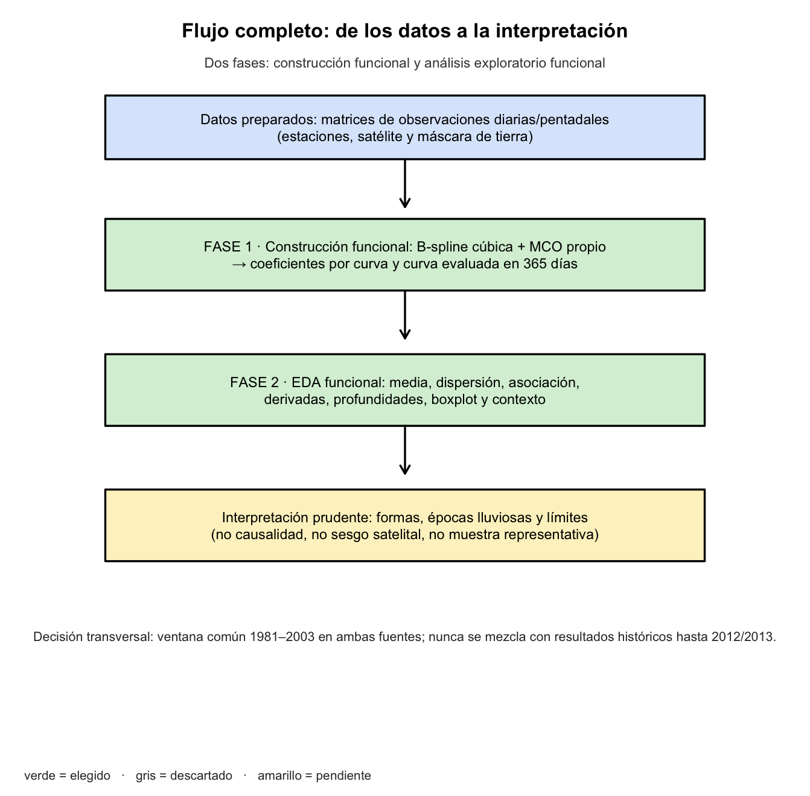{width=6.1in}

*Figura 1. Flujo completo de las dos fases. La ventana 1981–2003 se aplica antes de elegir K o ajustar, para que ambas fuentes hablen del mismo periodo.*


```{=openxml}
<w:p><w:r><w:br w:type="page"/></w:r></w:p>
```

# 1. Datos, procedencia y cobertura

**Estaciones.** `fda_fase1/curvas_estaciones_mm.csv.gz`: observaciones preparadas,
claves STATION_ID/YEAR y 365 columnas diarias. La unidad de trabajo es una
estación en un año, no una estación aislada. No se reconstruye aquí la limpieza
desde crudos ausentes de esta raíz.

**Satélite.** `fda_fase1/curvas_satelite_mm.csv.gz`: claves año/fila/columna y
72 tiempos heredados por año. Péntada es un intervalo de aproximadamente cinco
días; 72 columnas no prueban por sí solas el calendario ni su agregación exacta.

**Tierra.** De `fda_fase2/coef_satelite_tierra.csv.gz` se usan solo las claves de
la máscara heredada, NO sus coeficientes Python. La máscara fue construida con
referencia a CHIRPS, pero esto no identifica inequívocamente el producto recibido.

**ONI.** `eda_fase0/oni_anual_fase.csv` aporta la fase por ONI medio anual del
prototipo; el notebook 02 documenta NOAA CPC y una copia local. Falta confirmar
versión/fecha exacta de descarga. No es aquí una clasificación oficial de episodios.

**Tabla 1. Cobertura real después del filtro 1981–2003.** NA cuenta celdas;
ausencias cuenta combinaciones sitio–año sin curva, respecto del catálogo observado.

| Fuente | Curvas | Completas | Incompletas | Ausencias | NA |
| --- | --- | --- | --- | --- | --- |
| estaciones | 4.426 | 3.761 | 665 | 1.048 | 2.871 |
| satelite | 33.189 | 33.189 | 0 | 0 | 0 |
| satelite_tierra | 31.119 | 31.119 | 0 | 0 | 0 |


Se observan 238 estaciones; 238 × 23 = 5.474 combinaciones posibles respecto
del catálogo, frente a 4.426 presentes. No se afirma que todas las estaciones
debieran existir todos los años. Las 665 curvas incompletas contienen 2.871 NA:
se ajustan solo donde hay observación, sin reemplazarlos por cero.

Satélite: 1.443 píxeles por año en la caja, 1.353 en tierra; la completitud de
estas matrices no verifica los datos crudos. Se excluyen 12.987 curvas satelitales
posteriores a 2003 antes de seleccionar K o ajustar.

**Qué significa «cobertura», en simple.** Para cada fuente contamos cuatro cosas:
cuántas curvas hay (filas), cuántas están completas, cuántas tienen algún hueco
y cuántas combinaciones sitio–año del catálogo no aparecen. Un valor **NA** es un
día que no se midió: no es cero de lluvia. En estaciones hay 238 sitios posibles
en 23 años; si todos existieran siempre habría 5.474 combinaciones, pero hay
4.426. Eso no es necesariamente un error: una estación puede no haber operado
en ciertos años. Lo dejamos declarado en vez de inventarlo.

**Qué se encontró, leyendo la tabla.** La fuente satelital tiene muchas más
curvas que la terrestre porque cada año aporta cientos de píxeles, no decenas de
estaciones. Las 665 curvas incompletas de estaciones concentran 2.871 NA; se
ajustan solo en los días observados (ver la decisión de NA más adelante). Antes
de seleccionar K se descartan 12.987 curvas satelitales que caen fuera de 2003,
para no mezclar la ventana normativa con datos posteriores.

**De dónde sale cada insumo.** `curvas_estaciones_mm.csv.gz` y
`curvas_satelite_mm.csv.gz` contienen las matrices de observaciones ya
preparadas; `coef_satelite_tierra.csv.gz` aporta **solo las claves** de la
máscara terrestre (no sus coeficientes de Python); `oni_anual_fase.csv` trae la
fase del índice Niño por año. No se reconstruye aquí la limpieza desde los datos
crudos, porque esos archivos no están en esta carpeta.

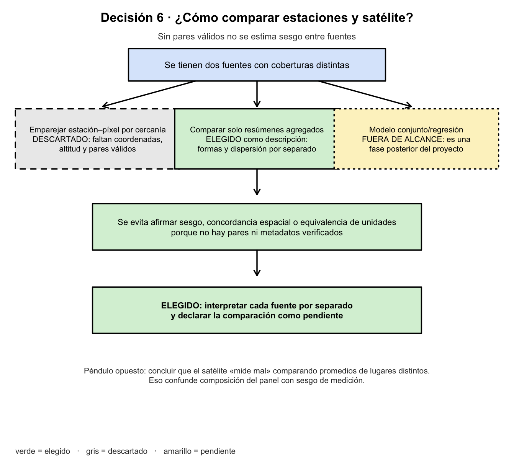{width=6.1in}

*Figura 2. Decisión sobre comparar las dos fuentes. Sin pares estación–píxel verificados, la comparación se declara pendiente en lugar de estimar un sesgo que los datos no permiten.*


```{=openxml}
<w:p><w:r><w:br w:type="page"/></w:r></w:p>
```

# 2. Glosario · de observaciones a curvas

| Término | Significado para explicar el proyecto |
| --- | --- |
| Dato discreto | Una observación en un tiempo concreto; las celdas de las matrices de entrada. |
| NA | Marca de un dato faltante. No significa cero de lluvia y no se convierte en cero para ajustar. |
| Dato funcional / curva | Una función x(t) que permite evaluar el fenómeno a lo largo del año. Es una representación estimada, no nuevos datos medidos. |
| Estación / píxel | Punto de medición terrestre / celda espacial del producto satelital. No se suponen pares entre fuentes. |
| Péntada | Intervalo cercano a cinco días. Duraciones, fechas y agregación del producto deben verificarse. |
| Base B-spline | Colección de funciones locales que se combinan para representar una curva flexible. |
| Orden / grado | Orden 4 significa polinomios de grado 3 por tramos; no significa K=4. |
| K | Número de funciones base y de coeficientes por curva. Mayor K permite más detalle y puede sobreajustar. |
| Phi (Φ) | Matriz n × K: en cada fila se evalúan las K bases en un tiempo observado. |
| Coeficiente | Peso de una función base en la curva; los K pesos resumen una curva, pero no son observaciones de lluvia. |
| MCO | Mínimos cuadrados ordinarios: elige pesos que minimizan la suma de residuos al cuadrado en los puntos observados. |
| Residuo | Observación menos valor ajustado en ese mismo tiempo. No se calcula residuo donde faltaba el dato. |
| S / H | Matriz suavizadora o hat: transforma observaciones en ajustes. En este MCO es una proyección, S²=S y tr(S)=K. |
| ECM | Error cuadrático medio de ajuste en los datos usados. Su descenso al aumentar K no prueba mejor generalización. |
| VC | Validación cruzada dejando un tiempo fuera. Aquí se calcula con el atajo por la diagonal de S. |
| VCG | Validación cruzada generalizada: aproxima VC usando la traza de S. Su mínimo decide K en este trabajo. |
| Ventana común | Periodo compartido por ambas fuentes: 1981–2003. Todo cálculo se restringe a él. |
| Nodo (interior) | Punto donde se unen los tramos de una B-spline; controla dónde puede cambiar la forma de la curva. |
| Rango completo | La matriz Phi tiene columnas linealmente independientes; sin esto el sistema de MCO no tiene solución única. |
| Sobreajuste | Cuando un modelo es tan flexible que copia el ruido de los datos usados y generaliza peor. |


**Ejemplo de traducción.** «K=6» quiere decir que cada curva de estación se
representa mediante seis funciones base y seis pesos. No quiere decir seis
estaciones, seis días ni seis años.


```{=openxml}
<w:p><w:r><w:br w:type="page"/></w:r></w:p>
```

# 3. Glosario · cómo interpretar el EDA

| Término | Significado y cautela |
| --- | --- |
| Banda puntual / EE / IC | Curva ajustada ±2 errores estándar (EE). IC significa intervalo de confianza. Bajo sigma²I (varianza residual constante e independencia), la banda es puntual, no simultánea. |
| Media funcional | Promedio de curvas evaluadas en un mismo día; se obtiene también promediando coeficientes. |
| Varianza / DE | Dispersión entre curvas en cada día. DE es la raíz de la varianza y conserva la unidad de la curva. |
| CV | Coeficiente de variación: DE/media. No tiene unidad; se vuelve inestable cerca de media cero. |
| Covarianza | Cómo cambian conjuntamente los valores de dos días entre curvas. Depende de la escala y tiene unidad al cuadrado. |
| Correlación | Covarianza normalizada entre −1 y 1, sin unidad; aquí relaciona días dentro de una fuente, no estaciones con píxeles. |
| Derivada | Pendiente instantánea. Al derivar una tasa en mm/día respecto de días se obtiene cambio de tasa en mm/día². |
| Profundidad | Medida de centralidad de una curva respecto del conjunto; valor alto significa más central bajo esa definición. |
| FM | Fraiman–Muniz: combina centralidad punto a punto. Se conserva escala del script depth.FM y también la escala FM_pdf. |
| MBD | Profundidad de banda modificada: fracción de tiempos en que la curva cae entre pares de curvas; aquí incluye empates en el borde. |
| Mediana funcional | Curva observada en el conjunto ajustado con profundidad máxima. Mediana FM y MBD pueden ser distintas. |
| Media recortada | Media de curvas con FM al menos igual al cuantil 25 %. Incluye empates, por lo que no siempre retiene exactamente 75 %. |
| Boxplot funcional | Envolvente del 50 % más profundo por MBD; límites expandidos 1,5 veces su amplitud y bigotes de las no atípicas. |
| Atípica | Curva que toca o rebasa algún límite de detección según la regla implementada de clase. No equivale automáticamente a error. |
| ONI / ENSO | ONI: Índice Niño Oceánico, usado como contexto de ENSO, El Niño–Oscilación del Sur. Una fase anual heredada no prueba causa local. |
| Banda puntual vs simultánea | La puntual vale para un día concreto; la simultánea cubriría todos los días a la vez. Aquí solo se dibuja la puntual. |
| Empate | Dos curvas con la misma profundidad. Afecta cómo se elige la mediana y cómo se aplica el recorte. |


```{=openxml}
<w:p><w:r><w:br w:type="page"/></w:r></w:p>
```

# 4. De los puntos a una representación anual

**La idea central, sin fórmulas.** Cada fila de la matriz es una serie en el
tiempo. Si la dibujamos tal cual, aparece una línea quebrada con huecos y ruido.
Queremos una curva suave que resuma su forma. Ese paso —de puntos a función— es
el corazón de la construcción funcional.

**Bloques 1–2.** Primero se filtran ambas fuentes a 1981–2003. Las filas son
curvas y las columnas tiempos, al revés de la notación matricial de varios
ejemplos docentes. Los identificadores (estación y año, o año/fila/columna)
siempre viajan con sus filas, para no perder a qué unidad pertenece cada curva.

**La malla de evaluación.** Evaluamos todas las curvas en los días 1 a 365, para
que se puedan comparar entre sí aunque unas tengan 365 días observados (estación)
y otras 72 pentadas (satélite). Esa malla no inventa datos: solo es el conjunto
de días donde se evalúa la curva estimada. Tampoco convierte 72 pentadas en 365
observaciones reales ni resuelve por sí misma los años bisiestos o los metadatos
satelitales pendientes; son límites que se declaran.

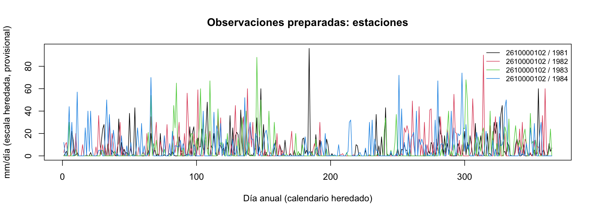{width=6.1in}

*Figura 3. Cuatro curvas estación–año, identificadas en la leyenda. Las irregularidades son datos discretos antes del ajuste.*


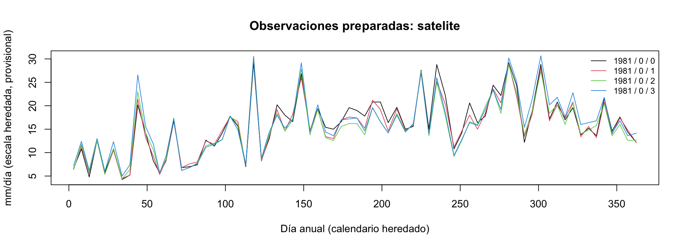{width=6.1in}

*Figura 4. Cuatro curvas píxel–año de la caja. Son ejemplos gráficos, no el subconjunto usado para estimar: el cálculo usa todas las filas elegibles.*

**Lectura prudente.** Las dos figuras no representan los mismos lugares. No permiten inferir sesgo satelital ni equivalencia de unidades.


```{=openxml}
<w:p><w:r><w:br w:type="page"/></w:r></w:p>
```

# 5. Elegir K sin confundir ajuste con validación

**Qué es K, en palabras simples.** K es cuántas piezas (funciones base) usamos
para armar cada curva. Con K pequeño la curva es rígida; con K grande es tan
flexible que puede «copiar» el ruido. Elegir K es decidir cuánta flexibilidad
permitimos. Ni poco ni demasiado: hay que validarlo.

**La trampa del ajuste.** El ECM mide qué tan cerca pasa la curva de los puntos
usados. Si uno elige K bajando el ECM, siempre gana el K más grande y se
sobreajusta. Por eso se usan criterios que **castigan la flexibilidad** (VC y
VCG) y no solo el ajuste.

**Bloque 3.** Se examina K=4…40 y 45…100 de cinco en cinco en estaciones;
K=4…40 en satélite. Se selecciona con las 3.761 curvas completas de estaciones
y las 33.189 curvas satelitales de la ventana. Las incompletas se ajustan después.

**Qué es «validar dejando un tiempo fuera».** VC quita un día, ajusta con los
demás y predice el día quitado; VCG aproxima esa idea sin reajustar una vez por
cada día, usando la traza de la matriz suavizadora. El K que mejor predice (no
el que mejor ajusta) es el que se adopta.

**Tabla 2. Mínimos reales.** ECM y VC se promedian por curva y tiempo;
VCG conserva la suma sobre curvas del script docente. No compare sus magnitudes
entre fuentes como si fueran el mismo universo o una medida de sesgo.

| Fuente | Criterio | K mínimo | Valor |
| --- | --- | --- | --- |
| estaciones | ECM | 100 | 79,944 |
| estaciones | VC | 6 | 122,485 |
| estaciones | VCG | 6 | 460.892,764 |
| satelite | ECM | 40 | 5,507 |
| satelite | VC | 11 | 16,097 |
| satelite | VCG | 11 | 530.883,147 |


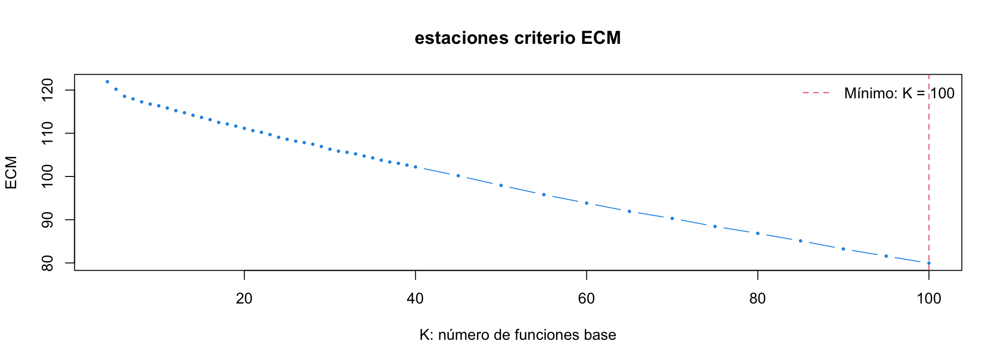{width=3.05in} 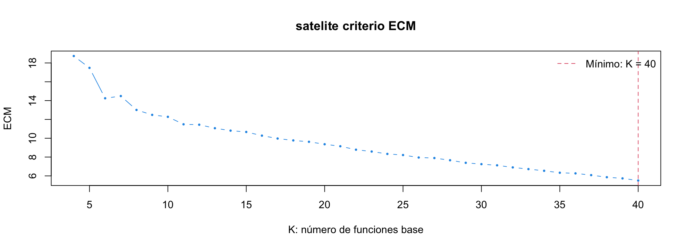{width=3.05in}

*Figuras 5–6. ECM por fuente. La línea vertical marca su mínimo; por sí solo no decide, porque decrece al aumentar K.*


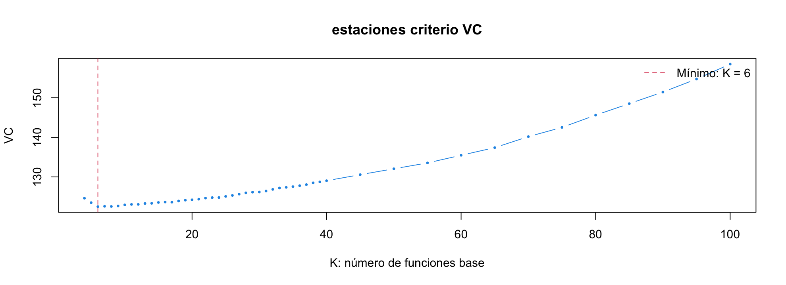{width=3.05in} 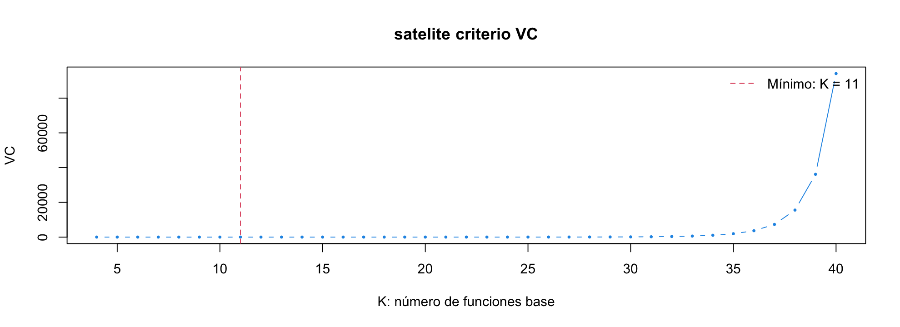{width=3.05in}

*Figuras 7–8. VC rápidas por fuente. Penaliza la flexibilidad y su mínimo suele quedar cerca del K adoptado.*


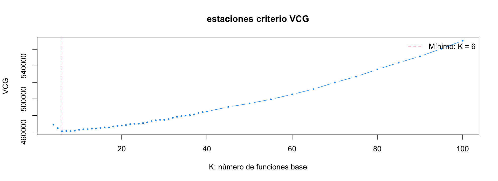{width=3.05in} 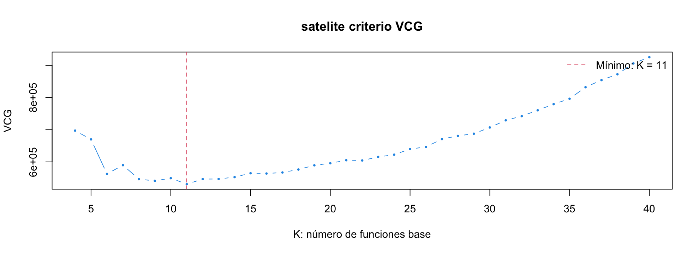{width=3.05in}

*Figuras 9–10. VCG por fuente. Su mínimo es el K adoptado: 6 en estaciones y 11 en satélite. Las tres gráficas cubren la exigencia ECM, VC y VCG.*


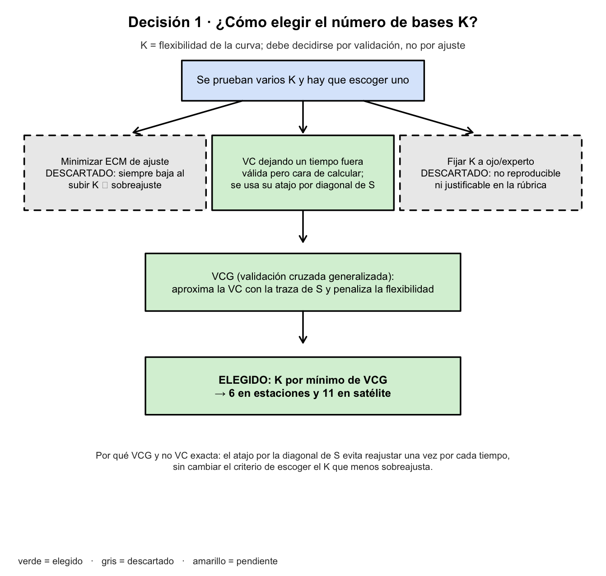{width=6.1in}

*Figura 11. Decisión de K: se descarta minimizar el ECM de ajuste (siempre baja) y fijar K a ojo; se usa VCG por su atajo de la traza de S. Resultado: 6 estaciones, 11 satélite.*


```{=openxml}
<w:p><w:r><w:br w:type="page"/></w:r></w:p>
```

# 6. Base, matriz Phi y coeficientes

**Qué es una B-spline, con una analogía.** Imagine una regla flexible partida en
tramos que se unen suavemente en puntos llamados **nodos**. Cada tramo es un
polinomio cúbico (grado 3). Las **funciones base** son piezas locales que, al
sumarlas con ciertos pesos (los **coeficientes**), producen la curva. Es como
armar una figura con K piezas móviles: los coeficientes dicen cuánto pesa cada
pieza, y K dice cuántas piezas hay (la flexibilidad).

**Por qué cúbica y con nodos equiespaciados.** El orden 4 (grado 3) es un
equilibrio clásico entre suavidad y flexibilidad; nodos igualmente espaciados
evitan introducir supuestos sobre dónde «debería» cambiar la lluvia. No se
optimiza la posición de los nodos: eso añadiría decisiones que la consigna no
pide y que complicarían la reproducibilidad.

**Bloques 4–5.** Se adoptan B-splines cúbicos (orden 4), nodos interiores
equiespaciados y dominio 1–365. La recursión de Cox-de Boor se programa en R
estándar. No se emplea `fda`, `splines` ni `smooth.basis` en construcción.

**De la matriz a los coeficientes.** Para una curva: `c = solve(t(Phi) %*% Phi, t(Phi)) %*% y`.
Con huecos se restringen Phi e y a los tiempos observados; se exige rango
completo y más observaciones que coeficientes. En el script C es N × K. Si la
matriz Phi no tuviera rango completo, el sistema no tendría solución única; por
eso se verifica antes de resolver.

**Qué se decidió y qué se evitó.** Programar la base y el MCO es requisito de la
consigna; usar un paquete habría ocultado el método. Los diagramas resumen esa
decisión y, aparte, cómo se tratan los datos faltantes.

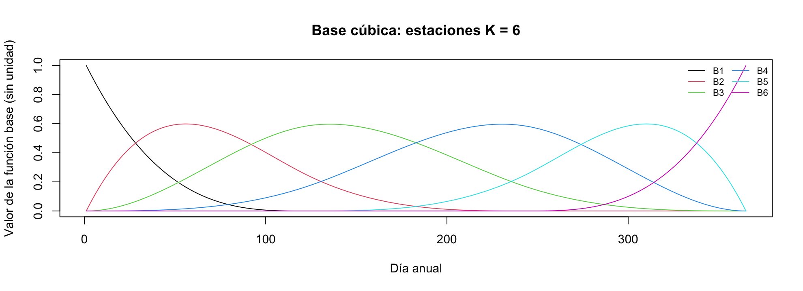{width=5.8in}

*Figura 12. Seis funciones locales de la base terrestre. La curva ajustada es su combinación ponderada.*


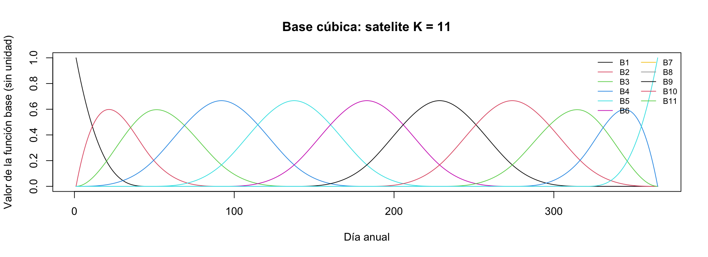{width=5.8in}

*Figura 13. Once funciones satelitales; más K no implica que el satélite sea más preciso.*

**Tabla 3. Primeras cuatro filas de Phi de estaciones (sin unidad).**

| Día | B1 | B2 | B3 | B4 | B5 | B6 |
| --- | --- | --- | --- | --- | --- | --- |
| 1 | 1,0000 | 0,0000 | 0,0000 | 0,0000 | 0,0000 | 0,0000 |
| 2 | 0,9755 | 0,0244 | 0,0001 | 0,0000 | 0,0000 | 0,0000 |
| 3 | 0,9514 | 0,0482 | 0,0004 | 0,0000 | 0,0000 | 0,0000 |
| 4 | 0,9276 | 0,0715 | 0,0009 | 0,0000 | 0,0000 | 0,0000 |


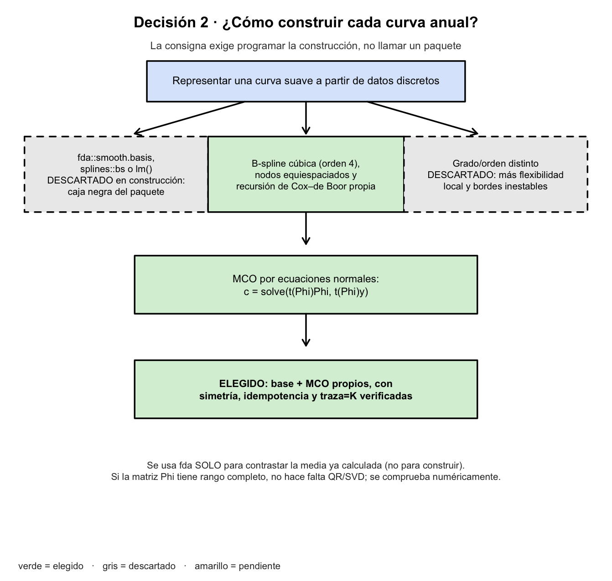{width=6.1in}

*Figura 14. Decisión de construcción: se descarta usar paquetes o cambiar el grado; se programan la B-spline cúbica y el MCO por ecuaciones normales.*


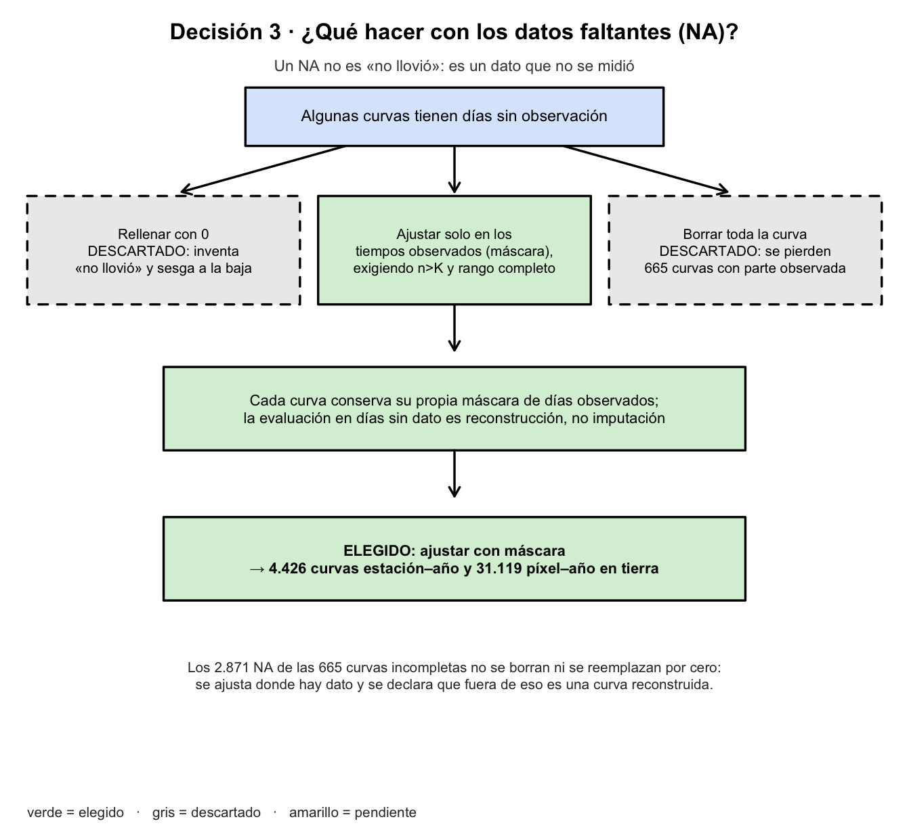{width=6.1in}

*Figura 15. Decisión sobre faltantes: no se rellena con cero ni se borra la curva; se ajusta solo en los días observados, con su propia máscara.*


```{=openxml}
<w:p><w:r><w:br w:type="page"/></w:r></w:p>
```

# 7. Ajuste MCO y banda puntual

**Qué hace el MCO.** Busca los pesos que hacen que la curva pase lo más cerca
posible de los puntos observados, midiendo «cerca» con la suma de residuos al
cuadrado. Es una proyección: convierte las observaciones en valores ajustados.

**Qué es la matriz S.** `S` (o «hat») aplica esa proyección: dado un vector de
observaciones, devuelve el vector ajustado. Dos propiedades útiles la delatan:
es simétrica e idempotente (aplicarla dos veces da lo mismo que una), y su traza
es igual a K. Comprobarlas es un control de que la implementación es correcta,
no una propiedad del clima.

`S = Phi %*% solve(t(Phi) %*% Phi, t(Phi))`. Se comprueban simetría,
idempotencia y traza=K en la malla completa y en cada máscara incompleta.
Los errores numéricos son próximos a la precisión de cálculo, no errores climáticos.

**Qué es la banda.** La banda gris alrededor de la curva es la curva ajustada
más/menos dos errores estándar. Es una banda **puntual** (vale día por día) y
supone varianza residual constante e independencia. Dibujarla no demuestra que
esos supuestos se cumplan; solo visualiza la incertidumbre bajo ese modelo.

**Tabla 4. Máximo error de cada propiedad entre máscaras.**

| Fuente | Control | Error máximo |
| --- | --- | --- |
| estaciones | simetria | 5.55e-17 |
| estaciones | idempotencia | 4.30e-16 |
| estaciones | traza | 1.07e-14 |
| satelite | simetria | 1.11e-16 |
| satelite | idempotencia | 2.22e-16 |
| satelite | traza | 3.55e-15 |


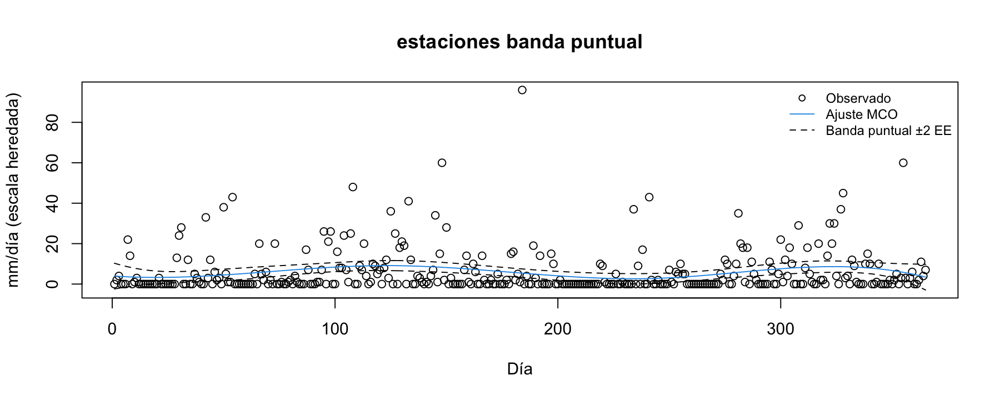{width=5.8in}

*Figura 16. Primera curva completa terrestre; identidad en banda_ejemplo_estaciones.csv. Puntos observados, línea azul ajustada y banda ±2 EE.*


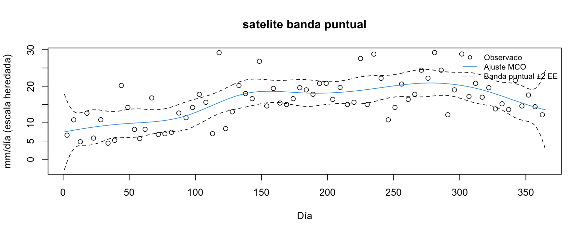{width=5.8in}

*Figura 17. Análogo para el primer píxel–año completo. Banda bajo sigma²I: puntual, no simultánea ni intervalo de predicción.*

No se recortan valores negativos para embellecer el ajuste: el MCO no impone no negatividad.


```{=openxml}
<w:p><w:r><w:br w:type="page"/></w:r></w:p>
```

# 8. Residuos: qué incertidumbre describen

**Qué es un residuo, en simple.** Es la diferencia, en un día concreto, entre lo
que se midió y lo que la curva estima. Residuos pequeños indican que la curva
pasa cerca de los datos; no indican que la curva sea «verdadera». Donde no hubo
dato, no se calcula residuo.

Un residuo es el dato observado menos el valor de su propia curva ajustada.
La varianza residual se estima como `sigma² = suma(residuo²)/(n_observado−K)`.
Para el ejemplo, `EE(t)² = sigma² × suma((Phi(t) %*% mapa)²)`.
La banda usa independencia y varianza residual constante; no se afirma que esas
suposiciones hayan quedado verificadas por dibujarla.

El segundo momento residual de clase es `Sigma_res = t(Res) %*% Res / N`,
solo con curvas completas. No se presenta como covarianza muestral centrada
con divisor N−1. Estructura fuera de la diagonal advierte dependencia residual.

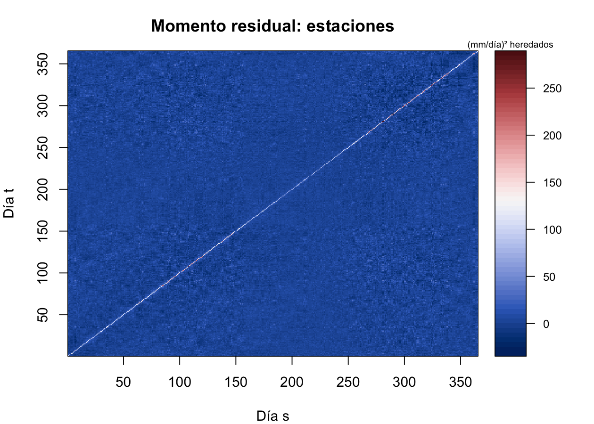{width=3.05in} 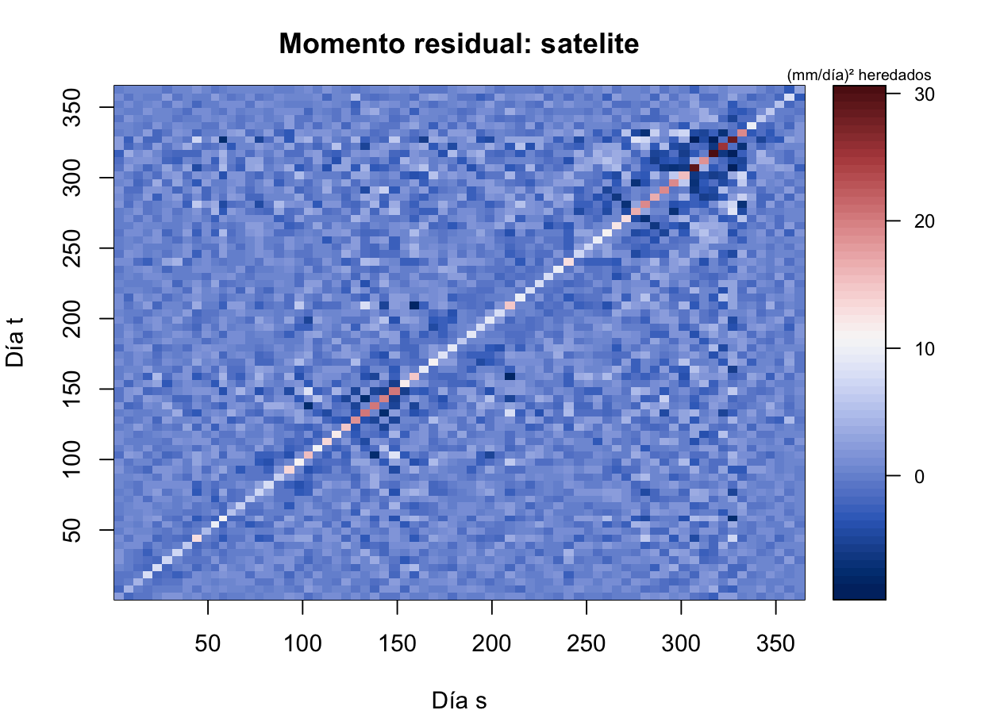{width=3.05in}

*Figuras 18–19. Segundo momento residual por fuente, en escala heredada al cuadrado. Los colores de cada panel tienen su propia escala.*

**Tabla 5. Primera curva de cada fuente: extracto de coeficientes (escala heredada), sigma² y número de observados.**

| Fuente | Clave | c1 | c2 | sigma² | n obs. |
| --- | --- | --- | --- | --- | --- |
| estaciones | 2610000102 / 1981 | 3,947 | 0,990 | 119,688 | 365 |
| satelite | 1981 / 0 / 0 | 7,502 | 8,533 | 24,784 | 72 |


Los archivos `coef_*.csv` guardan todos los pesos y claves; `banda_ejemplo_*.csv`
guarda la identidad exacta del ejemplo, curva, EE y límites en 365 días.
El RDS conserva además la máscara observada. Las evaluaciones en días sin dato
son reconstrucciones, no imputaciones que se escriban sobre la matriz original.


```{=openxml}
<w:p><w:r><w:br w:type="page"/></w:r></w:p>
```

# 9. Media funcional y contraste de librería

**Qué es la media funcional, en simple.** Es la curva promedio: para cada día se
promedian los valores de todas las curvas. Da la forma «típica» del año. Ojo:
cada estación–año pesa igual, sin importar cuántos días tenga observados; por
eso una curva con muchos huecos no domina el promedio.

**Cómo se calcula y por qué coincide.** Promediar los coeficientes y luego
evaluar la base es equivalente a evaluar cada curva y promediar en cada día,
porque la evaluación es lineal. El script hace ambas cosas y comprueba que
coinciden; esa es una verificación de implementación.

**Bloque 7.** La media se calcula como `mu = P %*% colMeans(C)` y se comprueba
contra el promedio de las curvas evaluadas. Solo en EDA se crea un objeto `fda`
con los coeficientes ya calculados y se contrasta con `fda::mean.fd`.
No se vuelven a construir las curvas mediante un paquete.

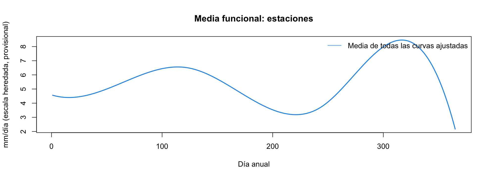{width=5.8in}

*Figura 20. Media de las 4.426 curvas terrestres; cada estación–año recibe el mismo peso.*


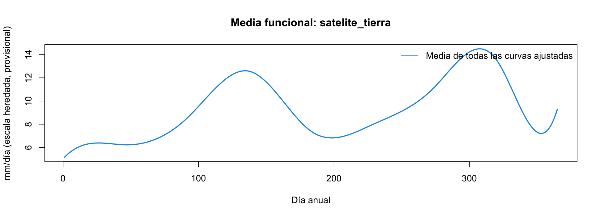{width=5.8in}

*Figura 21. Media de las 31.119 curvas en tierra. Ambas formas permiten discutir dos épocas de tasas altas, no demostrar concordancia espacial.*

**Tabla 6. Días ilustrativos, no promedios mensuales.** Media y DE en mm/día heredados; CV sin unidad.

| Fuente | Día | Media | DE | CV |
| --- | --- | --- | --- | --- |
| estaciones | 15 | 4,401 | 4,891 | 1,111 |
| estaciones | 105 | 6,508 | 4,202 | 0,646 |
| estaciones | 200 | 3,530 | 5,135 | 1,455 |
| estaciones | 290 | 7,333 | 5,853 | 0,798 |
| estaciones | 365 | 2,170 | 7,662 | 3,531 |
| satélite tierra | 15 | 6,196 | 3,575 | 0,577 |
| satélite tierra | 105 | 10,174 | 4,191 | 0,412 |
| satélite tierra | 200 | 6,823 | 5,771 | 0,846 |
| satélite tierra | 290 | 13,238 | 6,688 | 0,505 |
| satélite tierra | 365 | 9,292 | 5,492 | 0,591 |


```{=openxml}
<w:p><w:r><w:br w:type="page"/></w:r></w:p>
```

# 10. Varianza, DE y variación relativa

**Qué miden, en simple.** En cada día, la **varianza** dice cuánto se separan las
curvas entre sí (unidades al cuadrado). La **DE** es su raíz y vuelve a las
unidades de la lluvia, así que es más fácil de leer. El **CV** divide la DE por
la media y quita las unidades, pero se dispara cuando la media es casi cero.

**La confusión que hay que evitar.** Esto no es la incertidumbre de la media ni
el error de una medición: es **cuánto varían las curvas entre sí** ese día. Una
DE grande puede deberse a que hay sitios muy lluviosos junto a otros secos, no a
que el instrumento sea impreciso.

**Bloque 8.** Se usa varianza muestral de las curvas reconstruidas (divisor N−1),
DE como raíz directa y CV=DE/media si la media no es casi cero.
Esta es variabilidad entre curvas, no EE de una curva ni incertidumbre de la media.
`std.fd` suavizada es una alternativa de clase, no se declara idéntica a esta DE.

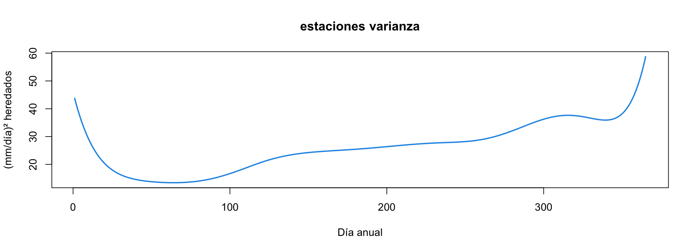{width=3.05in} 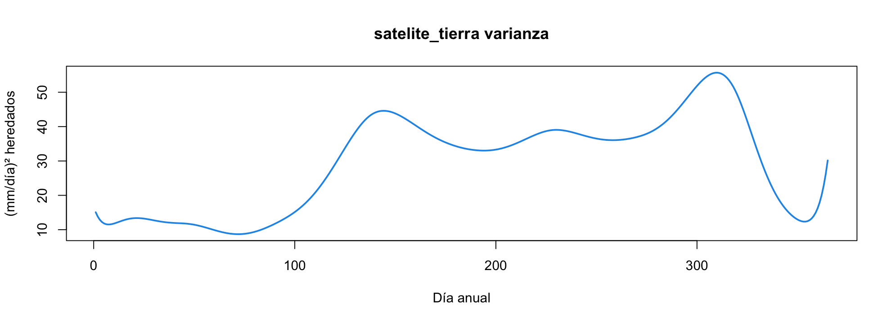{width=3.05in}

*Figuras 22–23. Varianza funcional por fuente, en (mm/día)² heredados. Es variabilidad entre curvas, no EE de una curva.*


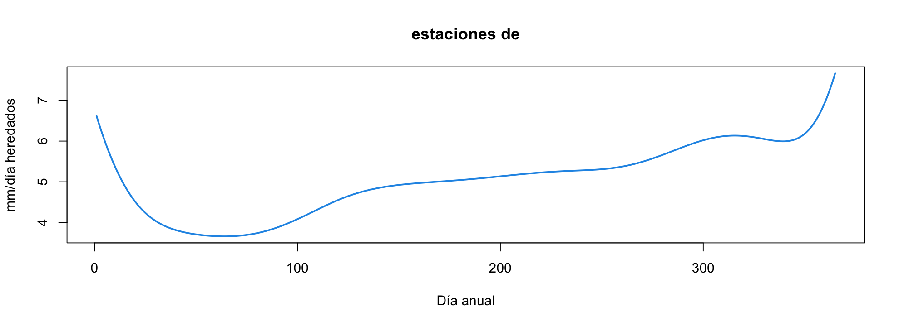{width=3.05in} 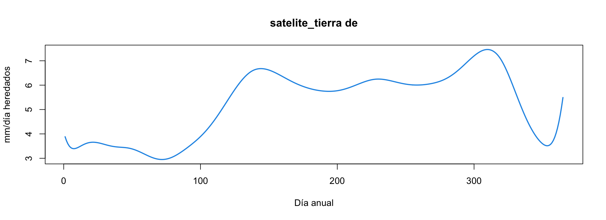{width=3.05in}

*Figuras 24–25. DE por fuente: raíz directa de la varianza. En estaciones el máximo en el día 365 exige cautela por el borde y la mezcla de sitios, años y máscaras de observación.*


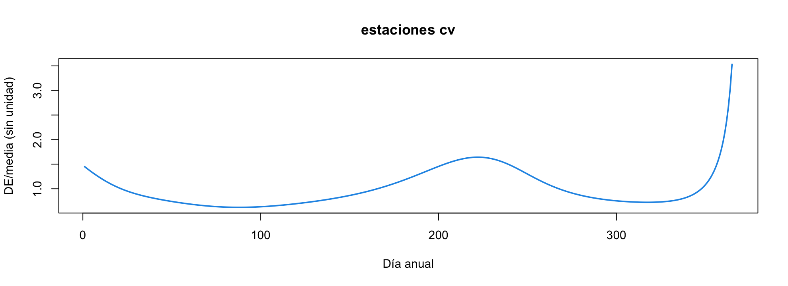{width=3.05in} 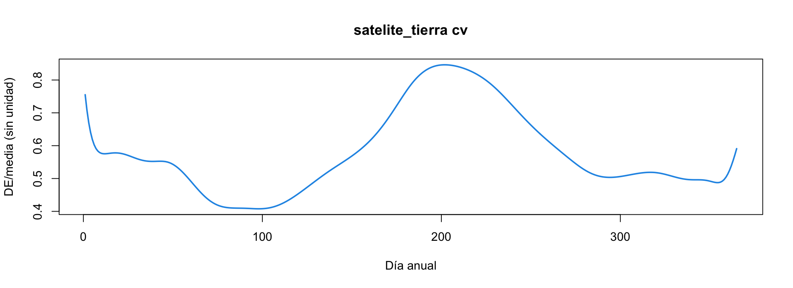{width=3.05in}

*Figuras 26–27. Coeficiente de variación CV=DE/media por fuente (adimensional). Una media pequeña puede producir CV alto sin una gran DE absoluta.*

**Tabla 7. Máximos diarios reales.** Varianza en (mm/día)² heredados, DE en mm/día heredados, CV adimensional.

| Fuente | Variable | Día máximo | Máximo |
| --- | --- | --- | --- |
| estaciones | varianza | 365 | 58,713 |
| estaciones | de | 365 | 7,662 |
| estaciones | cv | 365 | 3,531 |
| satelite_tierra | varianza | 310 | 55,691 |
| satelite_tierra | de | 310 | 7,463 |
| satelite_tierra | cv | 202 | 0,846 |

Las tres medidas describen dispersión entre curvas; no son incertidumbre de la media ni error satelital.


```{=openxml}
<w:p><w:r><w:br w:type="page"/></w:r></w:p>
```

# 11. Covarianza y correlación entre días

**Qué significan, en simple.** La covarianza pregunta: cuando un día es lluvioso
en una curva, ¿tiende a serlo también otro día en la misma curva? La correlación
es la misma idea pero sin unidades, entre −1 y 1. Aquí se comparan **días dentro
de una misma fuente**; nunca estaciones contra píxeles.

**Cómo leer el mapa de calor.** Una franja roja indica que esos dos días suelen
moverse juntos entre curvas; una azul, que van en sentidos opuestos. La diagonal
siempre es 1 (cada día consigo mismo). Asociación no es causalidad.

Se centran los coeficientes: `Cc = C − media_coef`.
`Cov = P %*% (t(Cc) %*% Cc/(N−1)) %*% t(P)`.
Su diagonal debe coincidir con la varianza diaria. La correlación divide por
las DE de los dos días. Cada celda compara días s y t dentro de una fuente.

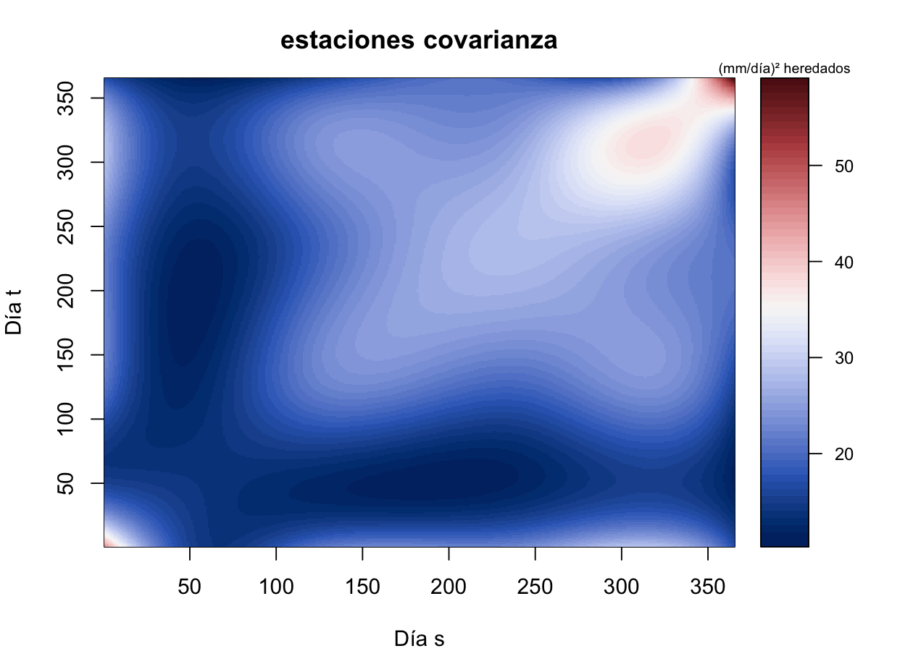{width=3.05in} 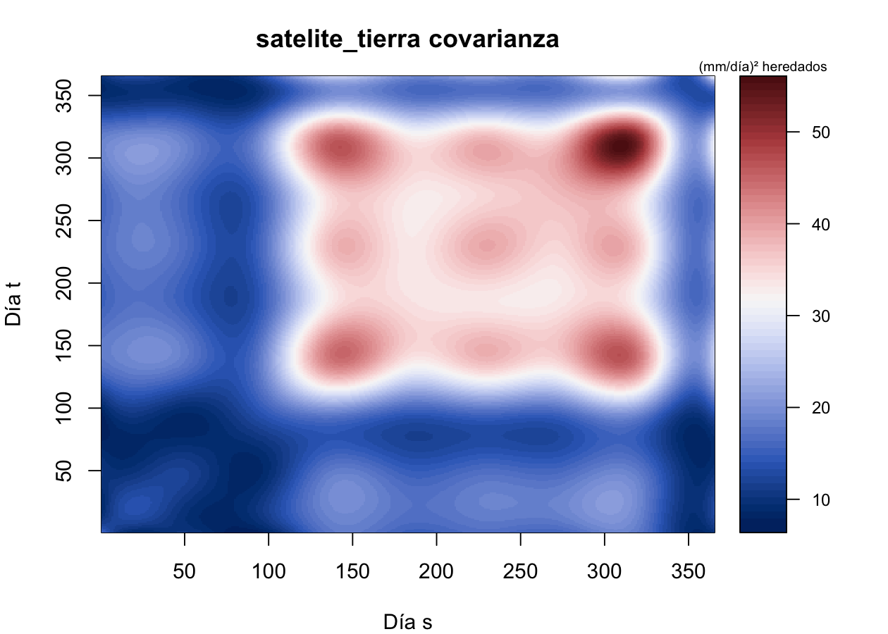{width=3.05in}

*Figuras 28–29. Covarianza terrestre y satelital. Unidad heredada al cuadrado; los rangos de color son propios de cada panel.*


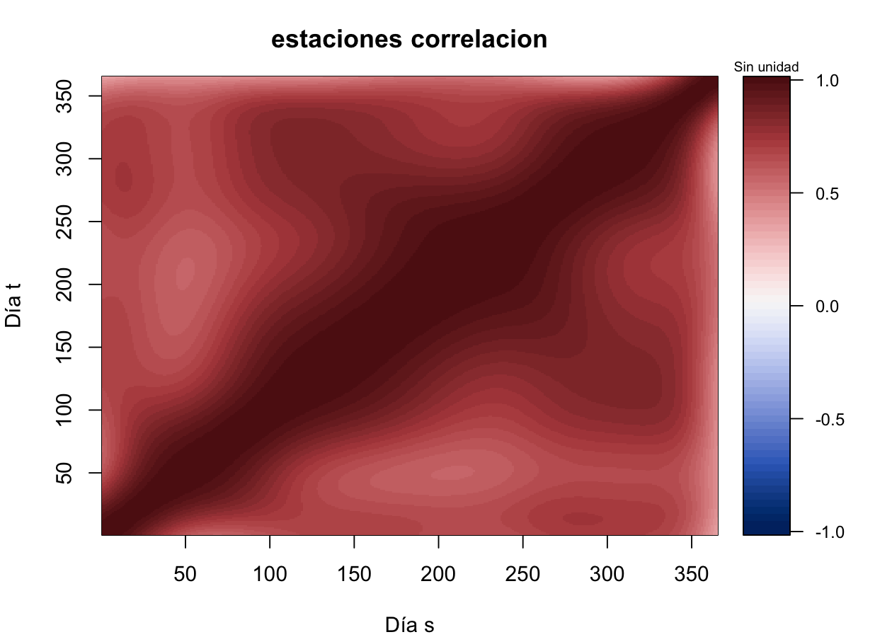{width=3.05in} 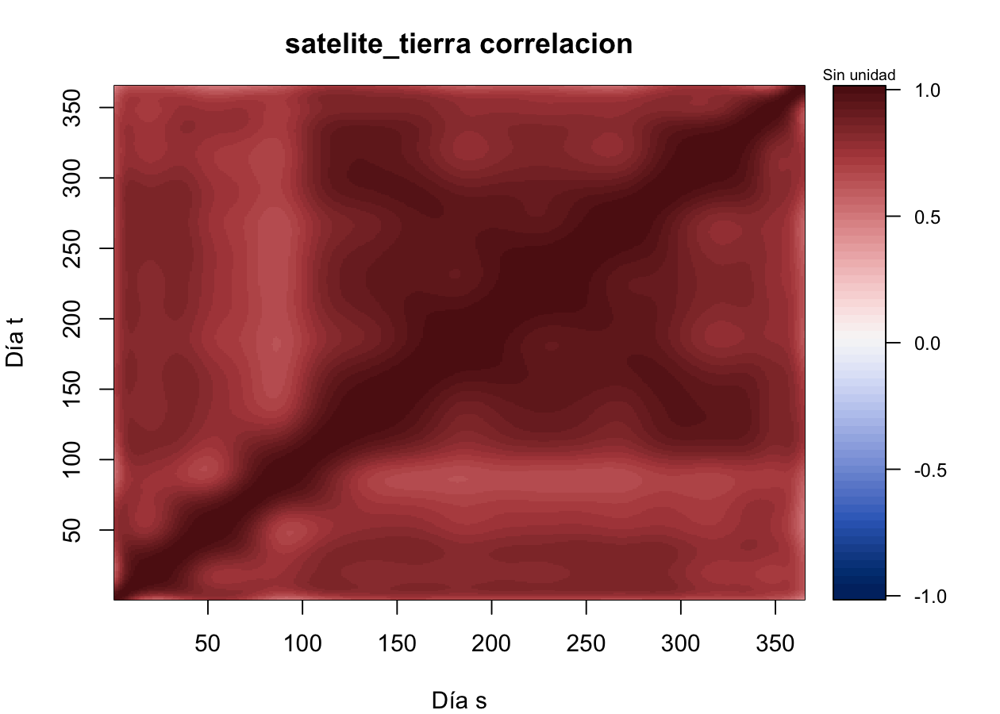{width=3.05in}

*Figuras 30–31. Correlación entre días; escala fijada de −1 a 1. Asociación temporal entre curvas, no correlación entre las dos fuentes.*


| Fuente | Correlación día 105–290 |
| --- | --- |
| estaciones | 0,808861 |
| satelite_tierra | 0,824418 |

La asociación positiva sugiere que curvas con tasas altas en un periodo también tienden a tenerlas en otro. No demuestra causalidad, orografía ni sesgo de medición.


```{=openxml}
<w:p><w:r><w:br w:type="page"/></w:r></w:p>
```

# 12. Derivadas y temporadas: qué sí se puede decir

**Qué es una derivada, en simple.** Es la pendiente de la curva: cuánto sube o
baja la tasa de lluvia de un día al siguiente. Si la pendiente pasa de positiva
a negativa, la curva alcanza un máximo local: un candidato a «época lluviosa».
Ojo: se deriva una **tasa** (mm/día) medida en días, así que las unidades de la
derivada son mm/día². Es una tasa de cambio, no una cantidad de lluvia.

**Por qué se usa la derivada analítica.** Al derivar la función base (un
polinomio) se obtiene la derivada exacta de la curva, sin aproximar con restas.
Las diferencias finitas son una aproximación que depende del paso elegido, y
`deriv.fd` vuelve a proyectar la curva, por lo que no da exactamente lo mismo.
La implementación se contrasta con `fda::eval.fd(..., Lfdobj=1)`.

**Bloque 9.** La derivada analítica se obtiene con la derivada de la base y los
coeficientes medios, sin diferencias finitas. Se verifica en pruebas contra
`fda::eval.fd(..., Lfdobj=1)`. `deriv.fd` reproyecta y no es idéntica.

Pendiente positiva: aumenta la tasa media; negativa: disminuye. Cruce de positivo
a negativo: candidato a máximo local. Aquí se deriva una tasa, no lluvia acumulada.

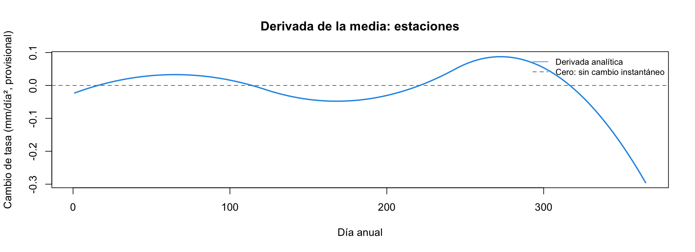{width=5.8in}

*Figura 32. Cambios de tasa en estaciones. Los cruces no son, por sí solos, fechas meteorológicas de inicio o fin.*


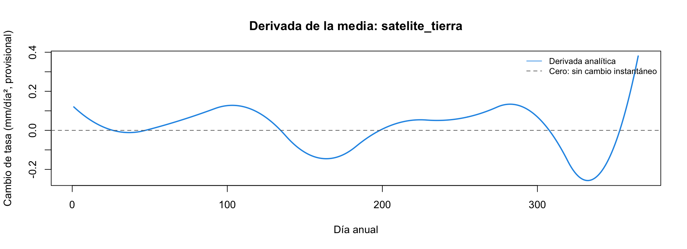{width=5.8in}

*Figura 33. Satélite: además de máximos dominantes hay oscilaciones menores. La flexibilidad y los bordes afectan la lectura.*

**Tabla 8. Intervalos de días con cambio positivo → no positivo de la derivada de la media.**

| Fuente | Intervalos de máximos locales candidatos |
| --- | --- |
| estaciones | 114–115, 316–317 |
| satelite_tierra | 26–27, 134–135, 307–308 |

El patrón dominante es compatible con dos épocas lluviosas. Sigue pendiente justificar y validar una regla docente de inicio/fin; no se inventa un detector.

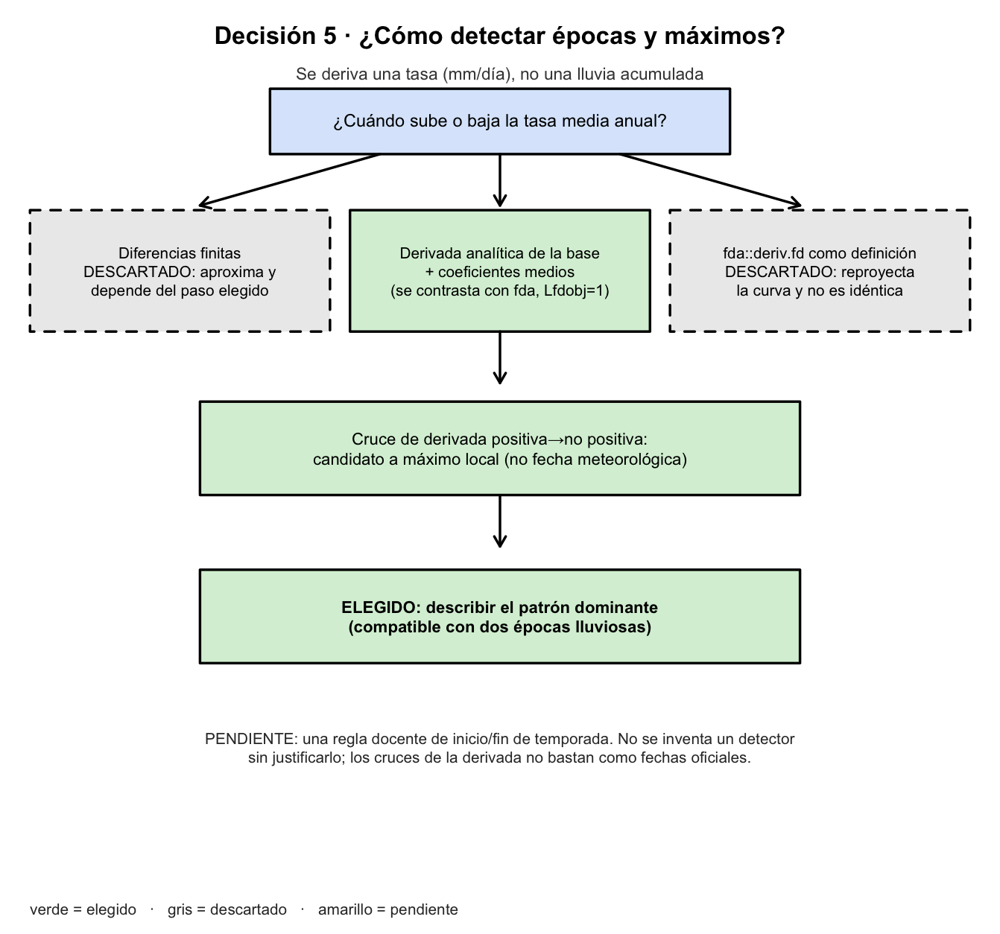{width=6.1in}

*Figura 34. Decisión sobre temporadas: se descartan diferencias finitas y deriv.fd como definición; se usa la derivada analítica. La regla de inicio/fin queda pendiente, no inventada.*


```{=openxml}
<w:p><w:r><w:br w:type="page"/></w:r></w:p>
```

# 13. Profundidad, mediana y media recortada

**Qué es «profundidad», con una imagen.** Piense en muchas curvas dibujadas una
sobre otra. La profundidad mide qué tan «central» es una curva: una curva muy
profunda está rodeada por las demás; una poco profunda vive en el borde del
conjunto. La curva **mediana** es la más profunda. Es una curva real del
conjunto, no un promedio.

**Por qué hay dos profundidades.** FM (Fraiman–Muniz) combina la centralidad día
a día. MBD (banda modificada) cuenta la fracción de días en que la curva cae
entre pares de otras curvas. Pueden elegir medianas distintas, sobre todo con
empates; por eso se reportan ambas en lugar de fingir que hay una sola verdad.

**La media recortada.** Es una media que deja fuera las curvas menos profundas
(el 25 % menos central). Sirve de puente entre la media (sensible a extremos) y
la mediana (robusta). Aquí se aplica con empates, así que no siempre retiene
exactamente el 75 %.

**Bloque 10.** FM agrega centralidad univariada; MBD compara cada curva con
bandas entre pares. Se calculan con todas las curvas de cada universo EDA en
la malla diaria. No se usa una muestra de 200 curvas para estimar profundidad.

La mediana es la primera curva de profundidad máxima; el recorte FM incluye
los empates del cuantil 25 %. MBD usa bandas inclusivas: los empates no se
tratan con rangos medios. Se conserva la escala docente FM y la columna FM_pdf.

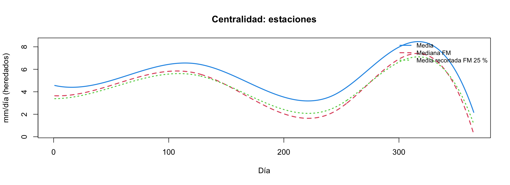{width=5.8in}

*Figura 35. Media, mediana FM y media recortada terrestre. Su separación describe asimetría o influencia de curvas grandes; no las elimina.*


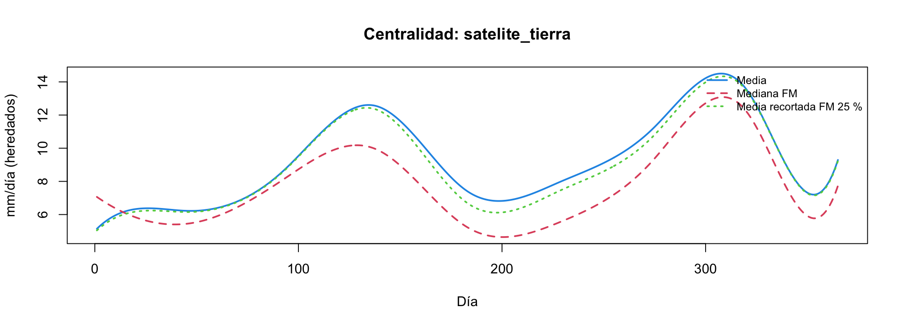{width=5.8in}

*Figura 36. Centralidad satelital. Una mediana es una curva concreta del conjunto, no necesariamente el promedio puntual.*

**Tabla 9. Curvas medianas identificadas por claves y profundidad.**

| Fuente | Criterio | Clave mediana | Profundidad |
| --- | --- | --- | --- |
| estaciones | FM | 2615400107 / 1993 | 0,891663 |
| estaciones | MBD | 2615400107 / 1993 | 0,493080 |
| satelite_tierra | FM | 1987 / 33 / 15 | 0,951752 |
| satelite_tierra | MBD | 2001 / 20 / 18 | 0,497877 |


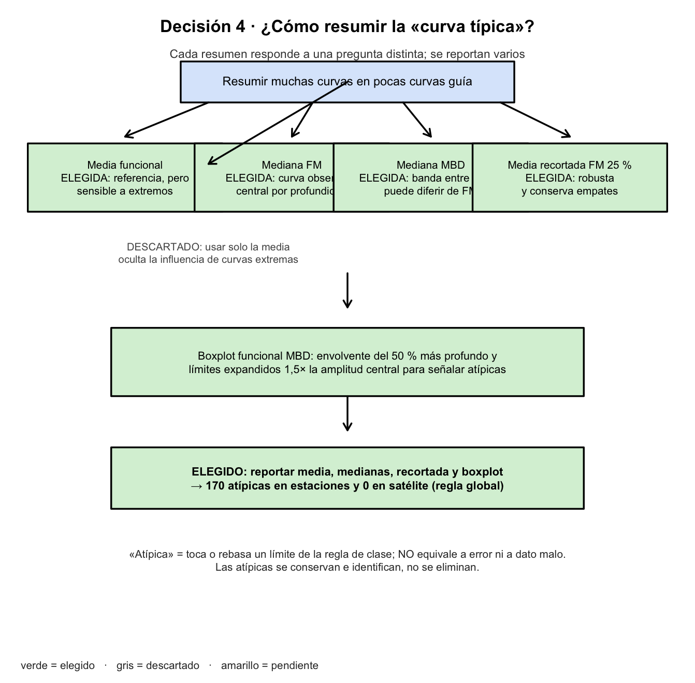{width=6.1in}

*Figura 37. Decisión sobre cómo resumir la curva típica: se reportan media, mediana FM, mediana MBD y media recortada, más boxplot; no se usa solo la media.*


```{=openxml}
<w:p><w:r><w:br w:type="page"/></w:r></w:p>
```

# 14. Boxplot funcional y curvas atípicas

**Qué es un boxplot funcional, en simple.** Es la versión «por curvas» del
diagrama de caja clásico. Se toma el 50 % más profundo del conjunto y se dibuja
su envolvente como una banda central. Esa banda muestra dónde vive la mayoría
«típica». Alrededor, unos límites ampliados marcan cuándo una curva se aleja
demasiado; las curvas que los tocan o rebasan se señalan.

**Qué significa «atípica» aquí.** Solo que una curva cumple la regla de la clase
para ser señalada. No es un diagnóstico de error ni una lista de datos malos:
puede ser un extremo real, un ajuste difícil o algo a revisar. Por eso se
conservan e identifican, no se eliminan.

**Bloque 11.** Se ordena por MBD, se toma el 50 % más profundo y se construye
su envolvente. Los límites se expanden 1,5 veces la amplitud central. Una curva
se señala si toca o rebasa un límite en algún día, conforme al código de clase.
Los bigotes son la envolvente de las curvas no señaladas, no esos límites.

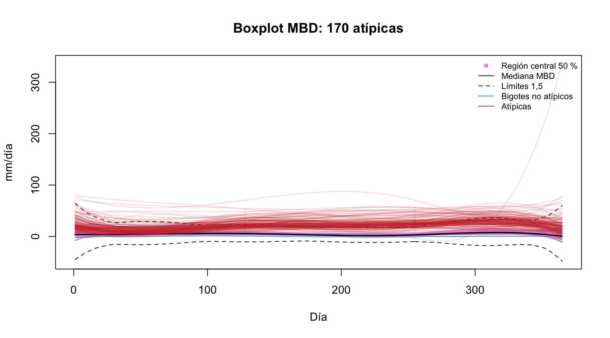{width=5.8in}

*Figura 38. Estaciones: 170 curvas señaladas sobre 4.426. Se conservan y se identifican; pueden reflejar extremos, ajustes o problemas a revisar.*


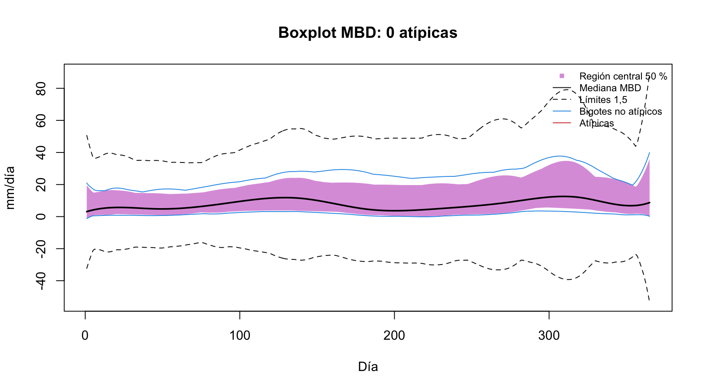{width=5.8in}

*Figura 39. Satélite terrestre: 0 señaladas bajo esta regla global. No significa ausencia de extremos locales ni calidad validada.*

**Tabla 10. Primeras cuatro atípicas, no ranking de severidad.** Lista completa de 170 en `atipicas_estaciones.csv`.

| Estación | Año | FM | MBD |
| --- | --- | --- | --- |
| 2612810108 | 1982 | 0,17880 | 0,13614 |
| 2620610101 | 1988 | 0,08366 | 0,07938 |
| 2620610103 | 1988 | 0,10256 | 0,09328 |
| 2620610103 | 1990 | 0,13602 | 0,11553 |


```{=openxml}
<w:p><w:r><w:br w:type="page"/></w:r></w:p>
```

# 15. Contexto por ONI anual

**Qué es el ONI, en simple.** El Índice Niño Oceánico resume si el Pacífico está
en una fase cálida (El Niño), fría (La Niña) o neutra. Aquí se usa una fase
**anual heredada** como contexto: agrupamos los años por fase y comparamos las
curvas de cada grupo.

**Qué se puede y qué no se puede concluir.** Se puede describir si, en estos
datos, los años de una fase tienen medias distintas. No se puede afirmar que el
ENSO cause esas diferencias: los grupos mezclan sitios y años, no se ajustan
otras variables y los años no son independientes. Una asociación descriptiva no
es un efecto causal.

**Bloque 12.** Se enlaza la fase heredada por año a cada curva reconstruida.
Los tamaños se cuentan por curvas, no por episodios ENSO independientes.
El promedio mezcla sitios y años y no ajusta covariables ni dependencia espacial.

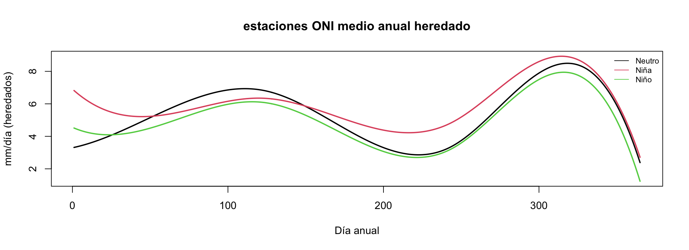{width=5.8in}

*Figura 40. Medias terrestres por fase ONI anual. Las diferencias son descriptivas y pueden estar influidas por composición del panel.*


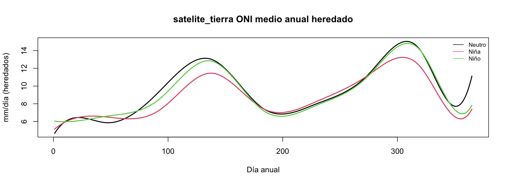{width=5.8in}

*Figura 41. Medias satelitales en tierra por la misma regla anual. No es un efecto causal estimado de ENSO.*

**Tabla 11. Tamaños de los grupos usados en cada media.**

| Fuente | Fase anual heredada | Curvas |
| --- | --- | --- |
| estaciones | Neutro | 2.089 |
| estaciones | Niña | 1.176 |
| estaciones | Niño | 1.161 |
| satelite_tierra | Neutro | 14.883 |
| satelite_tierra | Niña | 8.118 |
| satelite_tierra | Niño | 8.118 |

Para estudiar episodios oficiales se necesitaría verificar la serie y la definición temporal pertinente; aquí no se añade esa inferencia.


```{=openxml}
<w:p><w:r><w:br w:type="page"/></w:r></w:p>
```

# 16. Grupos descriptivos y lectura territorial

**De dónde salen los grupos, en simple.** No hay una división geográfica oficial
en estos archivos, así que se usan dos reglas heredadas del prototipo: para
estaciones, el prefijo del identificador (26 u otro); para satélite, un corte de
longitud aproximado. Son formas de **agrupar para mirar**, no cuencas ni zonas
orográficas verificadas.

**Por qué se rotulan con cautela.** Comparemos curvas de dos «grupos» no prueba
que la diferencia se deba al relieve: los grupos mezclan altitudes, suelos y
años distintos. La orografía es una hipótesis razonable para explorar, no una
explicación demostrada por estas gráficas.

Estaciones: prefijo del identificador 26 frente a otro prefijo. Satélite: corte
de longitud heredado −76,8. Estas reglas se conservan del prototipo y se
rotulan por lo que son: no delimitan cuencas ni zonas orográficas verificadas.

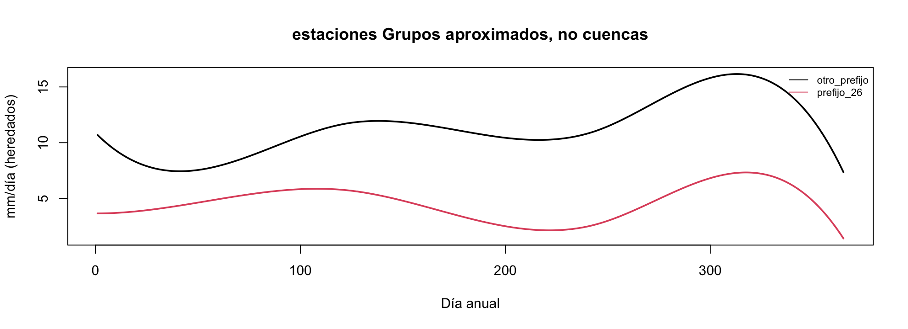{width=5.8in}

*Figura 42. Comparación por prefijo de estación; antes de interpretar por relieve se necesitan localización y metadatos.*


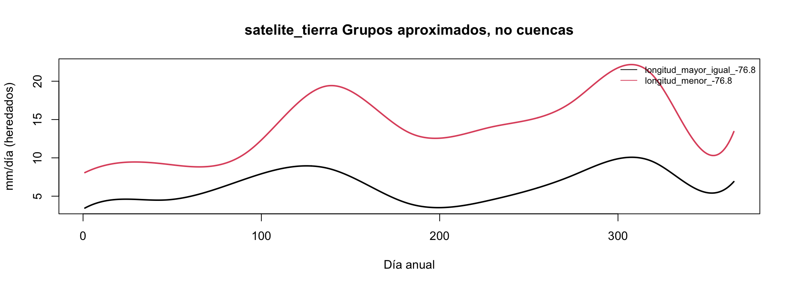{width=5.8in}

*Figura 43. Comparación por corte longitudinal aproximado en la máscara terrestre. No se han emparejado estaciones con píxeles.*

**Tabla 12. Curvas por grupo.**

| Fuente | Regla de grupo | Curvas |
| --- | --- | --- |
| estaciones | otro_prefijo | 570 |
| estaciones | prefijo_26 | 3.856 |
| satelite_tierra | longitud_mayor_igual_-76.8 | 19.734 |
| satelite_tierra | longitud_menor_-76.8 | 11.385 |

La orografía es una hipótesis contextual razonable para explorar, no una explicación demostrada por estos grupos. No se estima sesgo entre fuentes sin pares válidos.


```{=openxml}
<w:p><w:r><w:br w:type="page"/></w:r></w:p>
```

# 17. Conclusiones, límites y reproducción

**El recorrido en una frase.** Convertimos listas de lluvia en curvas anuales
suaves, elegimos su flexibilidad con validación, y describimos esas curvas con
promedios, dispersión, asociación, pendientes y profundidades; en el camino
dejamos explícito qué alternativas se descartaron y por qué.

**Conclusión.** La construcción manual entrega curvas y coeficientes trazables
en 1981–2003. Las medias son compatibles con dos épocas anuales de tasas altas;
la dispersión, las medianas y el boxplot complementan esa síntesis. Ni estos
resúmenes ni ONI establecen causalidad, representatividad o concordancia espacial.

**Tabla 13. Control de media y límites físicos del ajuste.** Mínimos y puntos
negativos se refieren a la malla evaluada, no a datos de lluvia negativos observados.

| Fuente | Error vs fda | Puntos <0 | Mínimo ajustado |
| --- | --- | --- | --- |
| estaciones | 1.78e-14 | 24.361 | -11,6244 |
| satelite_tierra | 9.41e-14 | 408 | -1,1955 |


**Pendientes sustantivos.** Confirmar producto, unidad y calendario satelital;
recuperar crudos y metadatos; justificar representatividad y sesgo de cobertura;
validar temporadas de lluvia y su sensibilidad a K/bordes. Los NA no se borran
por ajustar curvas. MCO sin restricción permite negativos. Media ±2 DE no es IC.

**Reproducir y estudiar.** En RStudio, abrir `proyecto_funcional.R` y ejecutar
desde la primera línea con Cmd/Ctrl+Enter, avanzando de arriba abajo. Primero
se definen los auxiliares completos; luego construcción y EDA calculan y muestran.
Source ejecuta todo desde una sesión nueva. Inspeccionar `Phi_est`, `S_est`, `e`, `s`, `eda_est`
y `eda_sat` en Environment. Ver una tabla completa: `ver_tabla("cobertura.csv")`.
Batch: `Rscript proyecto_funcional.R`. Regenerar Word: `python3 generar_informe_actual.py`.

**Evidencia.** `test_bloques_R.R`: preparación y 13 pasos secuenciales, con salida al paso.
`test_fda_R.R`, `test_periodo_R.R`, `test_usabilidad_R.R` y `verificar_flujo_R.R`:
matemática, periodo, dispositivos y 12 controles integrales; entradas preservadas.
El manifiesto del informe guarda hashes de sus CSV/PNG y del código. Esto no
reemplaza una inspección de la GUI real de RStudio.

**Fuentes.** Fe de erratas: objetivos y rúbrica 1/2/4.4; scripts docentes
`../analitica/Script_Construcción_FDA.R` (73–105, 215–305, 350–387) y
`Script_AnalisisExploratorio.R` (155–196, 253–289, 351–364, 445–518);
PDF Construcción pp. 3–5, 25–36 y PDF EDA pp. 20–62 (páginas físicas).
Para el uso de observados: `Script_t-Funcional.R` 129–143, allí penalizado.
Procedencia ONI documentada: https://cpc.ncep.noaa.gov/data/indices/oni.ascii.txt.
Trazabilidad completa en `REQUISITOS_Y_ENTREGA_R.md` y CSV de métodos.

**Autoría y alcance.** Adaptación propia apoyada por OpenCode, modelo
`openai/gpt-6.1-sol`; no se atribuye cada línea al docente. Debe completarse el
anexo Word de IA con los prompts efectivamente conservados; no se inventa un
historial ni se declara terminado ese requisito global. Esta guía de estudio
no es el informe final completo ni implementa las fases posteriores.

