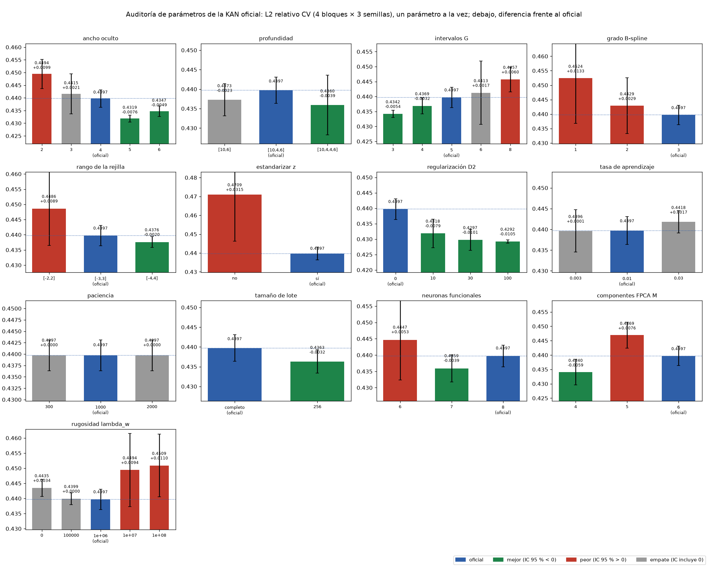

# Auditoría de los parámetros de la KAN oficial

Fecha: 18-nov-2026. Solo se usan los años 1981–2000; la prueba 2001–2003 no se tocó. Solo se audita la KAN: no hay comparaciones con el MLP ni con la cabeza lineal.

## 1. Objetivo

La rúbrica pide "justificar cada decisión" (nivel Excelente) y que los hiperparámetros no se elijan con el conjunto de prueba (tope de 4.3). Esta auditoría responde, parámetro por parámetro, de dónde sale cada valor de la KAN oficial (`entrenar_kan_base_oficial.py`) y, cuando es una decisión nuestra, qué evidencia la respalda.

Los parámetros se separan en tres tipos:
- **A. Los exige el enunciado:** se justifican citando el enunciado y verificando que el código lo cumple.
- **B. El enunciado da un rango y nosotros elegimos el valor:** se prueban los otros valores del rango.
- **C. Decisión del grupo:** se prueban alternativas con validación cruzada.

## 2. Parámetros que exige el enunciado (tipo A)

No se prueban alternativas porque usar otro valor incumpliría el enunciado.

| Parámetro | Valor en la KAN oficial | Qué dice el enunciado | Cumplimiento |
|---|---|---|---|
| Codificador | w_k(t) en B-splines, z_k = a_kᵀ W c con matriz de Gram | "z_k = ∫ w_k(t) X(t) dt = a_kᵀ W c" | W por cuadratura, igual a la de R (8e-14) |
| Entradas adicionales | altitud estandarizada y ONI | "al vector z se agregan la altitud de la estación y el índice ONI del año" | Sí: entrada de 10 = 8 neuronas + 2 |
| Forma de cada arista | φ(x) = w_b·SiLU(x) + w_s·Σ c_i B_i(x) | Tabla de cabezas, fila KAN | Sí, misma fórmula |
| Decodificador | μ(t) + Σ s_m ψ_m(t), FPCA congelado y ajustado con entrenamiento | "se mantienen congeladas" | Sí, μ y ψ vienen de R |
| Pérdida | (ĉ − c)ᵀ W (ĉ − c) + λ_w · rugosidad de w_k | "norma L² funcional … más una penalización de rugosidad sobre las w_k(t)" | Sí |
| Escala | √P (se suaviza en mm y luego se saca la raíz) | "Se modela sobre √P o log(1+P)" | Sí. No se prueba log(1+P) porque cambia el FPCA y los datos de todas las cabezas (D-23) |
| Reconstrucción | se eleva al cuadrado lo recortado en 0 | "la reconstrucción final en mm debe ser no negativa" | Sí, 0 % de valores negativos |
| Semillas | 3 (2026, 2027, 2028) | "Cada configuración se entrena con 3 semillas" | Sí |
| Partición | 1981–95 / 1996–2000 / 2001–03 | Rúbrica 4.4 | Sí |

## 3. Método para los parámetros de tipo B y C

### 3.1 Una variante por parámetro

Cada variante es la configuración oficial con **un solo parámetro cambiado**:

```
CONFIG_OFICIAL = neuronas 8, M 6, λ_w 1e6, capa oculta 4, G 5, grado 3, rango [−3, 3],
                 estandarizar z sí, D² 0, lr 1e-2, lote completo, 5000 épocas, paciencia 1000
```

Se probaron 31 variantes de 13 parámetros.

### 3.2 Validación cruzada por bloques

Cada variante se entrena 12 veces: 4 bloques de 5 años × 3 semillas, es decir **31 × 12 = 372 ajustes**. Cada vez se deja fuera un bloque, se entrena con los otros 15 años y se usa el bloque dejado fuera para la parada temprana y para medir el error. El bloque 1996–2000 se entrena con 1981–1995, que es exactamente la partición oficial.

Se usan 4 bloques porque un solo periodo de 5 años puede ser atípico (por ejemplo, por un El Niño fuerte). Una mejora solo es creíble si se repite en varios periodos.

### 3.3 Paso 0: el código de la auditoría reproduce la KAN oficial

Antes de correr variantes se verificó que el script nuevo, con la configuración oficial, da exactamente lo mismo que lo ya existente (`auditoria_kan/paso0_equivalencia.csv`):

| Prueba | Resultado | Pasa |
|---|---|---|
| 12 ajustes emparejados con la validación cruzada anterior | 12 de 12 | Sí |
| Diferencia máxima en las predicciones | 1,3e-8 (orden de suma de los hilos de la CPU) | Sí |
| Misma época óptima | 12 de 12 | Sí |
| L² relativo CV | 0,4397 (antes 0,4397) | Sí |
| Script de Federico, semilla 2026, bloque 1996–2000 | L² 0,417875 en la época 107 (idéntico) | Sí |

### 3.4 Qué se mide

- **Error:** L² relativo en mm por curva, promediado por estación y luego entre estaciones. Es la media de los 4 bloques × 3 semillas, y se reporta también la desviación estándar entre semillas.
- **Comparación con el oficial:** diferencia pareada por estación-bloque, con:
  - IC bootstrap del 95 % (2 000 remuestreos);
  - prueba de Wilcoxon;
  - número de bloques en que la variante tiene menos error.
- **Interpretabilidad:**
  - % de las entradas de cada capa que caen fuera de la rejilla, donde la spline ya no actúa;
  - **no linealidad** de las aristas: 1 − R² de una recta ajustada a φ(x) sobre los datos (0 = arista recta);
  - parámetros y época óptima.

### 3.5 Regla de decisión, fijada antes de correr

- Un valor alternativo es **candidato a cambio** solo si cumple las tres condiciones:
  1. el IC del 95 % de su diferencia frente al oficial excluye el cero a su favor;
  2. el Wilcoxon es significativo;
  3. gana al menos 3 de los 4 bloques.
- Además, no puede empeorar la interpretabilidad.
- En caso de empate se mantiene el oficial o el más simple.

Se exigen las tres condiciones porque se hicieron 31 comparaciones: con solo el IC, por azar se esperarían uno o dos falsos "mejores".

## 4. Resultados



*Figura A1. L² relativo CV de cada valor probado. Azul: oficial. Verde: mejor (IC < 0). Rojo: peor (IC > 0). Gris: empate. Las barras de error son la DE entre semillas.*

KAN oficial: **L² CV 0,4397**, DE 0,0034. Por bloque: 0,4308 / 0,4584 / 0,4464 / 0,4231. Tiene 728 parámetros y su época óptima media es 135. En la capa 1, el 1,1 % de las entradas está fuera de la rejilla y la no linealidad es 0,41; en la capa 2, son 12,7 % y 0,40.

| Parámetro | Valor | Parám. | L² CV | DE | Dif. vs oficial [IC 95 %] | p Wilcoxon | Bloques ganados | Veredicto |
|---|---|---|---|---|---|---|---|---|
| Ancho oculto | 2 | 408 | 0,4494 | 0,0058 | +0,0099 [+0,0067; +0,0131] | <0,001 | 0/4 | peor |
| | 3 | 568 | 0,4415 | 0,0079 | +0,0021 [−0,0004; +0,0045] | 0,034 | 1/4 | empate |
| | **4 (oficial)** | 728 | 0,4397 | 0,0034 | — | — | — | — |
| | 5 | 888 | 0,4319 | 0,0014 | −0,0076 [−0,0098; −0,0052] | <0,001 | 3/4 | mejor |
| | 6 | 1048 | 0,4347 | 0,0021 | −0,0049 [−0,0069; −0,0029] | <0,001 | 4/4 | mejor |
| Profundidad | [10,6] | 688 | 0,4373 | 0,0041 | −0,0023 [−0,0053; +0,0007] | 0,003 | 3/4 | empate |
| | [10,4,4,6] | 888 | 0,4360 | 0,0077 | −0,0039 [−0,0068; −0,0009] | 0,351 | 2/4 | mejor solo por IC |
| Intervalos G | 3 | 600 | 0,4342 | 0,0012 | −0,0054 [−0,0080; −0,0029] | <0,001 | 4/4 | mejor |
| | 4 | 664 | 0,4369 | 0,0027 | −0,0032 [−0,0056; −0,0007] | 0,176 | 1/4 | mejor solo por IC |
| | 6 | 792 | 0,4413 | 0,0106 | +0,0017 [−0,0012; +0,0042] | 0,081 | 2/4 | empate |
| | 8 | 920 | 0,4457 | 0,0042 | +0,0060 [+0,0035; +0,0086] | <0,001 | 1/4 | peor |
| Grado B-spline | 1 | 600 | 0,4524 | 0,0156 | +0,0133 [+0,0108; +0,0160] | <0,001 | 0/4 | peor |
| | 2 | 664 | 0,4429 | 0,0096 | +0,0029 [+0,0002; +0,0057] | <0,001 | 1/4 | peor |
| Rango de la rejilla | [−2, 2] | 728 | 0,4486 | 0,0121 | +0,0089 [+0,0064; +0,0115] | <0,001 | 0/4 | peor |
| | [−4, 4] | 728 | 0,4376 | 0,0018 | −0,0020 [−0,0036; −0,0003] | 0,002 | 3/4 | mejor (pequeño) |
| Estandarizar z | no | 728 | 0,4709 | 0,0246 | +0,0315 [+0,0249; +0,0384] | <0,001 | 0/4 | peor |
| Regularización D² | 10 | 728 | 0,4318 | 0,0046 | −0,0079 [−0,0099; −0,0059] | <0,001 | 4/4 | mejor |
| | 30 | 728 | 0,4297 | 0,0034 | −0,0101 [−0,0127; −0,0075] | <0,001 | 3/4 | mejor |
| | 100 | 728 | 0,4292 | 0,0005 | −0,0105 [−0,0137; −0,0073] | <0,001 | 3/4 | mejor |
| Tasa de aprendizaje | 3e-3 | 728 | 0,4396 | 0,0051 | +0,0001 [−0,0012; +0,0015] | 0,592 | 1/4 | empate |
| | 3e-2 | 728 | 0,4418 | 0,0027 | +0,0017 [−0,0003; +0,0037] | 0,002 | 1/4 | empate |
| Paciencia | 300 | 728 | 0,4397 | 0,0034 | 0 (idéntico) | — | — | empate |
| | 2000 | 728 | 0,4397 | 0,0034 | 0 (idéntico) | — | — | empate |
| Tamaño de lote | 256 | 728 | 0,4363 | 0,0029 | −0,0032 [−0,0056; −0,0004] | <0,001 | 3/4 | mejor |
| Neuronas funcionales | 6 | 626 | 0,4447 | 0,0123 | +0,0053 [+0,0027; +0,0078] | <0,001 | 1/4 | peor |
| | 7 | 677 | 0,4359 | 0,0041 | −0,0039 [−0,0059; −0,0019] | <0,001 | 2/4 | mejor solo por IC |
| Componentes FPCA M | 4 | 648 | 0,4340 | 0,0044 | −0,0059 [−0,0079; −0,0038] | <0,001 | 3/4 | mejor |
| | 5 | 688 | 0,4469 | 0,0045 | +0,0076 [+0,0047; +0,0105] | <0,001 | 2/4 | peor |
| Rugosidad λ_w | 0 | 728 | 0,4435 | 0,0029 | +0,0034 [−0,0003; +0,0077] | 0,727 | 1/4 | empate |
| | 1e5 | 728 | 0,4399 | 0,0020 | +0,0000 [−0,0028; +0,0029] | 0,929 | 2/4 | empate |
| | 1e7 | 728 | 0,4494 | 0,0121 | +0,0094 [+0,0073; +0,0115] | <0,001 | 0/4 | peor |
| | 1e8 | 728 | 0,4509 | 0,0104 | +0,0110 [+0,0089; +0,0131] | <0,001 | 0/4 | peor |

Ningún ajuste llegó al tope de 5 000 épocas.

## 5. Análisis por parámetro

### 5.1 Se mantienen y quedan justificados con evidencia

- **Grado B-spline = 3.** Grado 1 y grado 2 son significativamente peores. Grado 1 es el peor de la familia (+0,0133) y además el más inestable (DE 0,0156). Las cúbicas son también el estándar de la clase y de la formulación KAN.
- **Estandarizar z con estadísticas de entrenamiento: sí.** Es la decisión más importante de la auditoría. Sin estandarizar, el error sube 0,0315 (de lejos el peor resultado) y el **78 % de las entradas de la capa 1 cae fuera de la rejilla [−3, 3]**, donde la spline no actúa y la arista se reduce a la SiLU. Estandarizar es una transformación afín, así que no rompe la equivalencia de la cabeza lineal con la regresión funcional.
- **Rango [−3, 3].** [−2, 2] es peor (+0,0089), porque deja más entradas fuera de la rejilla (3,2 % en la capa 1 frente a 1,1 %). [−4, 4] mejora apenas 0,0020: la diferencia es pequeña frente a la DE entre semillas y no pasa la regla con margen. Con datos estandarizados, [−3, 3] cubre ±3 desviaciones estándar, que es la elección natural.
- **λ_w = 1e6.** 1e7 y 1e8 son peores (+0,009 y +0,011) porque obligan a las w_k(t) a ser demasiado suaves. 0 y 1e5 empatan con el oficial, pero sin penalización las w_k quedan sin suavizar y el enunciado exige penalizar su rugosidad. 1e6 es el valor más alto que no pierde precisión, es decir, el que da las w_k más suaves e interpretables sin costo en error. Coincide con la rejilla {0, 1e6, 1e7, 1e8, 1e9} de `lluvia_valle_red.py`.
- **lr = 1e-2.** 3e-3 empata (+0,0001; p = 0,59) pero necesita 375 épocas en promedio, frente a 135. 3e-2 tampoco mejora. Se mantiene el valor que llega al mismo error con menos cómputo.
- **Paciencia 1 000 y 5 000 épocas.** Paciencia 300 y 2 000 dan resultados **idénticos**: la mejor época llega pronto (135 en promedio) y no aparecen mejoras más tarde. Ningún ajuste toca las 5 000 épocas, así que el tope no limita el entrenamiento. La paciencia de 1 000 da margen sin cambiar el resultado.

### 5.2 Candidatos fuertes a cambio: cumplen las tres condiciones de la regla

| Cambio | Ganancia | Estabilidad | Interpretabilidad | Costo |
|---|---|---|---|---|
| **Ancho oculto 5** | −0,0076, 3/4 bloques | DE 0,0014, más estable que el oficial (0,0034) | No linealidad similar en la capa 1 (0,39 frente a 0,41) y menor en la capa 2 (0,30 frente a 0,40); 19 % fuera de la rejilla en la capa 2 (oficial 13 %) | 888 parámetros (+22 %): cuatro aristas más que interpretar por capa |
| **G = 3** | −0,0054, **4/4 bloques** | DE 0,0012, la más estable de las candidatas | Splines más rectas en la capa 1 (0,33 frente a 0,41) y **31 % de las entradas de la capa 2 fuera de la rejilla** (oficial 13 %) | 600 parámetros (−18 %), modelo más simple |

Ancho 6 también mejora (−0,0049, 4/4 bloques), pero menos que ancho 5 y con 1 048 parámetros, así que no aporta nada sobre ancho 5.

Lectura:
- **Ancho 5:** una capa oculta de 4 parece quedarse algo corta. Con 5 nodos el modelo es mejor y más estable entre semillas.
- **G = 3:** gana en los 4 periodos con menos parámetros, lo cual es un argumento de parsimonia. A cambio pierde detalle en las splines: con 3 intervalos son más rectas y casi un tercio de las entradas de la segunda capa cae fuera de la rejilla. Eso va en contra del objetivo de interpretar las funciones de activación.

### 5.3 Mejoran, pero no se adoptan

- **Regularización D² (10, 30, 100).** Es la mejora más grande (hasta −0,0105), pero **aplana las splines**: la no linealidad baja de 0,41 a 0,25 con D² = 100. Una KAN con aristas casi rectas pierde lo que justifica usarla. Ya se había visto en la figura G8 del informe de propuestas KAN. Se mantiene en 0 por interpretabilidad.
- **Lote de 256.** Mejora −0,0032, pero no es un parámetro de la KAN sino del entrenamiento. La rúbrica 4.3 exige el mismo presupuesto de entrenamiento para todas las cabezas, así que cambiarlo obligaría a reentrenar toda la ablación.
- **M = 4.** Mejora −0,0059, pero M = 5 es peor (+0,0076): el patrón no es monótono, lo que sugiere ruido más que una tendencia. Además, M define el decodificador compartido por las tres cabezas y por la regresión funcional de R. Con M = 4 la reconstrucción explica menos varianza de las curvas de estación, y el enunciado pide justificar M con la varianza explicada. Se mantiene M = 6, el máximo del rango del enunciado.
- **Neuronas = 7.** Mejora −0,0039, pero solo gana 2 de 4 bloques y 6 neuronas es peor. Tampoco es monótono. Se mantienen 8, el máximo del rango del enunciado: más ventanas del año que interpretar en las w_k(t).
- **[10,4,4,6] y G = 4.** El IC sale menor que 0, pero el Wilcoxon no es significativo (p = 0,35 y 0,18) y solo ganan 2 y 1 de 4 bloques. La media mejora por unas pocas estaciones. No pasan la regla.
- **[10,6] sin capa oculta.** Empata (−0,0023, IC incluye 0), con 3/4 bloques y menos parámetros. Es interesante para la interpretación, porque cada arista va directo de una entrada a un puntaje FPCA. Pero no mejora el error, así que no hay evidencia para cambiar.

### 5.4 Resumen por parámetro

| Parámetro | Valor oficial | Origen | Veredicto |
|---|---|---|---|
| Codificador, entradas, forma de arista, FPCA, pérdida, escala, semillas, partición | ver sección 2 | Enunciado | Se cumple |
| Neuronas funcionales | 8 | Rango del enunciado (6 a 8) | Se mantiene (7 no es consistente, 6 es peor) |
| Componentes M | 6 | Rango del enunciado (4 a 6) | Se mantiene (patrón no monótono y M es compartido por todas las cabezas) |
| Ancho oculto | 4 | Grupo | **Revisar: ancho 5 es mejor y más estable** |
| Profundidad | [10,4,6] | Grupo | Se mantiene (alternativas empatan o no pasan la regla) |
| Intervalos G | 5 | Grupo | **Revisar: G = 3 es mejor en 4/4 bloques, pero pierde interpretabilidad** |
| Grado B-spline | 3 | Grupo | Se mantiene (1 y 2 son peores) |
| Rango de la rejilla | [−3, 3] | Grupo | Se mantiene ([−2, 2] es peor y [−4, 4] mejora muy poco) |
| Estandarizar z | sí | Grupo | Se mantiene (sin estandarizar es el peor caso) |
| Regularización D² | 0 | Grupo | Se mantiene por interpretabilidad (D² aplana las splines) |
| Tasa de aprendizaje | 1e-2 | Grupo | Se mantiene (empata y necesita menos épocas) |
| Paciencia / épocas | 1000 / 5000 | Grupo | Se mantiene (el resultado no depende de ellas) |
| Lote | completo | Grupo | Se mantiene (es igual para todas las cabezas) |
| λ_w | 1e6 | Grupo | Se mantiene (1e7 y 1e8 son peores; es el valor más suave sin pérdida) |

## 6. Conclusión

- **10 de los 13 parámetros auditados quedan justificados con evidencia.** Las alternativas son peores o empatan, o el valor oficial se elige por una razón explícita: interpretabilidad, cómputo, ser el mismo para todas las cabezas o estar dentro del rango del enunciado.
- **Hay dos candidatos reales a cambio en la cabeza:**
  - **ancho oculto 5**, que mejora 0,0076 y es más estable;
  - **G = 3**, que mejora 0,0054 en los 4 bloques con menos parámetros pero con splines menos detalladas.
- **No se cambia nada todavía,** por dos razones:
  1. La auditoría cambió un parámetro a la vez, así que no sabemos si ancho 5 y G = 3 suman al combinarlos.
  2. Hay que medir el efecto en la interpretabilidad con las gráficas de las splines y el ajuste simbólico, no solo con los indicadores.
- Las mejoras están entre 0,005 y 0,008 de L² relativo (1–2 % del error). Son reales pero modestas: la KAN oficial no está mal elegida, aunque se puede afinar.

## 7. Próximos pasos propuestos (pendientes de aprobación)

1. **Ronda de confirmación** con el mismo protocolo: 5 combinaciones × 12 = 60 ajustes, unos 25 minutos.
   1. ancho 5 + G = 3
   2. ancho 5 + G = 4
   3. G = 3 + rango [−4, 4], para ver si corrige las entradas de la capa 2 fuera de la rejilla
   4. ancho 5 + G = 3 + rango [−4, 4]
   5. ancho 5 + rango [−4, 4]
2. **Análisis de "¿conviene cambiarlo?"** con la finalista frente a la oficial, revisando:
   - splines de las capas 1 y 2 graficadas;
   - % de entradas fuera de la rejilla;
   - R² del ajuste simbólico;
   - qué habría que rehacer (la ablación con el MLP igualado a ±10 % y las figuras de interpretación).
3. **Decisión con Federico** antes de tocar `entrenar_kan_base_oficial.py`.

## 8. Limitaciones

- **Un parámetro a la vez:** el diseño no captura interacciones entre parámetros. Por eso se propone la ronda de confirmación.
- **Error estimado en validación cruzada:** todas las diferencias se midieron en 1981–2000. La prueba 2001–2003 no se usó, como exige la rúbrica.
- **FPCA ajustado con 1981–1995:** en los bloques que dejan fuera 1981–85, 1986–90 o 1991–95, ese bloque participó en el FPCA de R. Afecta por igual a todas las variantes, así que la comparación sigue siendo justa. El bloque 1996–2000 está totalmente limpio.
- **Indicadores de interpretabilidad simples:** el % fuera de la rejilla y la no linealidad (1 − R² frente a una recta) resumen cada capa en un número. No reemplazan mirar las gráficas de las splines.

## 9. Archivos

**Scripts (en `KAN/codigo/`):**
- `auditoria_parametros_kan_jacobo.py`: entrena las variantes y hace la verificación del paso 0.
  - Uso: `correr <trabajador> <n> [códigos]` y `verificar`.
- `analizar_auditoria_kan_jacobo.py`: produce las tablas y la figura.

**Salidas (en `KAN/salidas/auditoria_kan/`):**
- `paso0_equivalencia.csv` y `paso0_equivalencia_por_ajuste.csv`: reproducción de la KAN oficial.
- `auditoria_resumen.csv`: todas las variantes con error, contrastes e indicadores de interpretabilidad.
- `auditoria_tabla_maestra.csv`: una fila por parámetro, con origen y veredicto.
- `auditoria_L2_por_bloque_y_semilla.csv`: los 384 ajustes.
- `fig_auditoria_parametros.png`: figura A1.
- `corridas/`: predicciones de cada ajuste.
- `modelos/`: modelos del bloque 1996–2000.
