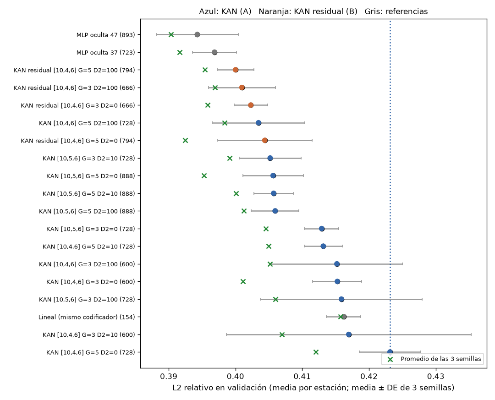
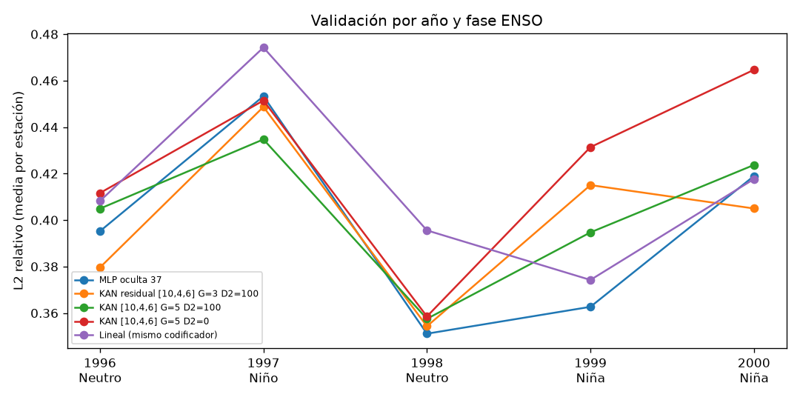
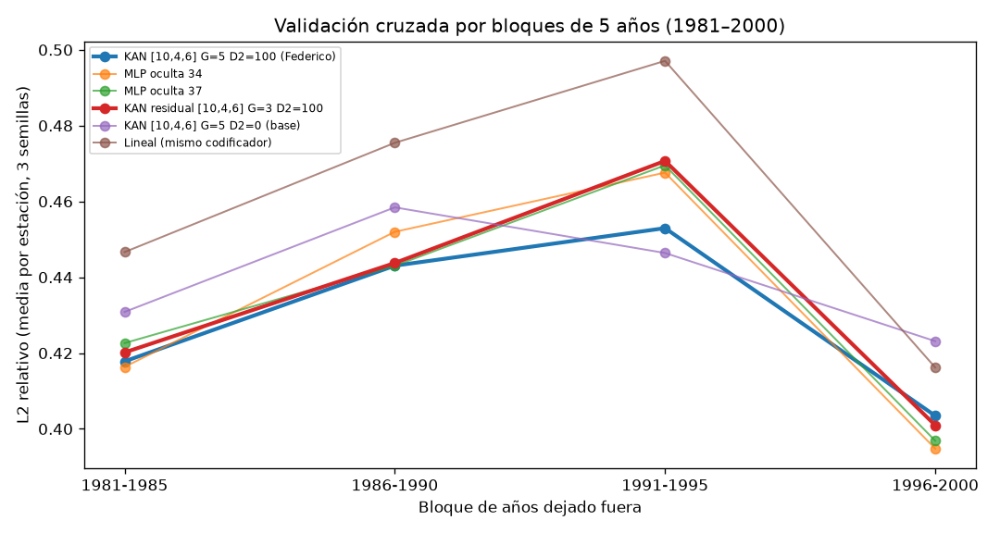

# Experimentos KAN complementarios: combinación, KAN residual y referencias

Fecha: 16-nov-2026. Rama de trabajo: `gus-cierre-funcional`. Solo se usó validación (1996–2000); la prueba 2001–2003 no se tocó.

## 1. Qué se hizo

Se usó el mismo núcleo de las propuestas de Federico (`kan_variantes_core.py`). Los datos de `para_python/`, el codificador de 8 neuronas, λ_w = 1e6, Adam con lr = 0,01, las 5 000 épocas con paciencia 1 000 y las semillas 2026, 2027 y 2028 son exactamente los mismos. La métrica también es la misma de `evaluar_parametros_kan.R`: el L² relativo de cada curva en mm/día, promediado por estación y luego entre estaciones.

| Grupo | Experimento | Configuraciones |
|---|---|---|
| A | Combinación de lo que Federico probó eje por eje | ancho {4, 5} × G {3, 5} × λ_D2 {0, 10, 100} = 12 |
| B | **KAN residual**: cabeza = capa lineal + KAN cuya última capa arranca en cero. La KAN solo aprende lo que la parte lineal no explica | G {3, 5} × λ_D2 {0, 100} = 4 |
| R | Referencias con el mismo codificador: cabeza lineal, MLP de 37 neuronas (723 parámetros, igual que la KAN base de 728) y MLP de 47 neuronas (893, igual que la KAN de ancho 5) | 3 |

Después se hizo una validación cruzada por bloques de 5 años con los finalistas y las referencias (sección 4), con 72 entrenamientos más.

En la primera etapa son 19 configuraciones × 3 semillas = 57 entrenamientos. En CPU tardaron 20 minutos, con 4 procesos en paralelo.

**Control de reproducción:** los resultados de Federico salen idénticos.

| Configuración | Federico | Esta corrida |
|---|---|---|
| KAN base [10,4,6], G=5 | 0,423 | 0,4231 |
| G=3 | 0,415 | 0,4153 |
| λ_D2 = 10 | 0,413 | 0,4132 |
| λ_D2 = 100 | 0,403 | 0,4035 |
| Ancho 5 | 0,406 | 0,4056 |

### Cómo leer los nombres de los modelos

Todos los modelos tienen las mismas tres piezas, y solo cambia la del medio:

1. **Codificador (igual en todos):** resume la curva del satélite en 8 números (z₁…z₈), con 8 funciones de peso w_k(s). Tiene 8 × 11 = 88 parámetros.
2. **Cabeza (lo que se compara):** recibe 10 entradas (los 8 z, la altitud estandarizada y el ONI) y entrega 6 números, los puntajes de los 6 componentes FPCA.
3. **Decodificador (igual en todos, fijo):** convierte los 6 puntajes en la curva de la estación con la media y las 6 funciones FPCA que salen de R. No se entrena.

**Términos de los nombres:**

| Término | Qué significa |
|---|---|
| `[10,4,6]` | Forma de la cabeza KAN: 10 entradas → 4 neuronas ocultas → 6 salidas. Son dos capas KAN |
| `[10,5,6]` | Lo mismo, con 5 neuronas ocultas ("ancho 5"): más capacidad y más parámetros |
| `G=5`, `G=3` | Intervalos de la rejilla de cada spline de la KAN. Más intervalos permiten formas más detalladas; menos dan funciones más simples. Cada conexión tiene G + 3 coeficientes spline |
| `D2=0`, `D2=10`, `D2=100` | Peso de la penalización de segunda diferencia sobre los coeficientes spline. Castiga las curvaturas bruscas de cada conexión: más alto, conexiones más suaves. 0 = sin penalización |
| **KAN** | Cabeza KAN normal. Cada conexión es una función aprendida: un término SiLU más una spline cúbica |
| **KAN residual** | Cabeza = parte lineal (10 → 6, 66 parámetros) + KAN. La KAN arranca dando cero y solo aprende lo que la parte lineal no explica. Propuesta nueva de este informe |
| **(base)** | La KAN de referencia de `lluvia_valle_red.py`: [10,4,6], G=5, sin D² |
| **(Federico)** | La mejor propuesta de Federico: la base con D²=100 |
| **MLP oculta N** | Red neuronal clásica: 10 entradas → N neuronas con activación SiLU → 6 salidas. N se elige para que tenga casi los mismos parámetros que una KAN y la comparación sea justa |
| **Lineal (mismo codificador)** | Cabeza lineal: los 6 puntajes son una combinación lineal de las 10 entradas. Equivale a la regresión funcional, pero con el codificador de 8 neuronas |
| **Parámetros** | Total entrenable: codificador (88) + cabeza |

**Cada modelo de las tablas:**

| Modelo | Qué es | Qué cambia frente a la base | Parámetros (cabeza + codificador) |
|---|---|---|---|
| KAN [10,4,6] G=5, D2=0 (base) | KAN de 2 capas, 4 ocultas, rejilla de 5 intervalos | Nada: es la referencia | 640 + 88 = 728 |
| KAN [10,4,6] G=5, D2=100 (Federico) | La base con penalización de suavidad fuerte | Conexiones más suaves | 640 + 88 = 728 |
| KAN [10,4,6] G=5, D2=10 | La base con penalización de suavidad moderada | Conexiones algo más suaves | 728 |
| KAN [10,4,6] G=3, D2=0, 10 o 100 | Rejilla más gruesa, con o sin penalización | Splines más simples (6 coeficientes por conexión en vez de 8) | 512 + 88 = 600 |
| KAN [10,5,6] G=5, D2=0, 10 o 100 | 5 neuronas ocultas, con o sin penalización | Más capacidad | 800 + 88 = 888 |
| KAN [10,5,6] G=3, D2=0, 10 o 100 | 5 ocultas y rejilla más gruesa | Más neuronas, pero splines más simples | 640 + 88 = 728 |
| KAN residual [10,4,6] G=3 o G=5, D2=0 o 100 | Parte lineal + KAN que corrige lo que falta | Agrega un atajo lineal; la KAN aprende solo la parte no lineal | G=3: 578 + 88 = 666; G=5: 706 + 88 = 794 |
| MLP oculta 34 | MLP con 34 neuronas | Sin splines: neuronas clásicas | 584 + 88 = 672 (igualado a la KAN residual G=3) |
| MLP oculta 37 | MLP con 37 neuronas | Sin splines: neuronas clásicas | 635 + 88 = 723 (igualado a la base) |
| MLP oculta 47 | MLP con 47 neuronas | Sin splines: neuronas clásicas | 805 + 88 = 893 (igualado a la KAN de ancho 5) |
| Lineal (mismo codificador) | Cabeza lineal, sin no linealidad | Elimina toda la no linealidad de la cabeza | 66 + 88 = 154 |

**Cómo leer las columnas de resultados:**

| Columna | Qué significa |
|---|---|
| **L² relativo** | Error de la curva predicha frente a la observada, como fracción del tamaño de la curva observada: 0,40 equivale a un error del 40 %. Se promedia primero por estación y luego entre estaciones. **Más bajo es mejor** |
| **media ± DE** | Media y desviación estándar entre las 3 semillas. La DE mide cuánto depende el resultado del azar de la inicialización |
| **Promedio de semillas** | Error de la curva que resulta de promediar las predicciones de las 3 semillas, un ensamble. Casi siempre es menor que la media |
| **Diferencia frente a la base [IC 95 %]** | Cuánto baja (negativo) o sube el error frente a la KAN base, con su intervalo de confianza por bootstrap entre estaciones. Si el intervalo no cruza 0, la diferencia es clara |
| **Estaciones que mejoran** | Porcentaje de estaciones donde el modelo tiene menos error que la base |

## 2. Resultados



Las configuraciones están ordenadas de mejor a peor. Cada punto es la media de las 3 semillas, la barra es ± 1 DE y la cruz verde es el error del promedio de las 3 semillas.

| Modelo | Qué es | Parámetros | L² val. (media ± DE) | Promedio de semillas | Diferencia frente a la base [IC 95 %] | Estaciones que mejoran |
|---|---|---:|---:|---:|---:|---:|
| MLP oculta 47 | Red clásica de 47 neuronas, igualada a la KAN de ancho 5 | 893 | 0,394 ± 0,006 | 0,390 | −0,029 [−0,039; −0,019] | 67 % |
| MLP oculta 37 | Red clásica de 37 neuronas, igualada a la KAN base | 723 | 0,397 ± 0,003 | 0,392 | −0,026 [−0,037; −0,016] | 62 % |
| KAN residual G=5, D2=100 | Lineal + KAN de 4 ocultas, rejilla 5, suavidad fuerte | 794 | 0,400 ± 0,003 | 0,395 | −0,023 [−0,031; −0,015] | 65 % |
| **KAN residual G=3, D2=100** | Lineal + KAN de 4 ocultas, rejilla 3, suavidad fuerte | **666** | **0,401 ± 0,005** | **0,397** | −0,022 [−0,030; −0,014] | 63 % |
| KAN residual G=3, D2=0 | Lineal + KAN de 4 ocultas, rejilla 3, sin penalización | 666 | 0,402 ± 0,003 | 0,396 | −0,021 [−0,030; −0,012] | 64 % |
| **KAN [10,4,6] G=5, D2=100** (la mejor de Federico) | KAN base con suavidad fuerte | 728 | 0,404 ± 0,007 | 0,398 | −0,020 [−0,027; −0,013] | 71 % |
| KAN [10,5,6] G=3, D2=10 | KAN de 5 ocultas, rejilla 3, suavidad moderada | 728 | 0,405 ± 0,005 | 0,399 | −0,018 | 64 % |
| KAN [10,5,6] G=5, D2=0 | KAN de 5 ocultas, rejilla 5, sin penalización | 888 | 0,406 ± 0,005 | 0,395 | −0,018 | 63 % |
| KAN [10,5,6] G=5, D2=100 | KAN de 5 ocultas, rejilla 5, suavidad fuerte | 888 | 0,406 ± 0,004 | 0,401 | −0,017 | 61 % |
| KAN [10,4,6] G=3, D2=0 | KAN de 4 ocultas, rejilla 3, sin penalización | 600 | 0,415 ± 0,004 | 0,401 | −0,008 | 56 % |
| Lineal (mismo codificador) | Cabeza lineal, sin no linealidad | 154 | 0,416 ± 0,003 | 0,416 | −0,007 [−0,025; 0,011] | 54 % |
| KAN [10,4,6] G=5, D2=0 (base) | KAN de referencia: 4 ocultas, rejilla 5, sin penalización | 728 | 0,423 ± 0,005 | 0,412 | — | — |

La tabla completa con las 19 configuraciones está en `resumen_experimentos.csv`. La diferencia frente a la base se calcula por estación, con el promedio de las 3 semillas, sobre 147 estaciones; el IC sale de un bootstrap por estación.



## 3. Qué dicen los resultados con la validación 1996–2000

> Lo de esta sección usa un solo bloque de 5 años. La validación cruzada de la sección 4 corrige los puntos 2 y 3: la KAN residual no se sostiene y la KAN con D²=100 queda por encima de los MLP en promedio.

1. **Las mejoras por eje no se suman.**
   - Al combinar ancho 5, G=3 y D² no se logra nada mejor que D² = 100 solo (0,4035). Varias combinaciones quedan incluso peor, como ancho 4 con G=3 y D²=100 (0,415) o ancho 5 con G=3 y D²=100 (0,416).
   - La penalización D² y la rejilla G=3 regularizan lo mismo, la suavidad de las aristas, así que se pisan entre sí.
   - Lo que sí funciona es D² = 100 con G=5.

2. **La KAN residual es la mejor KAN y usa menos parámetros.**
   - Con G=3 y D²=100 llega a 0,401 con 666 parámetros, frente a 0,404 con 728 de la mejor de Federico.
   - Las tres semillas quedan más juntas (DE 0,003–0,005).
   - Es más fácil de defender en el 4.5: la predicción se separa en una parte lineal, comparable con la regresión, y una corrección no lineal que la KAN aprende partiendo de cero.

3. **Con los mismos parámetros, el MLP iguala o supera a todas las KAN.**
   - El MLP de 37 neuronas (723 parámetros) da 0,397. Ninguna KAN baja de 0,400.
   - Entre los mejores la diferencia es pequeña (0,003 a 0,007) y queda dentro del ruido entre semillas, pero va en la misma dirección en todas las comparaciones.
   - Para el informe: la ablación debe decir con honestidad que la KAN **no gana en error** frente a un MLP igualado. Su ventaja es la interpretabilidad (aristas con forma legible y ajuste simbólico).

4. **Promediar las 3 semillas mejora todo y no cuesta nada.** Baja el error entre 0,004 y 0,012 en todas las redes. Conviene reportar el modelo final como el promedio de las tres semillas.

5. **La no linealidad aporta poco frente a la cabeza lineal.**
   - La cabeza lineal con el mismo codificador (154 parámetros) da 0,416, lo mismo que varias KAN.
   - Las mejores redes solo ganan unos 0,02 frente a ella.
   - El cuello de botella parece estar en el codificador de 8 neuronas, más que en la cabeza.

6. **Por año (figura 2):**
   - 1997 (Niño) es difícil para todos los modelos.
   - En 1999 y 2000, años Niña, la base sin regularizar es la peor; D² y la cabeza residual la corrigen.
   - Validación tiene dos años Niña y prueba ninguno, así que estas diferencias pueden no repetirse en la prueba.

7. **Cuidado con el ruido.**
   - Las mejores 8 configuraciones están entre 0,394 y 0,406, y la DE entre semillas llega a 0,007.
   - Con 5 años de validación no se pueden ordenar con confianza. Se distinguen claramente de la base, pero no entre sí.

## 4. Validación cruzada por bloques de años: desempate entre finalistas

Con solo 1996–2000 los mejores modelos no se podían ordenar. Para desempatar se dejó fuera, uno a la vez, cada bloque de 5 años de 1981–2000 y se entrenó con los otros 15. Son 6 modelos × 4 bloques × 3 semillas = 72 entrenamientos.

- **Control:** el bloque 1996–2000 reproduce exactamente la validación de la sección 2.
- **Limitación:** en los bloques de 1981–1995, el decodificador FPCA y la estandarización de la altitud vienen del ajuste de R con 1981–1995, así que ya vieron esos años. Esto afecta igual a todos los modelos y no cambia el orden entre ellos.
- **Parada temprana:** usa el bloque que se deja fuera, igual que en la validación original.



Cada columna de bloque es el L² relativo cuando ese bloque de años se deja fuera: se entrena con los otros 15 años y se mide el error en el bloque. La media CV es el promedio de los 4 bloques.

| Modelo | Qué es | Parámetros | 1981–85 | 1986–90 | 1991–95 | 1996–00 | **Media CV** (± DE semillas) | Promedio de semillas |
|---|---|---:|---:|---:|---:|---:|---:|---:|
| **KAN [10,4,6] G=5, D²=100 (Federico)** | KAN base con suavidad fuerte | 728 | 0,418 | 0,443 | **0,453** | 0,404 | **0,429 ± 0,000** | **0,421** |
| MLP oculta 34 | Red clásica igualada a la KAN residual | 672 | 0,416 | 0,452 | 0,468 | 0,395 | 0,433 ± 0,003 | 0,428 |
| MLP oculta 37 | Red clásica igualada a la KAN base y a la de Federico | 723 | 0,423 | 0,443 | 0,470 | 0,397 | 0,433 ± 0,002 | 0,429 |
| KAN residual G=3, D²=100 | Lineal + KAN de rejilla 3 con suavidad fuerte | 666 | 0,420 | 0,444 | 0,471 | 0,401 | 0,434 ± 0,002 | 0,426 |
| KAN base G=5, D²=0 | KAN de referencia, sin penalización | 728 | 0,431 | 0,458 | 0,446 | 0,423 | 0,440 ± 0,003 | 0,427 |
| Lineal (mismo codificador) | Cabeza lineal, sin no linealidad | 154 | 0,447 | 0,476 | 0,497 | 0,416 | 0,459 ± 0,001 | 0,459 |

Tablas: `cv_resumen.csv`, `cv_L2_por_bloque.csv` y `cv_contraste_finalistas.csv`.

**Qué dice la validación cruzada:**

1. **La KAN de Federico (G=5, D²=100) es la mejor en promedio y la más estable.**
   - Con 0,429, gana a la residual (0,434), a los dos MLP igualados (0,433) y a la base (0,440).
   - Sus tres semillas casi coinciden (DE 0,0003).
2. **La ventaja de la KAN residual era propia de 1996–2000.**
   - Solo gana en ese bloque.
   - Contraste pareado por estación en los 4 bloques (658 pares estación-bloque): la residual queda **peor por 0,0046 [IC 95 %: 0,0023; 0,0069], Wilcoxon p = 0,002**. Mejora solo en el 47 % de los pares.
   - Corrige la recomendación de la sección 3: con un solo bloque de validación se habría elegido mal.
3. **La KAN con D²=100 supera a los MLP igualados en promedio, aunque por poco (0,004).**
   - La diferencia sale casi toda del bloque 1991–1995, donde los MLP y la residual empeoran y la KAN con D² no.
   - En 1996–2000 los MLP son mejores. El resultado de la ablación depende de los años: hay que presentarlo como un empate con matices, no como una victoria clara.
4. **La no linealidad sí aporta.** Todas las redes mejoran 0,025–0,03 frente a la cabeza lineal en cada bloque.
5. **Promediar las 3 semillas** baja el error de la KAN finalista de 0,429 a 0,421.

## 5. Propuesta para la reunión

1. **Arquitectura final:** la KAN [10,4,6], G=5, D²=100 de Federico. Gana en la validación cruzada, es la más estable entre semillas y conserva los 728 parámetros de la base. La KAN residual queda descartada.
2. **Ablación justa:** contra el MLP de 37 neuronas (723 parámetros, dentro del ±10 %) y contra la cabeza lineal, todas con el mismo codificador. Se reporta la media CV por bloques y la validación 1996–2000, explicando que en ese bloque el MLP queda algo mejor.
3. **Modelo final = promedio de las 3 semillas.**
4. **Opcional para el 4.5:** podar las aristas débiles de la finalista y reentrenar, para obtener una fórmula simbólica más corta.
5. **La prueba 2001–2003 se evalúa una sola vez**, con esta configuración.

## 6. Cómo reproducir

Desde la raíz del repositorio, con PyTorch en CPU:

```powershell
cd KAN/codigo
foreach ($w in 0..3) { Start-Process python -ArgumentList "-X utf8 experimentos_kan_jacobo.py $w 4" -NoNewWindow }
python -X utf8 analizar_experimentos_kan_jacobo.py
foreach ($w in 0..3) { Start-Process python -ArgumentList "-X utf8 cv_bloques_kan_jacobo.py $w 4" -NoNewWindow }
python -X utf8 analizar_cv_bloques_kan_jacobo.py
```

La validación cruzada tarda unos 50 minutos con 4 procesos.

Las corridas quedan en `KAN/salidas/corridas/`, una por entrenamiento, y se pueden reanudar porque las ya hechas se saltan. Los resúmenes están en la misma carpeta:
- `resumen_experimentos.csv`
- `L2_relativo_por_semilla.csv`
- `L2_relativo_por_anio_validacion.csv`
- las dos figuras.
