# Interpretabilidad de la KAN oficial

Fecha: 18-nov-2026. Son las mismas gráficas G1–G8 de la asesoría, ahora con la **KAN oficial**: [10,4,6], G = 5, rejilla [−3, 3], sin D², semilla 2026, entrenada con 1981–1995 y validada con 1996–2000. La prueba 2001–2003 no se tocó.

**Verificación del modelo:** el modelo graficado da L² relativo **0,417875 en la época 107**, idéntico a `entrenar_kan_base_oficial.py` de Federico. Su codificador coincide con el de la auditoría de parámetros a 9e-16.

## 0. Arquitectura de la red funcional con cabeza KAN

La red reconstruye la curva anual de lluvia de una estación a partir de la curva satelital del píxel que la contiene. Tiene tres bloques, como pide el enunciado. El codificador y el decodificador son los mismos en las tres cabezas de la ablación (KAN, MLP y lineal); solo cambia la cabeza.

```
 curva satelital X(t)        codificador funcional        cabeza KAN [10,4,6]         decodificador FPCA
 (péntadas, base B-spline,   z_k = a_kᵀ W_s c             10 entradas → 4 → 6         ŷ(t) = μ(t) + Σ s_m ψ_m(t)
  K_s = 11 coeficientes c) ─► 8 neuronas funcionales ──► (z1…z8, altitud, ONI) ──► s1…s6 ─► (escala √P) ─► mm = max(ŷ, 0)²
                              + altitud + ONI
```

### Qué viene del enunciado y qué decidimos nosotros

**La arquitectura en sí es la que plantea el enunciado.** Las piezas estructurales vienen dadas y no las cambiamos:
- el codificador con w_k(t) en B-splines y la matriz de Gram;
- la altitud y el ONI como entradas;
- la forma de cada arista KAN, w_b·SiLU + w_s·spline;
- el decodificador FPCA congelado;
- la pérdida L² funcional con la rugosidad;
- la escala √P o log(1+P);
- las 3 semillas y la partición.

Lo que es **nuestro** son los valores concretos que el enunciado deja abiertos y una sola pieza añadida: **estandarizar z antes de la KAN**. No se inventó una arquitectura nueva.

| Elemento | Origen | Qué se eligió | Por qué (evidencia en la auditoría de parámetros) |
|---|---|---|---|
| Codificador z_k = a_kᵀ W_s c, w_k en B-splines | Enunciado | — | Se cumple tal cual |
| Altitud y ONI como entradas | Enunciado | — | Se cumple tal cual |
| Forma de la arista φ = w_b·SiLU + w_s·Σc_iB_i | Enunciado | — | Se cumple tal cual |
| Decodificador FPCA congelado, ajustado con entrenamiento | Enunciado | — | Se cumple tal cual |
| Pérdida L² funcional + rugosidad de las w_k | Enunciado | — | Se cumple tal cual |
| 3 semillas y partición 81–95 / 96–00 / 01–03 | Enunciado | — | Se cumple tal cual |
| Escala de la curva | Enunciado da a elegir (√P o log(1+P)) | **√P** | Conserva el acumulado anual y la reconstrucción no es negativa (D-23) |
| Número de neuronas funcionales | Enunciado da rango (6 a 8) | **8** | 6 es peor (+0,0053); 7 no mejora de forma consistente (gana 2 de 4 bloques) |
| Componentes FPCA, M | Enunciado da rango (4 a 6) | **6** (94,2 % de la varianza) | Patrón no monótono (4 mejor, 5 peor); M es el decodificador compartido por las tres cabezas |
| **Estandarizar z con la media y la DE de entrenamiento** | **Decisión nuestra (pieza añadida)** | **sí** | Sin ella el 78 % de las entradas cae fuera de la rejilla y el error sube +0,0315, el peor caso de la auditoría. Es afín: no rompe la equivalencia de la cabeza lineal |
| Capas y ancho de la KAN | Decisión nuestra (el enunciado solo dice "red KAN") | **[10, 4, 6]**: 1 capa oculta de 4 | Sin capa oculta empata; 2 capas no pasa la regla; ancho 2 es peor. **Ancho 5 es mejor (−0,0076) y queda como candidato a revisar** |
| Intervalos de la rejilla G | Decisión nuestra | **G = 5** | G = 8 es peor. **G = 3 es mejor (−0,0054, 4 de 4 bloques) pero deja splines más rectas: candidato a revisar** |
| Grado de las B-splines | Decisión nuestra | **3 (cúbicas)** | Grado 1 (+0,0133) y grado 2 (+0,0029) son peores |
| Rango de la rejilla | Decisión nuestra | **[−3, 3]** | [−2, 2] es peor (+0,0089); [−4, 4] mejora muy poco (−0,0020) |
| Regularización de las splines (D²) | Decisión nuestra | **ninguna** | D² baja el error pero aplana las splines (no linealidad 0,41 → 0,25): se pierde la interpretabilidad que justifica la KAN, y la ablación con el MLP deja de ser justa |
| λ_w (rugosidad de las w_k) | Decisión nuestra (el enunciado pide penalizar, no el valor) | **1e6** | 1e7 y 1e8 son peores; 0 y 1e5 empatan pero dejan las w_k sin suavizar |
| Optimizador y tasa de aprendizaje | Decisión nuestra | **Adam, 0,01, lote completo** | 0,003 empata pero necesita 375 épocas en vez de 135; lote 256 cambia el entrenamiento de todas las cabezas |
| Parada temprana | Decisión nuestra (la rúbrica pide parada con validación) | **paciencia 1 000, máximo 5 000** | Paciencia 300 y 2 000 dan resultados idénticos; ningún ajuste llega a 5 000 |
| Valores iniciales y float64 | Decisión nuestra | coeficientes ~ N(0; 0,1²), w_s = 1; doble precisión | Doble precisión para la verificación numérica de la equivalencia lineal (≤ 1e-4). Los valores iniciales no se auditaron |
| Implementación | Decisión nuestra (el enunciado permite PyTorch y pykan) | Capa KAN propia en PyTorch con la fórmula del enunciado | Permite controlar el conteo de parámetros y la forma exacta de la arista. Verificada con una función sintética (RMSE 2e-3 ≤ 1e-2) |

**En resumen:** la KAN oficial no cambia la arquitectura del enunciado. Lo que aporta el grupo es:
1. **la estandarización de z,** la única pieza añadida y la decisión con más efecto en el error;
2. **la elección justificada de cada hiperparámetro libre** (estructura [10,4,6], G = 5, grado 3, rango [−3, 3], sin D², λ_w = 1e6, entrenamiento) y de los valores dentro de los rangos del enunciado (√P, 8 neuronas, M = 6), todos contrastados con validación cruzada por bloques;
3. **una implementación propia** de la capa KAN, verificada.

Hay dos ajustes con evidencia de mejora que aún no se aplican: ancho 5 y G = 3, pendientes de la ronda de confirmación.

### 0.1 Entrada: la curva satelital como dato funcional

- Cada año del satélite (péntadas) se representa en una base B-spline cúbica de **K_s = 11** funciones sobre los días 1–365, con coeficientes **c** (11 números por estación-año).
- La curva se suaviza en mm/día, se recorta en 0 y luego se le saca la raíz: **se modela √P**, una de las dos escalas que permite el enunciado.
- La curva de la estación se representa igual, con una base de **K_e = 8** funciones.

### 0.2 Codificador funcional: 8 neuronas funcionales (88 parámetros)

- Cada neurona calcula una integral de la curva satelital pesada por una función de pesos aprendible:

  z_k = ∫ w_k(t) X(t) dt = a_kᵀ W_s c, con k = 1…8.

  - **w_k(t)** es una función en la misma base B-spline, con 11 coeficientes **a_k** que se aprenden: 8 × 11 = **88 parámetros**.
  - **W_s = ∫ φ(t) φ(t)ᵀ dt** es la matriz de Gram de la base, calculada por cuadratura de Gauss-Legendre. Coincide con la de R a 8e-14.
  - Cada w_k(t) indica **qué ventana del año usa esa neurona**.
- **Penalización de rugosidad** sobre las w_k(t): λ_w · Σ_k (a_kᵀ R a_k)/(a_kᵀ W_s a_k), con **λ_w = 1e6**. Así las w_k quedan suaves e interpretables, como exige el enunciado.
- **Estandarización:** cada z_k se centra y se escala con su media y DE en entrenamiento. Es una transformación afín, así que no rompe la equivalencia de la cabeza lineal con la regresión funcional, y deja las entradas dentro de la rejilla de las splines.
- **Entradas adicionales, como pide el enunciado:**
  - la **altitud** de la estación, estandarizada con la media (1 394 m) y la DE (560 m) de entrenamiento;
  - el **ONI** del año, en su escala original (entre −1,5 y +2).
- Resultado: un vector de **10 entradas**, (z1…z8, altitud, ONI).

### 0.3 Cabeza KAN [10, 4, 6] (640 parámetros)

**Estructura:** 2 capas KAN, 10 entradas → **4 neuronas ocultas (h1…h4)** → **6 salidas** (los puntajes FPCA s1…s6). En total hay 10×4 + 4×6 = **64 aristas**.

**Cada arista es una función aprendible, no un peso.** Tiene exactamente la forma del enunciado:

  φ(x) = w_b · SiLU(x) + w_s · Σ_{i=1}^{8} c_i B_i(x)

| Componente | Qué es | Valor |
|---|---|---|
| B_i(x) | B-splines **cúbicas** (grado 3) sobre la rejilla | **G = 5** intervalos en **[−3, 3]**, nodos cada 1,2; con los 3 nodos extendidos a cada lado salen **8 bases** por arista |
| c_i | coeficientes de la spline: dan la forma de la arista | 8 por arista, iniciales ~ N(0; 0,1²) |
| w_s | peso de la parte spline | 1 por arista, inicial 1 |
| w_b · SiLU(x) | término base: da una forma suave también fuera de la rejilla | w_b, 1 por arista, inicial ~ N(0; 1/n_entradas) |

- **Parámetros por arista:** 8 + 1 + 1 = 10. **Cabeza:** 64 × 10 = **640**. **Red completa:** 640 + 88 = **728**, contados con `sum(p.numel())`.
- **Los nodos solo suman, sin sesgo ni activación propia:**
  - h_j = Σ_i φ_ij(x_i), con j = 1…4 (capa 1, 40 aristas);
  - s_m = Σ_j φ_jm(h_j), con m = 1…6 (capa 2, 24 aristas).
- **Toda la no linealidad está en las aristas.** Por eso cada φ se puede graficar y leer: si es creciente o decreciente, si tiene un umbral o una campana, en qué rango de la entrada actúa. Esta es la diferencia con un MLP, donde la no linealidad está en los nodos y los pesos son números sueltos.
- **Fuera de la rejilla [−3, 3]** las bases B_i valen 0 y la arista se reduce a w_b·SiLU(x), casi una recta.
- La capa está implementada en PyTorch con la fórmula del enunciado (base B-spline por la recursión de Cox–de Boor). Se verificó con una **función sintética: RMSE 2e-3 ≤ 1e-2**, como pide la rúbrica 4.3.

### 0.4 Decodificador FPCA congelado

- La salida de la KAN son los 6 puntajes s_m. La curva de la estación se reconstruye como:

  ŷ(t) = μ(t) + Σ_{m=1}^{6} s_m ψ_m(t) (en escala √P)

- **μ(t)** y las funciones propias **ψ_m(t)** salen del FPCA de las curvas de estación de **entrenamiento (1981–1995)**, calculado en R. **No se entrenan.**
- **M = 6** componentes explican el **94,2 %** de la varianza, dentro del rango 4–6 del enunciado.
- Para volver a mm: **mm/día = max(ŷ, 0)²**, así que la reconstrucción nunca es negativa.

### 0.5 Entrenamiento

| Elemento | Valor |
|---|---|
| Pérdida | L² funcional (ĉ − c)ᵀ W_e (ĉ − c) entre la curva reconstruida y la observada, promediada sobre los pares, + λ_w · rugosidad de las w_k |
| Datos | 2 257 pares estación-año de entrenamiento (1981–1995) y 672 de validación (1996–2000). La prueba (2001–2003) no se usa |
| Optimizador | Adam, tasa de aprendizaje 0,01, lote completo, precisión float64 |
| Parada temprana | hasta 5 000 épocas; se guarda la época de menor L² en validación y se para tras 1 000 épocas sin mejorar |
| Regularización de la cabeza | ninguna (sin D²), para que las splines conserven su forma y la ablación con el MLP sea justa |
| Semillas | 2026, 2027 y 2028 |
| Resultado (semilla 2026) | L² relativo en validación 0,417875, en la época 107 |

Todos los valores se justificaron en la auditoría de parámetros (`AUDITORIA_PARAMETROS_KAN_JACOBO.md`).

### 0.6 Cómo leer las gráficas que siguen

- **Capa 1 (G3a, G8):** cómo cada entrada (una ventana del satélite, la altitud o el ONI) alimenta cada neurona oculta.
- **Capa 2 (G3b, G8):** cómo cada neurona oculta mueve cada puntaje FPCA:
  - **FPCA1** fija sobre todo el **nivel** general de lluvia;
  - **FPCA2** reparte la lluvia **entre temporadas**.
- **Aporte por época del año (G2):** como la salida es una suma, se puede separar cuánto aporta cada neurona a cada día del año.

---

## Gráficas de interpretabilidad

---

## G1. Predicción del año sobre todo el pasado de la estación

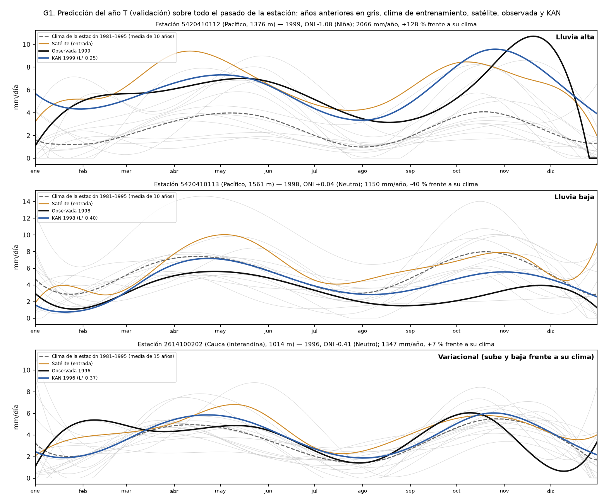

- **Qué muestra:** tres casos de validación. Para cada uno se ven los años anteriores de la estación (gris), su clima 1981–1995 (punteada), el satélite que entra a la red (naranja), lo observado (negro) y la KAN (azul).
- **Qué se concluye:**
  - **Lluvia alta** (Pacífico, 1999, La Niña, +128 % frente a su clima; L² 0,25): la KAN sigue bien el año. Baja el pico de abril que el satélite exagera y sube con la segunda temporada, aunque se queda corta en el máximo de diciembre.
  - **Lluvia baja** (Pacífico, 1998, −40 %; L² 0,40): la KAN queda casi sobre el clima de la estación. Corrige el exceso del satélite en abril, pero **no baja lo suficiente**, sobre todo en la segunda temporada (sep–nov).
  - **Variacional** (Cauca interandino, 1996; L² 0,37): reproduce las dos temporadas en la fecha correcta, pero no capta el pico atípico de febrero ni la caída de diciembre.
- **Lectura:** la KAN corrige el sesgo del satélite y conserva el régimen bimodal. Le cuesta seguir las anomalías fuertes del año, sobre todo las secas.

---

## G2. Casos de lluvia alta, baja y variacional, con sus B-splines

**Cómo leer cada figura:**

| Zona | Qué es |
|---|---|
| Arriba a la izquierda | La predicción del año sobre la historia de la estación |
| Arriba a la derecha | El aporte de cada neurona por época del año, en √mm/día. Por encima de 0 empuja hacia más lluvia. μ(t) más la suma de aportes da la predicción |
| Centro (4 × 10) | Las 40 B-splines de la capa 1. El punto marca dónde cae este caso y el número es su aporte (rojo suma, azul resta) |
| Abajo a la izquierda | Las barras de cada nodo de suma h1…h4 |
| Abajo a la derecha | La capa 2: el aporte de cada neurona a cada puntaje FPCA. Cada columna suma su puntaje |

### G2a. Lluvia alta

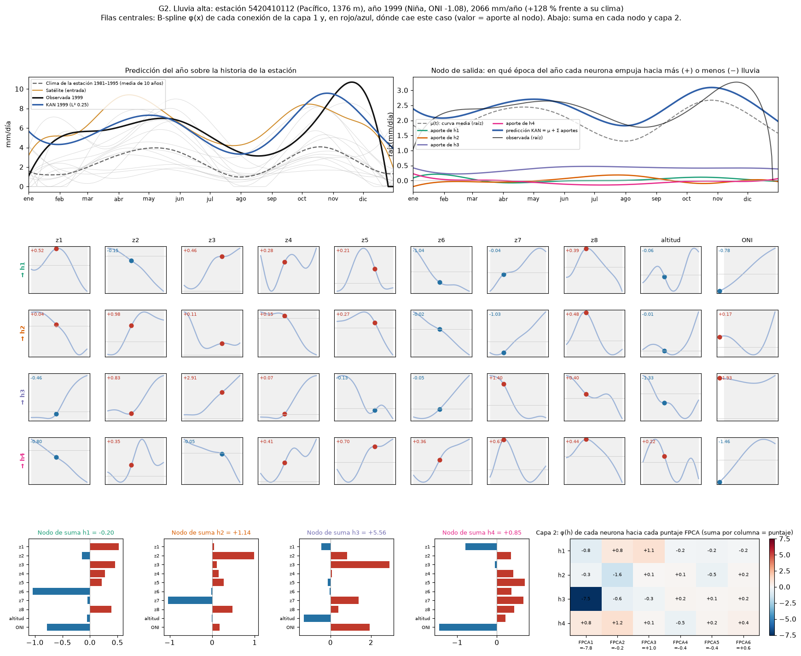

### G2b. Lluvia baja

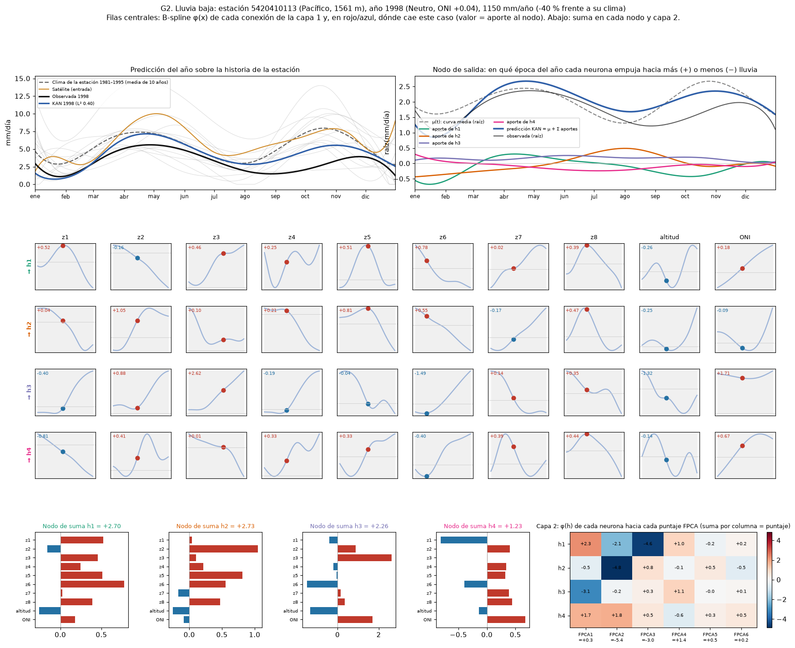

### G2c. Variacional

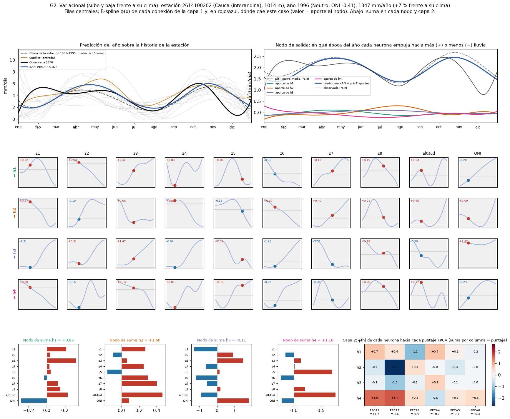

**Qué se concluye:**
- **Lluvia alta:**
  - El nodo h3 llega a +5,56, empujado sobre todo por z3 (+2,91), el ONI (+1,93) y z7 (+1,40); la altitud resta (−1,33).
  - En la capa 2, h3 aporta −7,5 a FPCA1, que fija el nivel general de lluvia. Ese es el movimiento que sube toda la curva: el aporte de h3 es positivo todo el año.
- **Lluvia baja:**
  - h3 queda en +2,26 y su aporte a FPCA1 baja a −3,1.
  - El puntaje FPCA1 total queda casi en 0 (+0,3), porque h1 y h4 empujan en sentido contrario (+2,3 y +1,7). Por eso la predicción queda pegada al clima y no baja lo suficiente.
  - h2 aporta −4,8 a FPCA2 y mueve la lluvia entre temporadas (+0,5 √mm/día en jul–sep).
- **Variacional:**
  - h3 queda cerca de 0 (−0,11), así que el nivel lo fijan h1 y h4. FPCA1 sale +1,7, algo menos lluvia que el promedio.
  - Los aportes por época son pequeños: la red reproduce el clima de la estación y no ve la anomalía de febrero ni la de diciembre.

---

## G3. B-splines con todos los casos

### G3a. Capa 1, con los 2 929 estación-años

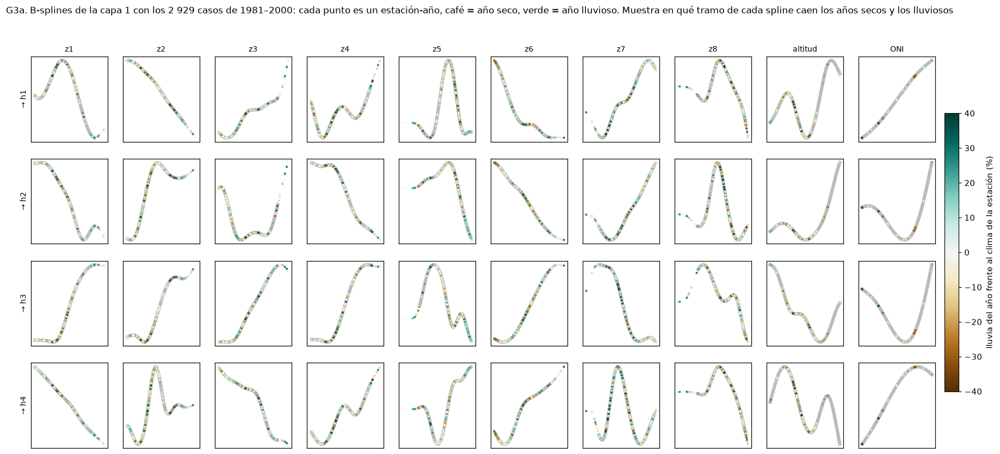

- **Qué muestra:** cada punto es un estación-año, café si fue seco frente a su clima y verde si fue lluvioso. La línea gris es la spline φ(x) de la conexión.
- **Qué se concluye:**
  - **Las splines de la capa 1 trabajan:** muchas tienen máximos, mínimos o cambios de pendiente, como z1 → h1, z4 → h1, altitud → h1 o ONI → h3.
  - Esto contrasta con la versión con D² = 100, donde eran casi rectas. La no linealidad media de la capa 1 es 0,41 (1 − R² frente a una recta; ver la auditoría de parámetros).
  - **Los años secos y los lluviosos se reparten a lo largo de las mismas curvas.** La capa 1 separa sobre todo el tipo de estación (régimen, altitud) más que la anomalía del año.
  - La correlación de las neuronas con la anomalía es débil: entre −0,30 (h4) y +0,05 (h3).
  - **En los extremos hay pocos puntos y algunas ondulaciones** (colas de z3 → h1, z5, z8 y la izquierda de z7). Ahí la forma de la spline la definen pocos casos y no conviene interpretarla.

### G3b. Capa 2, de las neuronas a los puntajes FPCA

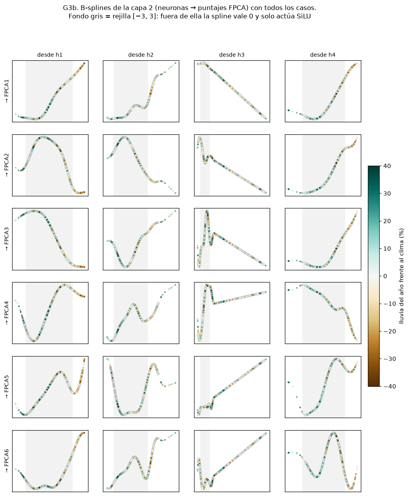

- **Qué muestra:** las 24 B-splines de la capa 2. El fondo gris es la rejilla [−3, 3].
- **Qué se concluye:**
  - **h1, h2 y h4 caen casi siempre dentro de la rejilla,** con 8 %, 15 % y 14 % fuera. Sus splines son curvas: campanas y curvas en S.
  - **h3 tiene un rango muy amplio,** con valores de hasta ~40 en algunos casos, y el **25 % de sus valores cae fuera de la rejilla**. En esa zona la conexión es una recta (solo SiLU). Por eso la columna "desde h3" es casi toda una línea recta con un tramo curvo pequeño cerca de 0.
  - La conexión más importante de la red, **h3 → FPCA1 (28 % de la capa 2), trabaja casi como una lineal** en la mayor parte de su rango.
  - Esto mejora frente a la KAN con D² = 100, donde el 59 % de h3 caía fuera de la rejilla.

---

## G4. Diagrama de la red

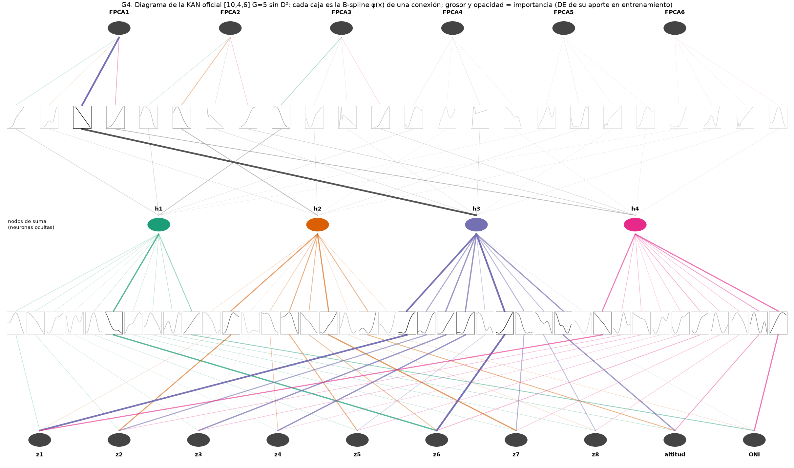

- **Qué muestra:** el grafo completo, 10 entradas → 4 neuronas → 6 puntajes. Cada caja es la B-spline de una conexión. El grosor y la opacidad indican su importancia, medida como la DE de su aporte (tabla en `G4_importancia_conexiones.csv`).
- **Qué se concluye:**
  - **Capa 2:** domina h3 → FPCA1 (28 %). Le siguen h2 → FPCA2 (10 %), h4 → FPCA1 (9 %) y h1 → FPCA3 (8 %). FPCA4 a FPCA6 casi no reciben señal.
  - **Capa 1:** **h3 concentra la información del satélite**, con z6 → h3 (7 %), z1 → h3 (7 %), z4 → h3 (5 %), z3 → h3 (5 %) y altitud → h3 (5 %).
  - **El ONI entra sobre todo por h4** (4 %).
- **Lectura:**
  - h3 resume "cuánta lluvia ve el satélite y a qué altitud", y fija el nivel anual (FPCA1).
  - h2 reparte la lluvia entre temporadas (FPCA2).
  - h4 lleva la señal ENSO.

---

## G5. Frecuencia de activación según la lluvia del año

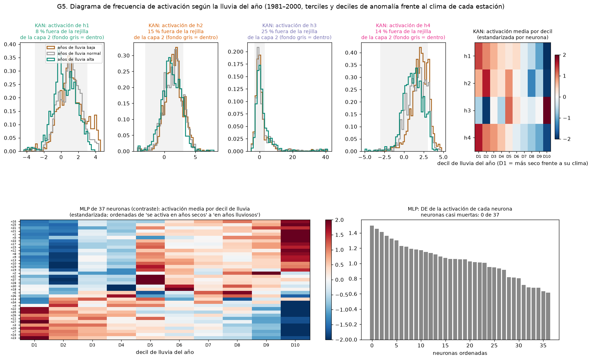

- **Qué muestra:**
  - **Arriba:** los histogramas de h1–h4 en años de lluvia baja, normal y alta, y la activación media por decil de lluvia.
  - **Abajo, como contraste acordado en la asesoría:** la activación por decil del MLP de 37 neuronas y la dispersión de cada neurona.
- **Qué se concluye:**
  - **No hay neuronas muertas** ni en la KAN ni en el MLP (0 de 37).
  - **h1 y h4 bajan de forma gradual cuando el año es más lluvioso,** de rojo en D1 a azul en D10. Son las neuronas que más se relacionan con la anomalía (correlación −0,24 y −0,30).
  - **h3 se dispara en el decil más lluvioso (D10)**, por la cola larga de su histograma.
  - Los histogramas de los tres terciles se solapan mucho: **la señal de la anomalía del año es débil**, lo cual coincide con G1 (los años secos no bajan lo suficiente).

---

## G6. Pérdida y gradientes por capa

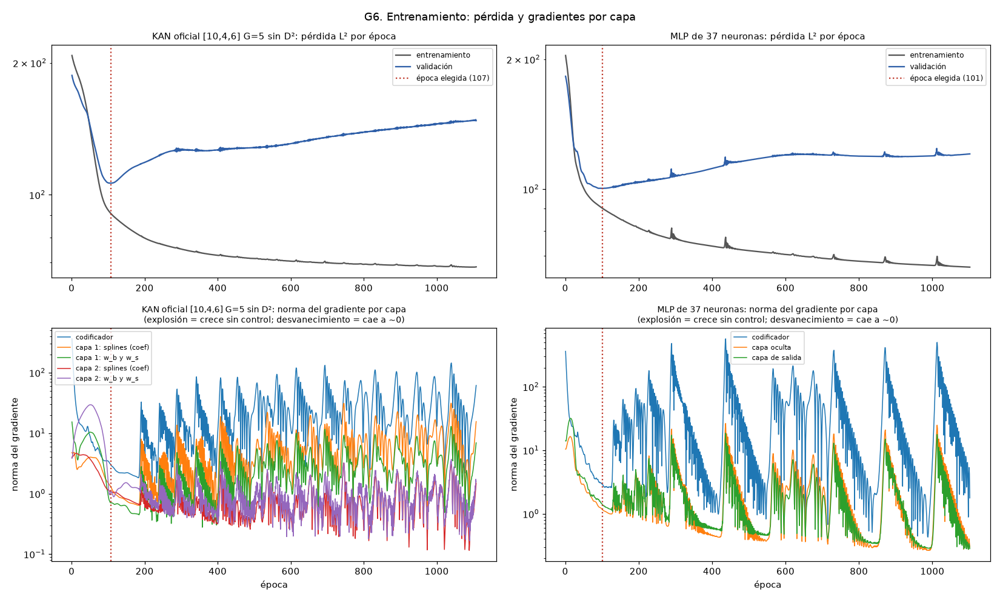

- **Qué muestra:**
  - **Arriba:** la pérdida de entrenamiento y la de validación por época.
  - **Abajo:** la norma del gradiente de cada capa.
  - La KAN va a la izquierda y el MLP a la derecha, como contraste. La línea roja es la época elegida.
- **Qué se concluye:**
  - **La validación tiene su mínimo en la época 107 y después sube** mientras el entrenamiento sigue bajando: es sobreajuste, y la parada temprana lo corta a tiempo.
  - **No hay desvanecimiento:** los gradientes de las splines no caen a 0.
  - **No hay explosión antes de la época elegida.** El gradiente del codificador baja de 136 al inicio a ~3 cerca de la época 107.
  - Después de la época ~190 aparecen oscilaciones, con picos de hasta 10² en el codificador y de ~10 en las splines de la capa 1. Pasa lo mismo en el MLP. Ocurren cuando el modelo ya sobreajusta y no afectan al modelo elegido.

---

## G7. Análisis de desfase

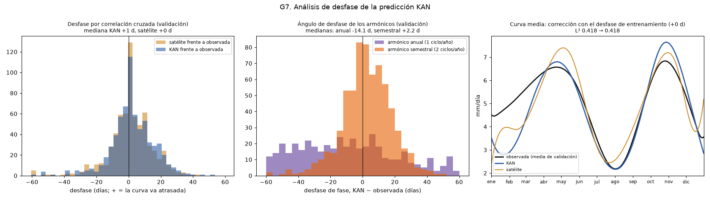

- **Qué muestra:**
  - **Izquierda:** el desfase por correlación cruzada frente a lo observado, para la KAN y el satélite.
  - **Centro:** el desfase de fase de los armónicos anual y semestral.
  - **Derecha:** la curva media de validación y la corrección con el desfase estimado en entrenamiento.
- **Qué se concluye:**
  - **La KAN no está desfasada.** El desfase mediano es +1 día en validación (0 en entrenamiento) y el armónico semestral, el de las dos temporadas, apenas +2,2 días.
  - El desfase estimado en entrenamiento es 0, así que corregir no cambia nada: L² 0,418 → 0,418.
  - El −14 días del armónico anual no es fiable: en un régimen bimodal ese armónico es débil y su fase se dispersa entre −60 y +60 días.
  - **El error es de amplitud, no de fase.** En la curva media, la KAN exagera el pico de noviembre (7,6 frente a 6,8 mm/día) y subestima la lluvia de enero–marzo.

---

## G8. B-splines al estilo de clase

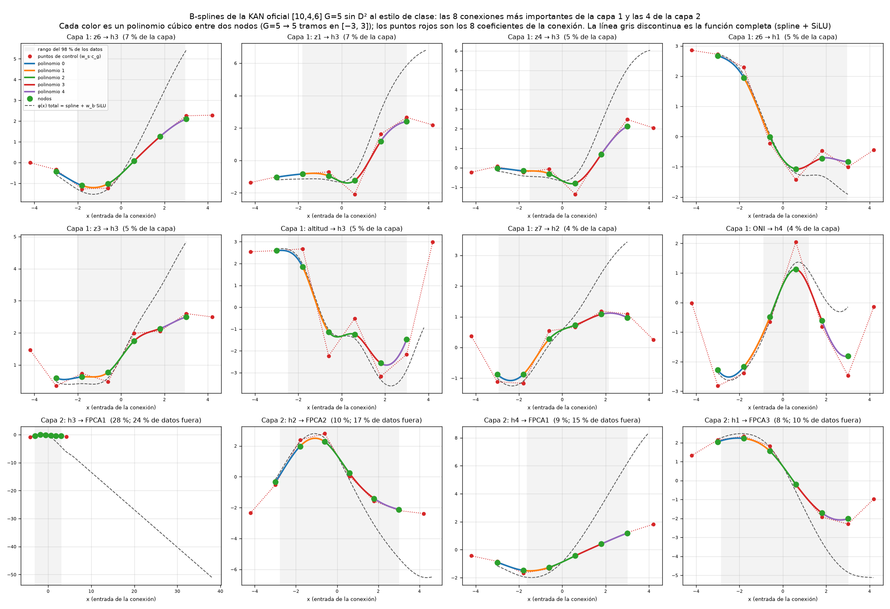

**Cómo leerla:**

| Elemento | Qué es en la KAN |
|---|---|
| Puntos rojos y línea punteada | Los 8 coeficientes de la conexión (w_s·c_g): los puntos de control |
| Puntos verdes | Los 6 nodos de la rejilla G = 5 en [−3, 3] |
| Tramos de colores | Los 5 polinomios cúbicos, uno por intervalo, que forman la spline |
| Línea gris discontinua | La función completa de la conexión: spline + w_b·SiLU(x) |
| Fondo gris | Donde está el 98 % de los datos de esa conexión |

**Qué se concluye:**
- **Sin D² las splines sí trabajan:** los puntos de control suben y bajan, y los 5 polinomios forman curvas con forma propia. Es la diferencia clave frente a la KAN con D² = 100, donde los puntos de control estaban alineados.
- **Capa 1, conexiones con lectura física:**
  - **z6 → h3, z1 → h3, z4 → h3 y z3 → h3:** son crecientes, planas en los valores bajos y empinadas en los altos. Más señal del satélite en esas ventanas del año produce más h3 y más lluvia (G4), pero solo por encima de cierto umbral. Es una corrección no lineal tipo umbral.
  - **Altitud → h3:** decreciente, con una meseta en la altitud media. A mayor altitud, menos aporte a h3, y la relación no es lineal.
  - **ONI → h4:** tiene forma de campana con máximo cerca de ONI ≈ +0,6. Los datos solo cubren aproximadamente de −0,9 a +1,2 (fondo gris), así que la caída hacia los extremos es extrapolación y no se debe interpretar.
- **Capa 2:**
  - **h3 → FPCA1:** la spline es casi 0 y todo lo hace la SiLU. Es una recta decreciente sobre un rango que llega a ~40, de los cuales solo [−3, 3] está en la rejilla (24 % de los datos fuera). Más h3 da un FPCA1 más negativo, es decir, más lluvia en todo el año.
  - **h2 → FPCA2 y h1 → FPCA3:** tienen forma de campana o de S dentro de la rejilla; esas splines sí aportan forma.
- Algunos puntos de control quedan fuera del 98 % de los datos, en los extremos. Esos tramos se apoyan en pocos casos y no se interpretan.

---

## Síntesis

1. **La KAN oficial es interpretable de verdad.**
   - Sus splines tienen forma: umbrales, campanas y mesetas.
   - Se puede seguir cada caso desde las entradas hasta la curva (G2).
   - Sin D², la parte spline no se apaga como pasaba con D² = 100.
2. **Hay una estructura clara:**
   - **h3** lleva el nivel de lluvia que ve el satélite, corregido por la altitud, hacia FPCA1;
   - **h2** reparte entre temporadas (FPCA2);
   - **h4** recoge el ONI;
   - **h1 y h4** son las que más se relacionan con la anomalía del año.
3. **Limitaciones que muestran las gráficas:**
   - La conexión más importante (h3 → FPCA1) es casi lineal porque el 25 % de h3 cae fuera de la rejilla (G3b, G8).
   - La señal de la anomalía del año es débil, y por eso los años secos no bajan lo suficiente (G1, G5).
   - Hay ondulaciones en los extremos con pocos datos (G3a, G8).
4. **No hay problemas de entrenamiento** (G6) **ni de fase** (G7). El error que queda es de amplitud de los picos y de anomalías fuertes.

**Pendiente para la rúbrica 4.5,** que no forma parte de este conjunto de gráficas:
- el ajuste simbólico de al menos una función de activación, con su R² (por ejemplo, z6 → h3 con forma de umbral u ONI → h4 con forma de campana);
- el contraste con los coeficientes de la cabeza lineal;
- la gráfica de las w_k(t), con la ventana del año que usa cada neurona.

## Archivos

**Scripts (en `KAN/codigo/`):**
- `interpretabilidad_kan_jacobo.py oficial`: genera G1–G7. Con `federico` se reproduce la versión anterior (D² = 100).
- `bspline_estilo_clase_kan_jacobo.py oficial`: genera G8.

**Salidas (en `KAN/salidas/interpretabilidad_oficial/`):**
- las figuras G1–G8;
- `G4_importancia_conexiones.csv`, `G6_registro_kan.csv`, `G6_registro_mlp.csv` y `G7_desfase_por_curva.csv`;
- `resumen_interpretabilidad.json`.

La carpeta `interpretabilidad/`, con la versión de D² = 100, queda intacta.
