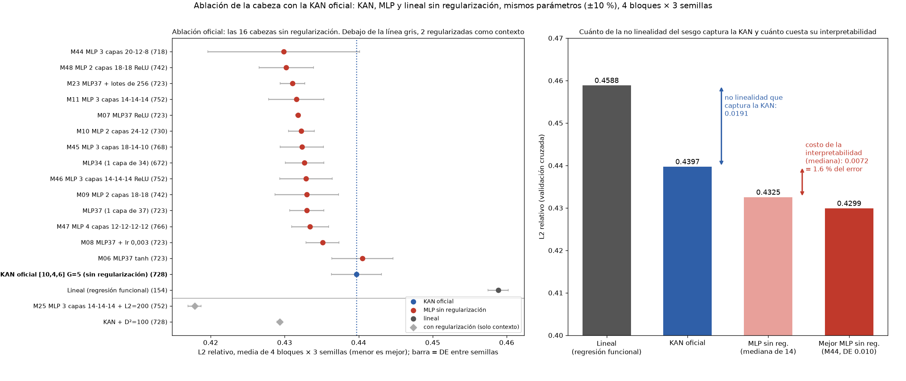
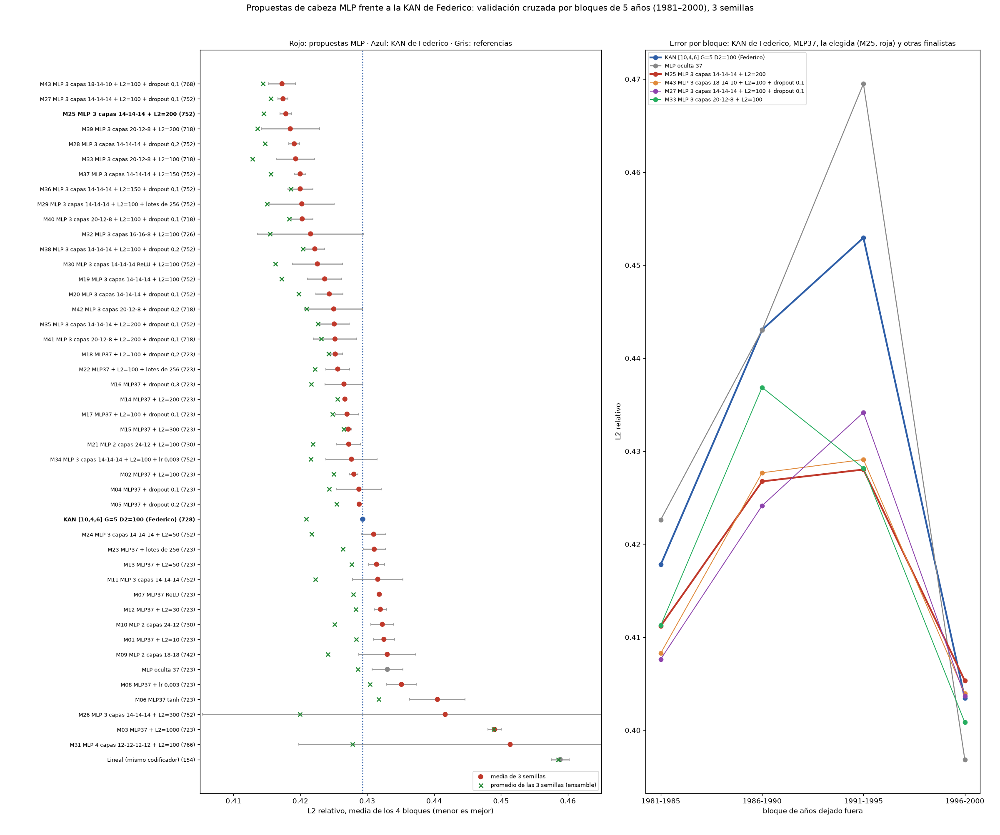
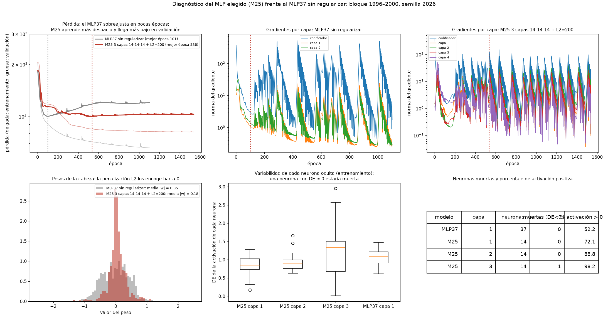

# Ablación de la cabeza: KAN oficial frente a MLP y cabeza lineal

Fecha: 17-nov-2026. Rama de trabajo: `gus-cierre-funcional`. Solo se usan los años 1981–2000; la prueba 2001–2003 no se tocó.

## 1. La KAN oficial y por qué no hubo que repetir los experimentos

La KAN oficial es la que entrena `entrenar_kan_base_oficial.py`, de Federico:
- arquitectura **[10,4,6], G=5**, rejilla [−3, 3], B-splines cúbicas + SiLU;
- lr = 0,01, λ_w = 1e6, 5 000 épocas con paciencia 1 000, semillas 2026, 2027 y 2028;
- 728 parámetros;
- **sin regularización en la cabeza**: solo se penaliza la rugosidad de las w_k(t) del codificador, como pide el enunciado.

Es exactamente la "KAN base" de la validación cruzada por bloques que ya estaba corrida. Se verificó ejecutando su script con la semilla 2026: da **L² = 0,417875 en la época 107**, idéntico a nuestra corrida de la KAN base en el mismo bloque y semilla. Como todos los MLP se entrenaron con los mismos bloques, semillas y protocolo, **no hubo que repetir nada**. Solo cambia la referencia: antes era la KAN con D²=100 (0,4293); ahora es la KAN oficial (0,4397).

## 2. Ablación oficial: todas las cabezas sin regularización

**Por qué sin regularización.** La KAN oficial no tiene penalización en la cabeza. Si al MLP se le diera L2 o dropout y a la KAN no, la diferencia mezclaría dos cosas: la arquitectura y la regularización. Para que la ablación mida solo lo que pide el enunciado ("cuánto se pierde por exigir interpretabilidad en la KAN"), **ninguna cabeza lleva regularización**. Todas comparten además:
- el mismo codificador y el mismo decodificador FPCA;
- el mismo número de parámetros (±10 %, contado con `sum(p.numel())`);
- 3 semillas por configuración;
- la validación cruzada por 4 bloques de 5 años (1981–85, 86–90, 91–95, 96–00).

Se probaron **14 MLP sin regularización**: 1, 2, 3 y 4 capas; SiLU, ReLU y tanh; lr 0,01 y 0,003; lote completo y lotes de 256.



| Cabeza | Qué es | Parám. (dif.) | L² CV | DE semillas | 81–85 | 86–90 | 91–95 | 96–00 | Dif. vs KAN oficial [IC 95 %] | Estación-bloque mejores | Bloques ganados |
|---|---|---|---|---|---|---|---|---|---|---|---|
| M44 | MLP 3 capas 20-12-8 | 718 (−1 %) | 0,4299 | **0,0102** | 0,423 | 0,452 | 0,440 | 0,404 | −0,0095 [−0,0140; −0,0052] | 58 % | 4 de 4 |
| M48 | MLP 2 capas 18-18 ReLU | 742 (+2 %) | 0,4302 | 0,0037 | 0,418 | 0,441 | 0,458 | 0,405 | −0,0096 [−0,0146; −0,0042] | 64 % | 3 de 4 |
| M23 | MLP37 con lotes de 256 | 723 (−1 %) | 0,4310 | 0,0017 | 0,420 | 0,443 | 0,461 | 0,400 | −0,0085 [−0,0135; −0,0034] | 60 % | 3 de 4 |
| M11 | MLP 3 capas 14-14-14 | 752 (+3 %) | 0,4316 | 0,0037 | 0,422 | 0,447 | 0,453 | 0,404 | −0,0080 [−0,0123; −0,0036] | 58 % | 3 de 4 |
| M07 | MLP37 ReLU | 723 (−1 %) | 0,4318 | 0,0003 | 0,421 | 0,445 | 0,467 | 0,395 | −0,0077 [−0,0134; −0,0018] | 63 % | 3 de 4 |
| M10 | MLP 2 capas 24-12 | 730 (+0 %) | 0,4323 | 0,0017 | 0,420 | 0,437 | 0,467 | 0,404 | −0,0076 [−0,0129; −0,0025] | 60 % | 3 de 4 |
| M45 | MLP 3 capas 18-14-10 | 768 (+5 %) | 0,4323 | 0,0029 | 0,420 | 0,452 | 0,448 | 0,410 | −0,0073 [−0,0116; −0,0030] | 57 % | 3 de 4 |
| MLP34 | MLP 1 capa de 34 | 672 (−8 %) | 0,4327 | 0,0026 | 0,416 | 0,452 | 0,468 | 0,395 | −0,0067 [−0,0123; −0,0010] | 62 % | 3 de 4 |
| M46 | MLP 3 capas 14-14-14 ReLU | 752 (+3 %) | 0,4329 | 0,0035 | 0,420 | 0,449 | 0,455 | 0,409 | −0,0068 [−0,0111; −0,0025] | 57 % | 3 de 4 |
| M09 | MLP 2 capas 18-18 | 742 (+2 %) | 0,4330 | 0,0043 | 0,418 | 0,444 | 0,469 | 0,401 | −0,0067 [−0,0117; −0,0017] | 59 % | 3 de 4 |
| MLP37 | MLP 1 capa de 37 | 723 (−1 %) | 0,4330 | 0,0023 | 0,423 | 0,443 | 0,470 | 0,397 | −0,0065 [−0,0121; −0,0009] | 60 % | 3 de 4 |
| M47 | MLP 4 capas 12-12-12-12 | 766 (+5 %) | 0,4334 | 0,0025 | 0,428 | 0,456 | 0,444 | 0,406 | −0,0059 [−0,0101; −0,0016] | 53 % | 4 de 4 |
| M08 | MLP37 con lr 0,003 | 723 (−1 %) | 0,4351 | 0,0022 | 0,423 | 0,445 | 0,474 | 0,399 | −0,0044 [−0,0100; +0,0012] | 60 % | 3 de 4 |
| M06 | MLP37 tanh | 723 (−1 %) | 0,4405 | 0,0041 | 0,420 | 0,465 | 0,472 | 0,405 | +0,0011 [−0,0041; +0,0062] | 48 % | 2 de 4 |
| **KAN oficial** | **[10,4,6] G=5, sin regularización** | **728** | **0,4397** | **0,0034** | **0,431** | **0,458** | **0,446** | **0,423** | — | — | — |
| Lineal | Cabeza lineal = regresión funcional | 154 | 0,4588 | 0,0014 | 0,447 | 0,476 | 0,497 | 0,416 | +0,0196 [+0,0115; +0,0280] | 46 % | 1 de 4 |

Notas sobre la tabla:
- La tabla completa está en `ablacion_oficial_resumen.csv`.
- **Dif. vs KAN oficial:** negativo significa que esa cabeza tiene menor error que la KAN. Se calcula estación por estación y bloque por bloque.
- M23 usa lotes de 256: no es una penalización, sino otra forma de optimizar.

**Qué dicen los resultados:**
1. **El sesgo satelital tiene una parte no lineal real.** La KAN baja el error de la cabeza lineal (regresión funcional) de 0,4588 a 0,4397, y la diferencia es significativa (p < 0,001).
2. **Un MLP del mismo tamaño baja un poco más.** 13 de los 14 MLP sin regularización tienen menor error que la KAN; solo tanh queda igual. La ventaja típica es de 0,007 (mediana de los 14 MLP: 0,4325).
3. **Esa ventaja es pequeña frente a lo que gana la KAN:**

| Medida | Valor |
|---|---|
| Mejora de la KAN sobre la cabeza lineal | 0,0191 |
| Mejora de un MLP típico sobre la cabeza lineal | 0,0263 |
| **Parte de la no linealidad que captura la KAN** | **73 %** frente al MLP típico; 66 % frente al mejor MLP |
| **Costo de la interpretabilidad** (KAN − MLP típico) | **0,0072, el 1,6 % del error** |

4. **El "mejor" MLP sin regularización (M44) no es fiable:** su DE entre semillas es 0,010, tres veces la de la KAN. Su resultado depende de la semilla.
5. **La profundidad no ayuda sin regularización:** 1, 2, 3 o 4 capas dan prácticamente lo mismo (0,430–0,433).

## 3. Por qué se justifica elegir la KAN oficial

1. **Cumple el objetivo del proyecto con un costo pequeño.** El enunciado pide una red KAN e interpretar sus funciones de activación con la climatología regional. Exigir esa interpretabilidad cuesta 0,007 de L² (1,6 % del error) frente a un MLP del mismo tamaño, y conserva el 73 % de la ganancia no lineal sobre la regresión funcional.
2. **La comparación es justa.** Ni la KAN ni el MLP llevan regularización en la cabeza; las dos tienen la misma información, el mismo tamaño y la misma evaluación. La diferencia mide solo la arquitectura, que es lo que pide la ablación (sección 4.3 de la rúbrica).
3. **Es igual de estable.** La DE entre semillas de la KAN (0,0034) está en el mismo rango que la de los MLP (0,0003–0,0043, y 0,010 en M44).
4. **No añadir D² a la KAN también se justifica.** La KAN con D²=100 tenía menor error (0,4293), pero en las B-splines (G8) se vio que esa penalización **deja las splines casi rectas**: la curvatura la pone SiLU y se pierde justamente lo que hace interpretable a la KAN. En la KAN oficial las splines sí tienen forma (G8b), con mínimos, máximos y ondulaciones que se pueden leer con la climatología. Además, regularizar solo la KAN rompería la comparación justa del punto 2.
5. **Lo que se gana en interpretación no lo da el MLP.** El MLP solo entrega pesos. La KAN entrega una función graficable por cada conexión entrada → neurona, y se le puede ajustar una expresión simbólica, que también pide la rúbrica.

## 4. Contexto: qué pasa si se regulariza la cabeza (fuera de la ablación oficial)

Para saber cuánto más se podía bajar el error, se exploraron además **30 MLP con regularización**, en 4 rondas: penalización L2 de los pesos, dropout, y su combinación con profundidad. **No forman parte de la ablación oficial**, porque la KAN oficial no está regularizada; se reportan como contexto.



| Ronda | Qué se probó | Qué se aprendió |
|---|---|---|
| 1 | L2 (10 a 1 000), dropout, tanh, ReLU, lr 0,003, más capas | Lo único que ayuda es regularizar |
| 2 | Ajuste fino de L2 y dropout; regularización + profundidad; mini-lotes | 3 capas + L2 mejora claramente |
| 3 | Variantes alrededor de 3 capas | Se llega a ≈ 0,417. 4 capas y L2 muy fuerte se vuelven inestables |
| 4 | Combinaciones de lo mejor | Meseta: las 5 mejores están empatadas entre sí |

La mejor regularizada, por estabilidad y simplicidad, es **M25: MLP de 3 capas de 14 neuronas + L2 = 200** (752 parámetros), con **L² CV = 0,4178**:

| Comparación | Diferencia de L² CV |
|---|---|
| M25 frente a la KAN oficial | −0,0221 [−0,0262; −0,0180] |
| M25 frente a la KAN con D²=100 | −0,0118 |



**Lectura:**
- La mayor parte de la mejora de M25 viene de la **regularización**, no de la arquitectura. El mismo MLP de 3 capas sin L2 (M11) queda en 0,4316, casi como el MLP37.
- La KAN también mejora con regularización: de 0,4397 a 0,4293 con D²=100. Pero, como se vio, a costa de su interpretabilidad.
- La figura 8 muestra el mecanismo:
  - L2 encoge los pesos (la media de |w| baja de 0,35 a 0,18) y evita el sobreajuste temprano del MLP sin regularizar;
  - no hay neuronas muertas;
  - no hay desvanecimiento ni explosión del gradiente antes de la mejor época.

## 5. Conclusión para el informe

1. **Ablación oficial (sin regularización en la cabeza), en validación cruzada:**

| Cabeza | L² CV |
|---|---|
| Lineal | 0,4588 |
| KAN oficial | 0,4397 |
| MLP (mediana de 14) | 0,4325 |

   El sesgo es no lineal. La KAN captura el 73 % de esa no linealidad, y la interpretabilidad cuesta el 1,6 % del error.
2. **Se mantiene la KAN oficial** como modelo principal del proyecto: es la que permite cumplir los objetivos de interpretación con un costo de error pequeño y medido.
3. **Como resultado complementario**, se puede reportar que regularizar la cabeza mejora a los dos modelos (MLP M25: 0,4178; KAN D²=100: 0,4293). En la KAN eso aplana las splines, así que no se adopta.
4. La prueba 2001–2003 se evalúa **una sola vez**, al final, con las tres cabezas de la ablación oficial (lineal, KAN oficial y MLP37 u otra fijada de antemano).

## 6. Archivos y cómo reproducir

Desde `KAN/codigo/`, con el entorno `.venv` del proyecto:

```
python -X utf8 cv_mlp_jacobo.py r1 0 4      (y 1 4, 2 4, 3 4 en paralelo; rondas r1 a r5)
python -X utf8 analizar_ablacion_oficial_jacobo.py
python -X utf8 analizar_mlp_jacobo.py figura
python -X utf8 figuras_mlp_jacobo.py
```

| Archivo | Contenido |
|---|---|
| `cv_mlp_jacobo.py` | Las 49 propuestas MLP por ronda. La r5 son los MLP profundos sin regularización |
| `analizar_ablacion_oficial_jacobo.py` | Ablación oficial (sección 2), costo de la interpretabilidad y figura 9 |
| `analizar_mlp_jacobo.py` | Todas las propuestas frente a la KAN con D²=100, pares de finalistas y figura 7 |
| `figuras_mlp_jacobo.py` | Diagnóstico del MLP regularizado y figura 8 |
| `ablacion_oficial_resumen.csv`, `ablacion_oficial_costo_interpretabilidad.csv` | Tablas de la ablación oficial |
| `mlp_resumen.csv`, `mlp_finalistas_pares.csv`, `mlp_diagnostico_neuronas.csv` | Tablas de la exploración con regularización |
