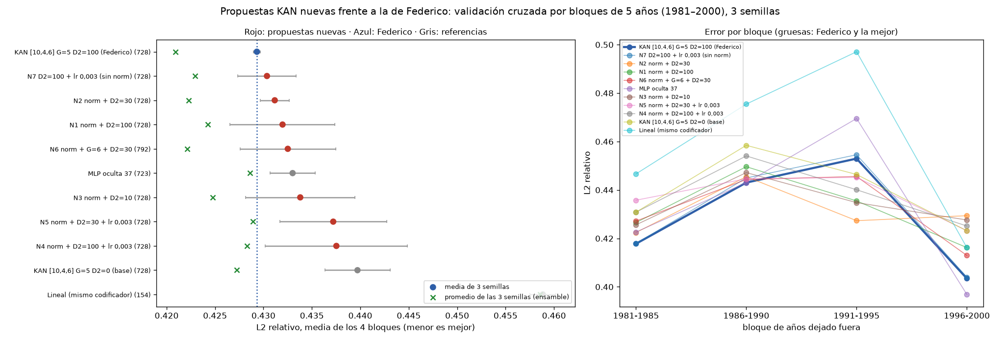
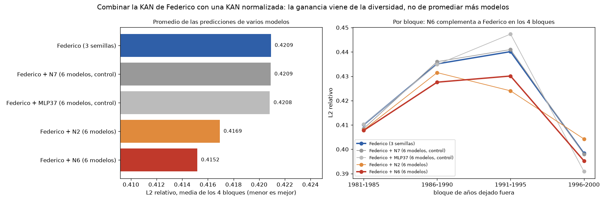
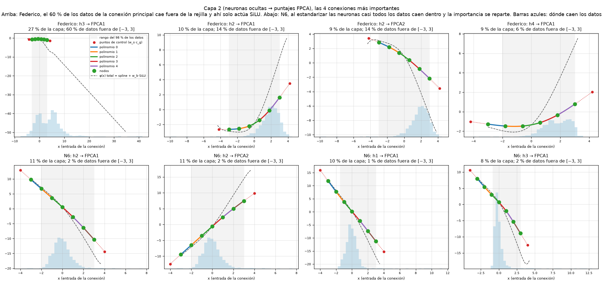

# Propuestas KAN nuevas frente a la KAN de Federico

Fecha: 17-nov-2026. Rama de trabajo: `gus-cierre-funcional`. Solo se usan los años 1981–2000; la prueba 2001–2003 no se tocó.

## 1. Punto de partida

El informe anterior (`INFORME_EXPERIMENTOS_KAN.md`) dejó como ganadora la **KAN de Federico [10,4,6], G=5, D²=100**, con L² de validación cruzada de 0,4293. El análisis de interpretabilidad (`LEEME_INTERPRETABILIDAD.md`) le encontró tres debilidades:

| Debilidad | Evidencia | Gráfica |
|---|---|---|
| La capa 2 casi no usa sus B-splines | El 21 % de las entradas de la capa 2 cae fuera de la rejilla [−3, 3], y en la neurona más importante (h3) es el 59 %. Fuera de la rejilla la spline vale 0 y solo queda SiLU | G3b, G8 |
| Con D²=100 las splines quedan casi rectas | La rugosidad de la capa 1 baja de 2,834 a 0,042 | G8 |
| El gradiente del codificador oscila después de la mejor época | Picos de hasta 10² mientras la validación empeora | G6 |

Las propuestas nuevas atacan esas debilidades **solo con herramientas vistas en clase**:
- estandarizar una variable con la media y la DE de entrenamiento;
- penalización de rugosidad (segunda diferencia de los coeficientes de la B-spline, como en suavizado funcional);
- número de nodos de la base B-spline;
- tasa de aprendizaje de Adam;
- promedio de modelos.

No se cambia nada más: mismo codificador, mismas 10 entradas, mismo decodificador FPCA, mismas semillas, misma parada temprana y misma métrica.

## 2. Las propuestas

| Nombre | Qué es | Qué debilidad ataca | Parámetros |
|---|---|---|---|
| **KAN de Federico** | [10,4,6], G=5, D²=100, lr=0,01 | (referencia) | 728 |
| **N1** norm + D²=100 | Federico + **estandarizar h1–h4** con la media y DE de entrenamiento antes de la capa 2 | Datos fuera de la rejilla | 728 |
| **N2** norm + D²=30 | N1 con una penalización D² intermedia | Fuera de rejilla + splines rectas | 728 |
| **N3** norm + D²=10 | N1 con D² baja | Fuera de rejilla + splines rectas | 728 |
| **N4** norm + D²=100 + lr 0,003 | N1 con una tasa de aprendizaje menor | Fuera de rejilla + oscilación | 728 |
| **N5** norm + D²=30 + lr 0,003 | N2 con una tasa de aprendizaje menor | Las tres | 728 |
| **N6** norm + G=6 + D²=30 | N2 con un nodo más en la rejilla (G=6: 6 tramos cúbicos) | Fuera de rejilla + más flexibilidad | 792 (+9 %) |
| **N7** D²=100 + lr 0,003 (sin norm) | Federico solo con una tasa de aprendizaje menor | Oscilación | 728 |

Todas tienen el mismo número de parámetros que Federico, salvo N6, que queda dentro del ±10 %. Estandarizar no agrega parámetros: la media y la DE salen de los datos de entrenamiento.

**Evaluación:** se usa la misma validación cruzada por bloques del informe anterior.
- 4 bloques de 5 años: 1981–85, 1986–90, 1991–95 y 1996–2000. El último coincide con la validación original.
- Cada bloque se deja fuera una vez y se entrena con los otros tres.
- 3 semillas por bloque.
- En total: 7 propuestas × 4 bloques × 3 semillas = **84 entrenamientos**, unos 70 minutos en CPU con 4 procesos.
- Las referencias (Federico, MLP37, KAN base y lineal) vienen de la corrida anterior, con los mismos bloques y semillas.

## 3. Resultados: modelos individuales



| Modelo | Qué es | L² CV | DE semillas | Ensamble 3 sem. | 81–85 | 86–90 | 91–95 | 96–00 | Dif. vs Federico [IC 95 %] | p Wilcoxon | Bloques ganados |
|---|---|---|---|---|---|---|---|---|---|---|---|
| **Federico** | KAN D²=100 | **0,4293** | 0,0003 | **0,4209** | 0,418 | 0,443 | 0,453 | 0,404 | — | — | — |
| N7 | Federico con lr 0,003 | 0,4304 | 0,0030 | 0,4229 | 0,418 | 0,445 | 0,455 | 0,404 | +0,0011 [−0,0002; 0,0024] | 0,08 | 0 de 4 |
| N2 | norm + D²=30 | 0,4312 | 0,0015 | 0,4223 | 0,422 | 0,446 | **0,427** | 0,429 | +0,0014 [−0,0032; 0,0059] | 0,002 | 1 de 4 |
| N1 | norm + D²=100 | 0,4320 | 0,0054 | 0,4242 | 0,427 | 0,450 | 0,436 | 0,416 | +0,0026 [−0,0013; 0,0065] | <0,001 | 1 de 4 |
| N6 | norm + G=6 + D²=30 | 0,4325 | 0,0049 | 0,4221 | 0,427 | 0,444 | 0,446 | 0,413 | +0,0031 [−0,0012; 0,0075] | 0,004 | 1 de 4 |
| MLP37 | MLP de 37 neuronas (ref.) | 0,4330 | 0,0023 | 0,4286 | 0,423 | 0,443 | 0,470 | **0,397** | +0,0038 [0,0003; 0,0076] | 0,82 | 2 de 4 |
| N3 | norm + D²=10 | 0,4338 | 0,0057 | 0,4247 | 0,426 | 0,447 | 0,435 | 0,428 | +0,0041 [−0,0002; 0,0084] | <0,001 | 1 de 4 |
| N5 | norm + D²=30 + lr 0,003 | 0,4372 | 0,0055 | 0,4289 | 0,436 | 0,445 | 0,445 | 0,423 | +0,0077 [0,0034; 0,0121] | <0,001 | 1 de 4 |
| N4 | norm + D²=100 + lr 0,003 | 0,4375 | 0,0073 | 0,4283 | 0,431 | 0,454 | 0,440 | 0,425 | +0,0081 [0,0036; 0,0127] | <0,001 | 1 de 4 |
| KAN base | sin D² (ref.) | 0,4397 | 0,0034 | 0,4273 | 0,431 | 0,458 | 0,446 | 0,423 | +0,0104 [0,0073; 0,0135] | <0,001 | 1 de 4 |
| Lineal | cabeza lineal (ref.) | 0,4588 | 0,0014 | 0,4586 | 0,447 | 0,476 | 0,497 | 0,416 | +0,0299 [0,0227; 0,0371] | <0,001 | 0 de 4 |

**Cómo leer las columnas:**
- **L² CV:** error relativo de la curva, promediado en los 4 bloques y las 3 semillas. Menor es mejor.
- **DE semillas:** cuánto cambia el resultado al cambiar la semilla. Mide estabilidad.
- **Ensamble 3 sem.:** el error al promediar las predicciones de las 3 semillas.
- **Dif. vs Federico:** se calcula estación por estación y bloque por bloque. Positivo significa peor que Federico. Si el intervalo contiene el 0, no hay diferencia clara.
- **p Wilcoxon:** prueba pareada de esas diferencias.
- **Bloques ganados:** en cuántos de los 4 bloques el modelo tuvo menor error que Federico.

**Qué se concluye:**
1. **Ninguna propuesta individual supera a Federico.** La KAN de Federico sigue siendo el mejor modelo individual, y además el más estable (DE 0,0003).
2. **N7 (solo bajar lr) empata con Federico:** el intervalo contiene el 0 y no gana ningún bloque. La oscilación del gradiente no estaba costando error, porque la parada temprana ya la cortaba.
3. **Estandarizar las neuronas cambia dónde acierta el modelo.** N1, N2, N3 y N6 son mucho mejores en 1991–95 (N2: 0,427 frente a 0,453), pero peores en 1996–2000 y 1981–85. En promedio se compensan, y la DE entre semillas sube.
4. **Bajar lr junto con normalizar (N4, N5) empeora:** se necesitan muchas más épocas (más de 1 100) y quedan peor.
5. Entre las normalizadas, D²=30 es el mejor peso de rugosidad: N2 < N1 (D²=100) < N3 (D²=10).

**Por qué no basta con una métrica:** si solo se mirara el bloque 1996–2000, que es la validación original, el mejor sería el MLP (0,397). Con los 4 bloques el MLP queda detrás de Federico. Y si solo se mirara 1991–95, el mejor sería N2. Por eso la decisión se toma con varios criterios a la vez:
- el promedio de los 4 bloques;
- la estabilidad entre semillas;
- cuántos bloques gana;
- la prueba pareada por estación;
- lo que muestra la interpretabilidad (sección 5).

## 4. Resultado principal: Federico + N6 es la mejor propuesta

El punto 3 indica que las KAN normalizadas **se equivocan en lugares distintos** que la de Federico. En estadística, cuando dos estimadores tienen errores poco correlacionados, promediarlos reduce el error. Se probó entonces promediar las predicciones de Federico (3 semillas) con cada propuesta (3 semillas). Para eso no hubo que entrenar nada nuevo, porque las predicciones de cada bloque ya estaban guardadas.



| Combinación | Qué es | Parámetros | L² CV | 81–85 | 86–90 | 91–95 | 96–00 | Dif. vs Federico [IC 95 %] | Estación-bloque mejores | p Wilcoxon | Bloques ganados |
|---|---|---|---|---|---|---|---|---|---|---|---|
| Federico (3 semillas) | Referencia | 728 | 0,4209 | 0,410 | 0,435 | 0,440 | 0,398 | — | — | — | — |
| Federico + N7 | **Control:** 6 modelos casi iguales | 1 456 | 0,4209 | 0,409 | 0,436 | 0,441 | 0,398 | 0,0000 [−0,0007; 0,0007] | 52 % | 0,46 | 2 de 4 |
| Federico + MLP37 | **Control:** 6 modelos, otra arquitectura | 1 451 | 0,4208 | 0,410 | 0,435 | 0,447 | 0,391 | +0,0001 [−0,0018; 0,0020] | 53 % | 0,07 | 2 de 4 |
| Federico + N2 | KAN sin y con normalizar | 1 456 | 0,4169 | 0,408 | 0,432 | 0,424 | 0,404 | −0,0042 [−0,0065; −0,0019] | 54 % | 0,006 | 3 de 4 |
| **Federico + N6** | **KAN sin y con normalizar (G=6)** | **1 520** | **0,4152** | **0,408** | **0,428** | **0,430** | **0,395** | **−0,0058 [−0,0081; −0,0036]** | **59 %** | **<0,001** | **4 de 4** |

**Por qué Federico + N6 es la mejor:**
1. **Es el único que mejora en los 4 bloques**, incluido 1996–2000, la validación original. Federico + N2 pierde ese bloque.
2. **La mejora es significativa:** −0,0058 de L², con un intervalo al 95 % que no toca el 0 (p < 0,001). Además mejora en el 59 % de los pares estación-bloque.
3. **La ganancia no es por promediar más modelos.** Los dos controles también promedian 6 modelos y no mejoran nada (0,4209 y 0,4208). La ganancia viene de que N6 aporta **información distinta**.
4. **Tiene justificación de arquitectura (sección 5):** Federico y N6 usan la capa 2 de manera diferente. En Federico la capa 2 actúa casi siempre como una recta SiLU; en N6 las splines sí reciben los datos.

**Costo y salvedad:**
- Se duplican los parámetros (1 520 frente a 728) y el tiempo de entrenamiento. Frente a un MLP del mismo tamaño ya no es una comparación igualada.
- Es un **promedio de dos modelos**, no una arquitectura nueva. Conviene preguntarle al profesor si lo acepta como modelo final.

## 5. Justificación de arquitectura: qué cambia al normalizar



Medido en el bloque 1996–2000 con la semilla 2026 (tabla en `nuevas_uso_rejilla.csv`):

| Medida | Federico | N2 | N6 |
|---|---|---|---|
| Datos de la capa 2 fuera de [−3, 3] | 21,0 % | 1,7 % | 1,7 % |
| … en la neurona h3 | 59,6 % | 2,3 % | 1,7 % |
| Rango de las neuronas ocultas | −10 a 41 | −5 a 6 | −7 a 13 |
| Importancia de la conexión principal de la capa 2 | 27 % | 13 % | 11 % |
| Rugosidad de la capa 1 | 0,042 | 0,034 | 0,033 |
| Rugosidad de la capa 2 | 0,016 | 0,031 | 0,019 |

**Qué se concluye:**
- **Normalizar resuelve el problema de la rejilla:** los datos fuera de [−3, 3] bajan del 21 % al 1,7 %. En Federico la conexión principal (h3 → FPCA1) recibe datos hasta 41, donde solo actúa SiLU. En N6 casi todos los datos caen sobre los tramos de la B-spline.
- **La información se reparte mejor:** en Federico una sola conexión carga el 27 % de la capa 2; en N6 la más importante carga el 11 %. Ya no hay un único camino del que dependa toda la red.
- **Las splines de N6 siguen siendo suaves**, casi rectas en la capa 2: D²=30 todavía penaliza bastante. La no linealidad la reparten la spline (dentro del rango de los datos) y SiLU (en los extremos).
- **Por qué se complementan:** son dos maneras distintas de llevar la señal a los puntajes FPCA. En Federico, por un camino dominante y casi lineal; en N6, por varios caminos dentro de la rejilla. Por eso aciertan en bloques distintos (Federico en 1996–2000, N6 en 1986–95) y su promedio mejora en todos.

## 6. Recomendación para la reunión con Federico

1. **Como modelo individual, se mantiene la KAN de Federico [10,4,6], G=5, D²=100.** Ninguna de las 7 propuestas la supera sola, y es la más estable.
2. **Como predicción final, se propone Federico + N6** (promedio de las dos KAN, 3 semillas cada una): L² CV 0,4152 frente a 0,4209, gana los 4 bloques y p < 0,001. Si el profesor no acepta promediar modelos, se queda la de Federico.
3. **Para el informe del curso**, la normalización de las neuronas ocultas sirve como resultado de interpretabilidad. Muestra que la KAN ganadora no usa la rejilla en su conexión principal y que estandarizar lo corrige, aunque por sí solo no baje el error.
4. **La prueba 2001–2003 se evalúa una sola vez**, al final, con el modelo que se elija.

## 7. Archivos y cómo reproducir

Desde `KAN/codigo/`, con el entorno `.venv` del proyecto:

```
python -X utf8 cv_propuestas_nuevas_kan.py 0 4   (y 1 4, 2 4, 3 4 en paralelo)
python -X utf8 analizar_propuestas_nuevas_kan.py
python -X utf8 figuras_propuestas_nuevas_kan.py
```

| Archivo | Contenido |
|---|---|
| `cv_propuestas_nuevas_kan.py` | Define N1–N7 y corre los 84 entrenamientos |
| `analizar_propuestas_nuevas_kan.py` | Tabla de la sección 3 y figura 4 |
| `figuras_propuestas_nuevas_kan.py` | Ensambles (sección 4), uso de la rejilla (sección 5), figuras 5 y 6 |
| `KAN/salidas/cv_nuevas/` | Predicciones de cada entrenamiento y modelos guardados del bloque 1996–2000 |
| `nuevas_resumen.csv`, `nuevas_L2_por_bloque_y_semilla.csv` | Resultados individuales |
| `nuevas_ensambles.csv`, `nuevas_uso_rejilla.csv` | Ensambles y uso de la rejilla |
