# Interpretabilidad de la KAN: gráficas pedidas en la asesoría

Modelo: KAN [10,4,6], G=5, D²=100 (la ganadora de la validación cruzada), semilla 2026. Solo se usan entrenamiento y validación (1981–2000); la prueba 2001–2003 no se toca. Script: `Propuestas_KAN/interpretabilidad_kan.py`.

**Cómo funciona la red, para leer las gráficas:**

1. El satélite se resume en 8 números, z1…z8.
2. Junto con la altitud y el ONI forman 10 entradas.
3. **Capa 1:** cada entrada pasa por su propia B-spline φ(x) hacia cada una de las 4 neuronas ocultas, h1…h4. Cada neurona **suma** lo que le llega: es el nodo de suma.
4. **Capa 2:** cada neurona pasa por otra B-spline hacia los 6 puntajes FPCA.
5. La curva final es μ(t) + Σ puntaje_m · ψ_m(t). Como es una suma, se puede separar **cuánto aporta cada neurona a cada día del año**.

---

## G1. Predicción del año T sobre todo el pasado de la estación

*Pedido: "la ventana de entrenamiento o todo el pasado más el T+1".*

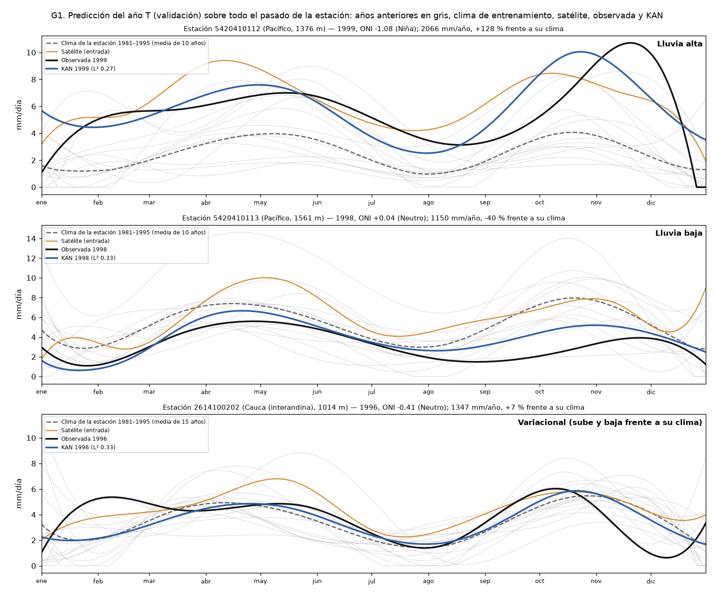

- **Qué muestra:** tres casos de validación. Para cada uno: los años anteriores de la estación (gris), su clima 1981–1995 (línea punteada), el satélite que entra a la red (naranja), lo observado (negro) y la predicción de la KAN (azul).
- **Qué se concluye:** la KAN corrige el satélite hacia lo observado y conserva la forma bimodal de dos temporadas de lluvia. En el año seco (−40 % frente a su clima) se acerca, pero no baja lo suficiente: queda entre el satélite y lo observado.

---

## G2. Casos de lluvia alta, baja y variacional, con sus B-splines al lado

*Pedido: un caso de lluvia alta, uno de baja y uno variacional, y al lado las B-splines de ese caso en cada nodo y en el nodo de suma.*

**Cómo leer cada figura:**

| Zona | Qué es |
|---|---|
| Arriba a la izquierda | La predicción del año sobre la historia de la estación |
| Arriba a la derecha | El **aporte de cada neurona por época del año**: por encima de 0 empuja hacia más lluvia, por debajo hacia menos. La suma de todos los aportes más μ(t) da la predicción |
| Centro (4 × 10 recuadros) | Las 40 **B-splines de la capa 1**. El punto marca dónde cae este caso en cada una y el número es su aporte (rojo suma, azul resta) |
| Abajo a la izquierda | Las barras de cada **nodo de suma** (h1…h4): qué entrada suma o resta en cada neurona |
| Abajo a la derecha | La **capa 2**: el aporte de cada neurona a cada puntaje FPCA. Cada columna suma su puntaje |

### G2a. Lluvia alta

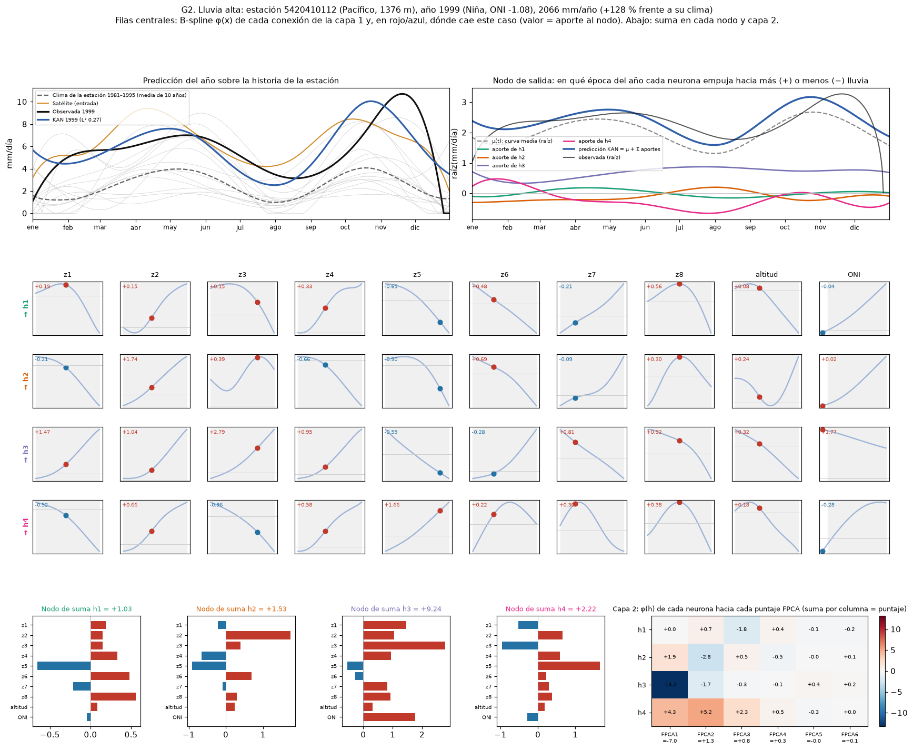

### G2b. Lluvia baja

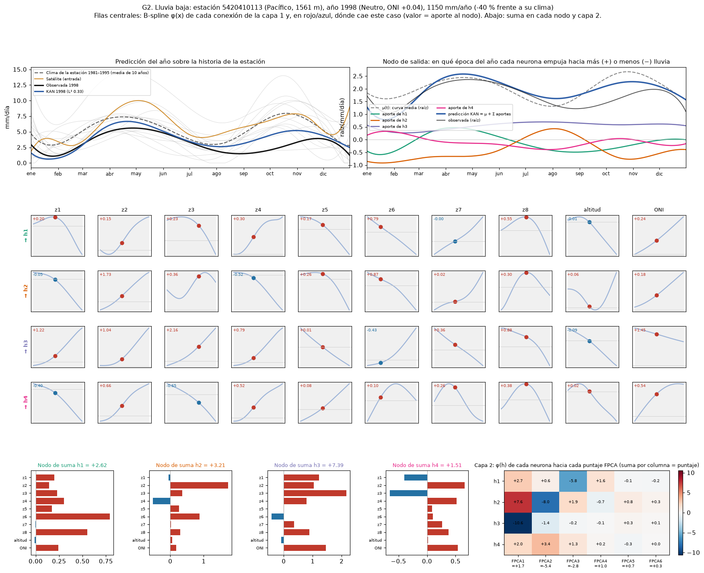

### G2c. Variacional: la lluvia sube y baja frente a su clima según la época

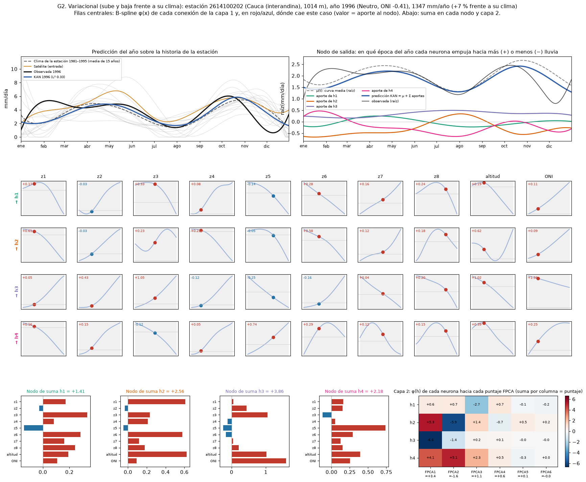

**Qué se concluye:**
- Se ve qué entradas y qué neurona empujan la lluvia hacia arriba o hacia abajo, y en qué meses.
- **h3 es la neurona dominante:** pasa a FPCA1, que fija el nivel general de lluvia, con el mayor peso.

---

## G3. B-splines de comportamiento generalizado

*Pedido: ver cómo la KAN absorbe la no linealidad en todo el rango, de poca a mucha lluvia, no solo en dos casos.*

### G3a. Capa 1, con los 2 929 estación-años

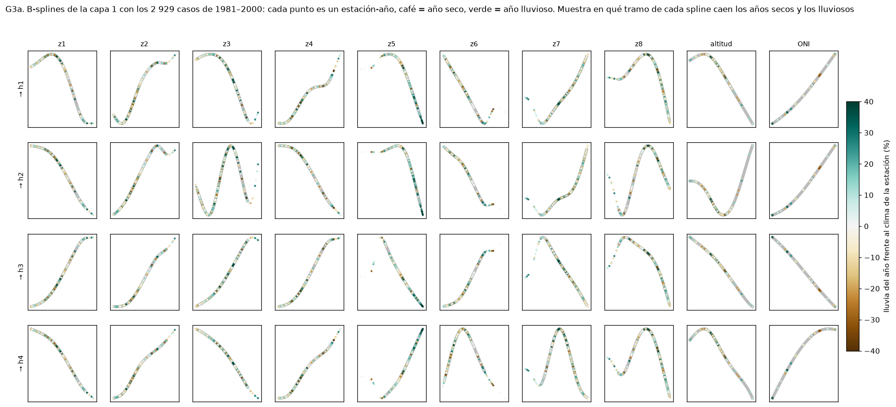

- **Qué muestra:** cada punto es un estación-año, café si el año fue seco frente al clima de la estación y verde si fue lluvioso. La línea gris es la B-spline.
- **Qué se concluye:**
  - Los años secos y los lluviosos se reparten a lo largo de las mismas splines.
  - **La capa 1 codifica sobre todo el tipo de estación (régimen y altitud), no la anomalía del año.** La correlación de cada neurona con la anomalía va de −0,16 a 0,07.

### G3b. Capa 2: neuronas hacia los puntajes FPCA

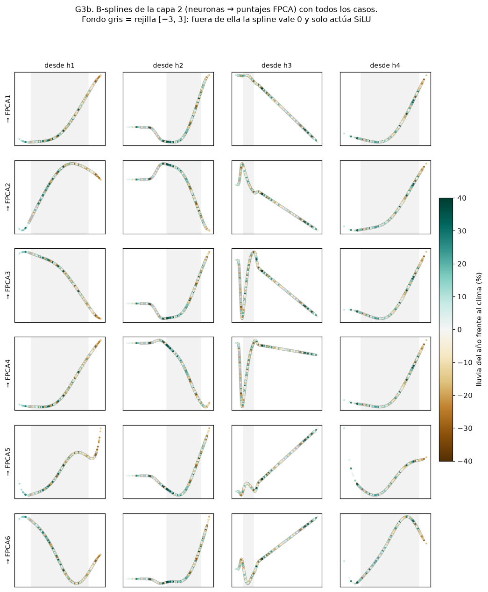

- **Qué muestra:** las 24 B-splines de la capa 2. El fondo gris marca la rejilla [−3, 3], el único tramo donde trabaja la spline.
- **Hallazgo:**
  - El 59 % de los valores de h3 cae fuera de la rejilla. Ahí la spline vale 0 y la conexión es una recta (solo SiLU).
  - Por eso, en la columna "desde h3" las curvas son rectas largas.
  - Consecuencia: **la conexión más importante de la red trabaja casi como una lineal.**

---

## G4. Diagrama de la red: dónde se gana o se pierde información

*Pedido: un diagrama para ver cómo en cada nodo se gana o se pierde información.*

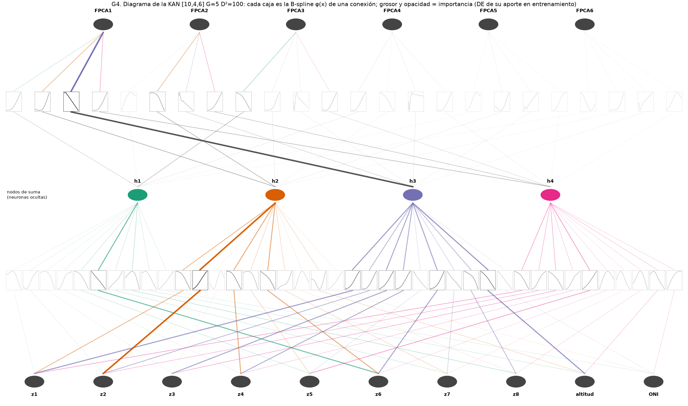

- **Qué muestra:** el grafo completo, de abajo hacia arriba: 10 entradas → 4 neuronas → 6 puntajes FPCA. Cada caja es la B-spline de una conexión. El grosor y la opacidad indican su importancia (la DE de su aporte en entrenamiento). La tabla está en `G4_importancia_conexiones.csv`.
- **Qué se concluye:**
  - Lo principal pasa por h3 → FPCA1, con el 27 % de la importancia de la capa 2.
  - En la capa 1 destacan z2 → h2, altitud → h3, z1 → h3 y z6 → h1/h3.
  - FPCA 4 a 6 casi no reciben señal.

---

## G5. Frecuencia de activación según suba o baje la lluvia (KAN y MLP)

*Pedido: qué neuronas se activan cuando la lluvia aumenta o disminuye, para detectar dónde está el problema. También en el MLP.*

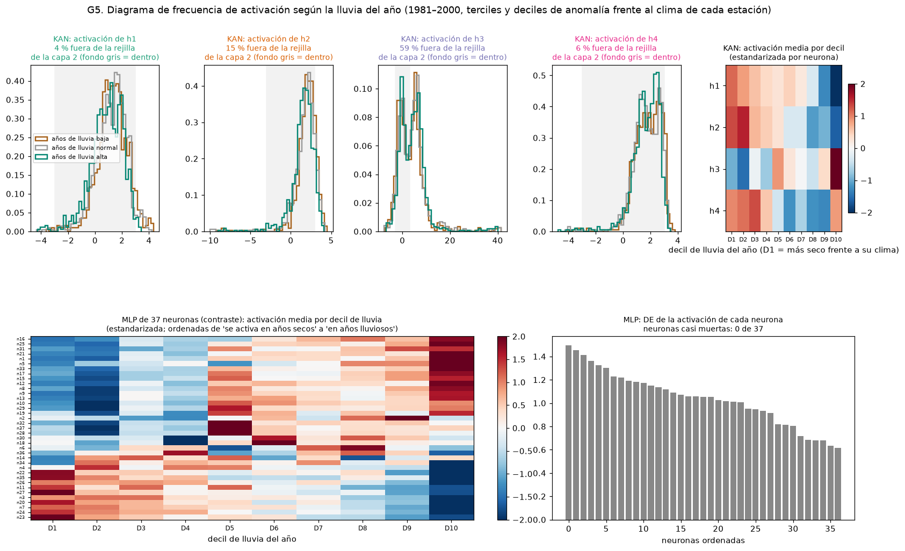

- **Qué muestra:**
  - **Arriba, la KAN:** histogramas de activación de h1–h4 en años de lluvia baja, normal y alta, y la activación media por decil de lluvia.
  - **Abajo, el MLP de 37 neuronas:** la activación por decil y la dispersión de cada neurona.
- **Qué se concluye:**
  - **No hay neuronas muertas** en la KAN ni en el MLP.
  - En la KAN, h1 y h2 bajan en los años más lluviosos y h3 se dispara en el decil más lluvioso.
  - Las distribuciones de los terciles se solapan mucho: la señal de la anomalía del año es débil.

---

## G6. Pérdida y gradientes por capa durante el entrenamiento

*Pedido: identificar si hay desvanecimiento o explosión de gradientes.*

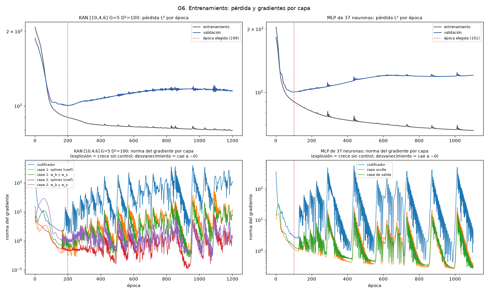

- **Qué muestra:** arriba, la pérdida de entrenamiento y validación por época; abajo, la norma del gradiente de cada capa. A la izquierda la KAN y a la derecha el MLP. La línea roja es la época elegida.
- **Qué se concluye:**
  - **No hay desvanecimiento:** los gradientes de las splines no caen a 0.
  - **No hay explosión antes de la época elegida (199).**
  - Después, el gradiente del codificador oscila con picos de hasta 10² mientras la validación empeora: es sobreajuste. La parada temprana corta a tiempo.
  - Una tasa de aprendizaje menor suavizaría esas oscilaciones.

---

## G7. Análisis de desfase

*Pedido: medir el ángulo de desfase de la predicción y, si se atrasa, corregirlo.*

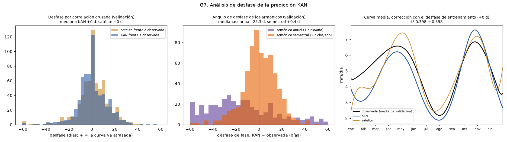

- **Qué muestra:**
  - **Izquierda:** el desfase por correlación cruzada frente a lo observado, para la KAN y el satélite.
  - **Centro:** el desfase de fase de los armónicos anual y semestral.
  - **Derecha:** la curva media y la corrección con el desfase estimado en entrenamiento.
- **Qué se concluye:**
  - **La KAN no está atrasada.** El desfase mediano es 0 días y el armónico semestral, el de las dos temporadas, solo +0,4 días.
  - Corregir con el desfase de entrenamiento no cambia nada: L² 0,398 → 0,398.
  - El −25 días del armónico anual no es fiable, porque en un régimen bimodal ese armónico es débil.
  - **El error de la KAN es de amplitud, no de fase:** subestima el pico de abril–mayo y exagera el de noviembre.

---

## G8. Las B-splines al estilo de clase: puntos de control, nodos y polinomios por tramo

*Como en el taller: cada conexión es una B-spline cúbica armada con un polinomio distinto en cada intervalo entre nodos.*

**Cómo leerla:**

| Elemento | Qué es en la KAN |
|---|---|
| Puntos rojos y línea punteada | Los **8 coeficientes** de la conexión (w_s·c_g), es decir, los puntos de control |
| Puntos verdes | Los **6 nodos** de la rejilla G=5 en [−3, 3] |
| Tramos de colores | Los **5 polinomios cúbicos**, uno entre cada par de nodos. Juntos forman la spline |
| Línea gris discontinua | La función completa de la conexión: spline + w_b·SiLU(x) |
| Fondo gris | Donde está el 98 % de los datos de esa conexión |

### G8a. KAN ganadora (D²=100)

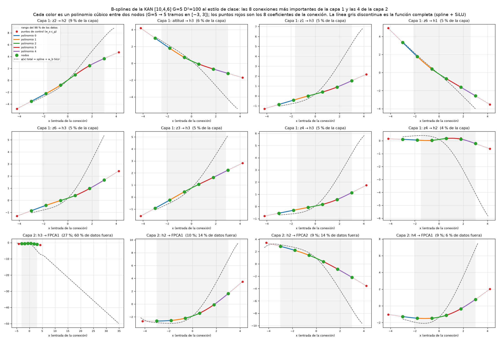

### G8b. KAN base, sin D² (contraste)

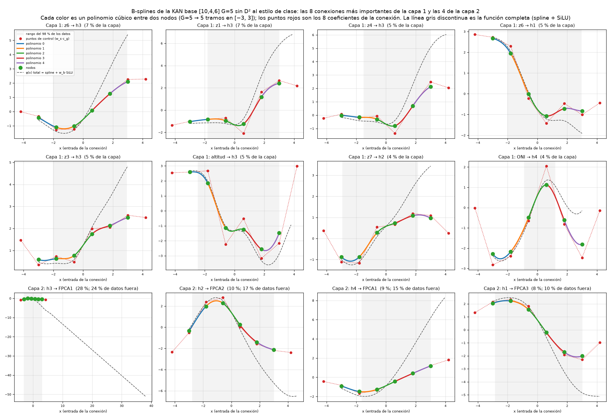

**Qué se concluye:**
- **Con D²=100 las splines quedaron casi rectas.** Los puntos de control están prácticamente alineados y los 5 polinomios forman casi una línea.
- La curvatura de cada conexión la pone sobre todo el término **SiLU** (línea gris), no la spline.
- **Sin D² las splines sí trabajan:** los puntos de control suben y bajan, y los polinomios crean mínimos, máximos y ondulaciones, como en ONI → h4, altitud → h3 o z1 → h3. Algunas de esas ondulaciones no tienen sentido físico y son sobreajuste: por eso la base generaliza peor (0,440 frente a 0,429).
- **Lectura de arquitectura:**
  - D²=100 resuelve el sobreajuste, pero casi apaga la parte spline. La KAN ganadora se comporta como una red SiLU con un ajuste casi lineal en cada conexión.
  - Esto explica por qué empata con el MLP: pierde parte de lo que distingue a una KAN.
- **En la conexión más importante (h3 → FPCA1)**, la spline está en un tramo muy corto: casi todos los datos caen fuera de [−3, 3], así que la función es la recta de SiLU.

---

## Qué ajustaría a la arquitectura después de este análisis

1. **La capa 2 debe usar sus splines:** estandarizar h1–h4 antes de la capa 2, o ajustar la rejilla de la capa 2 a su rango real. Hoy el 59 % de h3 cae fuera de la rejilla (G3b, G5).
2. **Una tasa de aprendizaje menor** (0,003) para quitar las oscilaciones del gradiente del codificador (G6). En la base ya había mejorado el error.
3. **Más señal de la anomalía del año:** la red distingue bien el tipo de estación, pero poco el año seco del lluvioso (G3a, G5). Hay que revisar si el codificador de 8 neuronas lo limita.
4. **No hace falta corregir la fase** (G7). Si se ajusta algo de la curva, debe ser la amplitud de los picos.
5. **Dejar trabajar la spline sin volver al sobreajuste** (G8): probar un D² intermedio, entre 10 y 30, junto con el punto 1. Así las splines se curvan donde los datos lo justifican y la KAN aprovecha lo que la distingue de un MLP.
